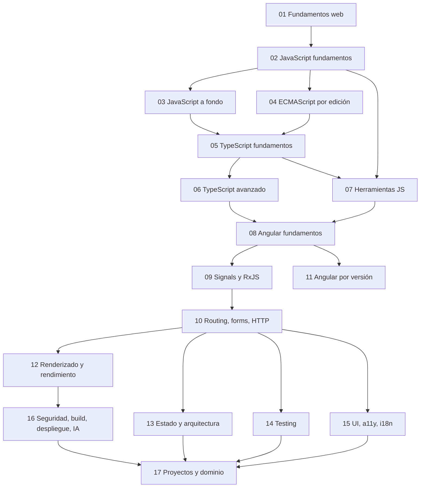

# Angular 00 - Índice
> Resultado: disponer de un mapa ordenado y completo (web, JavaScript, TypeScript, Angular) para dominar Angular desde cero hasta la última versión publicada.

**Contrapartida backend:** [[Java 00 - Indice]]

## Propósito
- Roadmap, no tutorial: una línea por tema, con checkbox y criterio de dominio.
- Orden pensado para no tener huecos: web -> JavaScript -> TypeScript -> herramientas -> Angular -> reactividad -> routing/forms/HTTP -> versiones -> rendimiento -> arquitectura -> testing -> UI -> seguridad/despliegue -> proyectos.
- Los temas con `(sin verificar)` no están confirmados contra fuente primaria; comprobar antes de darlos por ciertos.

## Estado verificado al 2026-11-11

| Elemento | Valor | Fuente |
|---|---|---|
| Última versión mayor de Angular | 22 (GA 2026-06-03); última minor estable 22.2.x (22.3 en rc, prevista ~nov 2026) | [angular.dev/reference/releases](https://angular.dev/reference/releases) · [GitHub releases](https://github.com/angular/angular/releases) |
| Soporte | Activo: v22 (hasta 2027-06). LTS: v21 (hasta 2027-06) y v20 (hasta 2026-11-28). Sin soporte: v2 a v19 | [angular.dev/reference/releases](https://angular.dev/reference/releases) |
| Cadencia | Una mayor por año (junio); v23.0 ~ junio 2027. Minors cada ~8 semanas. Soporte de mayores: 12 meses activo + 12 LTS | [angular.dev/reference/releases](https://angular.dev/reference/releases) |
| Requisitos de Angular 22 | Node ^22.22.3 / ^24.15.0 / ^26.0.0; TypeScript >=6.0 <6.1; RxJS ^6.5.3 o ^7.4.0 | [angular.dev/reference/versions](https://angular.dev/reference/versions) |
| TypeScript | 7.0 estable (2026-07-08, port nativo en Go); 6.0 (2026-03-23); 7.1 en beta (2026-10-20). Angular 22 aún exige 6.x | [Blog TypeScript](https://devblogs.microsoft.com/typescript/) |
| ECMAScript | ES2026 aprobado 2026-06-30; ES2027 previsto con Temporal y `using` | [InfoWorld](https://www.infoworld.com/article/4193461/ecmascript-2026-specification-approved.html) · [tc39/proposals](https://github.com/tc39/proposals/blob/main/finished-proposals.md) |
| Node.js | v26 "Lithium" LTS; v24 y v22 LTS/mantenimiento; v27 en alpha | [nodejs.org](https://nodejs.org/en/about/previous-releases) |
| RxJS | 7.x en producción; RxJS 8 pausado, sucesor previsto RxJS 9 (fuente secundaria) | [ReactiveX/RxJS](https://github.com/ReactiveX/RxJS) |
| Test runner por defecto | Vitest (default y estable desde v21; Karma deprecado desde v21) | [Ninja Squad v21](https://blog.ninja-squad.com/2025/11/20/what-is-new-angular-21.0) |
| Builder | `@angular/build` (esbuild + Vite); chunk optimizer Rolldown por defecto desde 22.1 | [Ninja Squad 22.1](https://blog.ninja-squad.com/2026/07/29/what-is-new-angular-22.1) |
| Vite / Rolldown | Vite 8 (2026-03-12, basado en Rolldown); Rolldown 1.0 (2026-05-07) | [Vite 8](https://vite.dev/blog/announcing-vite8) |

## Dependencias entre fases

## Fases

| # | Resultado esperado | Estimación | Nota |
|---|---|---|---|
| 01 | Explicar cómo viaja una página del servidor al píxel y usar HTML/CSS/DOM/Web APIs con criterio | 3-4 semanas | [[Angular 01 - Fundamentos web]] |
| 02 | Escribir JavaScript moderno idiomático sin dudas de sintaxis ni de tipos | 4-6 semanas | [[Angular 02 - JavaScript fundamentos]] |
| 03 | Razonar sobre el modelo de ejecución: closures, `this`, prototipos, event loop, memoria | 4-6 semanas | [[Angular 03 - JavaScript a fondo]] |
| 04 | Conocer cada edición de ECMAScript y qué ofrece cada una | 1-2 semanas | [[Angular 04 - ECMAScript por edicion]] |
| 05 | Tipar aplicaciones reales con TypeScript estricto | 3-4 semanas | [[Angular 05 - TypeScript fundamentos]] |
| 06 | Diseñar tipos avanzados y entender TS 6/7 y su impacto en Angular | 4-5 semanas | [[Angular 06 - TypeScript avanzado y versiones]] |
| 07 | Dominar Node, gestores de paquetes, bundlers, lint y monorepos | 2-3 semanas | [[Angular 07 - Herramientas y ecosistema JS]] |
| 08 | Construir aplicaciones Angular con componentes, templates, DI y directivas | 6-8 semanas | [[Angular 08 - Angular fundamentos]] |
| 09 | Modelar reactividad con signals y RxJS y elegir entre ambos | 5-7 semanas | [[Angular 09 - Reactividad - Signals y RxJS]] |
| 10 | Implementar navegación, formularios (incl. Signal Forms) y comunicación HTTP | 5-7 semanas | [[Angular 10 - Routing, formularios y HTTP]] |
| 11 | Leer y migrar cualquier proyecto Angular de cualquier versión | 2-3 semanas | [[Angular 11 - Angular por version]] |
| 12 | Optimizar detección de cambios, SSR, hidratación y rendimiento | 4-6 semanas | [[Angular 12 - Renderizado y rendimiento]] |
| 13 | Diseñar la arquitectura y el estado de aplicaciones grandes | 4-6 semanas | [[Angular 13 - Estado y arquitectura frontend]] |
| 14 | Testear unidad, integración y E2E con Vitest y Playwright | 3-5 semanas | [[Angular 14 - Testing]] |
| 15 | Entregar UI accesible, internacionalizada y tematizable | 4-5 semanas | [[Angular 15 - UI, accesibilidad e i18n]] |
| 16 | Asegurar, construir, desplegar y observar en producción; usar IA con Angular | 3-5 semanas | [[Angular 16 - Seguridad, build, despliegue e IA]] |
| 17 | Demostrar dominio con proyectos graduados y autoevaluación | continuo (8+ semanas) | [[Angular 17 - Proyectos y dominio]] |

Total orientativo: 12-18 meses a ritmo de 8-10 horas semanales. Las estimaciones son personales, no oficiales.

## Cómo usar el roadmap
- [ ] Avanzar en orden; las fases 04 y 07 pueden solaparse con 03 y 05.
- [ ] Marcar un tema solo cuando se pueda explicar sin notas y aplicarlo en código propio.
- [ ] Hacer las Prácticas de cada fase antes de pasar a la siguiente.
- [ ] Responder las Preguntas de dominio en voz alta o por escrito, sin consultar.
- [ ] Crear un repositorio de práctica por fase (o una carpeta por fase) y versionarlo.
- [ ] Enlazar cada aprendizaje relevante a las notas existentes del vault.

## Definición de "fase terminada"
- [ ] Todos los temas marcados.
- [ ] Todas las Preguntas de dominio respondidas sin notas.
- [ ] Todas las Prácticas hechas y funcionando.
- [ ] Revisados los Errores comunes contra el propio código.
- [ ] Una nota personal resumen (máximo una página) escrita con palabras propias.

## Mantenimiento cuando sale una nueva mayor de Angular
Calendario: una mayor cada junio (v23.0 ~ junio 2027). Pasos:
- [ ] Actualizar la tabla "Estado verificado" de este archivo (versión, soporte, Node, TS, RxJS, fechas).
- [ ] Añadir la sección de la nueva versión en [[Angular 11 - Angular por version]] y actualizar su tabla de soporte y la lista "en el roadmap oficial".
- [ ] Revisar [[Angular 06 - TypeScript avanzado y versiones]] si cambia el TypeScript requerido.
- [ ] Revisar [[Angular 04 - ECMAScript por edicion]] si se publica una nueva edición (cada junio).
- [ ] Revisar [[Angular 07 - Herramientas y ecosistema JS]] (Node LTS, Vite, gestores de paquetes).
- [ ] Revisar estados experimental/dev preview/estable en las fases 08, 09, 10, 12, 14, 15, 16.
- [ ] Retirar marcas `(sin verificar)` que ya se hayan confirmado.
- [ ] Re-ejecutar `ng update` en los proyectos de práctica de [[Angular 17 - Proyectos y dominio]].

## Notas existentes relacionadas
[[Guia JavaScript - Fundamentos Modernos]] · [[Guia TypeScript - Tipos y Buenas Practicas]] · [[Guia Angular - Reactividad y Signals]] · [[Guia Angular Moderno - Versiones 19, 20 y 21]] · [[POO]] · [[Guia SOLID - Principios con ejemplos Java y Spring]] · [[Guia GRASP - Principios de asignacion de responsabilidades]] · [[Guia Arquitecturas de Software - Comparativa y Usos]] · [[Guia Arquitectura de APIs - DTOs, capas y responsabilidades]]

## Fuentes
- https://angular.dev/reference/releases
- https://angular.dev/reference/versions
- https://angular.dev/roadmap
- https://devblogs.microsoft.com/typescript/
- https://nodejs.org/en/about/previous-releases
- https://github.com/tc39/proposals

---

# Angular 01 - Fundamentos web
> Resultado: explicar el camino completo de una URL a píxeles en pantalla y usar HTML, CSS, DOM y Web APIs con criterio.

**Requisitos:** ninguno · **Siguiente:** [[Angular 02 - JavaScript fundamentos]]

## Temas

### Cómo funciona la web
- [ ] URL — anatomía: scheme, host, port, path, query, fragment; encoding
- [ ] DNS — resolución, registros A/AAAA/CNAME, TTL, cache
- [ ] TCP/IP y TLS — handshake, certificados, HTTPS, HSTS
- [ ] HTTP/1.1 — keep-alive, head-of-line blocking
- [ ] HTTP/2 — multiplexing, HPACK, server push (obsoleto)
- [ ] HTTP/3 y QUIC — UDP, 0-RTT, diferencias con HTTP/2
- [ ] Request/response — métodos, idempotencia, seguridad de métodos
- [ ] Códigos de estado — 1xx a 5xx, los 20 más usados (200, 201, 204, 301, 302, 304, 400, 401, 403, 404, 409, 422, 429, 500, 502, 503)
- [ ] Headers — Content-Type, Accept, Authorization, Cache-Control, ETag, Content-Security-Policy
- [ ] Cookies — atributos Secure, HttpOnly, SameSite, Domain, Path, Max-Age
- [ ] Caching HTTP — Cache-Control, ETag/If-None-Match, validación, stale-while-revalidate, CDN
- [ ] Same-origin policy — definición de origin, qué bloquea y qué no
- [ ] CORS — simple requests, preflight, credenciales, headers Access-Control-*
- [ ] Content negotiation y compresión — gzip, brotli, zstd
- [ ] REST, JSON y formatos — media types, multipart, form-urlencoded

### HTML
- [ ] Estructura de documento — doctype, `html`, `head`, `body`, codificación, viewport
- [ ] Semántica — header, nav, main, section, article, aside, footer, headings
- [ ] Texto y enlaces — `a`, `em`, `strong`, `time`, `code`, listas, tablas
- [ ] Media — `img` (srcset, sizes, loading, decoding), `picture`, `video`, `audio`
- [ ] Formularios — `form`, `input` types, `label`, `select`, `textarea`, `fieldset`, `datalist`
- [ ] Validación nativa — required, pattern, min/max, Constraint Validation API
- [ ] Metadatos — `meta`, Open Graph, canonical, `link rel` (preload, preconnect, prefetch), favicon
- [ ] Elementos interactivos — `dialog`, `details`, Popover API
- [ ] Carga de scripts — `defer`, `async`, `type="module"`, `nomodule`
- [ ] Atributos globales — `data-*`, `hidden`, `inert`, `tabindex`, `lang`, `dir`

### CSS
- [ ] Cascada — orígenes, capas, orden de aparición, `!important`
- [ ] Especificidad — cálculo, `:where`, `:is`
- [ ] Herencia y valores — inherit, initial, unset, revert, computed vs used values
- [ ] Box model — content/padding/border/margin, `box-sizing`, margin collapsing
- [ ] Layout normal (flow) — block, inline, inline-block, BFC
- [ ] Flexbox — ejes, grow/shrink/basis, align/justify, wrap, gap
- [ ] Grid — tracks, áreas, auto-fit/auto-fill, minmax, subgrid
- [ ] Posicionamiento — static, relative, absolute, fixed, sticky, stacking context, z-index
- [ ] Responsive — media queries, mobile-first, viewport, fluid typography (`clamp`)
- [ ] Unidades — px, rem, em, %, vw/vh, dvh/svh/lvh, ch, fr
- [ ] Custom properties — `var()`, scope, `@property`
- [ ] Nesting CSS nativo — reglas anidadas y `&`
- [ ] Container queries — `container-type`, `@container`, unidades cq
- [ ] Selector `:has()` y pseudo-clases modernas — `:is`, `:where`, `:not`, `:focus-visible`
- [ ] Cascade layers — `@layer`, orden y casos de uso
- [ ] Logical properties — `margin-inline`, `inset-block`, writing modes
- [ ] Animaciones y transiciones — `transition`, `@keyframes`, `animation-timeline` (scroll-driven)
- [ ] View Transitions — misma página y entre documentos
- [ ] Otras features recientes — `@scope`, anchor positioning, `color-mix()`, `light-dark()` (comprobar Baseline de cada una)
- [ ] Metodologías — BEM, utility-first, CSS Modules, encapsulación
- [ ] Preprocesadores — Sass: variables, mixins, módulos (`@use`)

### DOM y eventos
- [ ] Árbol DOM — nodos, elementos, texto, `querySelector`, `closest`
- [ ] Manipulación — crear, insertar, clonar, `classList`, `dataset`, atributos vs propiedades
- [ ] Eventos — `addEventListener`, opciones (once, passive, capture, signal)
- [ ] Propagación — capture, target, bubbling, `stopPropagation`, `preventDefault`
- [ ] Delegación de eventos — patrón y ventajas
- [ ] CustomEvent — emisión y escucha
- [ ] Eventos de foco, teclado, puntero — pointer events, touch, drag and drop
- [ ] Reflow y layout thrashing — lecturas/escrituras intercaladas

### Pipeline de renderizado del navegador
- [ ] Parseo HTML y CSS — DOM, CSSOM, render tree
- [ ] Recursos bloqueantes — CSS y JS render-blocking, preload scanner
- [ ] Estilo, layout, paint, composite — qué dispara cada etapa
- [ ] Propiedades baratas (transform, opacity) vs caras — `will-change`
- [ ] Critical rendering path — optimización de LCP
- [ ] Event loop del navegador y frames — `requestAnimationFrame`, `requestIdleCallback`

### Almacenamiento
- [ ] Cookies — cuándo usarlas y limitaciones
- [ ] localStorage y sessionStorage — API síncrona, límites, seguridad
- [ ] IndexedDB — stores, índices, transacciones, wrappers
- [ ] Cache API — uso con Service Workers
- [ ] Storage API — cuotas, persistencia (`navigator.storage`)

### Web APIs
- [ ] fetch — Request/Response, streams, manejo de errores HTTP vs red
- [ ] AbortController y AbortSignal — cancelación, `AbortSignal.timeout`
- [ ] URL y URLSearchParams
- [ ] History API y Navigation API — pushState, popstate
- [ ] IntersectionObserver
- [ ] ResizeObserver
- [ ] MutationObserver
- [ ] Web Workers — dedicated, shared, mensajes, transferables
- [ ] Service Workers — ciclo de vida, estrategias de cache, push, background sync
- [ ] WebSocket
- [ ] Server-Sent Events (EventSource)
- [ ] Web Components — custom elements, Shadow DOM, templates, slots
- [ ] Otras — Clipboard, Geolocation, Notifications, File API, Web Crypto, BroadcastChannel, Streams, WebRTC (panorama)
- [ ] Permisos y contextos seguros — HTTPS requerido

### Accesibilidad básica
- [ ] HTML semántico antes que ARIA
- [ ] Foco y orden de tabulación — `tabindex`, focus visible, skip links
- [ ] Texto alternativo y etiquetas de formulario
- [ ] Contraste y tamaño de objetivos — WCAG básico
- [ ] Árbol de accesibilidad — inspección en DevTools
- [ ] Preferencias del usuario — `prefers-reduced-motion`, `prefers-color-scheme`

### Herramientas y métricas
- [ ] DevTools — Elements, Console, Network, Sources, Performance, Application, Lighthouse
- [ ] Throttling de red/CPU y emulación de dispositivos
- [ ] Core Web Vitals — LCP, INP, CLS; medición de campo vs laboratorio
- [ ] Baseline — Widely/Newly available; consultar web.dev y MDN antes de usar una API
- [ ] Compatibilidad — caniuse, browserslist (enlaza con fase 07)

## Preguntas de dominio
1. Describir, paso a paso, qué ocurre desde que se escribe una URL hasta ver la página.
2. Diferencia entre HTTP/1.1, HTTP/2 y HTTP/3 y qué problema resuelve cada uno.
3. Cuándo el navegador lanza un preflight CORS y qué headers debe devolver el servidor.
4. Qué significan HttpOnly, Secure y SameSite y qué ataque mitiga cada uno.
5. Calcular la especificidad de tres selectores dados y predecir cuál gana.
6. Por qué `margin` colapsa y cómo evitarlo.
7. Cuándo usar flexbox y cuándo grid.
8. Qué diferencia hay entre capture y bubbling y cómo funciona la delegación.
9. Qué etapas del pipeline dispara cambiar `width` frente a `transform`.
10. Diferencias prácticas entre localStorage, sessionStorage, cookies e IndexedDB.
11. Para qué sirve un Service Worker y qué riesgos tiene su cache.
12. Qué miden LCP, INP y CLS y cómo mejorar cada uno.
13. Por qué `defer` y `async` cambian el orden de ejecución de scripts.

## Prácticas
- [ ] Maquetar una página responsive sin librerías usando grid, flexbox y custom properties.
- [ ] Construir un formulario con validación nativa y mensajes accesibles.
- [ ] Implementar un componente con delegación de eventos (lista dinámica).
- [ ] Hacer un custom element con Shadow DOM y slots.
- [ ] Registrar un Service Worker con cache offline de una página.
- [ ] Auditar una página real con Lighthouse y corregir LCP/CLS.
- [ ] Observar una petición CORS con preflight en la pestaña Network y reproducir el error.
- [ ] Cargar imágenes con `IntersectionObserver` (lazy loading manual).

## Errores comunes
- Usar `div` para todo y reemplazar semántica por ARIA.
- Confundir CORS con un mecanismo de seguridad del servidor: es una política del navegador.
- Guardar tokens sensibles en localStorage sin entender el riesgo de XSS.
- Animar `top/left/width` en lugar de `transform/opacity`.
- Usar `100vh` en móvil sin considerar `dvh`.
- Asumir que una API nueva está disponible sin revisar Baseline.
- Ignorar el foco visible (`outline: none` sin reemplazo).
- Mezclar lecturas y escrituras del DOM provocando layout thrashing.

## Notas relacionadas
[[Guia JavaScript - Fundamentos Modernos]]

## Fuentes
- https://developer.mozilla.org/
- https://web.dev/
- https://web.dev/baseline
- https://html.spec.whatwg.org/
- https://www.w3.org/TR/WCAG22/
- https://httpwg.org/specs/

---

# Angular 02 - JavaScript fundamentos
> Resultado: escribir JavaScript moderno e idiomático dominando tipos, funciones, objetos, clases y módulos.

**Requisitos:** [[Angular 01 - Fundamentos web]] · **Siguiente:** [[Angular 03 - JavaScript a fondo]]

## Temas

### Valores y tipos
- [ ] Tipos primitivos — string, number, boolean, null, undefined, symbol, bigint
- [ ] Primitivos vs objetos — paso por valor vs referencia, inmutabilidad de primitivos
- [ ] `typeof` y sus rarezas — `typeof null`, funciones
- [ ] Coerción de tipos — implícita vs explícita, `ToPrimitive`, `valueOf/toString`
- [ ] Igualdad — `==`, `===`, `Object.is`, `NaN`, `-0`
- [ ] Truthy y falsy — lista completa
- [ ] Wrapper objects — `new String`, auto-boxing

### Variables y operadores
- [ ] `var`, `let`, `const` — alcance, reasignación vs mutación
- [ ] Hoisting — funciones, `var`, clases
- [ ] Temporal Dead Zone
- [ ] Operadores aritméticos, comparación, bitwise, `**`
- [ ] Nullish coalescing `??` (ES2020)
- [ ] Optional chaining `?.` (ES2020)
- [ ] Asignación lógica `&&=`, `||=`, `??=` (ES2021)
- [ ] Precedencia y asociatividad; operador coma, `void`, `in`, `instanceof`
- [ ] Spread y rest en expresiones

### Control de flujo
- [ ] `if/else`, `switch`, ternario
- [ ] Bucles — `for`, `while`, `do/while`, `for...of`, `for...in` (y por qué evitarlo en arrays)
- [ ] `break`, `continue`, labels
- [ ] Cortocircuito y expresiones vs sentencias

### Funciones
- [ ] Declaraciones y expresiones — diferencias de hoisting
- [ ] Arrow functions — `this` léxico, sin `arguments`, sin `new`
- [ ] Parámetros por defecto, rest, destructuring en parámetros
- [ ] `arguments` y funciones variádicas
- [ ] IIFE, callbacks, funciones de primera clase
- [ ] Funciones puras vs con efectos
- [ ] Recursión y límites de pila

### Scope
- [ ] Scope global, de función, de bloque, de módulo
- [ ] Scope léxico vs dinámico
- [ ] Sombreado de variables (shadowing)
- [ ] `globalThis`

### Strings
- [ ] Template literals y tagged templates
- [ ] Métodos — `slice`, `split`, `replaceAll`, `at`, `padStart`, `normalize`, `localeCompare`
- [ ] Unicode — code points vs code units, `isWellFormed` (ES2024)
- [ ] Raw strings (`String.raw`)

### Números
- [ ] Number — IEEE 754, `0.1 + 0.2`, `Number.EPSILON`, `Number.isInteger`, `MAX_SAFE_INTEGER`
- [ ] BigInt (ES2020) — literales, mezcla con Number
- [ ] Math — métodos principales; separadores numéricos (ES2021)
- [ ] Parseo — `parseInt`, `parseFloat`, `Number()`, `toFixed`
- [ ] `Intl.NumberFormat` (introducción)

### Arrays
- [ ] Creación y propiedades — `Array.from`, `Array.of`, huecos (holes)
- [ ] Mutadores — push, pop, shift, unshift, splice, sort, reverse, fill, copyWithin
- [ ] Accesores — slice, concat, join, includes (ES2016), indexOf, at (ES2022)
- [ ] Iterativos — forEach, map, filter, reduce, reduceRight, some, every, find, findIndex
- [ ] `flat`, `flatMap` (ES2019)
- [ ] `findLast`, `findLastIndex` (ES2023)
- [ ] Copia inmutable — `toSorted`, `toReversed`, `toSpliced`, `with` (ES2023)
- [ ] `Object.groupBy` / `Map.groupBy` (ES2024)
- [ ] `Array.fromAsync` (ES2026)
- [ ] Orden estable de `sort` y comparadores
- [ ] Array-likes y typed arrays (introducción)

### Objetos
- [ ] Literales, propiedades calculadas, shorthand de métodos
- [ ] Property descriptors — writable, enumerable, configurable; `defineProperty`
- [ ] `Object.freeze`, `seal`, `preventExtensions`
- [ ] Spread y rest de objetos (ES2018)
- [ ] Destructuring — anidado, valores por defecto, renombrado
- [ ] Getters y setters
- [ ] `Object.keys/values/entries/fromEntries/assign/hasOwn`
- [ ] Copia superficial vs profunda
- [ ] Optional chaining sobre propiedades y métodos

### Colecciones
- [ ] Map y Set — operaciones, iteración, igualdad por SameValueZero
- [ ] WeakMap y WeakSet — casos de uso y limitaciones
- [ ] Nuevos métodos de Set (ES2025)
- [ ] `Map.getOrInsert` / `getOrInsertComputed` (sin verificar: ES2026 vs ES2027)

### Symbol, fechas, JSON, RegExp
- [ ] Symbol — descripciones, registro global, well-known symbols (`Symbol.iterator`, `Symbol.toPrimitive`)
- [ ] Date — constructor, zonas horarias, parseo, limitaciones
- [ ] Temporal — estado: Stage 4 previsto para ES2027; Firefox 139, Chrome 144, Node 26; Safari solo Technology Preview (sin verificar el estado estable)
- [ ] JSON — `parse` (reviver), `stringify` (replacer, toJSON), límites con BigInt/Date
- [ ] RegExp — flags (g, i, m, s, u, v, y, d), grupos con nombre, lookbehind, `matchAll`, escapes Unicode
- [ ] `RegExp.escape` (sin verificar: tc39 lo lista en 2026; TS 6.0 lo incluye en lib es2025)

### Errores
- [ ] `try/catch/finally`, catch opcional (ES2019)
- [ ] Tipos de error — Error, TypeError, RangeError, SyntaxError, AggregateError
- [ ] `Error.cause` (ES2022) y errores personalizados
- [ ] `Error.isError` (ES2026)
- [ ] `throw` de valores no-Error y por qué evitarlo
- [ ] Estrategias — fallar rápido, errores esperados vs bugs

### Módulos
- [ ] ES Modules — `import`/`export`, default vs named, live bindings
- [ ] Dynamic `import()` y top-level `await` (ES2022)
- [ ] `import.meta`
- [ ] Import attributes y JSON modules (ES2025)
- [ ] CommonJS — `require`, `module.exports`, diferencias con ESM
- [ ] Interop CJS/ESM en Node y bundlers
- [ ] Ciclos de dependencias

### Clases
- [ ] Sintaxis `class`, constructor, métodos
- [ ] Campos de instancia y estáticos (ES2022)
- [ ] Miembros privados `#x` y métodos privados
- [ ] Static blocks
- [ ] Getters/setters y accessors
- [ ] Herencia — `extends`, `super`, sobrescritura
- [ ] `instanceof`, `new.target`
- [ ] Mixins y composición frente a herencia

### Iteradores y generadores
- [ ] Protocolo iterable e iterador
- [ ] Generadores — `function*`, `yield`, `yield*`, paso de valores
- [ ] Iterator helpers (ES2025) — `map`, `filter`, `take`, `drop`, `toArray`
- [ ] `Iterator.concat` (ES2026)

### Otros
- [ ] Strict mode — efectos y activación en módulos/clases
- [ ] Getters de `Symbol.toStringTag` y `toString` personalizado
- [ ] Labels, `with` (evitar), `eval` (evitar)
- [ ] Convenciones de estilo — nombres, inmutabilidad por defecto, funciones pequeñas

## Preguntas de dominio
1. Predecir el resultado de `[] + {}`, `[] == ![]`, `typeof null`, `0.1 + 0.2` y explicar por qué.
2. Diferencia entre `var`, `let` y `const` respecto a alcance, hoisting y TDZ.
3. Cuándo `==` es aceptable y cuándo no.
4. Qué valor tiene `this` en una arrow function y por qué.
5. Diferencia entre copia superficial y profunda y cómo hacer cada una.
6. Por qué `for...in` es mala idea en arrays.
7. Qué garantiza `Object.freeze` y qué no (profundidad).
8. Diferencia entre Map y objeto plano, y entre Map y WeakMap.
9. Qué es un iterador y cómo se vuelve iterable un objeto propio.
10. Diferencia entre `#privado` y la convención `_privado`.
11. Cómo funcionan los live bindings de ESM y qué cambia respecto a CommonJS.
12. Qué problemas tiene `Date` y qué ofrece Temporal.
13. Qué hace `??` distinto de `||`.

## Prácticas
- [ ] Resolver 30 ejercicios de transformación de arrays sin bucles `for` (map/filter/reduce/groupBy).
- [ ] Implementar `Stack`, `Queue` y `LinkedList` con clases y campos privados.
- [ ] Escribir un parser de CSV/JSON simple con regex y manejo de errores.
- [ ] Crear un objeto iterable y un generador que pagine datos.
- [ ] Reimplementar `map`, `filter` y `reduce` a mano.
- [ ] Hacer una utilidad `deepClone` y compararla con `structuredClone`.
- [ ] Dividir un script en módulos ESM y ejecutarlo en navegador y en Node.
- [ ] Documentar en una tabla 15 casos de coerción sorprendentes con su explicación.

## Errores comunes
- Confundir `const` con inmutabilidad.
- Usar `parseInt` sin radix o sin validar `NaN`.
- Comparar floats con `===` sin tolerancia.
- Mutar arrays con `sort`/`reverse` creyendo que devuelven copia.
- Usar `forEach` con `async` esperando secuenciación.
- Depender de `typeof x === "object"` sin descartar `null`.
- Serializar con `JSON.stringify` objetos con `Date`, `Map`, `BigInt` o ciclos.
- Mezclar CommonJS y ESM sin entender el interop.

## Notas relacionadas
[[Guia JavaScript - Fundamentos Modernos]] · [[POO]]

## Fuentes
- https://developer.mozilla.org/en-US/docs/Web/JavaScript
- https://tc39.es/ecma262/
- https://javascript.info/
- https://github.com/tc39/proposals

---

# Angular 03 - JavaScript a fondo
> Resultado: razonar sobre el modelo de ejecución de JavaScript (contextos, closures, this, prototipos, event loop, memoria) y depurar problemas asíncronos y de rendimiento.

**Requisitos:** [[Angular 02 - JavaScript fundamentos]] · **Siguiente:** [[Angular 04 - ECMAScript por edicion]]

## Temas

### Modelo de ejecución
- [ ] Execution contexts — global, función, eval; fases de creación y ejecución
- [ ] Call stack — frames, stack overflow, trazas
- [ ] Lexical environment y environment record — cadena de scope
- [ ] Closures — captura de variables, bucles con `var` vs `let`, patrones (módulo, factory, memoización)
- [ ] `this` — reglas: default, implícito, explícito, `new`, arrow
- [ ] `call`, `apply`, `bind` — usos y reimplementación
- [ ] Pérdida de `this` en callbacks y métodos extraídos

### Prototipos y clases por dentro
- [ ] Prototype chain — slot interno Prototype, `__proto__`, `Object.getPrototypeOf`
- [ ] `Object.create` y herencia prototipal pura
- [ ] Funciones constructoras y `new` (que hace el operador)
- [ ] `class` como azúcar sobre prototipos; métodos en el prototipo vs campos en la instancia
- [ ] Herencia de builtins (`extends Array`, `extends Error`)
- [ ] `instanceof` y `Symbol.hasInstance`
- [ ] Campos privados: WeakMap-like internals y brand checks

### Event loop y asincronía
- [ ] Modelo del event loop — stack, queues, Web APIs
- [ ] Macrotasks (setTimeout, I/O, eventos) vs microtasks (promesas, `queueMicrotask`)
- [ ] Posición del rendering en el ciclo — `requestAnimationFrame`
- [ ] Orden de ejecución — ejercicios con `setTimeout`, `Promise.then`, `await`
- [ ] Diferencias Node vs navegador — `process.nextTick`, `setImmediate`, fases libuv
- [ ] Callbacks — callback hell, inversión de control, error-first
- [ ] Promises — estados, encadenamiento, thenables, errores en `then`
- [ ] Combinadores — `all`, `allSettled`, `race`, `any`, `withResolvers` (ES2024), `Promise.try` (ES2025)
- [ ] `Promise.allKeyed` (propuesta Stage 3, sin verificar su estado actual en navegadores)
- [ ] async/await — secuencial vs paralelo, `await` en bucles, top-level await
- [ ] Async iterators y `for await...of`; async generators
- [ ] Propagación de errores asíncronos — `catch`, `unhandledrejection`, `finally`
- [ ] Cancelación — `AbortController`, `AbortSignal.any`, cancelación cooperativa
- [ ] Temporizadores y throttling/debounce implementados a mano
- [ ] Concurrencia limitada — pool de promesas, cola con prioridad
- [ ] Workers y `postMessage` para trabajo pesado

### Memoria
- [ ] Modelo de memoria — stack vs heap, referencias
- [ ] Garbage collection — mark and sweep, generacional, incremental
- [ ] Fugas de memoria típicas — listeners, timers, closures, caches sin límite, nodos DOM desprendidos
- [ ] `WeakRef` y `FinalizationRegistry` (ES2021) — cuándo NO usarlos
- [ ] Heap snapshots y Allocation timeline en DevTools
- [ ] `structuredClone` — alcance y límites

### Metaprogramación
- [ ] Proxy — traps (get, set, has, deleteProperty, apply, construct)
- [ ] Reflect — correspondencia con traps
- [ ] Symbols well-known — `toPrimitive`, `iterator`, `asyncIterator`, `species`
- [ ] Descriptores y `Object.defineProperty` avanzado
- [ ] Decoradores — estado en TC39 (Stage 2.7, sin verificar); relación con TypeScript (fase 06)
- [ ] Reactividad por Proxy/getters como base conceptual de signals
- [ ] TC39 Signals — estado de la propuesta no verificado

### Inmutabilidad y programación funcional
- [ ] Inmutabilidad — `freeze`, copia estructural, spread
- [ ] Funciones puras, efectos secundarios, transparencia referencial
- [ ] Composición y pipe
- [ ] Currying y aplicación parcial
- [ ] Higher-order functions
- [ ] Memoización y sus costes
- [ ] Transducers/lazy evaluation con iterator helpers
- [ ] Records y Tuples — propuesta retirada/no ratificada (sin verificar)

### Datos binarios e internacionalización
- [ ] ArrayBuffer, typed arrays, DataView
- [ ] ArrayBuffer redimensionable y `transfer` (ES2024)
- [ ] Base64/hex en `Uint8Array` (ES2026)
- [ ] TextEncoder/TextDecoder, Blob, File, streams
- [ ] Intl — `NumberFormat`, `DateTimeFormat`, `PluralRules`, `RelativeTimeFormat`, `ListFormat`, `Collator`, `Segmenter`

### Motor y rendimiento
- [ ] Pipeline de V8 — parser, Ignition, Sparkplug, Maglev, TurboFan
- [ ] Hidden classes (shapes) y estabilidad de forma de objetos
- [ ] Inline caches — monomórfico, polimórfico, megamórfico
- [ ] Deoptimizaciones — causas comunes
- [ ] Costes de `delete`, arrays con huecos, cambio de tipos en arrays
- [ ] Medición — `performance.now`, `performance.mark/measure`, User Timing, PerformanceObserver
- [ ] Profiling con DevTools y `--prof` / `--inspect` en Node
- [ ] Microbenchmarks fiables y sus trampas

### Módulos y bundling
- [ ] Resolución de módulos — especificadores, import maps, `exports` de package.json
- [ ] Tree shaking — requisitos (ESM, `sideEffects`), por qué falla
- [ ] Code splitting y dynamic import
- [ ] Grafos de dependencia y ciclos

### Seguridad
- [ ] XSS — reflejado, almacenado, DOM-based; sinks peligrosos (`innerHTML`, `eval`)
- [ ] Prototype pollution — vectores (`__proto__`, merges recursivos) y mitigaciones
- [ ] CSRF y SameSite
- [ ] Inyección y deserialización insegura (`eval`, `Function`)
- [ ] Content Security Policy y Trusted Types (introducción)
- [ ] Dependencias maliciosas y supply chain

## Preguntas de dominio
1. Dibujar el call stack y las colas para un fragmento con `setTimeout`, `Promise` y `await`, y dar el orden de salida.
2. Explicar el closure en un bucle `for (var ...)` con `setTimeout` y las dos formas de arreglarlo.
3. Enumerar las cuatro reglas de binding de `this` y su precedencia.
4. Qué hace exactamente `new Foo()` paso a paso.
5. Diferencia entre `Object.create(null)`, `{}` y `new Object()`.
6. Por qué una promesa ya resuelta ejecuta `then` después del código síncrono.
7. Cuándo `Promise.all` falla rápido y qué alternativa conserva todos los resultados.
8. Cómo cancelar un `fetch` y una cadena de promesas.
9. Qué tipos de fugas de memoria existen y cómo localizarlas con DevTools.
10. Para qué sirve Proxy y qué coste de rendimiento tiene.
11. Qué es una hidden class y cómo evitar cambios de forma.
12. Por qué el tree shaking exige ESM.
13. Cómo ocurre una prototype pollution y cómo se previene.

## Prácticas
- [ ] Implementar `bind`, `call`, `apply` y `new` desde cero.
- [ ] Implementar `Promise`, `Promise.all` y `Promise.race` propios que pasen un set de pruebas.
- [ ] Escribir `debounce`, `throttle`, `memoize` y `once`, con cancelación vía `AbortSignal`.
- [ ] Provocar una fuga de memoria con listeners y encontrarla con heap snapshot.
- [ ] Crear una mini-librería reactiva con Proxy (tipo `reactive`/`effect`).
- [ ] Construir un limitador de concurrencia para N peticiones simultaneas.
- [ ] Medir con `performance.measure` dos implementaciones y analizar con el panel Performance.
- [ ] Reproducir y arreglar un caso de prototype pollution en un `merge` recursivo.

## Errores comunes
- Creer que `async` hace el código paralelo.
- Olvidar `await` o `return` en una promesa dentro de `try/catch`.
- Usar `forEach(async ...)` y no esperar el resultado.
- Capturar `this` incorrecto al pasar métodos como callbacks.
- Mantener referencias en caches globales sin límite ni WeakMap.
- Usar `WeakRef` como mecanismo de cache fiable.
- Optimizar sin medir (microbenchmarks sin warmup).
- Confiar en `JSON.parse(JSON.stringify(x))` como clonado profundo.
- Dejar listeners/intervalos sin limpiar.

## Notas relacionadas
[[Guia JavaScript - Fundamentos Modernos]] · [[POO]]

## Fuentes
- https://tc39.es/ecma262/
- https://developer.mozilla.org/en-US/docs/Web/JavaScript/Event_loop
- https://v8.dev/blog
- https://html.spec.whatwg.org/multipage/webappapis.html#event-loops
- https://nodejs.org/en/learn
- https://owasp.org/www-community/attacks/

---

# Angular 04 - ECMAScript por edición
> Resultado: saber qué añadió cada edición de ECMAScript, cuál es el estado actual de las propuestas y qué puede usarse con seguridad.

**Requisitos:** [[Angular 02 - JavaScript fundamentos]] · **Siguiente:** [[Angular 05 - TypeScript fundamentos]]

Nota: la asignación de años de algunas features varia según la fuente (edición de la especificación vs año esperado en tc39). Las dudas llevan `(sin verificar)`. Ediciones anuales desde ES2015; la lista de tc39 es [finished-proposals](https://github.com/tc39/proposals/blob/main/finished-proposals.md).

## Temas

### ES5 (2009) — línea base
- [ ] Strict mode (`"use strict"`)
- [ ] `JSON.parse` / `JSON.stringify`
- [ ] `Array.prototype` — forEach, map, filter, reduce, some, every, indexOf
- [ ] `Object.keys`, `Object.create`, `Object.defineProperty`, getters/setters
- [ ] `Function.prototype.bind`
- [ ] `Date.now`, `String.prototype.trim`, `Array.isArray`
- [ ] Trailing commas en literales de objeto

### ES2015 (ES6)
- [ ] `let` / `const`
- [ ] Arrow functions
- [ ] Classes (`class`, `extends`, `super`)
- [ ] Template literals y tagged templates
- [ ] Destructuring
- [ ] Parámetros por defecto, rest y spread
- [ ] Módulos ES (`import`/`export`)
- [ ] Promises
- [ ] Iteradores y `for...of`
- [ ] Generadores
- [ ] Map, Set, WeakMap, WeakSet
- [ ] Symbol
- [ ] Proxy y Reflect
- [ ] Typed arrays
- [ ] Shorthand de propiedades/métodos y propiedades calculadas
- [ ] Nuevos métodos (`Object.assign`, `Array.from`, `String.includes/startsWith/endsWith`, `Number.isInteger`, `Math.*`)
- [ ] Binary/octal literals, Unicode escapes `\u{}`
- [ ] Tail call optimization (solo especificación; no implementada de forma general)

### ES2016
- [ ] `Array.prototype.includes`
- [ ] Operador de exponenciación `**`

### ES2017
- [ ] `async` / `await`
- [ ] `Object.values`, `Object.entries`
- [ ] `Object.getOwnPropertyDescriptors`
- [ ] `String.prototype.padStart` / `padEnd`
- [ ] Trailing commas en parámetros de función
- [ ] `SharedArrayBuffer` y `Atomics`

### ES2018
- [ ] Iteración asíncrona (`for await...of`, async generators)
- [ ] Rest/spread de propiedades de objeto
- [ ] `Promise.prototype.finally`
- [ ] RegExp: grupos con nombre, lookbehind, flag `s` (dotAll), escapes de propiedades Unicode
- [ ] Revisión de template literals (tagged templates con escapes inválidos)

### ES2019
- [ ] `Array.prototype.flat` / `flatMap`
- [ ] `Object.fromEntries`
- [ ] `trimStart` / `trimEnd`
- [ ] Optional catch binding (`catch {}`)
- [ ] `Symbol.prototype.description`
- [ ] `JSON.stringify` bien formado y JSON superset
- [ ] `Array.prototype.sort` estable
- [ ] `Function.prototype.toString` revisado

### ES2020
- [ ] BigInt
- [ ] Optional chaining `?.`
- [ ] Nullish coalescing `??`
- [ ] `globalThis`
- [ ] `Promise.allSettled`
- [ ] `import()` dinámico
- [ ] `String.prototype.matchAll`
- [ ] `import.meta`
- [ ] `export * as ns from`
- [ ] Orden de `for...in` especificado

### ES2021
- [ ] Asignación lógica `&&=`, `||=`, `??=`
- [ ] `String.prototype.replaceAll`
- [ ] `Promise.any` y `AggregateError`
- [ ] `WeakRef` y `FinalizationRegistry`
- [ ] Separadores numéricos `1_000_000` (algunas fuentes lo situan en 2022, sin verificar)

### ES2022
- [ ] Campos de clase públicos y estáticos
- [ ] Campos y métodos privados `#x`, `#x in obj`
- [ ] Static initialization blocks
- [ ] `Array.prototype.at` / `String.prototype.at`
- [ ] Top-level `await`
- [ ] `Object.hasOwn`
- [ ] RegExp match índices (flag `d`)
- [ ] `Error.cause`

### ES2023
- [ ] `findLast` / `findLastIndex`
- [ ] Change array by copy: `toSorted`, `toReversed`, `toSpliced`, `with`
- [ ] Hashbang (`#!`) en scripts
- [ ] Symbols como claves de WeakMap

### ES2024
- [ ] `Promise.withResolvers`
- [ ] `Object.groupBy` / `Map.groupBy`
- [ ] ArrayBuffer redimensionable y `ArrayBuffer.prototype.transfer`
- [ ] RegExp flag `v` (unicode sets)
- [ ] `Atomics.waitAsync`
- [ ] `String.prototype.isWellFormed` / `toWellFormed`

### ES2025
- [ ] Iterator helpers (`map`, `filter`, `take`, `drop`, `flatMap`, `reduce`, `toArray`, `forEach`, `some`, `every`, `find`)
- [ ] Nuevos métodos de Set (`union`, `intersection`, `difference`, `symmetricDifference`, `isSubsetOf`, `isSupersetOf`, `isDisjointFrom`)
- [ ] `Promise.try`
- [ ] RegExp modifiers (`(?i:...)`)
- [ ] Grupos de captura con nombre duplicados
- [ ] Import attributes y JSON modules
- [ ] `Float16Array` y `Math.f16round`
- [ ] `RegExp.escape` (sin verificar: TypeScript 6.0 lo incluye en `es2025`, tc39 lo lista como 2026)

### ES2026 (17a edición, aprobada 2026-06-30)
- [ ] `Array.fromAsync`
- [ ] `Error.isError`
- [ ] `Math.sumPrecise`
- [ ] `Uint8Array` base64/hex (`toBase64`, `fromBase64`, `toHex`, `fromHex`)
- [ ] `Iterator.concat` (Iterator Sequencing)
- [ ] `JSON.parse` con acceso al texto fuente y `JSON.rawJSON`
- [ ] `Map` / `WeakMap` `getOrInsert` y `getOrInsertComputed` (sin verificar: InfoWorld lo incluye en ES2026, tc39 lo muestra como "Upsert" de 2027)
- [ ] Contraste de listas: algunas fuentes cuentan 7 features y otras 9 (sin verificar)

### ES2027 (previsto, Stage 4 según tc39)
- [ ] Temporal (API de fecha/hora moderna) — disponibilidad: Firefox 139, Chrome 144, Node 26 por defecto; Safari solo TP (sin verificar el estado estable)
- [ ] Explicit Resource Management (`using`, `await using`)
- [ ] `Atomics.pause`
- [ ] Joint Iteration (`Iterator.zip`)
- [ ] Iterator chunking / includes / join (sin verificar)
- [ ] Upsert (`getOrInsert`) si no está ya en ES2026

### Propuestas Stage 3 (estado según tc39/proposals)
- [ ] Source Phase Imports
- [ ] Deferring Module Evaluation (`import defer`) — TypeScript 5.9 ya lo soporta
- [ ] Import Text
- [ ] Await Dictionary (`Promise.allKeyed`)
- [ ] RegExp Buffer Boundaries (`\A`, `\z`, `\Z`)
- [ ] Legacy RegExp features
- [ ] Dynamic Code Brand Checks
- [ ] Error Stack Accessor
- [ ] Non-extensible Applies to Private
- [ ] Curtailing the power of Thenables

### Propuestas Stage 2.7 y relevantes
- [ ] Decorators y Decorator Metadata (Stage 2.7; TypeScript implementa decoradores estándar desde 5.0)
- [ ] ShadowRealm
- [ ] ESM Phase Imports
- [ ] Immutable ArrayBuffers
- [ ] Import Bytes
- [ ] JSON.parse options
- [ ] Deferred Re-exports
- [ ] TC39 Signals — no aparece en la página de propuestas consultada; estado sin verificar

### Cómo seguir el proceso TC39
- [ ] Entender stages 0, 1, 2, 2.7, 3, 4 y qué significa cada uno
- [ ] Consultar `tc39/proposals`, actas de reuniones y `finished-proposals`
- [ ] Consultar compatibilidad en MDN y Baseline antes de usar una feature
- [ ] Relacionar `target`/`lib` de TypeScript y browserslist con las ediciones

## Preguntas de dominio
1. Enumerar tres features por edición desde ES2015 hasta ES2026 sin notas.
2. Qué stage debe alcanzar una propuesta para entrar en la especificación y qué implica Stage 3.
3. Qué diferencia hay entre una edición de ECMAScript y la disponibilidad en un navegador.
4. Qué features de ES2023 permiten evitar mutar arrays.
5. Cuándo usar `Promise.withResolvers` y `Promise.try`.
6. Qué problema resuelven los iterator helpers frente a convertir a array.
7. Por qué Temporal no está en ES2026 y qué lo reemplaza respecto a `Date`.
8. Cómo se transpilan/polyfillean features nuevas y qué herramientas lo hacen (fase 07).
9. Qué significa que los decoradores de TypeScript y los de TC39 sean distintos.

## Prácticas
- [ ] Crear una tabla personal edición-feature con un ejemplo ejecutable por cada una.
- [ ] Reescribir un script ES5 con features ES2015-ES2024.
- [ ] Verificar en una consola cuál es la disponibilidad real de 10 features recientes (Node, Chrome, Firefox, Safari).
- [ ] Configurar `target` y `lib` en `tsconfig` y observar qué errores aparecen al subir/bajar la edición.
- [ ] Probar Temporal en Node 26 y comparar con `Date` en tres casos (zonas horarias, aritmética, parseo).
- [ ] Suscribirse (RSS/GitHub watch) a `tc39/proposals` y registrar cambios de stage mensuales.

## Errores comunes
- Usar una feature sin comprobar el soporte del navegador objetivo.
- Confundir `target` de TypeScript con soporte real del runtime.
- Dar por hecho que una propuesta Stage 3 es estable.
- Asumir que Temporal ya está en Safari estable.
- Memorizar años de edición sin consultar la fuente (las listas varian).
- Usar `WeakRef`/`FinalizationRegistry` por moda.

## Notas relacionadas
[[Guia JavaScript - Fundamentos Modernos]]

## Fuentes
- https://tc39.es/ecma262/
- https://github.com/tc39/proposals
- https://github.com/tc39/proposals/blob/main/finished-proposals.md
- https://www.infoworld.com/article/4193461/ecmascript-2026-specification-approved.html
- https://blog.openreplay.com/whats-new-ecmascript-2026/
- https://developer.mozilla.org/en-US/docs/Web/JavaScript/Reference

---

# Angular 05 - TypeScript fundamentos
> Resultado: tipar aplicaciones reales con TypeScript en modo estricto y configurar un proyecto correctamente.

**Requisitos:** [[Angular 03 - JavaScript a fondo]] · [[Angular 04 - ECMAScript por edicion]] · **Siguiente:** [[Angular 06 - TypeScript avanzado y versiones]]

## Temas

### Fundamentos y configuración
- [ ] Por qué TypeScript — tipado estático, tooling, refactor seguro; tipos borrados en runtime
- [ ] Typing estructural — compatibilidad por forma, no por nombre; excess property checks
- [ ] Compilador `tsc` — `--init`, `--noEmit`, `--watch`, `--build`
- [ ] `tsconfig.json` esencial — `target`, `module`, `moduleResolution`, `lib`, `types`, `include/exclude`, `extends`
- [ ] Familia `strict` — `strictNullChecks`, `noImplicitAny`, `strictFunctionTypes`, `strictBindCallApply`, `strictPropertyInitialization`, `noImplicitThis`, `useUnknownInCatchVariables`, `alwaysStrict`
- [ ] Opciones de rigor extra — `noUncheckedIndexedAccess`, `exactOptionalPropertyTypes`, `noImplicitOverride`, `noFallthroughCasesInSwitch`, `noUnusedLocals`
- [ ] Defaults de TS 6.0/7.0 — `strict: true`, `module: esnext`, `target` es2025, `types: []` (ver fase 06)
- [ ] Inferencia de tipos — cuándo anotar y cuándo dejar inferir
- [ ] Editor y diagnósticos — leer errores de TS, "go to definition", quick fixes

### Tipos básicos
- [ ] Primitivos — `string`, `number`, `boolean`, `bigint`, `symbol`, `null`, `undefined`
- [ ] Tipos literales — string, number, boolean literals; widening/narrowing de literales
- [ ] `any` — escape hatch y por qué evitarlo
- [ ] `unknown` — alternativa segura a `any`
- [ ] `never` — exhaustividad y funciones que no retornan
- [ ] `void` vs `undefined`
- [ ] `object`, `Object`, `{}` — diferencias
- [ ] Arrays — `T[]` vs `Array<T>`, `readonly T[]`
- [ ] Tuplas — etiquetadas, opcionales, rest, readonly

### Objetos, interfaces y alias
- [ ] Tipos de objeto — propiedades opcionales, `readonly`, index signatures
- [ ] `interface` — extensión, merging
- [ ] `type` alias — union, intersección, mapped
- [ ] Interface vs type — criterios de decisión y rendimiento
- [ ] Composición — `extends` vs `&`, conflictos
- [ ] Tipos de función en objetos — call signatures, construct signatures

### Uniones, intersección y narrowing
- [ ] Union types (`A | B`) y intersección (`A & B`)
- [ ] Narrowing — `typeof`, `instanceof`, `in`, truthiness, equality
- [ ] Type guards definidos por usuario — `x is T`, `asserts x is T`
- [ ] Predicados inferidos (TS 5.5)
- [ ] Discriminated unions — propiedad discriminante, patrón `switch`
- [ ] Exhaustividad — `never` y `satisfies never`
- [ ] Control flow analysis — asignaciones, closures (mejoras de TS 5.4)

### Funciones
- [ ] Anotaciones de parámetros y retorno
- [ ] Parámetros opcionales, por defecto y rest tipados
- [ ] Overloads — firmas e implementación
- [ ] `this` types y parámetro `this`
- [ ] Funciones genéricas — introducción
- [ ] Callbacks tipados y variance de parámetros
- [ ] Assertion functions

### Clases
- [ ] Modificadores `public`, `private`, `protected`, `readonly`
- [ ] `#private` de ES vs `private` de TS
- [ ] Parameter properties
- [ ] Clases abstractas
- [ ] `implements` vs `extends`
- [ ] `override` y `noImplicitOverride`
- [ ] Campos estáticos, accessors y `accessor` keyword (TS 4.9)
- [ ] Tipo de `this` polimórfico

### Enums y alternativas
- [ ] `enum` numéricos y de string; `const enum`
- [ ] Problemas de enums y compatibilidad con type stripping (no son erasable)
- [ ] Alternativa — objeto `as const` + unión de literales
- [ ] Unión de literales como enum ligero

### Genéricos (básicos)
- [ ] Funciones, interfaces y clases genéricas
- [ ] Restricciones (`extends`) y valores por defecto de parámetros de tipo
- [ ] Inferencia de genéricos
- [ ] Tipos genéricos comunes en APIs (Promise, Array, Record)

### Módulos y declaraciones
- [ ] Import/export de tipos — `import type`, `export type`
- [ ] Archivos de declaración `.d.ts` y `@types/*`
- [ ] `declare` (módulos, globals), ambient declarations
- [ ] Resolución básica de módulos y `paths` (nota: `baseUrl` deprecado en 6.0)
- [ ] Triple-slash directives

### Operadores de tipo y utilidades
- [ ] Aserciones de tipo — `as`, `<T>`, non-null `!` y por qué usarlas con cuidado
- [ ] `satisfies` (TS 4.9)
- [ ] `as const`
- [ ] `typeof`, `keyof`, indexed access `T[K]`
- [ ] Utility types — `Partial`, `Required`, `Readonly`, `Pick`, `Omit`, `Record`, `Exclude`, `Extract`, `NonNullable`, `ReturnType`, `Parameters`, `ConstructorParameters`, `InstanceType`, `Awaited`, `NoInfer`, `Uppercase/Lowercase/Capitalize/Uncapitalize`
- [ ] `unique symbol`

### Sintaxis borrable y type stripping
- [ ] `--erasableSyntaxOnly` (TS 5.8) — qué sintaxis excluye (enum, namespace con código, parameter properties)
- [ ] Type stripping en Node (estable, sin flag; solo sintaxis borrable; no comprueba tipos)
- [ ] Ejecutar TS directamente — diferencias con compilar
- [ ] `isolatedModules` y `verbatimModuleSyntax` (introducción; detalle en fase 06)

### TypeScript en la práctica
- [ ] Tipar respuestas de API sin `any` — validación en runtime (Zod/Valibot, sin verificar versiones)
- [ ] Tipos de DOM y eventos
- [ ] Manejo de `null`/`undefined` y optional chaining con tipos
- [ ] Tipar `catch (e: unknown)`
- [ ] Migrar JS a TS de forma incremental (`allowJs`, `checkJs`)

## Preguntas de dominio
1. Qué significa que TypeScript sea estructural y qué consecuencias tiene.
2. Diferencia entre `any`, `unknown` y `never` y un uso legítimo de cada uno.
3. Cuándo elegir `interface` y cuándo `type`.
4. Cómo funciona una discriminated union y cómo garantizar exhaustividad.
5. Qué hacen `strictNullChecks` y `noUncheckedIndexedAccess` y qué errores evitan.
6. Diferencia entre `private` y `#private`.
7. Por qué los enums numéricos pueden ser problemáticos y qué alternativas existen.
8. Diferencia entre `as`, `satisfies` y una anotación de tipo.
9. Qué hace `as const` y cuándo es útil.
10. Qué sintaxis TS no es borrable y por qué importa para type stripping.
11. Cómo se escribe un type guard y un assertion function.
12. Diferencia entre `import type` y `import` normal.
13. Por qué `Object.keys(obj)` devuelve `string[]` y no `(keyof T)[]`.

## Prácticas
- [ ] Migrar un script JS de 300 líneas a TS con `strict: true`, sin `any`.
- [ ] Modelar un dominio (pedidos) con discriminated unions y exhaustividad.
- [ ] Escribir tres type guards y dos assertion functions con pruebas.
- [ ] Implementar utilidades `Pick`, `Omit`, `Partial` propias para entender los mapped types.
- [ ] Tipar un cliente HTTP genérico con respuestas y errores tipados.
- [ ] Ejecutar un `.ts` con Node sin compilar, y adaptar el código para `--erasableSyntaxOnly`.
- [ ] Activar `noUncheckedIndexedAccess` en un proyecto y corregir todos los errores.

## Errores comunes
- Usar `any` o `as` para "silenciar" el compilador.
- Abusar de `!` (non-null assertion).
- Anotar todo y perder los beneficios de la inferencia.
- Confundir tipos (compile-time) con validación en runtime.
- Usar `enum` por costumbre sin considerar alternativas.
- Dejar `strict` desactivado "por ahora".
- Importar tipos sin `import type` en entornos `isolatedModules`.
- Suponer que Node comprueba tipos al ejecutar `.ts`.

## Notas relacionadas
[[Guia TypeScript - Tipos y Buenas Practicas]] · [[Guia JavaScript - Fundamentos Modernos]] · [[POO]]

## Fuentes
- https://www.typescriptlang.org/docs/handbook/
- https://www.typescriptlang.org/tsconfig
- https://devblogs.microsoft.com/typescript/announcing-typescript-6-0/
- https://nodejs.org/en/learn/typescript/run-natively

---

# Angular 06 - TypeScript avanzado y versiones
> Resultado: diseñar tipos avanzados, configurar proyectos con rigor y entender qué cambia con TypeScript 6.0 y 7 (port nativo) en proyectos Angular.

**Requisitos:** [[Angular 05 - TypeScript fundamentos]] · **Siguiente:** [[Angular 07 - Herramientas y ecosistema JS]]

## Temas

### Genéricos avanzados
- [ ] Constraints y multiples parámetros de tipo
- [ ] Inferencia — contextual, de retorno, desde argumentos, `const` type parameters (TS 5.0)
- [ ] `NoInfer<T>` (TS 5.4)
- [ ] Default type parameters y genéricos en clases/interfaces
- [ ] Instantiation expressions (TS 4.7)

### Tipos condicionales
- [ ] `T extends U ? X : Y`
- [ ] `infer` — extraer tipos, `infer ... extends` (TS 4.7)
- [ ] Condicionales distributivos y cómo desactivar la distribución (`[T] extends [U]`)
- [ ] Condicionales recursivos (TS 4.1)
- [ ] `never` en condicionales y filtrado de uniones

### Mapped types y literal types
- [ ] Mapped types — modificadores `+/-readonly`, `+/-?`
- [ ] Key remapping con `as` (TS 4.1)
- [ ] Template literal types (TS 4.1) y manipulación de strings a nivel de tipo
- [ ] Tipos homomórficos vs no homomórficos
- [ ] Index signatures de symbol y template string (TS 4.4)

### Variance y tipos recursivos
- [ ] Covarianza, contravarianza, invarianza y bivarianza de métodos
- [ ] Anotaciones de varianza `in` / `out` (TS 4.7)
- [ ] Tipos recursivos y límites de profundidad
- [ ] Tipos de tupla variádicos (TS 4.0) y rest en medio (TS 4.2)

### Patrones de tipos
- [ ] Branded / nominal types — `type UserId = string & { __brand: "UserId" }`
- [ ] Opaque types y smart constructors
- [ ] Builder tipado y fluent APIs
- [ ] Type-level programming — aritmética, parseo de rutas, DeepPartial, DeepReadonly
- [ ] State machines tipadas
- [ ] Tipos para eventos, rutas y claves i18n
- [ ] Tipado de APIs desde esquemas (OpenAPI, Zod) y `z.infer`
- [ ] Cuándo NO usar tipos complejos — coste de mantenimiento y de compilación

### Declaration merging y augmentation
- [ ] Merging de interfaces, namespaces y funciones+namespaces
- [ ] Module augmentation (`declare module "x"`)
- [ ] Global augmentation (`declare global`)
- [ ] Escribir `.d.ts` para una librería JS sin tipos
- [ ] Publicar tipos en un paquete — `types`/`exports` en package.json
- [ ] `@types/*` y DefinitelyTyped

### Decoradores y recursos
- [ ] Decoradores legacy (`experimentalDecorators`) vs estándar (TS 5.0)
- [ ] Tipos de decoradores — clase, método, accessor, campo, parámetro (solo legacy)
- [ ] `accessor` keyword y decorator metadata (TS 5.2)
- [ ] Cómo los usa Angular (`@Component`, `@Input`...) y qué cambia con signal APIs
- [ ] `using` / `await using` (TS 5.2) y `Symbol.dispose` — ES2027 previsto
- [ ] `Disposable` / `AsyncDisposable` en recursos reales

### Proyectos y módulos
- [ ] Project references — `composite`, `tsc --build`, incremental
- [ ] Modos de resolución de módulos — `node16`/`nodenext`, `bundler` (TS 5.0), `node10` (deprecado), `classic` (eliminado)
- [ ] `module` modes — `node18` (5.8), `node20` (5.9), `esnext`, `preserve`
- [ ] `isolatedModules`
- [ ] `verbatimModuleSyntax` (5.0)
- [ ] `isolatedDeclarations` (5.5)
- [ ] `--noCheck` (5.6) y `--rewriteRelativeImportExtensions` (5.7)
- [ ] `#/` subpath imports (6.0) y `paths`
- [ ] `import defer` (5.9) y import attributes (5.3)
- [ ] `${configDir}` en tsconfig (5.5)
- [ ] `extends` con arrays (5.0)

### Rendimiento del type checker
- [ ] Diagnóstico — `--extendedDiagnostics`, `--generateTrace`, `tsc --listFiles`
- [ ] Causas de lentitud — uniones enormes, tipos recursivos, inferencia profunda
- [ ] Mitigaciones — anotaciones explícitas, interfaces sobre intersecciones, `skipLibCheck`, project references
- [ ] `--incremental` y `tsbuildinfo`

### Versión por versión (TS 4.0 a 5.9) (sin verificar: listas y fechas de memoria, verificar en release notes)
- [ ] 4.0 (2020-08) — variadic tuples, labeled tuples, `&&=`/`||=`/`??=`, `unknown` en catch
- [ ] 4.1 (2020-11) — template literal types, key remapping, recursive conditional types
- [ ] 4.2 (2021-02) — rest en medio de tuplas, mejor preservación de alias
- [ ] 4.3 (2021-05) — write types separados, `override`
- [ ] 4.4 (2021-08) — aliased conditions CFA, symbol/template index signatures, `useUnknownInCatchVariables`, `exactOptionalPropertyTypes`
- [ ] 4.5 (2021-11) — `Awaited`, modificadores `type` en imports, ESM nodenext (preview)
- [ ] 4.6 (2022-02) — código antes de `super()`, CFA en desestructuración de uniones
- [ ] 4.7 (2022-05) — `node16`/`nodenext` estable, instantiation expressions, `infer extends`, variance annotations
- [ ] 4.8 (2022-08) — mejoras de narrowing e intersección
- [ ] 4.9 (2022-11) — `satisfies`, `accessor`, narrowing con `in`
- [ ] 5.0 (2023-03) — decoradores estándar, `const` type params, enums como uniones, `moduleResolution: bundler`, `verbatimModuleSyntax`, `extends` arrays
- [ ] 5.1 (2023-06) — retornos `undefined` sin `return`, getters/setters de tipos no relacionados
- [ ] 5.2 (2023-08) — `using`, decorator metadata, spread de tuplas mejorado
- [ ] 5.3 (2023-11) — import attributes, narrowing en `switch(true)`
- [ ] 5.4 (2024-03) — narrowing preservado en closures, `NoInfer`
- [ ] 5.5 (2024-06) — inferred type predicates, chequeo de sintaxis regex, isolated declarations, `${configDir}`
- [ ] 5.6 (2024-09) — checks de nullish/truthy siempre verdaderos, iterator helper types, `--noCheck`
- [ ] 5.7 (2024-11) — checks de variables sin inicializar en closures, `--rewriteRelativeImportExtensions`, target es2024
- [ ] 5.8 (2025-02) — checks por rama en retornos, `--erasableSyntaxOnly`, `require()` de ESM, `--module node18`
- [ ] 5.9 (2025-08) — `import defer`, `--module node20`, `tsc --init` mínimo, hovers expandibles

### TypeScript 6.0 (2026-03-23) — última versión basada en el código JS
- [ ] Nuevos defaults — `strict: true`, `module: esnext`, `target` = es2025, `noUncheckedSideEffectImports: true`, `libReplacement: false`, `rootDir` = directorio del tsconfig, `types: []` (usar `["*"]` para el comportamiento anterior)
- [ ] Deprecaciones (funcionan con `"ignoreDeprecations": "6.0"`, eliminadas en 7.0) — `target es5`, `downlevelIteration`, `moduleResolution node/node10`, `module amd/umd/systemjs/none`, `baseUrl`, `esModuleInterop:false`, `allowSyntheticDefaultImports:false`, `alwaysStrict:false`, keyword `module` para namespaces, `asserts` en imports (usar `with`), `no-default-lib`
- [ ] Eliminados — `moduleResolution classic`, `--outFile`; archivos en CLI con tsconfig dan TS5112 (usar `--ignoreConfig`)
- [ ] Novedades — target/lib `es2025` (RegExp.escape, Promise.try, Iterator y Set methods), tipos de Temporal bajo `esnext`, `Map/WeakMap.getOrInsert(Computed)`, `#/` subpath imports, `bundler` + `commonjs`, `--stableTypeOrdering`, mejor inferencia contextual sin `this`
- [ ] Angular 22 exige TS >=6.0 <6.1 (TS 5.9 dejó de soportarse)
- [ ] Migrar un tsconfig a 6.0 y resolver todas las deprecaciones

### TypeScript 7.0 (2026-07-08) — port nativo en Go
- [ ] Arquitectura — compilador nativo; `npm i -D typescript` provee el `tsc` nativo; `@typescript/typescript6` provee `tsc6`; nightlies con `typescript@next`
- [ ] Rendimiento — builds completos 8x-12x más rápidos; `--checkers` (4 por defecto), `--builders`, `--singleThreaded`; nuevo watcher
- [ ] Cambios — defaults de 6.0 + `stableTypeOrdering` siempre activo; las deprecaciones de 6.0 son errores
- [ ] Sin API programática estable en 7.0 — afecta a typescript-eslint y herramientas de Vue/Svelte/Astro/plantillas Angular, que siguen en 6.x
- [ ] Análisis de JS/JSDoc reescrito (puede romper archivos JS)
- [ ] Impacto en Angular — el compilador Angular (ngc) y el language service dependen de la API de TS; "tsgo compatibility" figura como trabajo activo en el roadmap oficial; las plantillas Angular no están soportadas aún en TS 7
- [ ] Estrategia práctica — mantener TS 6.x para el build de Angular; usar `tsc` 7 solo para chequeos independientes si el proyecto lo permite (sin verificar su viabilidad en un proyecto Angular concreto)
- [ ] "ngp" — compilador Angular parcialmente en Rust (oxc); herramienta interna, sin versión estable (fuente secundaria)

### TypeScript 7.1 (beta 2026-10-20)
- [ ] `--target es2026` estable
- [ ] `import source`
- [ ] Import attributes en módulos ambient
- [ ] Nuevas libs `esnext` (`Promise.allKeyed`, `Iterator.zip`)
- [ ] Content mappers para lenguajes embebidos (relevante para plantillas Angular)
- [ ] Nueva API programática (`typescript/sync`, `/async`, `/fs`, `/ast`)
- [ ] 1.2x-1.9x más rápido que 7.0 (según el blog oficial)
- [ ] RC aproximadamente un mes tras la beta; final sin fecha

## Preguntas de dominio
1. Escribir `DeepReadonly<T>` y `Pretty<T>` y explicar cada parte.
2. Por qué un condicional distributivo devuelve una unión y cómo evitarlo.
3. Qué hace `infer` y dar tres usos reales.
4. Cuándo es necesario un branded type y cómo se construye de forma segura.
5. Diferencia entre decoradores legacy y estándar y qué usa Angular hoy.
6. Qué resuelve `isolatedDeclarations` y por qué mejora la velocidad en monorepos.
7. Diferencia entre `moduleResolution: bundler` y `nodenext`.
8. Cómo diagnosticar un proyecto con type-checking lento.
9. Qué cambia con `verbatimModuleSyntax` respecto a `importsNotUsedAsValues`.
10. Enumerar los defaults nuevos de TS 6.0 y las opciones que dejaron de existir.
11. Por qué Angular 22 sigue en TS 6.x aunque TS 7.0 sea estable.
12. Qué es type stripping y por qué `enum` o parameter properties lo rompen.

## Prácticas
- [ ] Implementar 20 type challenges (easy a hard) y comentar la solución.
- [ ] Crear una librería con branded types y smart constructors, con pruebas de tipo.
- [ ] Escribir `.d.ts` para un paquete JS real sin tipos.
- [ ] Augmentar un módulo (`express` o similar) y un global (`Window`).
- [ ] Configurar project references en un monorepo de 3 paquetes.
- [ ] Perfilar un proyecto con `--generateTrace` y reducir el tiempo de chequeo.
- [ ] Migrar un tsconfig de TS 5.9 a 6.0 y registrar cada cambio.
- [ ] Comparar el tiempo de `tsc` 6.x vs 7.x en un proyecto no Angular.

## Errores comunes
- Escribir tipos tan complejos que nadie puede mantenerlos.
- Confiar en `as` dentro de utilidades genéricas, perdiendo seguridad.
- Olvidar la distribución en condicionales.
- Mezclar `moduleResolution` y `module` incompatibles.
- Añadir `ignoreDeprecations` y no planificar la migración.
- Asumir que TS 7 funciona con todas las herramientas del ecosistema (typescript-eslint, plantillas Angular).
- Usar decoradores legacy y estándar a la vez sin entender la diferencia.
- Dejar `skipLibCheck` desactivado en proyectos grandes sin motivo.

## Notas relacionadas
[[Guia TypeScript - Tipos y Buenas Practicas]] · [[Guia Angular Moderno - Versiones 19, 20 y 21]]

## Fuentes
- https://www.typescriptlang.org/docs/handbook/release-notes/overview.html
- https://devblogs.microsoft.com/typescript/announcing-typescript-6-0/
- https://devblogs.microsoft.com/typescript/announcing-typescript-7-0/
- https://devblogs.microsoft.com/typescript/announcing-typescript-7-1-beta/
- https://angular.dev/reference/versions
- https://angular.dev/roadmap

---

# Angular 07 - Herramientas y ecosistema JS
> Resultado: manejar Node, gestores de paquetes, bundlers, linting y monorepos para trabajar con cualquier proyecto Angular.

**Requisitos:** [[Angular 02 - JavaScript fundamentos]] · [[Angular 05 - TypeScript fundamentos]] · **Siguiente:** [[Angular 08 - Angular fundamentos]]

## Temas

### Node.js
- [ ] Política de versiones — releases pares/impares hasta v26; desde v27 cadencia anual y LTS tras 6 meses en Current
- [ ] Estado actual — v26 "Lithium" LTS, v24 "Krypton" LTS, v22 "Jod" LTS/mantenimiento, v25 y v20 EOL, v27 alpha
- [ ] Usar solo LTS en producción; Angular 22 exige ^22.22.3 / ^24.15 / ^26
- [ ] Gestores de versiones — nvm, fnm, Volta, `.nvmrc`, `engines`
- [ ] Runtime básico — módulos (CJS/ESM), `process`, `fs`, `path`, `http`, streams, `child_process`, `worker_threads`
- [ ] APIs web en Node — `fetch`, `AbortController`, `URL`, Web Streams
- [ ] Test runner nativo `node:test` y `--watch`
- [ ] Type stripping — estable, sin flag, solo sintaxis borrable (v22.18+ sin flag, por defecto v23.6+, estable en v25.2 según fuente secundaria)
- [ ] `--experimental-transform-types` — estado en Node 26 contradictorio entre fuentes (sin verificar)
- [ ] Temporal activado por defecto en Node 26
- [ ] Variables de entorno, `.env` nativo (`--env-file`)
- [ ] Debugging — `--inspect`, Chrome DevTools, VS Code

### Otros runtimes
- [ ] Deno — 2.9.x; el equipo se unió a Cloudflare (2026-10-09), el runtime recibe ~1 año de mantenimiento y Deno Deploy se cierra (fuentes secundarias, sin verificar)
- [ ] JSR — registro que continúa
- [ ] Bun — se unió a Anthropic (2025-12), 1.4.x (fuentes secundarias, sin verificar)
- [ ] Criterios de elección — compatibilidad con Angular CLI: usar Node LTS para proyectos Angular

### Gestores de paquetes
- [ ] npm — `install`, `ci`, `package.json`, scripts, `npx`, `npm exec`
- [ ] pnpm — store global, enlaces duros, workspaces; pnpm 11 (2026-04-28, Node 22+); 12.x (reescritura en Rust, vía tag `next-12`) según fuente
- [ ] Yarn — Berry 4.x, Plug'n'Play, workspaces
- [ ] npm 11 en uso; sin evidencia de npm 12 (sin verificar)
- [ ] Lockfiles — `package-lock.json`, `pnpm-lock.yaml`, `yarn.lock`; commit y `ci` reproducible
- [ ] Semver — rangos `^`, `~`, prerelease, `peerDependencies`
- [ ] Workspaces — monorepos con dependencias locales
- [ ] `overrides` / `resolutions` / `pnpm.overrides`
- [ ] Auditoría y procedencia — `npm audit`, provenance, SBOM, Dependabot/Renovate
- [ ] Scripts de ciclo de vida y riesgo (`postinstall`); `--ignore-scripts`
- [ ] `package.json` — `exports`, `type`, `main`, `module`, `types`, `sideEffects`, `files`
- [ ] Publicar paquetes — `npm publish`, registros privados, scopes

### Bundlers y herramientas de build
- [ ] esbuild — velocidad, API, limitaciones
- [ ] Vite — dev server con ESM, HMR, plugins; Vite 8 basado en Rolldown (2026-03-12)
- [ ] Rolldown — bundler en Rust, 1.0 estable (2026-05-07)
- [ ] webpack — conocimiento legacy (builders antiguos de Angular, Module Federation)
- [ ] Rollup, Parcel, Turbopack (panorama)
- [ ] Builders de Angular — `@angular/build:application` (esbuild + Vite), `@angular-devkit/build-angular` (webpack, legacy)
- [ ] Chunk optimizer Rolldown en Angular (experimental en 22.0, por defecto desde 22.1)
- [ ] Source maps — tipos, producción vs desarrollo

### Transpilación y compatibilidad
- [ ] Transpilar vs polyfill vs downlevel
- [ ] Browserslist — consultas, `defaults`, baseline de navegadores de Angular
- [ ] Core-js y polyfills; que ya no hacen falta con navegadores modernos
- [ ] Target ES de TS vs target del bundler (esbuild/SWC/Babel)
- [ ] SWC y Babel (panorama)

### Calidad de código
- [ ] ESLint — flat config (`eslint.config.js`), reglas, plugins
- [ ] `angular-eslint` — reglas de plantillas y componentes; estado con ESLint 10 sin verificar
- [ ] `typescript-eslint` — modo type-aware; sigue en TS 6.x mientras no exista API estable en TS 7
- [ ] Prettier — integración con ESLint; Prettier integrado en apps nuevas desde 21.2
- [ ] EditorConfig
- [ ] Git hooks — Husky, lint-staged, simple-git-hooks
- [ ] Conventional Commits y commitlint
- [ ] Formateadores alternativos (Biome, oxlint, panorama; sin verificar su soporte Angular)

### Monorepos
- [ ] Conceptos — workspaces, grafo de proyectos, cache de tareas, affected
- [ ] Nx — 23.1 soporta Angular 22 y TS 6; Angular 22.1 requiere 23.2+ según la matriz (sin verificar)
- [ ] Angular CLI workspaces con multiples proyectos y librerías (`ng generate library`)
- [ ] Turborepo y pnpm workspaces (alternativas)
- [ ] Versionado y publicación — Changesets, `nx release`

### Editor, debugging y diagnóstico
- [ ] VS Code — extensión Angular Language Service, ESLint, Prettier
- [ ] Angular Language Service — autocompletado de plantillas, diagnósticos, refactors; relación con TS 7 (plantillas aún no soportadas en TS 7)
- [ ] Debugging — breakpoints en navegador y VS Code, source maps, `debugger`
- [ ] Angular DevTools — árbol de componentes, profiler, signal graph (ver fase 12)
- [ ] Análisis de bundle — `source-map-explorer`, `--stats-json`, esbuild analyzer
- [ ] Terminal y shell — scripting básico (bash/PowerShell) para tareas del proyecto
- [ ] Git avanzado — rebase, bisect, worktrees; flujo de ramas y PRs
- [ ] CI básico — GitHub Actions: instalar, lint, test, build

## Preguntas de dominio
1. Qué versión de Node exige la versión actual de Angular y por qué importa la política LTS.
2. Diferencia entre `npm install` y `npm ci`, y por qué el lockfile se versiona.
3. Qué significa `^1.2.3`, `~1.2.3` y una dependencia `peer`.
4. Cómo funciona el store de pnpm y qué problema evita (dependencias fantasma).
5. Por qué Vite sirve módulos ESM sin bundle en desarrollo.
6. Diferencia entre el builder `application` y el builder webpack legacy.
7. Qué hace browserslist y cómo lo usa el build de Angular.
8. Qué ventaja ofrece la flat config de ESLint.
9. Qué es el grafo de proyectos de Nx y qué significa "affected".
10. Qué riesgos de supply chain hay en `postinstall` y cómo mitigarlos.
11. Qué es type stripping y qué límites tiene.
12. Cómo inspeccionar el tamaño de un bundle y localizar el módulo culpable.

## Prácticas
- [ ] Instalar fnm/nvm y alternar entre Node 22, 24 y 26 en el mismo equipo.
- [ ] Crear un workspace pnpm con dos paquetes que se importen entre si.
- [ ] Configurar ESLint (flat config) + Prettier + Husky + lint-staged en un proyecto TS.
- [ ] Montar un proyecto con Vite desde cero (TS, alias, build de producción).
- [ ] Crear un workspace Nx con una app Angular y dos librerías; ejecutar `nx affected`.
- [ ] Analizar el bundle de una app y reducirlo documentando los cambios.
- [ ] Escribir un workflow de GitHub Actions con cache de dependencias.
- [ ] Ejecutar un `.ts` con Node, y con `tsx`/Vite-node; comparar.

## Errores comunes
- Usar versiones de Node no LTS en producción o en CI.
- No versionar el lockfile o mezclar gestores de paquetes en un mismo repo.
- Instalar con `npm install` en CI en lugar de `npm ci`.
- Ignorar avisos de `peerDependencies`.
- Usar `overrides` como parche permanente sin revisarlos.
- Configurar ESLint con reglas que contradicen a Prettier.
- Dejar `postinstall` sin revisar en dependencias nuevas.
- Mantener configuración webpack legacy sin plan de migración.

## Notas relacionadas
[[Guia JavaScript - Fundamentos Modernos]] · [[Guia TypeScript - Tipos y Buenas Practicas]]

## Fuentes
- https://nodejs.org/en/about/previous-releases
- https://nodejs.org/en/learn/typescript/run-natively
- https://pnpm.io/
- https://vite.dev/
- https://eslint.org/
- https://github.com/angular-eslint/angular-eslint
- https://nx.dev/docs/technologies/angular/guides/angular-nx-version-matrix
- https://angular.dev/tools/cli

---

# Angular 08 - Angular fundamentos
> Resultado: construir aplicaciones Angular modernas con componentes standalone, templates, directivas e inyección de dependencias.

**Requisitos:** [[Angular 06 - TypeScript avanzado y versiones]] · [[Angular 07 - Herramientas y ecosistema JS]] · **Siguiente:** [[Angular 09 - Reactividad - Signals y RxJS]]

## Temas

### Arquitectura y CLI
- [ ] Visión general — componentes, templates, DI, compilador, runtime; estilo de la guía 2025 (sin sufijo `.component`: `user.ts`, clase `User`) (v20+)
- [ ] Angular CLI — `ng new`, `ng serve`, `ng build`, `ng generate`, `ng test`, `ng update`, `ng add`
- [ ] Schematics — usar y escribir uno básico
- [ ] `angular.json` — projects, architect, builders, configurations, assets, styles, budgets
- [ ] Builders — `@angular/build:application`, dev-server, karma/vitest, extract-i18n
- [ ] Entornos y configuración — `fileReplacements` (legacy), variables en runtime, `provideAppInitializer()`
- [ ] Estructura del proyecto — `main.ts`, `app.config.ts`, `app.routes.ts`, `index.html`, `public/`
- [ ] `bootstrapApplication` y `ApplicationConfig`
- [ ] Standalone por defecto — v19 (no hace falta `standalone: true`)
- [ ] NgModules como conocimiento legacy — `NgModule`, `declarations`, `imports`, `exports`, `forRoot`
- [ ] Migrar de NgModules a standalone con schematic

### Componentes y templates
- [ ] Anatomía — `@Component`: `selector`, `template(Url)`, `styles(Urls)`, `imports`, `changeDetection`, `host`
- [ ] Interpolación `{{ }}` y expresiones permitidas
- [ ] Property binding `[prop]`, attribute binding `[attr.x]`, class `[class.x]`, style `[style.x]`
- [ ] Event binding `(event)` y `$event`
- [ ] Two-way binding `[(x)]` — banana-in-a-box
- [ ] Template reference variables `#ref`
- [ ] Pipes built-in — `date`, `currency`, `decimal`, `percent`, `json`, `slice`, `async`, `keyvalue`, `titlecase`, `i18nPlural`...
- [ ] Pipes personalizados — puros vs impuros
- [ ] Control flow `@if` / `@else`, `@for` con `track`, `@empty`, `@switch` (v17 dev preview, v18 estable)
- [ ] `@for` — variables contextuales (`$index`, `$first`, `$last`, `$even`, `$odd`, `$count`)
- [ ] `@switch` con multiples `@case` (21.1) y `@default never;` (21.2)
- [ ] `@let` (18.1 dev preview, estable en 19)
- [ ] `@defer` — triggers (`on idle`, `viewport`, `interaction`, `hover`, `timer`, `immediate`), `when`, `prefetch`, `@placeholder`, `@loading`, `@error`; `on idle(timeout)` (22)
- [ ] `@boundary` / `@error` — bloque de error boundary (22.2, developer preview)
- [ ] Estructurales legacy — `*ngIf`, `*ngFor`, `ngSwitch` (deprecados en v20; sin fecha de eliminación confirmada)
- [ ] `NgClass`, `NgStyle` (desaconsejados desde 21), `NgTemplateOutlet`, `ngTemplateOutletContext`
- [ ] Sintaxis moderna en templates — `**`, `in`, `void`, tagged templates (20); regex literals (21); arrow functions e `instanceof` (21.2); operadores de asignación `+=`, `??=` (20.1); spread (21.1)
- [ ] Semántica de `?.` alineada con TS (devuelve `undefined`) (22)
- [ ] Miembros `protected` (14) y `private` (22.2) accesibles en templates
- [ ] `ng-template`, `ng-container`, `ng-content`, `ngTemplateOutlet`
- [ ] Diagnósticos de plantilla — extended diagnostics, `strictTemplates` (por defecto en 22), NG8109 (signal sin invocar)

### Inputs, outputs y proyección
- [ ] `@Input` / `@Output` con decoradores y `EventEmitter` (legacy)
- [ ] `input()`, `input.required()`, `transform`, `alias` (estable desde v19)
- [ ] `output()` y `outputFromObservable`
- [ ] `model()` — two-way basado en signals
- [ ] Inputs requeridos (v16)
- [ ] `ngOnChanges` y `SimpleChanges<T>` (21)
- [ ] Content projection — `ng-content`, selectores, `ngProjectAs`, fallback content (18)
- [ ] Proyección multi-slot y condicional
- [ ] Queries — `viewChild`, `viewChildren`, `contentChild`, `contentChildren` (signals, estables en v19) y decoradores `@ViewChild`/`@ContentChild`
- [ ] `ElementRef`, `Renderer2` y por qué evitar acceso directo al DOM

### Ciclo de vida
- [ ] Hooks — `ngOnChanges`, `ngOnInit`, `ngDoCheck`, `ngAfterContentInit/Checked`, `ngAfterViewInit/Checked`, `ngOnDestroy`
- [ ] `DestroyRef` y `takeUntilDestroyed` (v16)
- [ ] `afterNextRender`, `afterEveryRender` (antes `afterRender`, estables en v20), `afterRenderEffect`
- [ ] Fases de render (`earlyRead`, `write`, `mixedReadWrite`, `read`) (sin verificar los nombres exactos)
- [ ] Orden de ejecución entre padres e hijos
- [ ] Hooks en SSR (cuáles no corren en servidor)

### Directivas
- [ ] Directivas de atributo — crear, `@HostListener`, `@HostBinding`
- [ ] Directivas estructurales personalizadas (legacy) y alternativas con control flow
- [ ] `host` metadata (preferido sobre decoradores)
- [ ] Host directives y directive composition API (v15)
- [ ] Directivas con `exportAs`
- [ ] Directivas built-in de formularios y routing (introducción)

### Estilos y encapsulación
- [ ] `ViewEncapsulation` — `Emulated`, `ShadowDom`, `None`
- [ ] `ExperimentalIsolatedShadowDom` (21, experimental)
- [ ] `:host`, `:host-context`, `::ng-deep` (deprecado, sin verificar)
- [ ] Estilos globales, assets, Sass y CSS custom properties
- [ ] Clases y estilos dinámicos con signals

### Inyección de dependencias
- [ ] Conceptos — token, provider, injector, dependency graph
- [ ] `inject()` (v14) y contexto de inyección; `runInInjectionContext`
- [ ] `@Injectable({ providedIn: 'root' })` y tree-shakable providers
- [ ] `@Service()` (v22) — atajo de `providedIn: 'root'` con `inject()`; migración `@Injectable` -> `@Service` (22.1)
- [ ] `injectAsync()` (22)
- [ ] Providers — `useClass`, `useValue`, `useFactory`, `useExisting`
- [ ] `InjectionToken` con `factory`
- [ ] Multi providers (`multi: true`)
- [ ] Jerarquía — Environment injector, Element/Node injector, module injector
- [ ] Resolution modifiers — `optional`, `self`, `skipSelf`, `host`
- [ ] `providers` vs `viewProviders` en componentes
- [ ] `EnvironmentProviders`, `makeEnvironmentProviders`, `provideX()` y `withX()` features
- [ ] `provideAppInitializer()` (19; `APP_INITIALIZER` deprecado)
- [ ] `HttpClient` disponible en injector raíz (21)
- [ ] `withAutoCleanupInjectors` (22.2, antes experimental)
- [ ] `DOCUMENT` en `@angular/core` (v20), `PLATFORM_ID`, `isPlatformBrowser`
- [ ] Servicios — responsabilidades, singletons, scoped services
- [ ] Anti-patrones — dependencias circulares, service locator

### Componentes dinámicos y elementos
- [ ] `ViewContainerRef.createComponent`, `createComponent` standalone
- [ ] Bindings dinámicos — `inputBinding`, `outputBinding`, `twoWayBinding` (v20)
- [ ] `NgComponentOutlet` y `ngTemplateOutlet`
- [ ] Carga perezosa de componentes con `@defer`
- [ ] Angular Elements — exponer componentes como custom elements
- [ ] Migraciones de ayuda — `ng generate @angular/core:...` (control-flow, inject, signals, standalone)

## Preguntas de dominio
1. Describir el flujo desde `main.ts` hasta el primer componente renderizado.
2. Diferencia entre property binding, attribute binding y interpolación.
3. Por qué `@for` exige `track` y qué expresión es buena.
4. Diferencia entre `input()` y `@Input()` y entre `model()` y `[(ngModel)]`.
5. Qué hooks se ejecutan, en qué orden, para un padre con dos hijos.
6. Cuándo usar `afterNextRender` en lugar de `ngAfterViewInit`.
7. Cómo resuelve Angular un token: orden de injectors y modificadores.
8. Diferencia entre `providers` y `viewProviders`.
9. Cuándo usar `useFactory`, `useExisting` y `multi`.
10. Qué ventajas tiene la directive composition API frente a la herencia.
11. Qué cambia con `@Service()` y cuándo seguiría usando `@Injectable`.
12. Cuándo usar `ViewEncapsulation.None` o `ShadowDom`.
13. Cómo se crea un componente dinámicamente y se le pasan inputs hoy.
14. Qué diferencia hay entre `@defer on viewport` y un lazy route.

## Prácticas
- [ ] Crear una app con `ng new` y recorrer cada archivo generado explicando su función.
- [ ] Construir un catálogo de componentes (botón, card, modal, tabs) usando `input`/`output`/`model` y content projection.
- [ ] Implementar un pipe puro y uno impuro y medir cuántas veces se ejecutan.
- [ ] Crear una directiva de atributo (tooltip) y componerla con `hostDirectives`.
- [ ] Implementar un servicio con `InjectionToken` y multi providers (plugins).
- [ ] Renderizar componentes dinámicamente desde configuración JSON.
- [ ] Migrar un componente NgModule/`*ngIf` a standalone/control flow con los schematics.
- [ ] Empaquetar un componente como Angular Element y usarlo en HTML plano.

## Errores comunes
- Llamar métodos pesados en la plantilla en lugar de usar `computed` o pipes puros.
- Olvidar `track` o usar el índice como clave en listas mutables.
- Acceder al DOM con `document` o `ElementRef` directamente.
- Proveer servicios en el nivel equivocado (singleton accidental vs instancia por componente).
- Usar `ngOnChanges` o `ngDoCheck` para lógica que debería ser `computed`.
- Declarar `standalone: true` redundante o mezclar NgModules y standalone sin criterio.
- Dependencias circulares en DI.
- Usar `::ng-deep` para romper encapsulación en vez de rediseñar estilos.

## Notas relacionadas
[[Guia Angular Moderno - Versiones 19, 20 y 21]] · [[Guia Angular - Reactividad y Signals]] · [[POO]] · [[Guia SOLID - Principios con ejemplos Java y Spring]]

## Fuentes
- https://angular.dev/overview
- https://angular.dev/guide/components
- https://angular.dev/guide/templates
- https://angular.dev/guide/di
- https://angular.dev/guide/directives
- https://angular.dev/tools/cli
- https://angular.dev/style-guide
- https://blog.ninja-squad.com/2026/06/03/what-is-new-angular-22.0

---

# Angular 09 - Reactividad - Signals y RxJS
> Resultado: modelar estado y flujos asíncronos con signals, resource y RxJS, y decidir cuál usar en cada caso.

**Requisitos:** [[Angular 08 - Angular fundamentos]] · **Siguiente:** [[Angular 10 - Routing, formularios y HTTP]]

## Temas

### Signals (núcleo)
Explicación con ejemplos: [[Guia Angular - Reactividad y Signals]]

- [ ] Modelo mental — valor reactivo con grafo de dependencias; lectura `s()`; escritura `set`/`update`
- [ ] `signal()` — `WritableSignal`, `asReadonly()`
- [ ] `computed()` — memoización, lazy, dependencias dinámicas
- [ ] `effect()` — para efectos secundarios, no para derivar estado; estable en v20
- [ ] `untracked()` — leer sin crear dependencia
- [ ] Igualdad — `equal` personalizado, objetos mutados vs nuevos
- [ ] Semántica del grafo — push/pull, glitch-free, evaluación perezosa
- [ ] Timing de effects — planificación (microtask desde v17, integrado en detección de cambios), `afterRenderEffect`
- [ ] Limpieza en effects — `onCleanup`
- [ ] Escritura de signals en effects — permitida desde v19 (`allowSignalWrites` deprecado)
- [ ] Contexto de inyección de `effect` y `injector` opcional
- [ ] `mutate()` eliminado en v17 — usar `update` con nueva referencia
- [ ] Errores en computed y ciclos
- [ ] Historia por versión de los signals — ver [[Angular 11 - Angular por version]]

### linkedSignal y resource
- [ ] `linkedSignal` — estado derivado reseteable y escribible (v19 dev preview, v20 estable); `set` personalizado (22.1)
- [ ] `resource()` — `params`, `loader`, `status`, `value`, `error`, `isLoading`, `reload()`; estable en v22
- [ ] Renombres de v20 (`request` -> `params`, stream)
- [ ] `rxResource()` — loader basado en Observable (estable en v22)
- [ ] `httpResource()` — recurso HTTP reactivo (experimental en v20, estable en v22)
- [ ] `ResourceSnapshot` / `snapshot()` (21.2)
- [ ] Cancelación y `AbortSignal` en loaders
- [ ] `debounced()` signal (experimental en 22)
- [ ] `PendingTasks` (estable en v20) y estabilidad de la app para SSR

### APIs de componente basadas en signals
- [ ] `input()`, `output()`, `model()` — interacción con `computed`/`effect`
- [ ] Signal queries — `viewChild`, `contentChildren`...
- [ ] `toSignal` / `toObservable` (estables en v20)
- [ ] `outputFromObservable` / `outputToObservable`
- [ ] Zoneless y signals como fuente de notificación de cambios
- [ ] Migraciones automáticas — `ng generate @angular/core:signal-input-migration`, `output-migration`, `signal-queries-migration`
- [ ] Signals y templates — leer signals y `@if (x(); as y)`
- [ ] Depuración — signal graph en Angular DevTools (watch signal, búsqueda en 22.1/22.2)
- [ ] Estado de la propuesta TC39 Signals: sin verificar

### RxJS en profundidad
- [ ] Contrato de Observable — `next`, `error`, `complete`, `unsubscribe`; Observer, Subscription, Teardown
- [ ] Hot vs cold — unicast vs multicast
- [ ] Subjects — `Subject`, `BehaviorSubject`, `ReplaySubject`, `AsyncSubject`
- [ ] Schedulers — `asyncScheduler`, `queueScheduler`, `animationFrameScheduler`, cuándo importan
- [ ] Creación — `of`, `from`, `fromEvent`, `interval`, `timer`, `defer`, `range`, `throwError`, `EMPTY`, `NEVER`, `ajax`, `webSocket`
- [ ] Transformación — `map`, `scan`, `reduce`, `pluck` (deprecado), `buffer*`, `window*`, `groupBy`, `pairwise`
- [ ] Filtrado — `filter`, `take`, `takeWhile`, `takeUntil`, `skip`, `first`, `last`, `distinctUntilChanged`, `debounceTime`, `throttleTime`, `auditTime`, `sampleTime`
- [ ] Combinación — `combineLatest`, `forkJoin`, `merge`, `concat`, `zip`, `race`, `withLatestFrom`, `startWith`, `combineLatestWith`
- [ ] Flattening — `switchMap` (cancelar anterior), `mergeMap` (concurrente), `concatMap` (secuencial), `exhaustMap` (ignorar nuevos); elección por caso (búsqueda, guardado, login, polling)
- [ ] Manejo de errores — `catchError`, `retry` (con `delay`/`count`), `retryWhen` (deprecado), `finalize`
- [ ] Utilidades — `tap`, `delay`, `timeout`, `defaultIfEmpty`, `materialize`
- [ ] Multicasting — `share`, `shareReplay({ refCount })`, `connectable`; `publish*` (deprecado)
- [ ] Polling y reintentos con backoff
- [ ] Fugas de memoria — suscripciones sin limpiar; `takeUntilDestroyed`, `async` pipe, `DestroyRef`
- [ ] Marble testing — `TestScheduler`, `run()`, sintaxis de marbles
- [ ] Patrones — typeahead, autosave, drag, polling, request deduplication, cache con `shareReplay`
- [ ] Interoperar con Promises y async/await (`firstValueFrom`, `lastValueFrom`)
- [ ] Estado de RxJS — 7.x en producción; RxJS 8 pausado; sucesor RxJS 9 basado en Observable de plataforma (fuente secundaria, sin verificar); Angular 22 soporta ^6.5.3 o ^7.4.0

### Interop y elección
- [ ] `@angular/core/rxjs-interop` — `toSignal` (con `initialValue`, `requireSync`), `toObservable`, `takeUntilDestroyed`, `outputFromObservable`
- [ ] `async` pipe — suscripción automática en plantillas
- [ ] Cuándo usar signals — estado síncrono, derivados, plantillas
- [ ] Cuándo usar RxJS — flujos de eventos, tiempo, cancelación, composición de async compleja
- [ ] Cuándo usar `resource`/`httpResource` — datos de servidor reactivos a parámetros
- [ ] Anti-patrones — `effect` para sincronizar estado, `subscribe` anidado, `toSignal` en bucles
- [ ] Migrar `BehaviorSubject` de servicios a signals

## Preguntas de dominio
1. Por qué `computed` es perezoso y memoizado y qué implica para efectos secundarios.
2. Cuándo es correcto usar `effect` y cuándo es un anti-patrón.
3. Qué significa glitch-free y cómo lo garantiza el grafo de signals.
4. Diferencia entre `linkedSignal` y `computed`.
5. Cómo funciona `resource` ante cambios rápidos de `params`.
6. Diferencia entre hot y cold con un ejemplo.
7. Cuándo usar `switchMap`, `mergeMap`, `concatMap` y `exhaustMap`.
8. Qué hace `shareReplay` y qué fuga de memoria puede causar sin `refCount`.
9. Cómo evitar fugas de suscripciones en componentes.
10. Qué hacen `toSignal` y `toObservable` y qué desfases de timing existen.
11. Cómo se prueba un operador con marble testing.
12. Dado un caso de uso (buscador, formulario, websocket), elegir signals, RxJS o resource y justificar.
13. Por qué mutar un objeto dentro de un signal no notifica y cómo solucionarlo.

## Prácticas
- [ ] Reescribir un servicio con `BehaviorSubject` usando signals, `computed` y `linkedSignal`.
- [ ] Implementar un typeahead con RxJS (debounce, distinct, switchMap) y su versión con `resource`.
- [ ] Construir una mini-tienda de estado con signals (patrón de servicio) con tests.
- [ ] Escribir tests con marbles para un operador personalizado.
- [ ] Crear un carrito con `httpResource` y estados de carga/error.
- [ ] Reproducir una fuga de suscripción y repararla con `takeUntilDestroyed`.
- [ ] Implementar polling con backoff exponencial y cancelación.
- [ ] Inspeccionar el signal graph con Angular DevTools en una app de ejemplo.

## Errores comunes
- Usar `effect` para derivar estado (usar `computed`).
- Olvidar invocar el signal en la plantilla (NG8109).
- Suscribirse manualmente sin limpieza.
- Anidar `subscribe` dentro de `subscribe`.
- Elegir `mergeMap` donde se necesita `switchMap` o `concatMap` (condiciones de carrera).
- Mutar objetos/arrays dentro de signals.
- Usar `toSignal` sin `initialValue` y encontrarse con `undefined`.
- Mezclar `shareReplay` sin `refCount` y mantener streams vivos.

## Notas relacionadas
[[Guia Angular - Reactividad y Signals]] · [[Guia Angular Moderno - Versiones 19, 20 y 21]] · [[Guia JavaScript - Fundamentos Modernos]]

## Fuentes
- https://angular.dev/guide/signals
- https://angular.dev/guide/signals/resource
- https://angular.dev/guide/signals/linked-signal
- https://angular.dev/ecosystem/rxjs-interop
- https://rxjs.dev/
- https://github.com/ReactiveX/RxJS
- https://angular.dev/roadmap

---

# Angular 10 - Routing, formularios y HTTP
> Resultado: implementar navegación, formularios (incluidos Signal Forms) y comunicación con APIs, incluida la autenticación.

**Requisitos:** [[Angular 09 - Reactividad - Signals y RxJS]] · **Siguiente:** [[Angular 11 - Angular por version]]

## Temas

### Router
- [ ] Configuración — `provideRouter(routes)`, `Routes`, `path`, `component`, `pathMatch`, wildcard `**`
- [ ] `RouterOutlet`, `RouterLink`, `RouterLinkActive`, `routerLinkActive`
- [ ] Parámetros — path params, query params, fragment, matrix params
- [ ] Binding de datos de ruta a inputs — `withComponentInputBinding()` (v16)
- [ ] Rutas hijas y rutas anidadas; outlets con nombre (auxiliares)
- [ ] Lazy loading — `loadComponent`, `loadChildren`, export default (v15)
- [ ] Guards funcionales — `canActivate`, `canActivateChild`, `canDeactivate`, `canMatch` (con 3er argumento en 22), `canLoad` (legacy)
- [ ] Guards basados en clase — deprecados desde 15.2; `mapToCanActivate` (v16)
- [ ] Resolvers funcionales — `ResolveFn`
- [ ] Redirecciones — `redirectTo` string/función (v18), `RedirectCommand` devuelto o lanzado (18; throw en 22.2)
- [ ] Ciclo de navegación — eventos `NavigationStart`...`NavigationEnd`, `NavigationCancel`, `NavigationError`
- [ ] `currentNavigation` como signal (20.2) e `isActive()` (21.1)
- [ ] Title strategy — `title` por ruta, `TitleStrategy` (v14)
- [ ] Estrategias de precarga — `PreloadAllModules`, personalizada
- [ ] View transitions — `withViewTransitions` (v17, experimental)
- [ ] Scroll restoration, anchors y la opción `scroll` (21)
- [ ] `routerOutletData` (v19)
- [ ] Estrategias de URL — hash vs path, trailing slash (21.2)
- [ ] `paramsInheritanceStrategy` (por defecto `always` en 22)
- [ ] `RouterLink browserUrl` (22)
- [ ] Modo de render por ruta — `RenderMode.Prerender/Server/Client`, `app.routes.server.ts` (v19)
- [ ] Router resources — `withRouterResources` (22.2, developer preview)
- [ ] Navigation API — `withExperimentalPlatformNavigation` (21.1, altamente experimental)
- [ ] Testing de rutas (ver fase 14)

### Formularios: template-driven
- [ ] `FormsModule`, `ngModel`, `ngForm`, `ngModelGroup`
- [ ] Validación en plantilla y estados (`touched`, `dirty`, `pristine`, `valid`, `pending`)
- [ ] Cuándo es adecuado y sus límites

### Formularios: reactive
- [ ] `FormControl`, `FormGroup`, `FormArray`, `FormRecord`
- [ ] Typed forms (v14) — `NonNullableFormBuilder`, `FormBuilder`
- [ ] Validadores síncronos y asíncronos; validadores a nivel de grupo (cross-field)
- [ ] `updateOn` (`change`, `blur`, `submit`)
- [ ] `valueChanges` / `statusChanges` y observable `events` unificado (v18)
- [ ] `ControlValueAccessor` — controles personalizados
- [ ] Formularios dinámicos desde metadatos; `FormArray` dinámico; `FormArrayDirective` (21)
- [ ] Mensajes de error, accesibilidad (`aria-describedby`, `aria-invalid`)
- [ ] `ErrorStateMatcher` y patrones de UX de validación
- [ ] Guardado automático, formularios por pasos (wizard), `canDeactivate` con cambios sin guardar

### Signal Forms (`@angular/forms/signals`)
- [ ] Estado — experimental en v21; estable en v22
- [ ] Modelo basado en signals: `form(model, schema)`, `FieldTree` (nombres de API sin verificar salvo `fieldTree`)
- [ ] Directiva `[formField]` (renombrada desde `[field]` en 21.1) y `fieldTree`
- [ ] Esquemas y validadores — requeridos, longitud, patrón, `minDate`/`maxDate` (22), validación asíncrona
- [ ] `touched` input y `touch()`; `debounce(field, 'blur')`; `reloadValidation`; `getError` tipado
- [ ] `FormValueControl` y `FormCheckboxControl`; compatibilidad con formularios clásicos (`compatForm`, `SignalFormControl`)
- [ ] `FormRoot`, `submission`, `focusBoundControl`, `provideSignalFormsConfig`
- [ ] `transformedValue`
- [ ] Migrar un formulario reactivo a Signal Forms
- [ ] Comparar ergonomía y rendimiento frente a reactive forms

### HttpClient
- [ ] `provideHttpClient()` y `withInterceptors`, `withFetch` (deprecado en 22), `withXhr()`, `withJsonpSupport` (JSONP deprecado en 22.1)
- [ ] Backend Fetch por defecto en v22 (SSR-friendly)
- [ ] Interceptores funcionales — orden, `next`, clonar peticiones, `HttpContext`/`HttpContextToken`
- [ ] Respuestas tipadas y `observe: 'response' | 'events'`
- [ ] Manejo de errores — `HttpErrorResponse`, mapeo de errores, interceptor global
- [ ] Reintentos y backoff
- [ ] Cache — `HttpTransferCache` (SSR), cache manual, `shareReplay`
- [ ] Progreso — `reportProgress`, subida/bajada de ficheros, `FormData`
- [ ] Cancelación de peticiones
- [ ] `httpResource` — peticiones reactivas y estados
- [ ] Parámetros (`HttpParams`), cabeceras (`HttpHeaders`), `responseType`
- [ ] XSRF/CSRF integrado (`withXsrfConfiguration`)
- [ ] `HttpClient` en root injector (21)
- [ ] Interceptores no rastreados en effects (22.1)

### APIs y tiempo real
- [ ] REST — convenciones, paginación, filtrado, ETags, problem details (RFC 9457; sin verificar número de RFC)
- [ ] GraphQL — Apollo Angular o cliente propio (sin verificar versiones)
- [ ] WebSocket — `rxjs/webSocket`, reconexión
- [ ] Server-Sent Events — `EventSource` envuelto en Observable
- [ ] Contratos y generación de clientes (ver fase 13)
- [ ] Manejo de offline y reintentos

### Autenticación y autorización
- [ ] Conceptos — autenticación vs autorización, sesiones vs tokens
- [ ] OAuth 2.0 / OIDC con Authorization Code + PKCE (nunca implicit)
- [ ] Almacenamiento de tokens — memoria, cookies HttpOnly, BFF; riesgos de localStorage
- [ ] Interceptor de autenticación — adjuntar token, refresh con cola, logout en 401
- [ ] Guards por rol/permiso y ocultación de UI
- [ ] Librerías (angular-auth-oidc-client, Auth0, Keycloak, Cognito; sin verificar versiones)
- [ ] Patrón Backend-for-Frontend y cookies de sesión
- [ ] Expiración, refresh tokens y rotación

## Preguntas de dominio
1. Describir el ciclo completo de una navegación y los eventos que emite.
2. Diferencia entre `canActivate`, `canMatch` y `canLoad`.
3. Cómo pasar datos a un componente vía ruta: resolver, `data`, input binding.
4. Cómo funcionan las rutas auxiliares y para qué sirven.
5. Diferencia entre template-driven y reactive y cuándo elegir cada uno.
6. Cómo se implementa un `ControlValueAccessor` y qué métodos exige.
7. Cómo se hace una validación cruzada entre campos y una asíncrona sin saturar el backend.
8. Qué aporta Signal Forms frente a reactive forms y qué limitaciones tiene.
9. Cómo funciona un interceptor funcional y cómo se ordenan varios.
10. Qué cambio con el backend Fetch por defecto en v22 y qué implica para interceptores y progreso.
11. Cómo manejar un 401 con refresh de token sin peticiones duplicadas.
12. Por qué PKCE y por qué no guardar tokens en localStorage.
13. Cuándo usar `httpResource` frente a `HttpClient` + `toSignal`.

## Prácticas
- [ ] Construir una app con rutas lazy, guards, resolvers y rutas auxiliares.
- [ ] Implementar un formulario complejo (FormArray anidado, validación cruzada y asíncrona).
- [ ] Crear un `ControlValueAccessor` (selector de fecha o rating).
- [ ] Reescribir el formulario anterior con Signal Forms y comparar.
- [ ] Escribir interceptores: token, errores globales, reintento y logging.
- [ ] Implementar login OIDC con PKCE contra Keycloak o similar.
- [ ] Subir un fichero con barra de progreso y cancelación.
- [ ] Consumir un WebSocket o SSE y reflejarlo en un signal.

## Errores comunes
- Redirigir en guards sin devolver `UrlTree`/`RedirectCommand`.
- Poner lógica de negocio en guards/resolvers.
- Reutilizar un `FormGroup` entre vistas sin reiniciarlo.
- Validar solo en cliente.
- Interceptores que reintentan peticiones no idempotentes.
- Guardar el token en localStorage sin evaluar XSS.
- Suscribirse a `valueChanges` sin limpiar.
- Refrescar tokens en paralelo (multiples refresh simultaneos).
- Depender de `withFetch` en código nuevo (deprecado en v22).

## Notas relacionadas
[[Guia Angular - Reactividad y Signals]] · [[Guia Angular Moderno - Versiones 19, 20 y 21]] · [[Guia Arquitectura de APIs - DTOs, capas y responsabilidades]]

## Fuentes
- https://angular.dev/guide/routing
- https://angular.dev/guide/forms
- https://angular.dev/guide/forms/signals/overview
- https://angular.dev/guide/http
- https://angular.dev/guide/http/http-resource
- https://oauth.net/2/pkce/
- https://blog.ninja-squad.com/2026/06/03/what-is-new-angular-22.0
- https://blog.ninja-squad.com/2026/09/23/what-is-new-angular-22.2

---

# Angular 11 - Angular por versión
> Resultado: situar cualquier proyecto Angular en su versión, saber qué cambia entre versiones y migrar con las herramientas oficiales.

**Requisitos:** [[Angular 08 - Angular fundamentos]] · **Siguiente:** [[Angular 12 - Renderizado y rendimiento]]

Fuentes principales: [angular.dev/reference/releases](https://angular.dev/reference/releases), [angular.dev/reference/versions](https://angular.dev/reference/versions) y las guías "What's new" de Ninja Squad. Las fechas de v2-v13 provienen de Wikipedia.

Explicación de las novedades de v19, v20 y v21: [[Guia Angular Moderno - Versiones 19, 20 y 21]]

## Temas

### Contexto: AngularJS vs Angular
- [ ] AngularJS (1.x) — scopes, digest cycle, directivas, controladores; fin de soporte
- [ ] Angular (2+) — reescritura en TypeScript, componentes, DI jerárquica
- [ ] Por qué no hay Angular 3 (alineación del router) y semver con releases regulares
- [ ] Ruta de migración histórica (ngUpgrade) como conocimiento de contexto

### Política de versiones y soporte
- [ ] Cadencia nueva — una mayor por año (junio); minors cada ~8 semanas (4-6 por ciclo)
- [ ] Soporte — 12 meses activo + 12 meses LTS = 24 meses (antes 6 + 12)
- [ ] Deprecaciones — APIs deprecadas se mantienen al menos 1 mayor (antes 2)
- [ ] Estados de API — experimental, developer preview, estable, deprecado
- [ ] Tabla de soporte actual (2026-11-11)

| Versión | Lanzamiento | Estado | Fin LTS |
|---|---|---|---|
| 22 | 2026-06-03 | Activo | 2027-06 |
| 21 | 2025-11-19 | LTS | 2027-06 |
| 20 | 2025-05-28 | LTS | 2026-11-28 |
| 2 a 19 | — | Sin soporte | — |
| 23 | ~2027-06 | Prevista | — |

### Angular 2 a 13 (resumen)
- [ ] v2 (2016-09-14) — reescritura; AngularJS pasa a llamarse así
- [ ] v4 (2017-03-23) — v3 omitida; `ngIf/else`; HttpClient en 4.3
- [ ] v5 (2017-11-01) — soporte PWA, build optimizer
- [ ] v6 (2018-05-04) — Angular Elements, `ng update`, `ng add`
- [ ] v7 (2018-10-18) — CDK virtual scroll y drag-drop
- [ ] v8 (2019-05-28) — differential loading, imports dinámicos en rutas lazy, Ivy opt-in
- [ ] v9 (2020-02-06) — Ivy y AOT por defecto
- [ ] v10 (2020-06-24) — date range picker, opción strict
- [ ] v11 (2020-11-11) — webpack 5 experimental, font inlining
- [ ] v12 (2021-05-12) — IE11 deprecado
- [ ] v13 (2021-11-04) — View Engine eliminado, IE11 descartado

### Angular 14 (2022-06-02) — Node ^14.15/^16.10, TS >=4.6.2 <4.9
- [ ] Formularios reactivos tipados (`FormRecord`, `NonNullableFormBuilder`)
- [ ] Función `inject()`
- [ ] Standalone components/directives/pipes en developer preview
- [ ] Título por ruta y `TitleStrategy`
- [ ] Miembros `protected` en plantillas
- [ ] TestBed `errorOnUnknownElements/Properties`
- [ ] `ariaCurrentWhenActive`; DevTools para Firefox

### Angular 15 (2022-11-18) — Node ^14.20/^16.13/^18.10, TS ~4.8.2
- [ ] APIs standalone estables
- [ ] `NgOptimizedImage` estable
- [ ] `provideHttpClient()` e interceptores funcionales
- [ ] Directive composition API (`hostDirectives`)
- [ ] Router desenvuelve exports `default` en lazy loading
- [ ] Deprecados: `providedIn: NgModule`/`'any'`; guards/resolvers de clase (15.2)

### Angular 16 (2023-05-03) — Node ^16.14/^18.10, TS >=4.9.3 <5.1
- [ ] Signals en developer preview
- [ ] Inputs requeridos
- [ ] Hidratación no destructiva (developer preview)
- [ ] `DestroyRef`
- [ ] `withComponentInputBinding()`
- [ ] Mappers de guards funcionales (`mapToCanActivate`)
- [ ] `provideServiceWorker`
- [ ] Soporte de TS 5.0 y decoradores TC39
- [ ] Builder esbuild/Vite en developer preview

### Angular 17 (2023-11-08) — Node ^18.13/^20.9, TS >=5.2 <5.3
- [ ] Control flow `@if/@for/@switch` (developer preview)
- [ ] `@defer` (developer preview)
- [ ] Núcleo de signals estable (excepto effect/toSignal/toObservable); `mutate()` eliminado
- [ ] View Transitions en router (experimental)
- [ ] Nuevo builder `application` (esbuild + Vite) por defecto en apps nuevas; standalone por defecto en CLI
- [ ] `provideAnimationsAsync`
- [ ] Nueva web angular.dev y nuevo logo
- [ ] Effects planificados vía microtask

### Angular 18 (2024-05-22) — Node ^18.19.1/^20.11.1/^22, TS >=5.4 <5.5
- [ ] Control flow y `@defer` estables
- [ ] Zoneless experimental (`provideExperimentalZonelessChangeDetection`); zone.js en modo mantenimiento
- [ ] Event replay (developer preview) e i18n en SSR
- [ ] Fallback de `ng-content`
- [ ] Observable `events` en formularios
- [ ] `redirectTo` como función; guards devuelven `RedirectCommand`
- [ ] Paquete `@angular/build`
- [ ] `HttpClientModule` y similares deprecados
- [ ] `ng doc` eliminado
- [ ] `@let` en 18.1 (developer preview)

### Angular 19 (2024-11-19) — Node ^18.19.1/^20.11.1/^22, TS >=5.5 <5.7 (19.0); <5.9 en 19.2
- [ ] Standalone por defecto (`standalone: true` redundante)
- [ ] `input()`, `output()`, `model()` y signal queries estables
- [ ] `@let` estable; event replay estable
- [ ] `linkedSignal` (developer preview); `resource()` / `rxResource()` (experimentales)
- [ ] Effects pueden escribir signals (`allowSignalWrites` deprecado)
- [ ] Hidratación incremental (developer preview)
- [ ] Modo de render por ruta (`RenderMode`, `app.routes.server.ts`)
- [ ] HMR de estilos y templates (templates experimental)
- [ ] `provideAppInitializer()` (`APP_INITIALIZER` deprecado)
- [ ] `routerOutletData`, `strictStandalone`, diagnóstico de imports standalone no usados
- [ ] `security.autoCsp`, `outputMode`
- [ ] Migraciones a signals

### Angular 20 (2025-05-28) — Node ^20.19/^22.12/^24, TS >=5.8 <5.9 (20.0-20.1)
- [ ] Estables: `effect`, `toSignal`, `toObservable`, `linkedSignal`, `afterNextRender`, `afterEveryRender`, `PendingTasks`
- [ ] Zoneless en developer preview (`provideZonelessChangeDetection`)
- [ ] `ngIf/ngFor/ngSwitch` deprecados
- [ ] `httpResource` (experimental); renombres de `resource` (`params`, stream)
- [ ] `TestBed.get` e `InjectFlags` eliminados; `ng-reflect-*` desactivado
- [ ] `@angular/platform-browser-dynamic` y HammerJS deprecados
- [ ] `DOCUMENT` movido a `@angular/core`
- [ ] Guía de estilo 2025 (sin sufijo `.component`)
- [ ] `@angular/build` como builder por defecto
- [ ] Builder de pruebas con Vitest (experimental)
- [ ] `typeCheckHostBindings`
- [ ] Sintaxis de template: `**`, `in`, `void`, tagged templates
- [ ] `createComponent` con `inputBinding/outputBinding/twoWayBinding`
- [ ] `enableProfiling()`; `llms-full.txt`
- [ ] `withI18nSupport` y `withIncrementalHydration` estables
- [ ] 20.1 (2025-07) — servidor MCP del CLI (`ng mcp`), operadores de asignación en templates
- [ ] 20.2 (2025-08-20) — zoneless estable; `animate.enter/animate.leave`; `@angular/animations` deprecado; `ng g ai-config`; TS 5.9
- [ ] 20.3 (2025-09-11) — corrección de seguridad CVE-2025-59052 (`BootstrapContext`)

### Angular 21 (2025-11-19) — Node ^20.19/^22.12/^24, TS >=5.9 <6.0
- [ ] Zoneless por defecto en apps nuevas (apps con zone deben añadir `provideZoneChangeDetection()`; migración automática)
- [ ] Signal Forms (experimental), `compatForm`
- [ ] Vitest como runner por defecto (estable); Karma deprecado; migración Jasmine -> Vitest
- [ ] `@angular/aria` en developer preview
- [ ] `HttpClient` en el injector raíz
- [ ] Regex literals en templates; opciones de `IntersectionObserver` en `@defer on viewport`
- [ ] `ExperimentalIsolatedShadowDom`; `SimpleChanges<T>`; `FormArrayDirective`
- [ ] Opción `scroll` del router; schematic de Tailwind
- [ ] Tools MCP nuevas (`ai_tutor`, `onpush_zoneless_migration`, `modernize`, experimentales)
- [ ] `NgClass`/`NgStyle` desaconsejados
- [ ] 21.1 (2026-01-15) — renombres de Signal Forms, `provideSignalFormsConfig`, `@switch` con varios `@case`, spread en templates, `isActive()`, `provideStabilityDebugging()`, tools MCP `build/devserver/test/e2e`
- [ ] 21.2 (2026-02-26) — arrow functions e `instanceof` en templates, `@default never;`, `ChangeDetectionStrategy.Eager`, `snapshot()` de resource, `FormRoot`, Prettier integrado

### Angular 22 (2026-06-03) — Node ^22.22.3/^24.15/^26, TS >=6.0 <6.1 (Node 20 y TS 5.9 abandonados)
- [ ] `OnPush` por defecto; `Default` renombrado a `Eager`
- [ ] Signal Forms estable
- [ ] `resource`, `rxResource`, `httpResource` estables
- [ ] `@angular/aria` GA
- [ ] Decorador `@Service()`; `injectAsync()`
- [ ] Fetch como backend por defecto de `HttpClient` (`withFetch` deprecado; `withXhr()` añadido por migración)
- [ ] Hidratación incremental por defecto; `strictTemplates` por defecto
- [ ] `debounced()` (experimental); APIs WebMCP (`declareExperimentalWebMcpTool`, experimental)
- [ ] `?.` en templates alineado con TS; `canMatch` 3er argumento; `paramsInheritanceStrategy: 'always'`
- [ ] `@defer on idle(timeout)`; `RouterLink browserUrl`
- [ ] `migrate-karma-to-vitest`; skills de agente (`angular-new-app`, `angular-developer`)
- [ ] Tools MCP `find_examples`/`modernize` eliminadas
- [ ] Builders experimentales `jest`/`web-test-runner` eliminados
- [ ] 22.1 (2026-07-29) — `linkedSignal` con `set` personalizado, JSONP deprecado, migración `@Injectable` -> `@Service`, Rolldown chunk optimizer estable por defecto, MCP `run_target`/devserver estables, búsqueda en signal graph de DevTools, mascota "Angie"
- [ ] 22.2 (2026-09-23) — `@boundary`/`@error` (developer preview), `withRouterResources` (developer preview), `RedirectCommand` lanzable, `withAutoCleanupInjectors`, `TestBed.createDirective()`, miembros privados en templates, Vitest v5, `--stats-json`, DevTools "Watch signal" y analizador de detección de cambios (experimental)
- [ ] 22.3 (~nov 2026) — rc.0 publicado; funcionalidades sin verificar

### Tabla resumen de estados (consultar en cada versión)
- [ ] Standalone: v14 experimental, v15 estable, v17 por defecto en CLI, v19 por defecto en compilador
- [ ] Signals: v16 preview, v17 núcleo, v19 inputs/queries, v20 effect/interop
- [ ] Control flow: v17 preview, v18 estable, v20 estructurales deprecados (eliminación no confirmada, sin verificar)
- [ ] Zoneless: v18 experimental, v20 preview, v20.2 estable, v21 por defecto en apps nuevas
- [ ] SSR/hidratación: v16 preview, v18 event replay, v19 incremental (preview), v20 estable, v22 por defecto
- [ ] Vitest: v20 experimental, v21 por defecto
- [ ] Animaciones: v20.2 API nativa; paquete deprecado
- [ ] Selectorless components: previsualizado en v20, reportado como retirado del roadmap (fuente única, sin verificar)
- [ ] Wiz / convergencia Angular+Wiz: sin fuente, no afirmar nada (sin verificar)

### Migración
- [ ] `ng update` — flujo: actualizar de una mayor a la siguiente, nunca saltando
- [ ] update.angular.dev — guía interactiva
- [ ] Schematics de migración — control flow, standalone, `inject()`, signal inputs/outputs/queries, `@Service`
- [ ] Migración a zoneless — guía y `onpush_zoneless_migration`
- [ ] Migración de Karma/Jasmine a Vitest
- [ ] Migración de webpack a builder `application`
- [ ] Migración de `@angular/animations` a `animate.enter/leave`
- [ ] Estrategia — rama de actualización, tests verdes antes y después, actualizar librerías de terceros
- [ ] Matriz de compatibilidad — Node/TS/RxJS por versión (ver tabla en fase 00 y `angular.dev/reference/versions`)

### En el roadmap oficial pero no entregado (angular.dev/roadmap)
- [ ] Compilador: compatibilidad con tsgo (TS 7)
- [ ] Compatibilidad con el ecosistema
- [ ] Experiencia IA: Angular potenciado por IA, herramientas de desarrollo con IA, generación de código
- [ ] Web MCP (disponible para experimentar)
- [ ] Modernización de pruebas unitarias con `ng test` (Vitest como runner principal)
- [ ] Compilador "ngp" parcialmente en Rust — herramienta interna, sin versión estable (fuente secundaria)

## Preguntas de dominio
1. Cuál es la política de soporte actual y hasta cuándo se soportan v20, v21 y v22.
2. Qué Node y TypeScript exige cada versión desde 14 hasta 22.
3. En qué versión se estabilizó cada una: standalone, control flow, signals, zoneless, Signal Forms, resource, Vitest.
4. Qué dejó de ser el comportamiento por defecto en v22 y cómo se revierte.
5. Qué APIs están deprecadas hoy y cuál es su sustituto.
6. Cómo migrar una app v16 a v22 paso a paso.
7. Qué hace `ng update` por dentro y qué son las migraciones.
8. Diferencia entre experimental, developer preview y estable.
9. Qué diferencias hay entre AngularJS y Angular.
10. Qué features de v21 y v22 afectan a un proyecto existente sin tocar código.
11. Qué está anunciado en el roadmap y aún no entregado.

## Prácticas
- [ ] Crear un proyecto Angular 16 y actualizarlo hasta 22 con `ng update`, registrando cada migración.
- [ ] Aplicar las migraciones de control flow, inject y signal inputs a una base de código de ejemplo.
- [ ] Migrar una suite Karma/Jasmine a Vitest.
- [ ] Activar zoneless en una app existente y corregir los fallos.
- [ ] Escribir un documento de "diferencias v19 vs v22" para un equipo ficticio.
- [ ] Configurar un recordatorio anual (junio) para revisar esta nota.

## Errores comunes
- Saltarse versiones mayores al actualizar.
- Actualizar sin tests verdes ni commit limpio.
- Ignorar avisos de deprecación hasta que la API desaparece.
- Confundir "developer preview" con "estable".
- Dar por hecho que una feature nueva aplica a proyectos viejos sin migración.
- Fiarse de blogs antiguos con APIs ya cambiadas (por ejemplo `[field]` vs `[formField]`).
- Mantener librerías de terceros incompatibles con la nueva mayor.

## Notas relacionadas
[[Guia Angular Moderno - Versiones 19, 20 y 21]] · [[Guia Angular - Reactividad y Signals]]

## Fuentes
- https://angular.dev/reference/releases
- https://angular.dev/reference/versions
- https://angular.dev/roadmap
- https://update.angular.dev/
- https://en.wikipedia.org/wiki/Angular_(web_framework)
- https://blog.ninja-squad.com/2026/06/03/what-is-new-angular-22.0
- https://blog.ninja-squad.com/2025/11/20/what-is-new-angular-21.0
- https://blog.ninja-squad.com/2025/05/28/what-is-new-angular-20.0

---

# Angular 12 - Renderizado y rendimiento
> Resultado: entender cómo Angular detecta cambios y renderiza, y optimizar carga, hidratación y rendimiento medido con herramientas reales.

**Requisitos:** [[Angular 10 - Routing, formularios y HTTP]] · **Siguiente:** [[Angular 13 - Estado y arquitectura frontend]]

## Temas

### Detección de cambios
- [ ] Modelo clásico con Zone.js — parcheo de APIs asíncronas, `NgZone`, `ApplicationRef.tick`
- [ ] Estrategia por defecto (`Eager`, antes `Default`) y árbol de comprobación
- [ ] `OnPush` — cuándo se marca un componente como sucio (input por referencia, evento, async pipe, signal)
- [ ] `OnPush` por defecto en v22; `ChangeDetectionStrategy.Eager` (alias desde 21.1/21.2)
- [ ] Detección de cambios basada en signals — marcado granular del `LView`
- [ ] `ChangeDetectorRef` — `markForCheck`, `detectChanges`, `detach`, `reattach`
- [ ] Zoneless — `provideZonelessChangeDetection()`; estable en 20.2; por defecto en apps nuevas desde v21
- [ ] Requisitos de zoneless — signals, `markForCheck`, async pipe, `PendingTasks`
- [ ] Migrar de Zone.js a zoneless; `provideZoneChangeDetection()` para apps con zone
- [ ] Zone.js en modo mantenimiento desde v18; `ngZone.runOutsideAngular`
- [ ] `ExpressionChangedAfterItHasBeenChecked` — causas y soluciones
- [ ] Depuración — analizador de detección de cambios de DevTools (22.2, experimental), `provideStabilityDebugging()`
- [ ] Antipatrones — métodos en la plantilla, `ngDoCheck` pesado

### Internos de renderizado
- [ ] Ivy — instrucciones de plantilla, locality, tree-shakability
- [ ] DOM incremental — creación y actualización de nodos
- [ ] Compilación de plantillas — AOT (por defecto desde v9) vs JIT
- [ ] `TView` y `LView` — estructura de datos por vista
- [ ] Compilador — `ngc`, análisis, type-checking de plantillas (`strictTemplates`)
- [ ] Compilador "ngp" en Rust (interno, sin versión estable) y tsgo (roadmap)
- [ ] Hot Module Replacement — estilos (v19) y plantillas (experimental en v19)
- [ ] Locales de compilación (AOT, `fullTemplateTypeCheck` históricos)

### Carga diferida
- [ ] Lazy loading de rutas (`loadComponent`, `loadChildren`)
- [ ] `@defer` — triggers y prefetch; `on viewport` con opciones de IntersectionObserver (21); `on idle(timeout)` (22)
- [ ] Estrategias — above-the-fold vs below-the-fold, interacción, hover
- [ ] Estados `@placeholder`, `@loading`, `@error` y evitar CLS
- [ ] `@defer` y SSR/hidratación incremental
- [ ] Precarga de rutas y chunks

### SSR, SSG e hidratación
- [ ] Por qué SSR — SEO, LCP, compartición social; costes
- [ ] Setup — `ng add @angular/ssr`, `server.ts`, motor Node, `outputMode`
- [ ] Prerender / SSG — rutas estáticas y parametrizadas
- [ ] Modos de render por ruta (`RenderMode.Prerender`, `Server`, `Client`; v19)
- [ ] Hidratación — `provideClientHydration()`, mismatch, `ngSkipHydration`
- [ ] `withEventReplay()` — estable en v19
- [ ] Hidratación incremental — dev preview (v19), estable (v20), por defecto (v22)
- [ ] `TransferState` / `HttpTransferCache`
- [ ] APIs de navegador en el servidor — `isPlatformBrowser`, `afterNextRender`, tokens `REQUEST`/`RESPONSE` (nombres sin verificar)
- [ ] i18n con SSR (v18)
- [ ] Seguridad SSR — CVE-2025-59052 (`BootstrapContext`), validación de cabeceras Host (sin verificar más detalles)
- [ ] Alternativas — Analog (meta-framework, 2.0 en nov 2025; Angular 21+)
- [ ] Hosting SSR (ver fase 16) y caching en CDN

### Rendimiento
- [ ] Budgets — `initial`, `anyComponentStyle`, `anyScript`
- [ ] Tree shaking — providers tree-shakable, imports finos
- [ ] Análisis de bundle — `--stats-json`, source-map-explorer
- [ ] `track` en `@for` — claves estables
- [ ] `NgOptimizedImage` — `ngSrc`, `priority`, `fill`, loaders, `placeholder`
- [ ] Virtual scroll — `cdk-virtual-scroll-viewport`
- [ ] Memoización con `computed`; pipes puros
- [ ] Reducir trabajo en el render — listas grandes, paginación, ventanas
- [ ] Web Workers con Angular (`ng generate web-worker`)
- [ ] Carga de fuentes y CSS — preload, `font-display`, critical CSS inlining
- [ ] Scripts de terceros — `defer`, `@defer`, Partytown (sin verificar)
- [ ] Profiling — Angular DevTools Profiler, Chrome Performance, `enableProfiling()` (v20), User Timing
- [ ] Core Web Vitals — LCP, INP, CLS y su relación con Angular
- [ ] Monitorización real (RUM) — `web-vitals`, Lighthouse CI
- [ ] Rendimiento de arranque — `provideAppInitializer`, `APP_INITIALIZER` pesado
- [ ] Rendimiento del build — Rolldown chunk optimizer (estable por defecto desde 22.1), type-check paralelo con esbuild (22.2)

## Preguntas de dominio
1. Explicar cómo Zone.js dispara la detección de cambios y por qué se quiere eliminar.
2. Cuándo se marca como sucio un componente `OnPush`.
3. Qué cambia en v22 respecto a la estrategia por defecto y cómo se mantiene el comportamiento anterior.
4. Qué significa zoneless y qué obligaciones impone al código.
5. Qué son `TView` y `LView` y por qué existen.
6. Diferencia entre SSR, SSG y render en cliente y cuándo usar cada uno por ruta.
7. Qué problema resuelve la hidratación y qué es un mismatch.
8. Qué añade la hidratación incremental y el event replay.
9. Cuándo usar `@defer` y cuándo lazy loading de rutas.
10. Por qué `track` importa en `@for`.
11. Cómo diagnosticar un LCP alto en una app Angular.
12. Cómo encontrar qué componente consume más en cada ciclo de detección.
13. Qué impacto tiene `NgOptimizedImage` en LCP.

## Prácticas
- [ ] Medir una app con Zone.js y OnPush; migrarla a zoneless y comparar ciclos de CD.
- [ ] Provocar y arreglar `ExpressionChangedAfterItHasBeenChecked`.
- [ ] Añadir SSR + hidratación a una app y resolver un mismatch.
- [ ] Configurar modos de render por ruta (prerender, server, client).
- [ ] Introducir `@defer` en 3 puntos (viewport, interacción, idle) y medir.
- [ ] Optimizar una lista de 10.000 filas con `track` y virtual scroll.
- [ ] Reducir el bundle inicial un 30% usando el análisis de budgets.
- [ ] Obtener un informe Lighthouse >90 en rendimiento y documentar cada cambio.

## Errores comunes
- Llamar `detectChanges` por todas partes como parche.
- Mutar objetos con `OnPush` sin cambiar la referencia.
- Acceder a `window`/`document` en el servidor sin protección.
- No usar `track` o usar el índice en listas dinámicas.
- Hacer SSR sin estrategia de cache y duplicar peticiones HTTP.
- Optimizar sin medir con el profiler.
- Marcar imágenes LCP sin `priority`.
- Importar librerías completas en lugar de módulos concretos.

## Notas relacionadas
[[Guia Angular - Reactividad y Signals]] · [[Guia Angular Moderno - Versiones 19, 20 y 21]]

## Fuentes
- https://angular.dev/guide/zoneless
- https://angular.dev/best-practices/runtime-performance
- https://angular.dev/guide/ssr
- https://angular.dev/guide/hydration
- https://angular.dev/guide/incremental-hydration
- https://angular.dev/guide/templates/defer
- https://angular.dev/guide/image-optimization
- https://web.dev/vitals/

---

# Angular 13 - Estado y arquitectura frontend
> Resultado: diseñar la estructura, el estado y las fronteras de una aplicación Angular grande y mantenible.

**Requisitos:** [[Angular 10 - Routing, formularios y HTTP]] · **Siguiente:** [[Angular 14 - Testing]]

## Temas

### Tipos de estado
- [ ] Estado local de UI (componente)
- [ ] Estado compartido de cliente (entre componentes/features)
- [ ] Estado de servidor (cache de datos remotos, sincronización)
- [ ] Estado de URL (router como fuente de verdad)
- [ ] Estado de formulario
- [ ] Estado derivado vs duplicado — fuente única de verdad
- [ ] Criterio de elección — alcance, ciclo de vida, frecuencia de cambio, trazabilidad

### Soluciones de estado
- [ ] Servicios con signals — `signal`, `computed`, métodos públicos de mutación, `asReadonly`
- [ ] Patrón store ligero — un servicio por feature
- [ ] NgRx Store — acciones, reducers, selectors (`createFeature`), principios Redux
- [ ] NgRx Effects — efectos secundarios, manejo de errores
- [ ] NgRx Entity — normalización y adaptadores
- [ ] NgRx ComponentStore — estado local de componente
- [ ] NgRx SignalStore — `signalStore`, `withState`, `withComputed`, `withMethods`, `withHooks`, `signalMethod`
- [ ] NgRx SignalStore events plugin (`@ngrx/signals/events`) — estable en NgRx 21 (fuente secundaria); NgRx 22 no localizado (sin verificar)
- [ ] NgRx Router Store y DevTools
- [ ] Alternativas — TanStack Query para Angular, Akita/Elf, NGXS (sin verificar estado y versiones)
- [ ] Cuándo NO usar NgRx — complejidad vs beneficio
- [ ] Cache de servidor — `httpResource`, `rxResource`, TanStack Query; invalidación y revalidación
- [ ] Optimistic updates y rollback
- [ ] Inmutabilidad y comparación por referencia

### Patrones de componentes
- [ ] Container-presentational (smart/dumb) — responsabilidades de cada uno
- [ ] Componentes presentacionales con `input`/`output` y OnPush
- [ ] Atomic design — atoms, molecules, organisms, templates, pages
- [ ] Composición sobre herencia; content projection y plantillas como API
- [ ] Headless components y directivas de comportamiento
- [ ] Facades — API simplificada sobre stores/servicios
- [ ] Patrones de formulario complejos — formularios por feature

### Estructura de proyecto
- [ ] Organización por tipo vs por feature
- [ ] Feature-based / screaming architecture — carpetas que expresan el dominio
- [ ] Límites de feature, public API (`index.ts`) y reglas de importación
- [ ] Lazy loading por feature
- [ ] Carpetas `core`, `shared`, `features`, `ui` y sus riesgos
- [ ] Convenciones de nombres — guía de estilo 2025 sin sufijo `.component`
- [ ] Ownership por equipo

### Arquitectura limpia en frontend
- [ ] Capas — presentación, aplicación, dominio, infraestructura
- [ ] Hexagonal / ports and adapters en Angular (tokens de DI como puertos)
- [ ] Modelado de dominio — entidades, value objects, mappers DTO <-> modelo
- [ ] Casos de uso como servicios de aplicación
- [ ] Regla de dependencia y su verificación (ESLint boundaries, Nx module boundaries)
- [ ] Anti-corruption layer frente a APIs inestables
- [ ] Cuándo la arquitectura limpia es excesiva
- [ ] Relación con SOLID y GRASP aplicada al frontend

### Monorepo y librerías
- [ ] Nx — apps, libs, tags, `enforce-module-boundaries`, grafo, affected, cache
- [ ] Tipos de librería — feature, ui, data-access, útil
- [ ] Librerías Angular — `ng generate library`, `ng-packagr`, `exports`, peer dependencies
- [ ] Versionado y publicación de librerías internas
- [ ] Angular CLI workspaces multi-proyecto

### Micro-frontends
- [ ] Cuándo tienen sentido y sus costes
- [ ] Module Federation (webpack) y Native Federation (esbuild) — estado sin verificar
- [ ] Contratos entre shell y remotes; versiones compartidas
- [ ] Comunicación entre micro-frontends
- [ ] Alternativas — monorepo modular, web components, iframes

### Design systems y contratos
- [ ] Design system — tokens, componentes, documentación (ver fase 15)
- [ ] Librerías de componentes propias; versionado semántico y changelog
- [ ] Contratos de API — OpenAPI y generación de clientes (`openapi-generator`, `ng-openapi-gen`; sin verificar versiones)
- [ ] Contract testing (Pact; sin verificar)
- [ ] Alineación con el backend — DTOs y capas (ver Guía de APIs)

### Errores, logging y telemetría
- [ ] Estrategia de errores — errores esperados vs inesperados, `ErrorHandler` global
- [ ] Error boundaries de plantilla — `@boundary`/`@error` (22.2, developer preview)
- [ ] Mensajes de usuario vs diagnóstico técnico
- [ ] Logging estructurado y niveles
- [ ] Telemetría — Sentry, OpenTelemetry web, analytics (sin verificar versiones)
- [ ] Correlación de peticiones (request IDs) con el backend
- [ ] Feature flags y configuración remota

## Preguntas de dominio
1. Clasificar el estado de una pantalla de ejemplo en local, compartido, servidor, URL y formulario.
2. Cuándo basta un servicio con signals y cuándo se justifica NgRx.
3. Diferencia entre NgRx Store, ComponentStore y SignalStore.
4. Por qué el estado de servidor no debería vivir en un store global sin estrategia.
5. Qué es un componente presentacional y qué beneficios tiene con OnPush.
6. Diferencia entre estructura por tipo y por feature.
7. Cómo se hace cumplir la regla de dependencia entre capas o librerías.
8. Qué es una facade y cuándo es un anti-patrón.
9. Qué ports/adapters se pueden modelar con `InjectionToken`.
10. Cuándo NO usar micro-frontends.
11. Cómo se genera un cliente tipado desde OpenAPI y qué se gana.
12. Cómo se centraliza el manejo de errores sin ocultar fallos.

## Prácticas
- [ ] Implementar la misma feature con (a) servicio + signals, (b) NgRx Store, (c) SignalStore y comparar.
- [ ] Reestructurar una app por tipo a estructura por feature con barrels y reglas ESLint.
- [ ] Configurar un workspace Nx con reglas de fronteras que fallen al violarlas.
- [ ] Aplicar arquitectura hexagonal a un módulo (dominio, puertos, adaptadores HTTP y mock).
- [ ] Generar un cliente desde OpenAPI y encapsularlo tras una facade.
- [ ] Crear una librería Angular publicable (npm local) con `ng-packagr`.
- [ ] Prototipar un shell con un remote vía Native Federation y documentar los problemas.
- [ ] Implementar un `ErrorHandler` global con telemetría y mensajes de usuario.

## Errores comunes
- Usar NgRx por defecto para estado trivial.
- Duplicar el estado del servidor en varios stores.
- Componentes "inteligentes" y "tontos" mezclados en un mismo archivo.
- Carpetas `shared` convertidas en cajón de sastre.
- Dependencias circulares entre features.
- Sobre-arquitectura: capas y mappers sin necesidad.
- Micro-frontends para equipos pequeños.
- Acoplar la UI al formato exacto del DTO.

## Notas relacionadas
[[Guia Arquitecturas de Software - Comparativa y Usos]] · [[Guia Arquitectura de APIs - DTOs, capas y responsabilidades]] · [[Guia SOLID - Principios con ejemplos Java y Spring]] · [[Guia GRASP - Principios de asignacion de responsabilidades]] · [[POO]] · [[Guia Angular - Reactividad y Signals]]

## Fuentes
- https://ngrx.io/
- https://nx.dev/
- https://angular.dev/style-guide
- https://angular.dev/tools/libraries
- https://www.openapis.org/
- https://martinfowler.com/articles/micro-frontends.html
- https://github.com/ReactiveX/RxJS

---

# Angular 14 - Testing
> Resultado: diseñar y automatizar una estrategia de pruebas (unidad, integración, E2E, accesibilidad) con Vitest, TestBed y Playwright.

**Requisitos:** [[Angular 10 - Routing, formularios y HTTP]] · **Siguiente:** [[Angular 15 - UI, accesibilidad e i18n]]

## Temas

### Estrategia
- [ ] Pirámide y trofeo de testing en frontend — qué probar en cada nivel
- [ ] Probar comportamiento, no implementación
- [ ] Qué no probar — código del framework, detalles privados
- [ ] Pruebas deterministas — tiempo, red, aleatoriedad
- [ ] Dobles de prueba — stub, spy, mock, fake
- [ ] Cobertura — métricas útiles y falsa seguridad

### Runner y configuración
- [ ] Vitest — runner por defecto y estable desde v21; v4 con Angular 21; v5 en el CLI en 22.2
- [ ] `ng test` — builder, modo watch, filtros, reporters
- [ ] Karma/Jasmine — deprecados desde v21; leer y mantener código legacy
- [ ] Builders experimentales `jest` y `web-test-runner` — eliminados en v22
- [ ] Migrar Jasmine a Vitest — schematic, `migrate-karma-to-vitest` (22)
- [ ] Jest — uso en proyectos existentes (vía configuración propia; estado sin verificar)
- [ ] Vitest browser mode y providers (`ng add`; 21.2)
- [ ] Entornos — jsdom/happy-dom vs navegador real
- [ ] Analog y Vitest independiente (panorama)

### TestBed y componentes
- [ ] `TestBed.configureTestingModule` / `TestBed.createComponent` con componentes standalone
- [ ] `ComponentFixture` — `detectChanges`, `whenStable`, `autoDetectChanges`
- [ ] Providers de prueba — `useValue`, `useClass`, overrides de DI
- [ ] `TestBed.createDirective()` (22.2)
- [ ] `errorOnUnknownElements` / `errorOnUnknownProperties`
- [ ] Probar inputs, outputs y `model()` — `fixture.componentRef.setInput`
- [ ] Probar content projection y queries
- [ ] Probar `@defer` — `DeferBlockFixture`/`getDeferBlocks` (nombres sin verificar)
- [ ] Pruebas de pipes, directivas y servicios
- [ ] Zoneless en tests — `provideZonelessChangeDetection`, `await fixture.whenStable()`
- [ ] Component harnesses — Angular CDK testing (`ComponentHarness`, `HarnessLoader`) y harnesses de Material
- [ ] Angular Testing Library — consultas por rol y texto, `userEvent` (estado sin verificar)

### Reactividad y asincronía
- [ ] Probar signals y `computed`
- [ ] Probar `effect` — `TestBed.tick()`/`flushEffects` (API exacta sin verificar), `runInInjectionContext`
- [ ] Probar `resource` / `httpResource` — estados loading, resolved, error
- [ ] Probar RxJS — `subscribe` con `done`, `firstValueFrom`, marble testing con `TestScheduler`
- [ ] Tiempo — fake timers de Vitest, `fakeAsync`/`tick` (zone.js; legacy)
- [ ] `PendingTasks` y estabilidad

### HTTP, router y formularios
- [ ] HTTP — `provideHttpClientTesting`, `HttpTestingController`, `expectOne`, `flush`, `verify`
- [ ] Interceptores — pruebas con `withInterceptors`
- [ ] Router — `RouterTestingHarness`, `provideRouter`, probar guards/resolvers funcionales con `runInInjectionContext`
- [ ] Formularios reactivos — estados, validadores, mensajes
- [ ] Signal Forms — probar esquemas y validación
- [ ] Probar SSR/hidratación (nivel de integración; panorama)

### Mocking
- [ ] `vi.fn`, `vi.spyOn`, `vi.mock` en Vitest
- [ ] Mock de servicios con `InjectionToken` y ports
- [ ] MSW (Mock Service Worker) para APIs (sin verificar versión)
- [ ] Fakes en memoria para repositorios
- [ ] Mock de `fetch`, `IntersectionObserver`, `ResizeObserver` en jsdom
- [ ] Evitar mocks excesivos — probar contra el contrato real cuando es barato

### E2E y visual
- [ ] Playwright — locators por rol, auto-waiting, trace viewer, fixtures, paralelismo (versión sin verificar)
- [ ] Cypress — alternativa; diferencias (versión sin verificar)
- [ ] Page objects vs funciones auxiliares
- [ ] Datos de prueba y aislamiento entre pruebas
- [ ] E2E en CI — sharding, retries, artefactos
- [ ] Pruebas de regresión visual — Playwright screenshots, Chromatic/Storybook, Percy (panorama)
- [ ] Tools MCP `e2e`, `test`, `build` del CLI (21.1; experimentales)

### Accesibilidad, rendimiento y calidad
- [ ] axe-core con Playwright/Vitest — pruebas automáticas de accesibilidad
- [ ] Pruebas manuales — teclado y lector de pantalla
- [ ] Lighthouse CI y budgets de rendimiento
- [ ] Pruebas de contrato (Pact; sin verificar)
- [ ] Mutation testing (Stryker; sin verificar)

### Metodología y CI
- [ ] TDD — rojo, verde, refactor aplicado a componentes y servicios
- [ ] BDD y Gherkin (panorama)
- [ ] Pruebas flaky — causas y remedios
- [ ] Integración continua — lint, test, build, E2E; cache; umbrales de cobertura
- [ ] Pruebas en PR vs nightly
- [ ] Reportes y trazabilidad (JUnit, HTML)

## Preguntas de dominio
1. Dibujar la pirámide/trofeo de testing para una app Angular y justificar la proporción.
2. Por qué Vitest sustituye a Karma/Jasmine y qué implica la migración.
3. Cómo probar un componente que usa `input()` y `output()`.
4. Qué es un harness y por qué es más estable que consultar el DOM.
5. Cómo probar un `computed` y un `effect`.
6. Cómo probar un servicio con `HttpClient` sin red.
7. Cómo se prueba un guard funcional.
8. Diferencia entre `fakeAsync` y fake timers de Vitest.
9. Cuándo usar mocks y cuándo fakes.
10. Cómo evitar pruebas flaky en E2E.
11. Qué se prueba con regresión visual y qué riesgos tiene.
12. Qué cobertura es suficiente y por qué 100% no es objetivo.

## Prácticas
- [ ] Configurar Vitest en un proyecto nuevo y escribir 20 pruebas de componentes con TestBed.
- [ ] Migrar una suite Jasmine a Vitest y registrar diferencias.
- [ ] Escribir pruebas con harnesses de Material para un formulario.
- [ ] Probar un servicio con `HttpTestingController` incluyendo errores y reintentos.
- [ ] Probar un `resource`/`httpResource` en sus tres estados.
- [ ] Crear 5 flujos E2E en Playwright con trace y ejecutarlos en CI.
- [ ] Añadir axe-core a las pruebas E2E y corregir las violaciones.
- [ ] Hacer un feature completo con TDD estricto.

## Errores comunes
- Probar detalles de implementación (nombres privados, orden interno).
- Seleccionar por clases CSS en lugar de roles/texto/harness.
- Usar `setTimeout` reales o esperas fijas en E2E.
- Olvidar `verify()` en `HttpTestingController`.
- Mocks que replican la implementación y no detectan regresiones.
- Compartir estado entre pruebas.
- Mantener Karma "por ahora" sin plan de migración.
- Perseguir cobertura sin aserciones significativas.

## Notas relacionadas
[[Guia Angular Moderno - Versiones 19, 20 y 21]] · [[Guia Angular - Reactividad y Signals]]

## Fuentes
- https://angular.dev/guide/testing
- https://angular.dev/guide/testing/components-scenarios
- https://angular.dev/guide/testing/component-harnesses-overview
- https://vitest.dev/
- https://playwright.dev/
- https://testing-library.com/docs/angular-testing-library/intro
- https://blog.ninja-squad.com/2025/11/20/what-is-new-angular-21.0

---

# Angular 15 - UI, accesibilidad e i18n
> Resultado: construir interfaces accesibles, tematizables e internacionalizadas con Angular Material, CDK, Aria y herramientas de estilo.

**Requisitos:** [[Angular 10 - Routing, formularios y HTTP]] · [[Angular 01 - Fundamentos web]] · **Siguiente:** [[Angular 16 - Seguridad, build, despliegue e IA]]

## Temas

### Angular Material y CDK
- [ ] Angular Material — instalación (`ng add @angular/material`), componentes principales (botones, formularios, tablas, diálogos, menús, navegación)
- [ ] Theming Material 3 (M3) — tokens, mixins `mat.theme`, variables CSS del sistema, tonos y roles de color (detalles de API sin verificar por versión)
- [ ] Densidad, tipografía y modo oscuro con Material
- [ ] Sobrescribir estilos de forma soportada (tokens del sistema)
- [ ] Cambios incompatibles en v22 en accesibilidad, drag-drop y menú (fuente secundaria, sin verificar)
- [ ] CDK Overlay — posicionamiento, scroll strategies, backdrop
- [ ] CDK Portal — `ComponentPortal`, `TemplatePortal`
- [ ] CDK a11y — `FocusTrap`, `FocusMonitor`, `LiveAnnouncer`, `ListKeyManager`
- [ ] CDK Drag and Drop — listas, mover entre contenedores
- [ ] CDK Virtual Scroll
- [ ] CDK Layout — `BreakpointObserver`
- [ ] CDK Table, Tree, Stepper, Clipboard, Dialog, Menú, Listbox
- [ ] CDK Testing harnesses (ver fase 14)
- [ ] Alternativas — PrimeNG, Spartan (UI headless), Taiga UI, NG-ZORRO (estado y versiones sin verificar)

### Angular Aria y patrones headless
- [ ] `@angular/aria` — developer preview en v21, GA en v22
- [ ] Componentes/directivas — Accordion, Autocomplete, ComboBox, Grid, ListBox, Menú, Multiselect, Select, Tabs, Toolbar, Tree
- [ ] Patrones headless — comportamiento y accesibilidad sin estilos
- [ ] Combinar Aria con estilos propios o Tailwind
- [ ] Contrastar con los patrones WAI-ARIA Authoring Practices

### Estilos y diseño
- [ ] Tailwind CSS con Angular — schematic (v21), Tailwind 4.3.x (patch exacto sin verificar), configuración en CSS
- [ ] Sass en Angular — `@use`, partials, `loadPaths`
- [ ] Custom properties y design tokens — primitivos, semánticos, de componente
- [ ] Estrategias de estilo — utility-first, BEM, CSS por componente, encapsulación (ver fase 08)
- [ ] Layouts responsive — container queries, grid, `BreakpointObserver`
- [ ] Theming — claro/oscuro, `prefers-color-scheme`, `light-dark()`, persistencia de preferencia
- [ ] Design tokens interoperables (Style Dictionary; panorama)
- [ ] Storybook — 10.x (ESM-only); `@storybook/angular-vite` desde 10.5 (fuente secundaria); stories, controles, docs, interaction tests
- [ ] Documentación viva del design system y regresión visual

### Animaciones
- [ ] API nativa — `animate.enter` y `animate.leave` (20.2)
- [ ] `@angular/animations` — deprecado desde 20.2; migrar
- [ ] Transiciones CSS y keyframes con clases dinámicas
- [ ] View Transitions del router (`withViewTransitions`, experimental) y de plataforma
- [ ] `prefers-reduced-motion`
- [ ] Rendimiento de animaciones (compositor)

### Accesibilidad en profundidad
- [ ] WCAG 2.2 — principios POUR, niveles A/AA/AAA y criterios nuevos de 2.2
- [ ] Semántica HTML primero; ARIA como complemento (roles, estados, propiedades)
- [ ] Gestión del foco — orden, trampas, restaurar foco tras cerrar overlays, foco en navegaciones SPA
- [ ] Navegación por teclado — patrones de widgets (roving tabindex, `aria-activedescendant`)
- [ ] Lectores de pantalla — NVDA, JAWS, VoiceOver, TalkBack; pruebas manuales
- [ ] Anuncios en vivo — `LiveAnnouncer`, `aria-live`, `role="status"`/`alert`
- [ ] Formularios accesibles — etiquetas, errores, `aria-describedby`, `autocomplete`
- [ ] Bindings ARIA sin `attr.` (20.2)
- [ ] Contraste de color y objetivos táctiles
- [ ] Imágenes, iconos y contenido no textual
- [ ] Tablas, diálogos modales, menús, tabs accesibles
- [ ] Auditoría — axe, Lighthouse, Accessibility Insights, Angular ESLint a11y rules
- [ ] Declaraciones de accesibilidad y requisitos legales (EAA / WCAG) — panorama (sin verificar fechas legales)

### i18n y localización
- [ ] `@angular/localize` — `$localize`, `i18n` en plantillas, `i18n-*` en atributos
- [ ] Extracción — `ng extract-i18n`, formatos XLIFF/XMB/JSON
- [ ] Builds por locale — `localize` en `angular.json`, rutas por idioma
- [ ] ICU — `plural` y `select`; `i18nPlural`, `i18nSelect`
- [ ] Soporte i18n en SSR — `withI18nSupport` (estable en v20)
- [ ] Alternativas de runtime — Transloco, ngx-translate (estado y versiones sin verificar)
- [ ] Formato de fechas, números y monedas — `LOCALE_ID`, pipes `date`/`currency`/`number`, `Intl`
- [ ] Zonas horarias y calendarios — Temporal cuando esté disponible
- [ ] RTL — `dir`, propiedades lógicas CSS, espejado de iconos
- [ ] Pluralización, género y concatenación — errores típicos
- [ ] Flujo de traducción con equipos/herramientas TMS (panorama)
- [ ] Textos en código — evitar concatenar fragmentos traducidos

### PWA y capacidades
- [ ] Service Worker de Angular — `provideServiceWorker`, `ngsw-config.json`, estrategias de cache
- [ ] `SwUpdate` — detección de nuevas versiones y recarga controlada
- [ ] Manifest — iconos, `display`, `theme_color`
- [ ] Offline y sincronización — IndexedDB, cola de peticiones
- [ ] Notificaciones push y Web Push (panorama)
- [ ] Instalabilidad y criterios de PWA

### Responsive y componentes de UI comunes
- [ ] Diseño mobile-first, breakpoints y tipografía fluida
- [ ] Tablas de datos grandes — virtualización, ordenación, paginación
- [ ] Diálogos, toasts/snackbars, tooltips, popovers (Popover API)
- [ ] Skeletons y estados vacíos/error/carga
- [ ] Directrices de UX de formularios

## Preguntas de dominio
1. Cómo se tematiza Angular Material con Material 3 y qué son los tokens del sistema.
2. Qué resuelve el CDK Overlay y cómo se maneja el foco al abrir/cerrar.
3. Qué es Angular Aria y qué ventaja tiene un enfoque headless.
4. Cómo migrar de `@angular/animations` a `animate.enter/leave`.
5. Cuáles son los cuatro principios POUR y ejemplos de fallo de cada uno.
6. Cuándo usar ARIA y cuándo es mejor HTML semántico.
7. Cómo se gestiona el foco en una SPA al cambiar de ruta.
8. Diferencia entre i18n en tiempo de compilación (`@angular/localize`) y de runtime.
9. Cómo funciona ICU para plurales y qué errores comunes tiene la pluralización manual.
10. Qué cambia al soportar RTL.
11. Cómo se mantiene un modo oscuro coherente con tokens.
12. Cómo funciona el service worker de Angular y cómo se actualiza sin romper sesiones.

## Prácticas
- [ ] Construir un layout con Angular Material y un tema M3 propio (claro y oscuro).
- [ ] Implementar un diálogo y un menú contextual con CDK Overlay y gestión de foco.
- [ ] Crear un combobox o tabs con `@angular/aria` y estilarlo con Tailwind.
- [ ] Migrar animaciones de `@angular/animations` a `animate.enter/leave`.
- [ ] Auditar una pantalla con axe y lector de pantalla; corregir hasta AA.
- [ ] Internacionalizar una app a 3 idiomas (uno RTL) con plurales ICU.
- [ ] Convertir una app en PWA con modo offline y aviso de nueva versión.
- [ ] Documentar 10 componentes en Storybook con pruebas de interacción.

## Errores comunes
- Usar `div` clicables en lugar de `button`.
- Quitar el outline de foco sin reemplazo.
- Hardcodear textos y concatenar fragmentos traducidos.
- Usar solo color para transmitir información.
- Sobrescribir estilos internos de Material con `::ng-deep`.
- Olvidar `prefers-reduced-motion`.
- Cachear en el service worker datos sensibles o stale sin estrategia.
- Probar accesibilidad solo con herramientas automáticas.

## Notas relacionadas
[[Guia Angular Moderno - Versiones 19, 20 y 21]] · [[Guia JavaScript - Fundamentos Modernos]]

## Fuentes
- https://material.angular.dev/
- https://angular.dev/guide/aria/overview
- https://angular.dev/guide/animations
- https://angular.dev/best-practices/a11y
- https://angular.dev/guide/i18n
- https://angular.dev/ecosystem/service-workers
- https://www.w3.org/TR/WCAG22/
- https://www.w3.org/WAI/ARIA/apg/
- https://storybook.js.org/

---

# Angular 16 - Seguridad, build, despliegue e IA
> Resultado: asegurar, construir, desplegar y monitorizar una aplicación Angular en producción, y usar herramientas de IA con criterio.

**Requisitos:** [[Angular 12 - Renderizado y rendimiento]] · [[Angular 15 - UI, accesibilidad e i18n]] · **Siguiente:** [[Angular 17 - Proyectos y dominio]]

## Temas

### Seguridad en Angular
- [ ] Modelo de seguridad — tratar todo valor como no confiable; contextos (HTML, estilo, URL, resource URL)
- [ ] Sanitización automática en bindings
- [ ] `DomSanitizer` — `bypassSecurityTrust*` y por qué evitarlo
- [ ] XSS — evitar `innerHTML`, `eval`, `[innerHTML]` sin sanitizar; plantillas generadas dinámicamente
- [ ] Content Security Policy — cabeceras, nonces, `security.autoCsp` (v19), CSP estricta
- [ ] Trusted Types — soporte de Angular y políticas
- [ ] XSRF/CSRF — `withXsrfConfiguration`, cookies `SameSite`
- [ ] Almacenamiento de credenciales — cookies HttpOnly vs memoria vs localStorage
- [ ] Clickjacking — `frame-ancestors`, `X-Frame-Options`
- [ ] CORS correcto y cabeceras de seguridad (HSTS, `X-Content-Type-Options`, Referrer-Policy, Permissions-Policy)
- [ ] Riesgos de dependencias — auditoría, provenance, bloqueo de scripts, SBOM
- [ ] Seguridad de SSR — validación de host, CVE-2025-59052 y `BootstrapContext`, fuga de estado entre peticiones
- [ ] Secretos — no incluirlos en el bundle; variables en runtime
- [ ] OWASP Top 10 aplicado a SPAs
- [ ] Autenticación/autorización en cliente vs servidor (ver fase 10)
- [ ] Respuesta a vulnerabilidades — avisos de seguridad de Angular y plazos de parche

### Sistema de build
- [ ] Builder `application` (esbuild + Vite) — salida browser/server, `outputMode`, `@angular/build`
- [ ] Configuraciones — `development`, `production`, personalizadas
- [ ] Variables de entorno y configuración en runtime (evitar rebuild por entorno)
- [ ] Budgets — límites y fallos de CI
- [ ] Source maps — producción, `hidden`, subida a servicios de errores
- [ ] Optimizaciones — minificación, tree shaking, inlining de fuentes/críticos, chunking
- [ ] Rolldown chunk optimizer — estable por defecto desde 22.1 (`NG_BUILD_CHUNKS_ROLLDOWN=false` para revertir)
- [ ] Cache de build y persistent cache
- [ ] Browserslist y objetivos de compilación
- [ ] Prerender, SSR y artefactos del servidor
- [ ] Deprecación de builders webpack; migración al builder `application`
- [ ] Proxy de desarrollo y HMR
- [ ] `--stats-json` y análisis (22.2)
- [ ] Reproducibilidad — `npm ci`, lockfile, imagen de Node fija

### Despliegue
- [ ] Hosting estático — S3 + CloudFront, Netlify, Vercel, Firebase Hosting, GitHub Pages, Cloudflare Pages (comparar)
- [ ] Fallback de SPA (`index.html`) y rutas profundas
- [ ] SSR en Node — Express/Fastify, PM2, contenedores
- [ ] SSR en edge/serverless — Cloudflare Workers, Lambda, Vercel (adaptadores y límites; sin verificar soporte oficial)
- [ ] Docker — multi-stage build, imagen mínima (nginx para estáticos, Node para SSR), usuario no root
- [ ] CDN y cache — `Cache-Control` con hashes inmutables, invalidación, `stale-while-revalidate`
- [ ] Compresión — brotli/gzip en servidor o CDN
- [ ] Dominios, TLS y HTTP/3
- [ ] CI/CD — GitHub Actions, GitLab CI, AWS CodePipeline; etapas lint, test, build, deploy
- [ ] Estrategias — blue/green, canary, rollbacks, despliegue por preview environments
- [ ] Gestión de versiones desplegadas y cache busting (service worker, `SwUpdate`)
- [ ] Infraestructura como código — CDK/Terraform para el hosting (panorama)
- [ ] Configuración por entorno y secretos en pipeline

### Monitorización y operaciones
- [ ] Error tracking — Sentry u otro (versión sin verificar); `ErrorHandler`; source maps
- [ ] RUM y Core Web Vitals en producción
- [ ] Logs de SSR y trazas (OpenTelemetry)
- [ ] Alertas y SLOs de frontend
- [ ] Analítica y consentimiento (GDPR) — panorama
- [ ] Feature flags y despliegue progresivo
- [ ] Versionado y política de actualizaciones — actualizar una mayor al año, LTS, `ng update`, Renovate/Dependabot

### IA y herramientas para Angular
- [ ] Servidor MCP del CLI — `ng mcp` (20.1); tools de documentación (`search_documentation`, `get_best_practices`; 20.2)
- [ ] Tools MCP adicionales — `ai_tutor`, `onpush_zoneless_migration`, `modernize` (21; experimentales), `build`, `devserver`, `test`, `e2e` (21.1), `run_target` (estable en 22.1); `find_examples`/`modernize` eliminadas en 22
- [ ] `ng generate ai-config` — ficheros de buenas prácticas para Claude, Gemini, Copilot, Cursor (20.2)
- [ ] `llms.txt` y `llms-full.txt` (v20) — consumo por agentes (contenido de `angular.dev/llms.txt` sin verificar)
- [ ] Skills de agente oficiales — `angular-new-app`, `angular-developer` (22)
- [ ] WebMCP — `declareExperimentalWebMcpTool` y APIs relacionadas (22, experimentales); "Web MCP" disponible para experimentar en el roadmap
- [ ] Prompts y reglas de buenas prácticas oficiales — signals, standalone, control flow, zoneless
- [ ] Revisar siempre el código generado por IA contra la documentación actual y los tests
- [ ] Construir features de IA — streaming de respuestas (fetch streams, SSE), UI de chat, estados de carga
- [ ] Integración con APIs de modelos desde backend (nunca claves en el cliente)
- [ ] Genkit y Firebase AI (panorama; estado y versiones sin verificar)
- [ ] Seguridad de IA — prompt injection, datos sensibles, límites de uso
- [ ] Roadmap oficial: experiencia IA (Angular potenciado por IA, herramientas de desarrollo, generación de código)

## Preguntas de dominio
1. Qué protege Angular automáticamente y qué responsabilidad deja al desarrollador.
2. Por qué `bypassSecurityTrustHtml` es peligroso y alternativas seguras.
3. Cómo se configura una CSP estricta con nonces en una app con SSR.
4. Cuándo se necesita XSRF y cómo lo soporta Angular.
5. Dónde guardar tokens y por qué.
6. Qué hace el builder `application` y en qué se diferencia del de webpack.
7. Cómo se controlan budgets y qué pasa cuando se superan.
8. Estrategia de cache para assets con hash y para `index.html`.
9. Diferencias entre hosting estático, SSR en Node y SSR en edge.
10. Cómo se estructura un Dockerfile multi-stage para Angular.
11. Cómo se despliega una nueva versión sin que los usuarios queden con chunks viejos.
12. Qué ofrece el servidor MCP de Angular y qué riesgos tiene delegar a un agente.
13. Por qué las claves de proveedores de IA no deben vivir en el frontend.

## Prácticas
- [ ] Auditar una app con una lista OWASP y corregir los hallazgos.
- [ ] Implementar CSP con nonces y Trusted Types en una app con SSR.
- [ ] Configurar budgets y un pipeline que falle ante regresión de tamaño.
- [ ] Contenerizar la app (estáticos con nginx y SSR con Node) y comparar tamaños.
- [ ] Desplegar en CDN con cache inmutable y probar invalidación al publicar.
- [ ] Montar un pipeline CI/CD completo con entornos de preview.
- [ ] Integrar error tracking con source maps y provocar un error de producción.
- [ ] Configurar `ng mcp` y `ng generate ai-config` en un agente y revisar la calidad del resultado.
- [ ] Construir un chat con streaming contra un backend que proxifica el modelo.

## Errores comunes
- Deshabilitar la sanitización para "que funcione".
- Guardar secretos o claves de API en `environment.ts`.
- Cachear `index.html` con TTL largo y romper actualizaciones.
- Publicar source maps públicamente sin querer.
- SSR sin aislar estado por petición.
- Confiar ciegamente en código generado por IA.
- Dejar CSP en modo permisivo (`unsafe-inline`) sin plan.
- Desplegar sin plan de rollback.

## Notas relacionadas
[[Guia Arquitectura de APIs - DTOs, capas y responsabilidades]] · [[Guia Angular Moderno - Versiones 19, 20 y 21]] · [[Java 00 - Indice]]

## Fuentes
- https://angular.dev/best-practices/security
- https://angular.dev/tools/cli/build
- https://angular.dev/tools/cli/deployment
- https://angular.dev/ai
- https://angular.dev/llms.txt
- https://angular.dev/roadmap
- https://owasp.org/www-project-top-ten/
- https://blog.ninja-squad.com/2026/07/29/what-is-new-angular-22.1

---

# Angular 17 - Proyectos y dominio
> Resultado: demostrar dominio completo con proyectos graduados, un capstone full-stack, autoevaluación y un hábito sostenido de actualización.

**Requisitos:** [[Angular 13 - Estado y arquitectura frontend]] · [[Angular 14 - Testing]] · [[Angular 15 - UI, accesibilidad e i18n]] · [[Angular 16 - Seguridad, build, despliegue e IA]] · **Siguiente:** [[Angular 00 - Indice]]

## Temas

### Escalera de proyectos
Cada proyecto: repositorio propio, README, pruebas y despliegue. Criterios de aceptación como checklist.

#### Proyecto 1 — Página web interactiva sin framework (fases 01-03)
- [ ] Maquetación responsive accesible con HTML/CSS puro y JavaScript modular
- [ ] Criterios — Lighthouse accesibilidad >=95; sin dependencias; navegación por teclado completa

#### Proyecto 2 — Librería TypeScript utilitaria (fases 02-07)
- [ ] Paquete con tipos genéricos, pruebas, build con Vite/tsc y publicación local en npm
- [ ] Criterios — `strict: true`, cero `any`, tests >=90% de ramas útiles, `exports` correcto

#### Proyecto 3 — Lista de tareas Angular (fases 08-09)
- [ ] App con componentes standalone, signals, `@for`/`@if`, persistencia local
- [ ] Criterios — OnPush/zoneless; sin `subscribe` manual; componentes presentacionales con `input`/`output`

#### Proyecto 4 — Dashboard con API pública (fases 09-10)
- [ ] Routing lazy, `httpResource`, interceptores, manejo de errores y paginación
- [ ] Criterios — estados loading/error/empty; guards funcionales; tests de servicios con `HttpTestingController`

#### Proyecto 5 — Gestor de formularios complejos (fase 10)
- [ ] Formulario multi-paso con validación cruzada y asíncrona; versión con Signal Forms
- [ ] Criterios — `ControlValueAccessor` propio; accesible; tests de validadores

#### Proyecto 6 — Aplicación con autenticación (fases 10, 16)
- [ ] Login OIDC con PKCE, guards por rol, refresh de token y logout
- [ ] Criterios — sin tokens en localStorage; manejo de 401; CSP básica

#### Proyecto 7 — Tienda con SSR (fases 12, 13)
- [ ] SSR + hidratación incremental, modos de render por ruta, `NgOptimizedImage`, `@defer`
- [ ] Criterios — LCP <2,5 s y CLS <0,1 en Lighthouse móvil; SEO con metadatos por ruta

#### Proyecto 8 — App empresarial por features (fase 13)
- [ ] Monorepo Nx con librerías por feature, NgRx SignalStore, reglas de fronteras, arquitectura por capas
- [ ] Criterios — grafo sin ciclos; fronteras verificadas en CI; facade por feature

#### Proyecto 9 — Design system y Storybook (fase 15)
- [ ] Librería de componentes (tokens, tematización claro/oscuro, `@angular/aria` o CDK), publicada y documentada
- [ ] Criterios — WCAG 2.2 AA; stories con pruebas de interacción; regresión visual

#### Proyecto 10 — App internacionalizada y PWA (fase 15)
- [ ] 3 idiomas (uno RTL), plurales ICU, service worker, modo offline
- [ ] Criterios — instalable; aviso de nueva versión; pruebas axe sin violaciones

#### Proyecto 11 — Plataforma de tiempo real (fases 09, 10)
- [ ] WebSocket/SSE, reconexión, estado optimista, virtual scroll
- [ ] Criterios — sin fugas (heap estable tras 30 min); tests con marbles

#### Proyecto 12 — Migración de una app legacy (fase 11)
- [ ] Tomar una app Angular 14-16 con NgModules/Karma y llevarla a la última versión
- [ ] Criterios — standalone, control flow, signals, zoneless, Vitest; sin warnings; informe de migración

#### Proyecto 13 — Micro-frontends o app IA (fases 13, 16)
- [ ] Opción A: shell + remotes con Native Federation; opción B: chat con streaming y backend proxy
- [ ] Criterios — contratos documentados (A); claves solo en backend y límites de uso (B)

### Capstone full-stack (pareja del roadmap Java)
Backend: ver [[Java 00 - Indice]] (Spring Boot, persistencia, API REST documentada con OpenAPI).
- [ ] Dominio elegido y documento de requisitos (usuarios, casos de uso, modelo de datos)
- [ ] Backend Java con API REST, autenticación OIDC y OpenAPI publicado
- [ ] Cliente Angular generado desde OpenAPI tras facades/puertos
- [ ] Arquitectura por features con Nx o workspace equivalente
- [ ] Autenticación PKCE, roles y manejo de sesión
- [ ] SSR/prerender para rutas públicas y SPA para el área privada
- [ ] Estado con signals/SignalStore y `httpResource` para datos de servidor
- [ ] Formularios con Signal Forms, validación consistente con el backend
- [ ] Accesibilidad AA, i18n en 2 idiomas y tema claro/oscuro
- [ ] Tests — unidad (Vitest), integración (HTTP/router), E2E (Playwright) en CI
- [ ] Contenedores (Docker), pipeline CI/CD y despliegue con rollback
- [ ] Observabilidad — errores, RUM y logs correlacionados con el backend
- [ ] Seguridad — CSP, XSRF/CORS, auditoría de dependencias
- [ ] Documentación — README, ADRs, diagrama de arquitectura, runbook
- [ ] Revisión final contra la lista de autoevaluación de esta fase

### Autoevaluación: preguntas difíciles por área
- [ ] Web — Explicar un preflight CORS fallido de extremo a extremo y su diagnóstico
- [ ] Web — Dado un LCP de 4 s, enumerar hipótesis y cómo medir cada una
- [ ] JavaScript — Predecir el orden de salida de un fragmento con microtasks, macrotasks y `await`
- [ ] JavaScript — Explicar cómo una closure retiene memoria y cómo detectar la fuga
- [ ] ECMAScript — Citar la edición de 10 features arbitrarias y su estado en navegadores
- [ ] TypeScript — Implementar `DeepPartial`, `UnionToIntersection` y un tipo de rutas tipadas
- [ ] TypeScript — Explicar el impacto de TS 6 y TS 7 en un proyecto Angular
- [ ] Herramientas — Reproducir un fallo de CI por lockfile o versión de Node y corregirlo
- [ ] Angular — Describir cómo resuelve DI un token con `viewProviders`, `skipSelf` y multi
- [ ] Angular — Explicar la diferencia real entre `Eager`, `OnPush` y zoneless
- [ ] Reactividad — Justificar signals, RxJS o resource para cinco escenarios dados
- [ ] Reactividad — Encontrar y corregir una condición de carrera por `mergeMap`
- [ ] Routing — Diseñar el flujo de guards, resolvers y redirecciones de un área privada
- [ ] Formularios — Comparar reactive y Signal Forms con criterios medibles
- [ ] HTTP — Diseñar la estrategia de refresh de token sin peticiones duplicadas
- [ ] Versiones — Planificar la migración v17 -> v22 con riesgos
- [ ] Rendimiento — Diagnosticar un ciclo de detección de cambios excesivo con DevTools
- [ ] SSR — Resolver un mismatch de hidratación y justificar el modo de render por ruta
- [ ] Arquitectura — Defender la estructura de carpetas y fronteras de una app de 200 pantallas
- [ ] Estado — Justificar el uso (o rechazo) de NgRx en un caso dado
- [ ] Testing — Diseñar la estrategia de pruebas de una feature con tiempo, red y router
- [ ] UI — Hacer accesible un componente personalizado complejo (combobox)
- [ ] i18n — Resolver pluralización y RTL en un flujo existente
- [ ] Seguridad — Encontrar un vector XSS en un componente y justificar el arreglo
- [ ] Despliegue — Diseñar cache e invalidación para SSR + CDN
- [ ] IA — Evaluar críticamente un cambio generado por un agente y detectar errores de versión

### Lecturas y fuentes de referencia
- [ ] Documentación oficial — angular.dev (guías, API, tutoriales), TypeScript Handbook, MDN
- [ ] Especificaciones — ECMA-262 y propuestas TC39, HTML/DOM (WHATWG), CSS (W3C), WCAG 2.2
- [ ] Libros — "You Don't Know JS Yet" (K. Simpson), "Eloquent JavaScript" (M. Haverbeke), "Effective TypeScript" (D. Vanderkam), "Learning RxJS"/RxJS docs, "Clean Architecture" (R. Martin), "Refactoring UI" (A. Wathan, S. Schoger) (ediciones sin verificar)
- [ ] Blogs y newsletters — blog.angular.dev, Ninja Squad "What's new", Ng-News, Angular Love, Netanel Basal, Manfred Steyer (Angular Architects), Tim Deschryver, Thomas Trajan (sin verificar vigencia)
- [ ] Canales — YouTube de Angular, ng-conf, NG Rome/ngIndia (sin verificar), conferencias de TC39
- [ ] Repositorios — angular/angular, angular/components, angular/angular-cli, ngrx/platform, tc39/proposals, microsoft/typescript
- [ ] Comunidad — Discord de Angular, GitHub Discussions, RFCs de Angular

### Mantenerse actualizado
- [ ] Revisar `angular.dev/reference/releases` y `angular.dev/roadmap` cada mes
- [ ] Leer las notas de cada minor (cada ~8 semanas) y "What's new" de Ninja Squad
- [ ] Seguir los RFCs y discusiones de angular/angular
- [ ] Planificar la actualización anual (junio) y revisar este roadmap (ver [[Angular 00 - Indice]])
- [ ] Mantener un proyecto "canario" que se actualice en cada release candidate
- [ ] Revisar TypeScript, Node LTS, Vite y las herramientas del ecosistema cada trimestre
- [ ] Contribuir — reportar un bug, mejorar documentación o abrir un PR en el ecosistema

## Preguntas de dominio
1. Cuál es el estado actual de Angular, TypeScript, Node y ECMAScript, citando la fuente.
2. Qué decisiones de arquitectura tomaría para una app de 200 pantallas y por qué.
3. Qué pasaría si Zone.js se eliminará hoy de un proyecto concreto.
4. Qué criterios usaría para migrar una app a Signal Forms.
5. Cómo argumentaría a favor o en contra de SSR en un producto dado.
6. Qué haría ante una vulnerabilidad XSS en producción, paso a paso.
7. Cómo evaluaría un cambio generado por IA en una base de código Angular.
8. Cómo estructuraría el onboarding de un equipo nuevo con este roadmap.
9. Qué parte del roadmap oficial aún no está entregada y qué impacto tendrá.
10. Cómo mantendría esta nota al día con cada mayor.

## Prácticas
- [ ] Completar al menos 8 proyectos de la escalera con despliegue público.
- [ ] Completar el capstone full-stack con documentación y CI/CD.
- [ ] Hacer una revisión de pares (o auto-revisión con checklist) de un proyecto.
- [ ] Dar una charla o escribir un artículo sobre un tema complejo (signals, zoneless, SSR).
- [ ] Responder la lista completa de autoevaluación sin consultar y puntuar cada respuesta.
- [ ] Actualizar un proyecto a la siguiente mayor el mes en que se publique.

## Errores comunes
- Hacer solo tutoriales sin construir proyectos propios.
- Saltar los criterios de aceptación y dar por terminado un proyecto.
- Aprender solo la última API ignorando el código legacy que se encuentra en el trabajo.
- No desplegar nunca lo construido.
- Leer solo blogs y no la documentación oficial ni el código fuente.
- Dejar de actualizar el conocimiento tras terminar el roadmap.

## Notas relacionadas
[[Guia Angular Moderno - Versiones 19, 20 y 21]] · [[Guia Angular - Reactividad y Signals]] · [[Guia Arquitecturas de Software - Comparativa y Usos]] · [[Guia Arquitectura de APIs - DTOs, capas y responsabilidades]] · [[Guia SOLID - Principios con ejemplos Java y Spring]] · [[Guia GRASP - Principios de asignacion de responsabilidades]] · [[POO]] · [[Java 00 - Indice]]

## Fuentes
- https://angular.dev/
- https://angular.dev/reference/releases
- https://angular.dev/roadmap
- https://github.com/angular/angular
- https://github.com/angular/angular/discussions
- https://github.com/tc39/proposals
- https://www.typescriptlang.org/docs/
- https://developer.mozilla.org/
- https://blog.ninja-squad.com/

---

