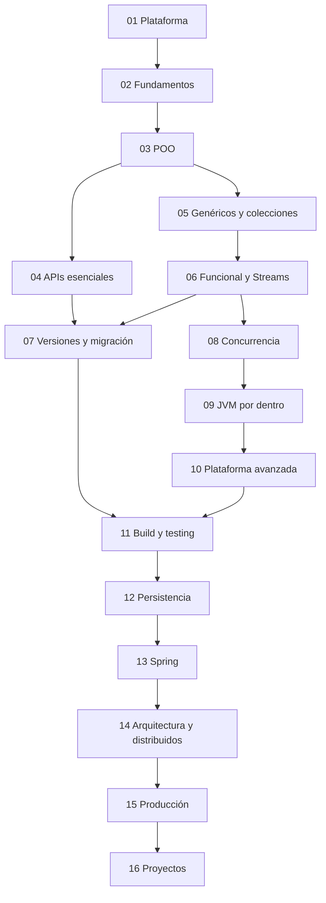

# Java 00 - Índice

> Objetivo: dominar Java de forma total, desde la sintaxis básica hasta la última versión, con Java 8, 11, 17, 21 y 25 como versiones de primera clase (son las que aparecen en bases de código reales).

Contraparte de frontend: [[Angular 00 - Indice]].

## Propósito

- Mapa ordenado y completo de temas, con casillas `- [ ]` para marcar avance durante meses.
- Es una hoja de ruta (qué aprender, en qué orden, cómo saber que se domina), no un tutorial: una línea por tema.
- Las notas propias del autor se enlazan desde cada fase.
- Convención de nombres: `Java 08 - Concurrencia` es la fase 8 de la hoja de ruta; `Java LTS 8` es el release Java 8. No confundir.
- Marca `(sin verificar)`: dato específico de versión que no está en la hoja de hechos verificada; confirmar en https://openjdk.org/jeps/ antes de citarlo.

## Estado verificado al 2026-11-11

| Elemento | Valor | Fuente |
|---|---|---|
| Último JDK GA | Java 27, GA 2026-09-15, no LTS, 9 JEPs | https://aliteq.com/jdk-27-whats-new-for-developers |
| GA anterior | Java 26, GA 2026-03-17, no LTS, 10 JEPs | https://www.infoq.com/news/2026/03/java26-released |
| LTS actual | Java 25 (GA 2025-09-16). Oracle Premier hasta sept 2030, Extended hasta sept 2033 | https://aliteq.com/jdk-27-whats-new-for-developers |
| Próximo LTS | Java 29, previsto sept 2027 (cadencia LTS de 2 años: 17, 21, 25, 29) | https://aliteq.com/jdk-27-whats-new-for-developers |
| JDK en desarrollo | JDK 28: Rampdown One 2026-12-03, Rampdown Two 2027-01-14, RC 2027-02-04, GA previsto 2027-03-09 (lista de JEPs aún móvil) | https://www.happycoders.eu/java/java-28-features/ |
| Spring Boot | 4.1.2 estable; 4.2.0-RC2 (GA ~2026-11-30, sin confirmar) | https://repo1.maven.org/maven2/org/springframework/boot/spring-boot/maven-metadata.xml |
| Spring Framework | 7.0.10 estable; 7.1.0-RC2 | Maven Central `spring-core` |
| Hibernate ORM | 7.4.15.Final; 8.0.0.Beta4 (no GA) | https://in.relation.to/2026/05/26/orm-74/ |
| JUnit | 6.1.3 (6.0.0 GA 2025-09-30, base Java 17) | https://docs.junit.org/6.1.0/release-notes/ |
| Maven | 3.9.16 estable; 4.0.0-rc-7 (no GA) | Maven Central `apache-maven` |
| Gradle | 9.9.1 | https://services.gradle.org/versions/current |
| Jakarta EE | 11 (junio 2025, dato secundario); Jakarta EE 12 NO publicada (JDK mínimo 21 previsto) | https://jakartaee.github.io/platform/jakartaee12/JakartaEE12ReleasePlan |

Contradicciones conocidas: la fecha práctica de fin de actualizaciones gratuitas de Oracle JDK 21 es conflictiva entre fuentes (Oracle: sept 2026; Azul: julio 2026). Confirmar en https://www.oracle.com/java/technologies/java-se-support-roadmap.html.

## Qué versión estudiar y por qué

| Versión | Por qué | Nota |
|---|---|---|
| 8 | Todavía abundante en código legado empresarial; base de lambdas, streams y `java.time` | [[Java LTS 8]] |
| 11 | LTS de transición tras 9 y 10: módulos, `var`, HTTP Client, eliminación de Java EE/CORBA | [[Java LTS 11]] |
| 17 | Línea base de Spring Boot 3/4 y JUnit 6; records, sealed, text blocks, encapsulación fuerte | [[Java LTS 17]] |
| 21 | Virtual threads, pattern matching para `switch`, Sequenced Collections | [[Java LTS 21]] |
| 25 | LTS actual: Scoped Values, Compact Source Files, Flexible Constructor Bodies, AOT | [[Java LTS 25]] |
| Última (27) y futuro | Rumbo de la plataforma: Valhalla, Lazy Constants, G1 por defecto, Structured Concurrency | [[Java 26-27 y futuro]] |

Hub de cronología y migración: [[Java 07 - Versiones y migracion]].

## Dependencias entre fases

## Fases

| Nº | Resultado esperado | Tiempo aprox. | Nota |
|---|---|---|---|
| 01 | Instalar, cambiar y usar JDKs y herramientas de línea de comandos | 1-2 semanas | [[Java 01 - Plataforma, JDK y herramientas]] |
| 02 | Escribir programas procedurales correctos en Java | 4-6 semanas | [[Java 02 - Fundamentos del lenguaje]] |
| 03 | Modelar dominios con POO moderna (records, sealed, patterns) | 6-8 semanas | [[Java 03 - Programacion orientada a objetos]] |
| 04 | Dominar las APIs de uso diario (strings, tiempo, I/O, excepciones) | 6-8 semanas | [[Java 04 - APIs esenciales]] |
| 05 | Elegir y razonar sobre genéricos y colecciones | 4-6 semanas | [[Java 05 - Genericos y colecciones]] |
| 06 | Programar en estilo funcional con Streams | 3-4 semanas | [[Java 06 - Programacion funcional y Streams]] |
| 07 | Ubicar cada característica por versión y planificar migraciones | 2-3 semanas | [[Java 07 - Versiones y migracion]] |
| 08 | Escribir código concurrente correcto, incluidos virtual threads | 8-10 semanas | [[Java 08 - Concurrencia]] |
| 09 | Entender y diagnosticar la JVM (GC, JIT, memoria) | 6-8 semanas | [[Java 09 - JVM por dentro]] |
| 10 | Usar módulos, reflexión, FFM y manipulación de bytecode | 6-8 semanas | [[Java 10 - Plataforma avanzada]] |
| 11 | Construir, probar y mantener calidad con Maven/Gradle | 4-6 semanas | [[Java 11 - Build, testing y calidad]] |
| 12 | Persistir datos con SQL, JDBC, JPA y migraciones | 8-10 semanas | [[Java 12 - Persistencia y bases de datos]] |
| 13 | Construir backends con Spring Boot y Jakarta EE | 8-12 semanas | [[Java 13 - Spring y ecosistema backend]] |
| 14 | Diseñar arquitecturas y sistemas distribuidos | 8-12 semanas | [[Java 14 - Arquitectura, APIs y sistemas distribuidos]] |
| 15 | Operar, asegurar y observar Java en producción | 6-8 semanas | [[Java 15 - Produccion]] |
| 16 | Consolidar con proyectos, certificación y lectura | continuo | [[Java 16 - Proyectos y dominio]] |

Total orientativo: 12 a 18 meses a ritmo parcial. Las fases 07 y las notas por versión se pueden consultar en paralelo desde la fase 02.

## Cómo usar la hoja de ruta

1. Seguir el orden de las fases 01 a 06; después alternar según el trabajo real (8 a 10 son profundización, 11 a 15 son ecosistema).
2. Marcar cada `- [ ]` solo tras responder las preguntas de dominio sin apuntes y completar las prácticas de la fase.
3. Mantener el JDK de práctica en 25 (LTS) y un JDK 8 y 17 a mano con [[Jabba]] o [[Scoop]] para reproducir código legado.
4. Cada tema lleva etiqueta de versión (`Java 16+`) para saber si existe en 8, 11, 17, 21 o 25.
5. Consultar la nota `Java LTS N` correspondiente cuando se trabaje en un proyecto de esa versión.

## Fase terminada cuando

- [x] Todas las casillas de temas están marcadas.
- [x] Las preguntas de dominio se responden sin apuntes.
- [x] Cada práctica tiene código ejecutable en un repositorio propio.
- [x] Se puede explicar un error común de la fase con un ejemplo propio.

## Mantener la hoja al día (cada seis meses)

Con cada JDK nuevo (marzo y septiembre):

| Archivo | Qué actualizar |
|---|---|
| Este índice | Tabla "Estado verificado" (JDK GA, LTS, JDK en desarrollo, frameworks) y fecha |
| [[Java 26-27 y futuro]] | Nueva versión, JEPs, estado de proyectos OpenJDK |
| [[Java 07 - Versiones y migracion]] | Cronología y matriz "característica a release final"; fechas de soporte |
| `Java LTS N` correspondiente | Solo si el release es LTS (siguiente: Java 29, sept 2027) |
| [[Java 09 - JVM por dentro]] | Cambios de GC, valores por defecto, flags |
| [[Java 13 - Spring y ecosistema backend]] | Versiones de Spring, línea base de Java |
| [[Java 11 - Build, testing y calidad]] | Maven, Gradle, JUnit |

Retirar la marca `(sin verificar)` solo tras confirmar en https://openjdk.org/projects/jdk/NN/.

## Notas propias del autor

[[Java 8 - Notas|Java 8]] · [[Java 25 - Notas]] · [[Java 8 vs Java 25]] · [[Resumen Bugs]]

## Guías de apoyo

- Diseño (independiente del lenguaje): [[POO]] · [[Guia SOLID - Principios con ejemplos Java y Spring]] · [[Guia GRASP - Principios de asignacion de responsabilidades]] · [[Guia Arquitecturas de Software - Comparativa y Usos]] · [[Guia Arquitectura de APIs - DTOs, capas y responsabilidades]] · [[Guia CRUD - Conceptos, capas y buenas practicas]]
- Java y Spring: [[Guia Spring Boot - Anotaciones y Ventajas]] · [[Guia Lombok - Anotaciones y Buenas Practicas]]

---

# Java 01 - Plataforma, JDK y herramientas

> Resultado: instalar varios JDKs, cambiar entre ellos, compilar, ejecutar, empaquetar y depurar con las herramientas del JDK sin depender de un IDE.

**Requisitos:** ninguno · **Siguiente:** [[Java 02 - Fundamentos del lenguaje]]

## Temas

### Historia y ediciones
- [x] Historia de Java (Sun, Oracle, OpenJDK) — hitos desde JDK 1.0 hasta hoy; ver [[Java 07 - Versiones y migracion]]
- [x] Ediciones: Java SE, Java EE renombrado a Jakarta EE, Java ME — qué cubre cada una
- [x] JDK vs JRE vs JVM — qué contiene cada uno y por qué el JRE ya no se distribuye por separado
- [x] WORA (write once, run anywhere) — cómo lo logran bytecode y JVM; sus límites reales
- [ ] Compilación a bytecode y ejecución — ciclo fuente, `.class`, carga, interpretación y JIT
- [ ] Cadencia de releases — un release cada seis meses (marzo y septiembre), JEP 322 (Java 10)
- [ ] Política LTS — LTS cada dos años: 8, 11, 17, 21, 25, próximo 29 (sept 2027)
- [ ] Proceso JEP / JCP / OpenJDK — quién propone, quién aprueba, qué es una JSR
- [ ] Preview e incubator — qué son, cómo se habilitan (`--enable-preview --release N`, módulos `jdk.incubator.*`)
- [ ] Ciclo de vida de una característica — incubator, preview 1..N, final, deprecación, eliminación

### Distribuciones y licencias
- [ ] Oracle JDK vs OpenJDK — diferencias de licencia (NFTC) y soporte
- [ ] Eclipse Temurin — distribución comunitaria de referencia
- [ ] Amazon Corretto — soporte a largo plazo gratuito
- [ ] Azul Zulu — builds y soporte comercial
- [ ] BellSoft Liberica — incluye variantes con JavaFX
- [ ] Microsoft Build of OpenJDK
- [ ] GraalVM — JIT Graal y native image; la línea 25.x sigue a JDK 25
- [ ] Criterios para elegir distribución — soporte, fecha de fin de actualizaciones, licencia, certificación TCK
- [ ] Fin de actualizaciones gratuitas por versión — Oracle JDK 17 gratis terminó en oct 2024; Temurin 17 al menos hasta oct 2027; Temurin 21 al menos hasta dic 2029

### Instalación y gestión de versiones
- [ ] Instalar un JDK manualmente — `JAVA_HOME` y `PATH`
- [ ] SDKMAN — instalar, listar y cambiar JDKs (Linux/macOS/WSL)
- [ ] [[Jabba]] — gestor de JDKs en Windows
- [ ] [[Scoop]] — instalar JDKs en Windows con buckets
- [ ] Verificar versión activa — `java -version`, `javac -version`, `java --version`
- [ ] Mantener JDK 8, 11, 17, 21 y 25 en paralelo — para reproducir código legado
- [ ] Formato de número de versión — `Runtime.version()`, esquema `feature.interim.update.patch`

### Herramientas de línea de comandos
- [ ] `javac` — opciones `-d`, `-cp`, `--release`, `-Xlint`, `-parameters`
- [ ] `java` — lanzar clase, JAR (`-jar`), módulo (`-m`)
- [ ] Lanzamiento de archivo fuente único — `java Hola.java` (Java 11+, JEP 330)
- [ ] Lanzamiento de múltiples archivos fuente — Java 22+ (JEP 458)
- [ ] `jshell` — REPL (Java 9+, JEP 222)
- [ ] `jar` — crear, listar y extraer JARs; manifest
- [ ] `javadoc` — generar documentación, snippets (Java 18+, JEP 413), comentarios Markdown (Java 23+, JEP 467)
- [ ] `javap` — desensamblar bytecode (`-c -v -p`)
- [ ] `jdeps` — análisis de dependencias entre módulos y paquetes
- [ ] `jdeprscan` — detectar uso de APIs deprecadas
- [ ] `jlink` — runtime a medida (Java 9+, JEP 282)
- [ ] `jpackage` — instaladores nativos (incubator en 14, final en 16, JEP 392)
- [ ] `jcmd` — comando de diagnóstico universal de la JVM
- [ ] `jps`, `jstack`, `jmap`, `jstat`, `jinfo` — diagnóstico básico
- [ ] `jfr` y `jconsole`/`jvisualvm` (este último ya no está en el JDK)
- [ ] `jarsigner`, `keytool` — firma y almacenes de claves
- [ ] `jmod`, `jimage` — formatos internos de módulos
- [ ] `jwebserver` — Simple Web Server (Java 18+, JEP 408)
- [ ] `jhsdb` y `serialver` — usos puntuales
- [ ] Herramientas retiradas — `javah` (eliminado en 10), `jjs`/Nashorn (eliminado en 15, JEP 372), Pack200 (eliminado en 14, JEP 367)

### Código, paquetes y módulos
- [ ] Classpath — resolución y orden, wildcard `lib/*`
- [ ] Module path — diferencia con classpath; ver [[Java 10 - Plataforma avanzada]]
- [ ] Paquetes y estructura de directorios — convención dominio inverso
- [ ] JAR, manifest — `Main-Class`, `Class-Path`, `Multi-Release`
- [ ] JAR ejecutable y "fat JAR" — cuándo usarlos
- [ ] Opciones `-X`, `-XX` y archivos `@argfiles`; variable `JAVA_TOOL_OPTIONS`

### IDEs y depuración
- [ ] IntelliJ IDEA — proyectos, SDK por módulo, inspecciones, atajos
- [ ] Eclipse — workspace, perfiles de compilador
- [ ] VS Code con Extension Pack for Java
- [ ] Depurador — breakpoints condicionales, watch, evaluate, step into/over/out
- [ ] Depuración remota — `-agentlib:jdwp`
- [ ] Hot swap y limitaciones — qué cambios admite la JVM sin reiniciar
- [ ] Convenciones de estilo — Google Java Style, Oracle Code Conventions, nombres

## Preguntas de dominio
1. ¿Qué diferencia hay entre JDK, JRE y JVM y qué se instala hoy en producción?
2. ¿Cuándo sale la próxima versión LTS y cuál es el ciclo?
3. ¿Qué significa preview y cómo se compila y ejecuta código con una característica preview?
4. ¿Qué diferencia hay entre Oracle JDK, Temurin y Corretto en licencia y soporte?
5. ¿Qué hace `--release 17` que no hace `-source 17 -target 17`?
6. ¿Cómo se ejecuta un archivo `.java` sin compilar explícitamente y desde qué versión?
7. ¿Qué diferencia hay entre classpath y module path?
8. ¿Qué contiene un JAR ejecutable y cómo declara su clase principal?
9. ¿Para qué sirven `jlink` y `jpackage` y qué los diferencia?
10. ¿Cómo se inspecciona el bytecode de una clase?
11. ¿Cómo se cambia de JDK en una sesión sin tocar variables del sistema?
12. ¿Qué es un JEP y quién lo aprueba?

## Prácticas
1. Instalar JDK 8, 17 y 25 con [[Scoop]] o [[Jabba]] y alternar entre ellos.
2. Compilar un "Hola mundo" con `javac`, empaquetarlo con `jar` y ejecutarlo con `-jar`.
3. Ejecutar un archivo fuente único y uno multi-archivo en JDK 25.
4. Desensamblar con `javap -c` un bucle `for` y un `switch`.
5. Usar `jshell` para probar `List.of`, `var` y text blocks.
6. Crear un runtime mínimo con `jlink` y medir su tamaño.
7. Generar un instalador con `jpackage`.
8. Depurar un programa con un breakpoint condicional en IntelliJ IDEA.

## Errores comunes
- Confundir la versión de `java` con la de `javac` por un `PATH` mal ordenado.
- Compilar con JDK nuevo sin `--release` y ejecutar en un JRE antiguo (`UnsupportedClassVersionError`).
- Usar un JRE/JDK sin `JAVA_HOME` en herramientas de build.
- Asumir que `-source/-target` valida la API disponible (no lo hace; `--release` sí).
- Habilitar preview en producción.
- Mezclar classpath y module path sin entender los módulos automáticos.
- Elegir una distribución sin revisar el fin de soporte gratuito.
- Ignorar `java -Xlog` y `jcmd` al diagnosticar.

## Notas relacionadas
[[Jabba]] · [[Scoop]] · [[Java 8 - Notas|Java 8]] · [[Java 25 - Ejecutar Java25Showcase]]

## Fuentes
- https://openjdk.org/jeps/
- https://openjdk.org/projects/jdk/
- https://docs.oracle.com/en/java/javase/25/docs/specs/man/index.html
- https://www.oracle.com/java/technologies/java-se-support-roadmap.html
- https://sdkman.io/

---

# Java 02 - Fundamentos del lenguaje

> Resultado: escribir programas procedurales correctos en Java, razonando sobre tipos, memoria, flujo de control y complejidad.

**Requisitos:** [[Java 01 - Plataforma, JDK y herramientas]] · **Siguiente:** [[Java 03 - Programacion orientada a objetos]]

## Temas

### Estructura de un programa
- [ ] Clase, método `main` clásico — `public static void main(String[] args)`
- [ ] Archivos fuente compactos e instance main — Preview 21 (JEP 445), 22, 23, 24; Final en Java 25 (JEP 512)
- [ ] Orden de elementos en un archivo — package, imports, tipo
- [ ] Una clase pública por archivo — regla de nombre de archivo
- [ ] Código de salida — `System.exit`, valor de retorno del proceso

### Tipos primitivos y conversiones
- [ ] Los ocho primitivos — `byte`, `short`, `int`, `long`, `float`, `double`, `char`, `boolean`
- [ ] Rangos y tamaños — constantes `MIN_VALUE`/`MAX_VALUE`
- [ ] Literales — decimal, hexadecimal, octal, binario (`0b`), guiones bajos, sufijos `L`, `f`, `d`
- [ ] Casting explícito y promoción numérica — reglas de `byte + byte` a `int`
- [ ] Conversiones con pérdida — `long` a `int`, `double` a `int`
- [ ] Tipos envoltorio — `Integer`, `Long`, `Double`, `Boolean`, `Character`
- [ ] Autoboxing y unboxing — `NullPointerException` al desempaquetar `null`
- [ ] Caché de enteros — `Integer.valueOf` cachea -128 a 127; `==` vs `equals`
- [ ] Aritmética sin signo — `Integer.toUnsignedString`, `divideUnsigned` (Java 8+)
- [ ] `char` y Unicode — code points, surrogate pairs

### Variables y alcance
- [ ] Declaración, inicialización y valores por defecto de campos
- [ ] Alcance — bloque, método, clase
- [ ] Inferencia `var` — locales Java 10+ (JEP 286); en parámetros de lambda Java 11+ (JEP 323)
- [ ] Restricciones de `var` — sin inicializador, `null`, campos, parámetros de método
- [ ] `final` — variables, parámetros, constantes
- [ ] Constantes `static final` y convención de nombres

### Operadores
- [ ] Aritméticos, relacionales, lógicos, bit a bit y desplazamientos (`>>`, `>>>`)
- [ ] Precedencia y asociatividad
- [ ] Cortocircuito `&&` / `||` frente a `&` / `|`
- [ ] Operador ternario y asignación compuesta (conversión implícita)
- [ ] Incremento y decremento — pre y post
- [ ] Desbordamiento de enteros — `Math.addExact`, `multiplyExact`, `toIntExact`
- [ ] Trampas de coma flotante — `0.1 + 0.2`, `NaN`, `Infinity`, comparación con epsilon
- [ ] Semántica estricta de coma flotante — siempre estricta desde Java 17 (JEP 306)
- [ ] División entera y módulo con negativos — `%` vs `Math.floorMod`

### Cadenas (básico)
- [ ] `String` como objeto inmutable — literales vs `new String`
- [ ] Concatenación — `+`, `concat`, `StringBuilder`
- [ ] Comparación — `equals`, `equalsIgnoreCase`, `compareTo`
- [ ] Métodos básicos — `length`, `charAt`, `substring`, `indexOf`, `split`, `trim`
- [ ] Text blocks — Final en Java 15 (JEP 378); ver [[Java 04 - APIs esenciales]]

### Control de flujo
- [ ] `if` / `else if` / `else`
- [ ] `switch` sentencia clásica — fall-through y `break`
- [ ] `switch` expresión con `->` y `yield` — Final en Java 14 (JEP 361)
- [ ] `switch` sobre `String` y `enum`; exhaustividad en expresiones
- [ ] `for`, `for` mejorado, `while`, `do-while`
- [ ] `break` y `continue` etiquetados
- [ ] Bucles infinitos y condiciones de salida
- [ ] Pattern matching en `switch` — adelanto; ver [[Java 03 - Programacion orientada a objetos]]

### Arrays
- [ ] Declaración, creación e inicialización, `length`
- [ ] Arrays multidimensionales y arrays irregulares (jagged)
- [ ] Covarianza de arrays y `ArrayStoreException`
- [ ] `java.util.Arrays` — `sort`, `binarySearch`, `fill`, `copyOf`, `copyOfRange`, `equals`, `deepEquals`, `toString`, `deepToString`, `asList`, `stream`
- [ ] `Arrays.mismatch` y `Arrays.compare` — Java 9+
- [ ] `Arrays.parallelSort` y `parallelPrefix` — Java 8+
- [ ] Arrays y varargs

### Métodos
- [ ] Declaración, parámetros, retorno, firma
- [ ] Sobrecarga — resolución en tiempo de compilación, ambigüedades con boxing
- [ ] Varargs — reglas y trampas con `null`
- [ ] Paso por valor — referencias se copian; efecto sobre objetos mutables
- [ ] Recursión — caso base, profundidad, `StackOverflowError`
- [ ] Métodos `static` — cuándo usarlos

### Memoria (modelo mental)
- [ ] Pila vs montón — variables locales, frames, objetos
- [ ] Referencias, `null` y alias
- [ ] Recolección de basura — idea general; detalle en [[Java 09 - JVM por dentro]]
- [ ] Identidad vs igualdad (`==` vs `equals`)

### Paquetes e imports
- [ ] `package`, `import`, imports estáticos, conflicto de nombres
- [ ] Declaraciones de import de módulo — Final en Java 25 (JEP 511)
- [ ] `java.lang` implícito

### Comentarios y documentación
- [ ] Comentarios de línea y bloque
- [ ] Javadoc — `@param`, `@return`, `@throws`, `{@code}`, `{@link}`
- [ ] Comentarios de documentación en Markdown — Final en Java 23 (JEP 467)
- [ ] Convenciones de nombres — `CamelCase`, `camelCase`, `UPPER_SNAKE`, paquetes en minúsculas

### Entrada y salida de consola
- [ ] `System.out`, `System.err`, `printf` y `String.format`
- [ ] `Scanner` sobre `System.in`
- [ ] `System.console()` y `IO` de consola — `java.lang.IO` en Java 25 (JEP 512)
- [ ] Argumentos de línea de comandos

### Algoritmos y complejidad básica
- [ ] Notación Big-O — constante, logarítmica, lineal, `n log n`, cuadrática
- [ ] Búsqueda lineal y binaria
- [ ] Ordenamientos — burbuja, inserción, selección, merge, quick
- [ ] Recursión vs iteración
- [ ] Manipulación de cadenas y arrays — palíndromos, anagramas, two-pointers
- [ ] Números — primos, MCD, Fibonacci, factorial con desbordamiento

## Preguntas de dominio
1. ¿Por qué `Integer a = 127, b = 127; a == b` es `true` y con 128 puede ser `false`?
2. ¿Qué imprime `0.1 + 0.2 == 0.3` y por qué?
3. ¿Qué diferencia hay entre `a++` y `++a` dentro de una expresión?
4. ¿Qué ocurre al hacer `byte b = 10; b += 5;` y por qué compila?
5. ¿Por qué Java es "paso por valor" también para objetos?
6. ¿Qué diferencia hay entre `switch` sentencia y `switch` expresión?
7. ¿Qué es el desbordamiento de `int` y cómo detectarlo?
8. ¿Dónde viven en memoria variables locales, objetos y estáticos?
9. ¿Qué restricciones tiene `var`?
10. ¿Qué hace `>>>` frente a `>>`?
11. ¿Cuál es la complejidad de `Arrays.sort` para primitivos y para objetos?
12. ¿Cuándo es válido un `main` sin `public static void`?

## Prácticas
1. Implementar una calculadora de consola con validación de entrada.
2. Escribir FizzBuzz, factorial y Fibonacci de forma iterativa y recursiva; medir el desbordamiento.
3. Implementar búsqueda binaria y tres ordenamientos propios; comparar con `Arrays.sort`.
4. Provocar y explicar `StackOverflowError`, `ArrayIndexOutOfBoundsException` y `NumberFormatException`.
5. Reproducir las trampas del caché de `Integer` y de coma flotante en `jshell`.
6. Reescribir un `switch` clásico a `switch` expresión.
7. Documentar un método con Javadoc y generar el HTML con `javadoc`.
8. Resolver 20 ejercicios de algoritmos básicos en un archivo fuente compacto (JDK 25).

## Errores comunes
- Comparar `String` y wrappers con `==`.
- Olvidar `break` en un `switch` clásico (fall-through).
- Usar `float`/`double` para dinero.
- Ignorar el desbordamiento silencioso de enteros.
- Modificar un array mientras se itera con índice equivocado.
- Confundir `=` con `==` en condiciones booleanas.
- Usar `var` donde el tipo deja de ser evidente.
- Dividir enteros esperando un resultado decimal.
- Variables no inicializadas en ramas condicionales.

## Notas relacionadas
[[Resumen Bugs]] · [[Java 8 - Notas|Java 8]] · [[Java 25 - Ejecutar Java25Showcase]]

## Fuentes
- https://docs.oracle.com/javase/specs/jls/se25/html/index.html
- https://docs.oracle.com/javase/tutorial/java/
- https://openjdk.org/jeps/286
- https://openjdk.org/jeps/361
- https://openjdk.org/jeps/512

---

# Java 03 - Programación orientada a objetos

> Resultado: modelar dominios con clases, interfaces, enums, records y sealed types, aplicando principios de diseño y patrones con modismos Java modernos.

**Requisitos:** [[Java 02 - Fundamentos del lenguaje]] · **Siguiente:** [[Java 04 - APIs esenciales]]

## Temas

### Clases y objetos
- [ ] Clase, objeto, instancia, estado y comportamiento
- [ ] Campos, métodos y miembros `static`
- [ ] Constructores — por defecto, sobrecarga, encadenamiento con `this(...)`
- [ ] Cuerpos de constructor flexibles — sentencias antes de `super(...)`: P1 en 22 (JEP 447), P2 23, P3 24, Final en Java 25 (JEP 513)
- [ ] Orden de inicialización — campos estáticos, bloques estáticos, campos de instancia, bloques de instancia, constructor
- [ ] `this` y `super`
- [ ] Encapsulación y modificadores de acceso — `private`, package-private, `protected`, `public`
- [ ] `static` — miembros, bloques, clases anidadas estáticas
- [ ] Métodos factoría estáticos y patrón builder

### Herencia y polimorfismo
- [ ] Herencia simple de clases — `extends`
- [ ] Reglas de sobrescritura (`@Override`) — visibilidad, tipo de retorno covariante, excepciones
- [ ] Polimorfismo y despacho dinámico — resolución en tiempo de ejecución
- [ ] Ocultamiento de campos y métodos estáticos (hiding)
- [ ] Clases abstractas — cuándo usarlas
- [ ] Interfaces — contrato, herencia múltiple de tipo
- [ ] Métodos `default` y `static` en interfaces — Java 8
- [ ] Métodos `private` en interfaces — Java 9
- [ ] Problema del diamante con `default` — `Interface.super.metodo()`
- [ ] Composición vs herencia — preferir composición
- [ ] `final` en clases y métodos
- [ ] Acoplamiento y cohesión

### Métodos de `Object`
- [ ] Contrato de `equals` — reflexivo, simétrico, transitivo, consistente, `null`
- [ ] Contrato de `hashCode` — consistente con `equals`
- [ ] `toString` útil
- [ ] `clone` y por qué suele evitarse — constructor de copia, factoría
- [ ] `finalize` — deprecado para eliminación en Java 18 (JEP 421); usar `Cleaner` o try-with-resources
- [ ] `getClass`, `wait`, `notify` — ver [[Java 08 - Concurrencia]]
- [ ] `compareTo` y consistencia con `equals`

### Clases anidadas
- [ ] Clase interna (inner) — referencia implícita a la externa, fugas de memoria
- [ ] Clase anidada estática
- [ ] Clase local
- [ ] Clase anónima — vs lambda
- [ ] Clases internas e interfaces — control de acceso con "nest-based access" (Java 11, JEP 181)

### Enums
- [ ] Enum básico — constantes, `values`, `valueOf`, `ordinal`, `name`
- [ ] Campos, constructores y métodos en enums
- [ ] Cuerpos específicos por constante
- [ ] Enums que implementan interfaces
- [ ] `EnumSet` y `EnumMap`
- [ ] `switch` sobre enums y exhaustividad
- [ ] Enum como singleton y máquina de estados

### Records
- [ ] Record — Preview 14 (JEP 359), 15; Final en Java 16 (JEP 395)
- [ ] Constructor compacto y canónico
- [ ] Métodos adicionales, campos estáticos, interfaces
- [ ] Limitaciones — sin herencia, campos finales
- [ ] Records genéricos y anidados
- [ ] Records como DTOs y claves de mapa
- [ ] Serialización de records

### Sealed classes e interfaces
- [ ] `sealed`, `permits`, `non-sealed`, `final` — P1 en 15 (JEP 360), P2 16, Final en Java 17 (JEP 409)
- [ ] Jerarquías cerradas y tipos de datos algebraicos con records
- [ ] Exhaustividad en `switch` sobre jerarquías selladas

### Pattern matching
- [ ] `instanceof` con patrón — P1 14 (JEP 305), P2 15; Final en Java 16 (JEP 394)
- [ ] `switch` con patrones — P1 17 (JEP 406); Final en Java 21 (JEP 441)
- [ ] Guardas `when` y dominancia de patrones
- [ ] Patrones de record — Final en Java 21 (JEP 440)
- [ ] Patrones anidados y `null` en `switch`
- [ ] Variables y patrones sin nombre (`_`) — Preview 21 (JEP 443); Final en Java 22 (JEP 456)
- [ ] Tipos primitivos en patrones — Preview 23 (JEP 455), P2 24, P3 25, P4 26, P5 27; según una única fuente, retirado y se eliminará en 28 (sin verificar). No es final en ninguna versión
- [ ] String Templates — Preview 21/22 y retirada antes de 23 (no usar)

### Inmutabilidad
- [ ] Objetos inmutables — campos `final`, sin setters, copias defensivas
- [ ] Records e inmutabilidad superficial
- [ ] Colecciones inmutables — ver [[Java 05 - Genericos y colecciones]]
- [ ] Clases basadas en valor (value-based) — advertencias en Java 16 (JEP 390)
- [ ] Project Valhalla — JEP 401 Value Classes en Preview, objetivo JDK 28 (en desarrollo); ver [[Java 26-27 y futuro]]

### Anotaciones (básico)
- [ ] Anotaciones estándar — `@Override`, `@Deprecated`, `@SuppressWarnings`, `@FunctionalInterface`, `@SafeVarargs`
- [ ] Definir anotaciones propias — retención y destino
- [ ] Anotaciones de tipo y repetibles — Java 8
- [ ] Detalle de procesamiento — ver [[Java 10 - Plataforma avanzada]]

### Principios de diseño
- [ ] SOLID — ver [[Guia SOLID - Principios con ejemplos Java y Spring]]
- [ ] GRASP — ver [[Guia GRASP - Principios de asignacion de responsabilidades]]
- [ ] DRY, KISS, YAGNI, ley de Demeter
- [ ] Programar contra interfaces, "tell, don't ask"
- [ ] Más conceptos de POO — [[POO]]

### Patrones de diseño GoF
Cada patrón con su modismo Java.

| Categoría | Patrones y modismo Java |
|---|---|
| Creacionales | Singleton (enum), Factory Method (método estático), Abstract Factory, Builder (clase anidada o record), Prototype (constructor de copia) |
| Estructurales | Adapter (clase o lambda), Bridge, Composite (sealed + record), Decorator (`InputStream` wrappers), Facade, Flyweight (`Integer.valueOf`), Proxy (`java.lang.reflect.Proxy`) |
| Comportamiento | Chain of Responsibility, Command (`Runnable`), Interpreter, Iterator (`Iterable`), Mediator, Memento, Observer (`Flow`), State (enum), Strategy (lambda), Template Method, Visitor (switch con patrones sobre sealed) |

- [ ] Creacionales — implementar los cinco
- [ ] Estructurales — implementar los siete
- [ ] De comportamiento — implementar los once
- [ ] Reemplazar Visitor por `switch` con patrones sobre jerarquía sellada — Java 21+
- [ ] Antipatrones — God object, Anemic domain model, Singleton global mutable

## Preguntas de dominio
1. ¿Cuál es el orden exacto de inicialización al instanciar una subclase?
2. ¿Qué contrato deben cumplir `equals` y `hashCode`?
3. ¿Cuándo preferir interfaz o clase abstracta?
4. ¿Qué diferencia hay entre sobrecarga y sobrescritura?
5. ¿Qué es un record y qué NO es (qué restricciones tiene)?
6. ¿Para qué sirve `sealed` y cómo habilita `switch` exhaustivo?
7. ¿Qué diferencia hay entre clase interna, anidada estática y anónima?
8. ¿Por qué `clone` es problemático?
9. ¿Qué hace `non-sealed`?
10. ¿Qué es una clase value-based y qué implica para `synchronized`?
11. ¿Cuándo es mejor composición que herencia?
12. ¿Cómo se expresa un tipo de dato algebraico en Java 21?
13. ¿Qué cambia entre `instanceof` clásico y con patrón?

## Prácticas
1. Modelar un sistema de figuras con interfaz sellada y records, y calcular áreas con `switch` con patrones.
2. Implementar `equals`/`hashCode` a mano y verificar el contrato con pruebas.
3. Reescribir una jerarquía con herencia profunda usando composición.
4. Implementar 6 patrones GoF distintos con lambdas donde corresponda.
5. Crear una máquina de estados con enum y cuerpos por constante.
6. Convertir un DTO mutable con Lombok ([[Guia Lombok - Anotaciones y Buenas Practicas]]) a record.
7. Escribir una clase inmutable con copias defensivas y probar que no se rompe.
8. Aplicar SOLID a un diseño existente y documentar la violación corregida.

## Errores comunes
- Sobrescribir `equals` sin `hashCode`.
- Herencia para reutilizar código en lugar de composición.
- Exponer colecciones mutables internas.
- Llamar métodos sobrescribibles desde el constructor.
- Usar `clone()` o `finalize()` en código nuevo.
- Abusar de getters/setters (modelo anémico).
- Singleton con estado mutable global.
- Creer que un record es profundamente inmutable.
- Usar `instanceof` en cascada en vez de polimorfismo o `switch` con patrones.

## Notas relacionadas
[[POO]] · [[Guia SOLID - Principios con ejemplos Java y Spring]] · [[Guia GRASP - Principios de asignacion de responsabilidades]] · [[Guia Lombok - Anotaciones y Buenas Practicas]] · [[Guia Arquitecturas de Software - Comparativa y Usos]]

## Fuentes
- https://docs.oracle.com/javase/specs/jls/se25/html/index.html
- https://openjdk.org/jeps/395
- https://openjdk.org/jeps/409
- https://openjdk.org/jeps/441
- https://openjdk.org/jeps/440
- https://openjdk.org/jeps/456
- https://openjdk.org/jeps/513
- Effective Java, Joshua Bloch

---

# Java 04 - APIs esenciales

> Resultado: usar con criterio las APIs estándar de uso diario (cadenas, tiempo, números, excepciones, I/O, red, logging, criptografía) y conocer sus trampas.

**Requisitos:** [[Java 03 - Programacion orientada a objetos]] · **Siguiente:** [[Java 05 - Genericos y colecciones]]

## Temas

### Cadenas en profundidad
- [ ] Internals de `String` — pool de literales, inmutabilidad, `intern`
- [ ] Compact Strings — Java 9 (JEP 254): representación Latin-1 o UTF-16
- [ ] `StringBuilder` vs `StringBuffer` — cuándo cada uno; capacidad inicial
- [ ] Concatenación con `invokedynamic` — Java 9+
- [ ] Text blocks — Final en Java 15 (JEP 378): indentación, escapes, `\s`, `\<newline>`
- [ ] Métodos de `String` añadidos en 11 — `isBlank`, `lines`, `strip`, `stripLeading`, `stripTrailing`, `repeat`
- [ ] Métodos añadidos en 12 a 15 — `indent`, `transform`, `stripIndent`, `translateEscapes`, `formatted`
- [ ] Métodos añadidos en 21 — `indexOf` con rango, `splitWithDelimiters`, `StringBuilder.repeat`
- [ ] `String.format`, `printf`, `Formatter` — especificadores y `Locale`
- [ ] Unicode, code points y normalización — `Normalizer`
- [ ] UTF-8 por defecto — Java 18 (JEP 400): efecto en `Charset.defaultCharset()`
- [ ] `HexFormat` — Java 17
- [ ] Base64 — `java.util.Base64`, variantes URL y MIME (Java 8)

### Expresiones regulares
- [ ] `Pattern`, `Matcher`, `find`, `matches`, `group`, grupos con nombre
- [ ] Flags, cuantificadores voraces, perezosos y posesivos
- [ ] Lookahead y lookbehind
- [ ] Rendimiento y ReDoS (backtracking catastrófico)
- [ ] `replaceAll` con lambdas — `Matcher.replaceAll(Function)` (Java 9)

### Números
- [ ] `Math`, `StrictMath`, funciones exactas (`addExact`, etc.)
- [ ] `BigInteger` — operaciones, primalidad, rendimiento
- [ ] `BigDecimal` — escala, precisión, `MathContext`, `RoundingMode`
- [ ] Manejo de dinero — `BigDecimal` con escala fija o unidades menores; no `double`
- [ ] `equals` vs `compareTo` en `BigDecimal`
- [ ] `Math.clamp` — Java 21

### Fecha y hora
- [ ] `java.time` — Java 8 (JEP 150): `LocalDate`, `LocalTime`, `LocalDateTime`
- [ ] `Instant`, `ZonedDateTime`, `OffsetDateTime`, `ZoneId`, `ZoneOffset`
- [ ] `Duration` vs `Period`
- [ ] `DateTimeFormatter` y parseo (ISO-8601)
- [ ] `TemporalAdjusters`, `ChronoUnit`, `Clock` para pruebas
- [ ] Zonas horarias y horario de verano — trampas
- [ ] API legada — `Date`, `Calendar`, `SimpleDateFormat` (no thread-safe); conversión con `toInstant`
- [ ] `java.sql.Timestamp` y mapeo JDBC 4.2 de `java.time`

### Optional
- [ ] `Optional` — Java 8: `map`, `flatMap`, `filter`, `orElse`, `orElseGet`, `orElseThrow`
- [ ] `ifPresentOrElse`, `or`, `stream` — Java 9
- [ ] `isEmpty` — Java 11
- [ ] `Optional` como tipo de retorno, no en campos ni parámetros
- [ ] `OptionalInt`, `OptionalLong`, `OptionalDouble`

### Excepciones
- [ ] Jerarquía — `Throwable`, `Error`, `Exception`, `RuntimeException`
- [ ] Checked vs unchecked — criterio de diseño
- [ ] `try`/`catch`/`finally` — orden, multi-catch, rethrow preciso
- [ ] `try-with-resources` — `AutoCloseable`, orden de cierre; recursos efectivamente finales (Java 9)
- [ ] Excepciones suprimidas — `getSuppressed`, `addSuppressed`
- [ ] Excepciones personalizadas — cuándo crearlas, causa encadenada
- [ ] Mensajes útiles de `NullPointerException` — Final en Java 14 (JEP 358)
- [ ] Buenas prácticas — no tragar excepciones, no usar para control de flujo, fail fast
- [ ] `StackOverflowError`, `OutOfMemoryError` — qué se puede y qué no recuperar
- [ ] `Objects.requireNonNull` y validación de argumentos
- [ ] `assert` — habilitación con `-ea`
- [ ] `StackWalker` — Java 9

### Entrada/salida clásica
- [ ] Streams de bytes — `InputStream`, `OutputStream`, buffering
- [ ] Readers y Writers — codificaciones, `InputStreamReader`
- [ ] `File` (legado), `RandomAccessFile`
- [ ] `PrintStream`, `Scanner`, `Console`
- [ ] `InputStream.transferTo` y `readAllBytes` — Java 9

### NIO y NIO.2
- [ ] `Path`, `Paths`, `Path.of` — Java 11 para `Path.of`
- [ ] `Files` — `readString`, `writeString` (Java 11), `lines`, `walk`, `list`, `copy`, `move`
- [ ] Atributos de archivo, enlaces simbólicos, permisos
- [ ] Canales y buffers — `ByteBuffer`, `FileChannel`, direct buffers
- [ ] `MappedByteBuffer` y buffers mapeados no volátiles (Java 14, JEP 352)
- [ ] `WatchService`
- [ ] `AsynchronousFileChannel` y NIO selector (`Selector`, `SocketChannel`)
- [ ] Canales de socket de dominio Unix — Java 16 (JEP 380)
- [ ] Reimplementación de la API de sockets legados — Java 13 (JEP 353) y `DatagramSocket` en 15 (JEP 373)

### Serialización
- [ ] `Serializable`, `serialVersionUID`, `transient`
- [ ] Peligros de la deserialización — gadget chains, no deserializar datos no confiables
- [ ] Filtros de deserialización — Java 9; específicos de contexto en Java 17 (JEP 415)
- [ ] Alternativas — JSON (Jackson), Protobuf, Avro; ver [[Java 14 - Arquitectura, APIs y sistemas distribuidos]]

### Red y HTTP
- [ ] `java.net` — `URI`, `URL`, `Socket`, `ServerSocket`, `InetAddress`
- [ ] SPI de resolución de direcciones — Java 18 (JEP 418)
- [ ] `HttpClient` — incubator en 9, estándar en Java 11 (JEP 321): sync, async, HTTP/2, WebSocket
- [ ] HTTP/3 en `HttpClient` — Final en Java 26 (JEP 517)
- [ ] Simple Web Server — Java 18 (JEP 408)
- [ ] TLS 1.3 — Java 11 (JEP 332)
- [ ] `HttpURLConnection` (legado)

### Utilidades
- [ ] `Objects` — `equals`, `hash`, `toString`, `requireNonNullElse`, `checkIndex`
- [ ] `Random`, `ThreadLocalRandom`, `SecureRandom`
- [ ] API de generadores aleatorios — Java 17 (JEP 356): `RandomGenerator`, `RandomGeneratorFactory`
- [ ] `UUID` — versiones, `randomUUID`
- [ ] `Locale`, i18n, `ResourceBundle`, `NumberFormat`, `MessageFormat`, `Collator`
- [ ] `Properties` y `java.util.prefs`
- [ ] `Runtime`, `System` — `getProperty`, `getenv`, `nanoTime`, `currentTimeMillis`, `gc`
- [ ] `ProcessBuilder` y `ProcessHandle` — Java 9 para `ProcessHandle`
- [ ] `Timer`/`TimerTask` y `ScheduledExecutorService` — ver [[Java 08 - Concurrencia]]
- [ ] Stable Values / Lazy Constants — Preview 25 (JEP 502) renombrado en 26; Preview 26 (JEP 526) y 27 (JEP 531)

### Logging
- [ ] `java.util.logging`
- [ ] `System.Logger` — Java 9
- [ ] SLF4J como fachada
- [ ] Logback y Log4j2 — configuración, appenders, niveles
- [ ] Logging estructurado y MDC — ver [[Java 15 - Produccion]]
- [ ] No registrar datos sensibles; costo de construir mensajes

### Criptografía (visión general)
- [ ] JCA/JCE — `MessageDigest`, `Cipher`, `Signature`, `KeyStore`, `SecureRandom`
- [ ] Curve25519/448 — Java 11 (JEP 324); ChaCha20-Poly1305 — Java 11 (JEP 329)
- [ ] EdDSA — Java 15 (JEP 339)
- [ ] API de Key Encapsulation Mechanism — Final en Java 21 (JEP 452)
- [ ] Key Derivation Function API — P1 en 24 (JEP 478), Final en Java 25 (JEP 510)
- [ ] Criptografía poscuántica — ML-KEM y ML-DSA Final en Java 24 (JEP 496, 497); intercambio híbrido en TLS 1.3 Final en Java 27 (JEP 527)
- [ ] Codificación PEM — P1 en 25 (JEP 470), P2 26 (JEP 524), P3 27 (JEP 538); Final objetivo JDK 28 (JEP 542, en desarrollo)
- [ ] Hash de contraseñas — bcrypt, Argon2 (no `MessageDigest` directo)

## Preguntas de dominio
1. ¿Por qué `String` es inmutable y qué implica `intern`?
2. ¿Cuándo usar `StringBuilder` y cuándo basta `+`?
3. ¿Qué diferencia hay entre `LocalDateTime`, `ZonedDateTime` e `Instant`?
4. ¿Por qué no usar `double` para dinero y qué alternativa usar?
5. ¿Cuándo usar checked vs unchecked exceptions?
6. ¿Qué ocurre si `close()` lanza excepción dentro de un try-with-resources?
7. ¿Por qué es peligrosa la deserialización y cómo se mitiga?
8. ¿Qué diferencia hay entre `Files.walk` y `Files.list`?
9. ¿Qué ventajas ofrece `HttpClient` sobre `HttpURLConnection`?
10. ¿Cuándo usar `Optional` y cuándo no?
11. ¿Cómo evitar ReDoS en regex?
12. ¿Cómo conseguir un número aleatorio criptográficamente seguro?
13. ¿Qué cambió con UTF-8 por defecto en Java 18?

## Prácticas
1. Implementar un procesador de texto con regex (extracción de logs con grupos con nombre).
2. Calcular facturas con `BigDecimal` y reglas de redondeo; probar con casos límite.
3. Escribir utilidades de fechas que manejen cambios de horario de verano; probarlas con `Clock` fijo.
4. Copiar un árbol de directorios con NIO.2 y observarlo con `WatchService`.
5. Crear una jerarquía de excepciones de dominio con causa encadenada y pruebas.
6. Consumir una API REST con `HttpClient` de forma síncrona y asíncrona.
7. Configurar SLF4J + Logback con MDC y salida JSON.
8. Cifrar y descifrar con AES-GCM y firmar con Ed25519.

## Errores comunes
- `new BigDecimal(0.1)` en lugar de `BigDecimal.valueOf` o el constructor con `String`.
- `SimpleDateFormat` compartido entre hilos.
- `catch (Exception e) {}` vacío.
- Concatenar `String` en bucles.
- Usar `Optional.get()` sin comprobar.
- Confiar en `Charset.defaultCharset()` en versiones previas a 18.
- Deserializar datos no confiables con `ObjectInputStream`.
- Usar `LocalDateTime` para instantes absolutos.
- Registrar contraseñas, tokens o datos personales.
- Usar `Random` para tokens de seguridad.

## Notas relacionadas
[[Java 8 - Notas|Java 8]] · [[Resumen Bugs]] · [[Guia Arquitectura de APIs - DTOs, capas y responsabilidades]]

## Fuentes
- https://docs.oracle.com/en/java/javase/25/docs/api/index.html
- https://openjdk.org/jeps/321
- https://openjdk.org/jeps/517
- https://openjdk.org/jeps/415
- https://openjdk.org/jeps/510
- https://docs.oracle.com/javase/tutorial/datetime/

---

# Java 05 - Genéricos y colecciones

> Resultado: diseñar con genéricos, elegir la colección correcta según su estructura interna y complejidad, e implementar estructuras de datos clásicas a mano.

**Requisitos:** [[Java 03 - Programacion orientada a objetos]] · **Siguiente:** [[Java 06 - Programacion funcional y Streams]]

## Temas

### Genéricos
- [ ] Clases, interfaces y métodos genéricos — parámetros de tipo
- [ ] Inferencia de tipos y diamante `<>` — diamante con clases anónimas en Java 9
- [ ] Tipos acotados — `<T extends Number & Comparable<T>>`
- [ ] Wildcards — `?`, `? extends`, `? super`
- [ ] PECS (Producer Extends, Consumer Super)
- [ ] Borrado de tipos (type erasure) y consecuencias — sin `new T()`, sin `instanceof List<String>`, sobrecarga ambigua
- [ ] Métodos puente (bridge methods)
- [ ] Contaminación del heap (heap pollution) — `@SafeVarargs`
- [ ] Tipos reificables — qué son y por qué importan para arrays
- [ ] Cotas recursivas — `<T extends Comparable<T>>`, `Enum<E extends Enum<E>>`
- [ ] Genéricos y arrays — por qué no se pueden crear arrays genéricos
- [ ] Reglas de subtipado — `List<Object>` no es supertipo de `List<String>`
- [ ] Captura de wildcard (wildcard capture)
- [ ] Futuro: genéricos especializados (Valhalla); no incluidos en JDK 28 (ver [[Java 26-27 y futuro]])

### Jerarquía del framework
- [ ] `Iterable` y `Collection`
- [ ] `List`, `Set`, `Queue`, `Deque`, `Map` — contratos
- [ ] `SortedSet`/`NavigableSet`, `SortedMap`/`NavigableMap`
- [ ] Colecciones secuenciadas — `SequencedCollection`, `SequencedSet`, `SequencedMap`: Final en Java 21 (JEP 431)
- [ ] `Collection.toArray`, `removeIf` (Java 8), `stream`

### Implementaciones e internals
| Implementación | Estructura | Operaciones clave |
|---|---|---|
| `ArrayList` | Array redimensionable | get O(1), add amortizado O(1), insert/remove medio O(n) |
| `LinkedList` | Lista doblemente enlazada | acceso O(n), add/remove en extremos O(1) |
| `ArrayDeque` | Array circular | push/pop/offer/poll O(1) |
| `PriorityQueue` | Heap binario | offer/poll O(log n), peek O(1) |
| `HashMap` | Tabla hash + árboles | get/put O(1) medio, O(log n) con treeificación |
| `LinkedHashMap` | Hash + lista enlazada | orden de inserción o acceso (LRU) |
| `TreeMap` | Árbol rojo-negro | O(log n), orden natural |
| `HashSet` / `TreeSet` | Respaldados por `HashMap`/`TreeMap` | igual que su mapa |
| `EnumMap` | Array indexado por ordinal | O(1) |
| `IdentityHashMap` | Compara por `==` | O(1) |
| `WeakHashMap` | Claves débiles | limpieza por GC |

- [ ] `ArrayList` — capacidad, crecimiento, `ensureCapacity`, `trimToSize`
- [ ] `LinkedList` — cuándo realmente conviene (casi nunca)
- [ ] `ArrayDeque` — preferida a `Stack` y `LinkedList` como pila/cola
- [ ] `PriorityQueue` — orden con `Comparator`, no es ordenada al iterar
- [ ] `HashMap` — función hash, colisiones, factor de carga 0.75, redimensionamiento (resize)
- [ ] Treeificación — bucket pasa de lista a árbol (umbral 8, tabla mínima 64)
- [ ] `LinkedHashMap` — `accessOrder` y `removeEldestEntry` para caché LRU
- [ ] `TreeMap` y `TreeSet` — `NavigableMap`: `floorKey`, `ceilingKey`, `subMap`
- [ ] `HashSet` y `LinkedHashSet`
- [ ] `EnumMap` y `EnumSet`
- [ ] `IdentityHashMap`, `WeakHashMap`
- [ ] Legadas — `Vector`, `Stack`, `Hashtable`, `Enumeration`: por qué evitarlas
- [ ] `BitSet`

### Ordenación y comparación
- [ ] `Comparable` y `compareTo`
- [ ] `Comparator` — `comparing`, `thenComparing`, `reversed`, `nullsFirst`, `naturalOrder` (Java 8)
- [ ] Consistencia entre `compareTo` y `equals`
- [ ] Estabilidad del ordenamiento (TimSort para objetos, dual-pivot quicksort para primitivos)

### Iteración
- [ ] `Iterator` y `ListIterator`
- [ ] `Spliterator` — Java 8; base de los streams paralelos
- [ ] Fail-fast vs fail-safe — `ConcurrentModificationException`, `modCount`
- [ ] Eliminar durante la iteración — `Iterator.remove`, `removeIf`
- [ ] `forEach`, `forEachRemaining`

### Colecciones inmutables y utilidades
- [ ] Vistas no modificables — `Collections.unmodifiableList`
- [ ] Fábricas inmutables — `List.of`, `Set.of`, `Map.of`, `Map.entry`, `Map.ofEntries` (Java 9, JEP 269)
- [ ] `List.copyOf`, `Set.copyOf`, `Map.copyOf` — Java 10
- [ ] Diferencia entre vista no modificable e inmutable
- [ ] Hostilidad a `null` en fábricas inmutables
- [ ] `Collections` — `sort`, `shuffle`, `reverse`, `binarySearch`, `frequency`, `nCopies`, `synchronizedList`, `emptyList`
- [ ] `Arrays.asList` — vista de tamaño fijo
- [ ] Métodos de `Map` de Java 8 — `getOrDefault`, `putIfAbsent`, `computeIfAbsent`, `compute`, `merge`, `replaceAll`
- [ ] `reversed()`, `getFirst`, `getLast`, `addFirst`, `removeLast` en `List` — Java 21 (JEP 431)

### Colecciones concurrentes (puntero)
- [ ] `ConcurrentHashMap`, `CopyOnWriteArrayList`, `ConcurrentLinkedQueue`, `BlockingQueue` — detalle en [[Java 08 - Concurrencia]]

### Elección y estructuras a mano
- [ ] Árbol de decisión para elegir colección — acceso, orden, duplicados, concurrencia
- [ ] Implementar lista enlazada, pila, cola y deque
- [ ] Implementar tabla hash con encadenamiento
- [ ] Implementar heap binario y `PriorityQueue`
- [ ] Implementar árbol binario de búsqueda y recorridos (pre, in, post, nivel)
- [ ] Árbol AVL o rojo-negro (conceptual)
- [ ] Grafo — lista de adyacencia, BFS, DFS, Dijkstra
- [ ] Trie y union-find
- [ ] Algoritmos: ordenamientos, búsqueda binaria, programación dinámica básica, backtracking
- [ ] Caché LRU con `LinkedHashMap`

## Preguntas de dominio
1. ¿Cómo funciona `HashMap.put` desde el hash hasta la treeificación?
2. ¿Qué pasa en el redimensionamiento y cuál es su costo?
3. ¿Qué es PECS y cuándo se aplica?
4. ¿Qué consecuencias tiene el borrado de tipos?
5. ¿Por qué no se puede crear `new List<String>[10]`?
6. ¿Cuándo usar `LinkedList` frente a `ArrayList`?
7. ¿Qué diferencia hay entre `unmodifiableList` y `List.of`?
8. ¿Qué es fail-fast y cómo se evita `ConcurrentModificationException`?
9. ¿Qué contrato exige `TreeMap` a sus claves?
10. ¿Qué agregan las Sequenced Collections y desde qué versión?
11. ¿Qué es la contaminación del heap?
12. ¿Cómo se implementa un LRU con `LinkedHashMap`?

## Prácticas
1. Implementar `MiArrayList<T>` y `MiHashMap<K,V>` con pruebas.
2. Escribir un método genérico `max` con cota recursiva y otro con wildcards (PECS).
3. Medir `ArrayList` vs `LinkedList` vs `ArrayDeque` con JMH (ver [[Java 09 - JVM por dentro]]).
4. Crear una clave de `HashMap` con `hashCode` malo y observar el efecto en rendimiento.
5. Implementar un LRU cache con `LinkedHashMap`.
6. Resolver 15 problemas de estructuras de datos eligiendo la colección y justificándola.
7. Reproducir `ConcurrentModificationException` y corregirla de tres formas.
8. Implementar Dijkstra con `PriorityQueue`.

## Errores comunes
- Usar tipos crudos (`List` sin parámetro).
- Mutar la clave de un `HashMap` después de insertarla.
- `hashCode` inconsistente con `equals`.
- `Arrays.asList` y luego `add` (lanza excepción).
- Eliminar dentro de un `for` mejorado.
- Asumir que `HashMap` conserva el orden.
- Usar `Stack`/`Vector`/`Hashtable` en código nuevo.
- `List.of` con elementos `null`.
- Usar `LinkedList` por "inserciones rápidas" sin medir.
- Comparador que resta enteros (desbordamiento).

## Notas relacionadas
[[Streams]] · [[Filter]] · [[Java 8 - Notas|Java 8]]

## Fuentes
- https://docs.oracle.com/en/java/javase/25/docs/api/java.base/java/util/package-summary.html
- https://docs.oracle.com/javase/tutorial/java/generics/
- https://openjdk.org/jeps/431
- https://openjdk.org/jeps/269
- Effective Java, Joshua Bloch

---

# Java 06 - Programación funcional y Streams

> Resultado: escribir código declarativo con lambdas, interfaces funcionales y la API de Streams, y saber cuándo no usarlos.

**Requisitos:** [[Java 05 - Genericos y colecciones]] · **Siguiente:** [[Java 07 - Versiones y migracion]]

## Temas

### Lambdas y interfaces funcionales
- [ ] Sintaxis de lambda — Java 8 (JSR 335, JEP 126); ver [[λ - Lambdas]]
- [ ] Interfaz funcional y `@FunctionalInterface`
- [ ] Inferencia de tipos en lambdas y `var` en parámetros — Java 11 (JEP 323)
- [ ] Paquete `java.util.function` completo: `Function`, `BiFunction`, `UnaryOperator`, `BinaryOperator`, `Supplier`, `Consumer`, `BiConsumer`, `Predicate`, `BiPredicate`
- [ ] Variantes primitivas — `IntFunction`, `ToIntFunction`, `IntPredicate`, `IntUnaryOperator`, `IntSupplier`, `LongX`, `DoubleX`, `BooleanSupplier`, `ObjIntConsumer`
- [ ] Métodos por defecto — `andThen`, `compose`, `negate`, `and`, `or`, `Function.identity`
- [ ] `Predicate.not` — Java 11
- [ ] Lambdas vs clases anónimas — `this`, alcance, bytecode con `invokedynamic`
- [ ] Interfaces funcionales del JDK fuera de `java.util.function` — `Runnable`, `Callable`, `Comparator`

### Referencias a métodos
- [ ] Cuatro tipos — estática, de instancia ligada, de instancia no ligada, de constructor (`Clase::new`); ver [[Method references]]
- [ ] Referencias a constructores de arrays (`int[]::new`)
- [ ] Cuándo preferir referencia a lambda

### Closures y funciones de orden superior
- [ ] Variables capturadas — efectivamente finales; ver [[Closures]]
- [ ] Captura de `this` y fugas de memoria
- [ ] Funciones de orden superior — recibir y devolver funciones; ver [[Callbacks - HOF]]
- [ ] Composición de funciones y currying en Java
- [ ] Lambdas reutilizables — ver [[Reusable Lambdas]]
- [ ] Firmas funcionales — ver [[Firmas]]
- [ ] Paradigma — ver [[Functional Programming]]

### Optional (modismos)
- [ ] Encadenar con `map`/`flatMap`/`filter`; evitar `isPresent` + `get`
- [ ] `orElseThrow()` sin argumentos — Java 10
- [ ] Anti-patrones: `Optional` en campos, parámetros y colecciones

### Stream API
- [ ] Concepto — pipeline: fuente, operaciones intermedias, terminal; ver [[Streams]]
- [ ] Creación — `collection.stream()`, `Stream.of`, `Arrays.stream`, `Stream.generate`, `Stream.iterate`, `Stream.empty`, `Stream.concat`, `Stream.builder`, `Files.lines`, `String.chars`
- [ ] `Stream.iterate` con predicado y `Stream.ofNullable` — Java 9
- [ ] Intermedias sin estado — `filter` ([[Filter]]), `map`, `flatMap` ([[FlatMap, sum]]), `peek`, `mapToInt`, `mapToObj`, `boxed`
- [ ] Intermedias con estado — `distinct`, `sorted`, `limit`, `skip`
- [ ] `takeWhile` y `dropWhile` — Java 9
- [ ] `mapMulti` — Java 16
- [ ] Terminales — `forEach` ([[forEach()]]), `forEachOrdered`, `collect`, `reduce`, `count`, `min`, `max`, `toArray`
- [ ] Terminales de cortocircuito — `findFirst`, `findAny`, `anyMatch`, `allMatch`, `noneMatch`
- [ ] `Stream.toList()` — Java 16; lista inmutable
- [ ] Pereza (laziness) — nada se ejecuta sin terminal
- [ ] Cortocircuito y orden de evaluación elemento a elemento
- [ ] Orden de encuentro (encounter order), `unordered`
- [ ] Reutilización — un stream se consume una vez
- [ ] `flatMapToInt`, `Stream.flatMap` con optionals
- [ ] Efectos secundarios y requisitos de no interferencia, `stateless` y `associativity`

### Collectors
- [ ] `toList`, `toSet`, `toCollection`, `joining`, `counting`, `summingX`, `averagingX`, `summarizingX`, `minBy`, `maxBy`
- [ ] `groupingBy` — clasificador, mapa downstream, colector downstream
- [ ] `partitioningBy`
- [ ] `toMap` — claves duplicadas lanzan excepción, función de mezcla, tipo de mapa
- [ ] `mapping`, `filtering`, `flatMapping` — Java 9 para `filtering`/`flatMapping`
- [ ] `reducing`, `collectingAndThen`
- [ ] `teeing` — Java 12
- [ ] `toUnmodifiableList/Set/Map` — Java 10
- [ ] Colectores personalizados — `Collector.of`, características
- [ ] `Collectors.groupingByConcurrent`

### Streams primitivos
- [ ] `IntStream`, `LongStream`, `DoubleStream` — `range`, `rangeClosed`, `sum`, `average`, `summaryStatistics`
- [ ] Conversiones — `boxed`, `mapToObj`, `asLongStream`
- [ ] Evitar boxing en rutas calientes

### Streams paralelos
- [ ] `parallel()`/`parallelStream()` y `ForkJoinPool.commonPool`
- [ ] Cuándo ayudan — datos grandes, operaciones costosas y sin estado, fuentes que se dividen bien
- [ ] Riesgos — I/O bloqueante, estado compartido, orden, contención en el pool común
- [ ] Medir con JMH antes de paralelizar; ver [[Java 09 - JVM por dentro]]

### Stream Gatherers
- [ ] `Gatherer` — P1 en 22 (JEP 461), P2 23 (JEP 473), Final en Java 24 (JEP 485)
- [ ] Gatherers integrados — `windowFixed`, `windowSliding`, `fold`, `scan`, `mapConcurrent`
- [ ] Escribir un gatherer propio con estado

### Diseño funcional en Java
- [ ] Funciones puras y efectos laterales
- [ ] Inmutabilidad y estructuras de datos persistentes (concepto)
- [ ] Records y sealed types como tipos de datos algebraicos
- [ ] Manejo de errores sin excepciones — `Optional`, tipos `Result` propios
- [ ] Evaluación perezosa con `Supplier`
- [ ] Librerías: Vavr (visión general)

### Cuándo no usar streams
- [ ] Bucles simples con índices o mutación — un `for` es más legible
- [ ] Excepciones checked dentro de lambdas
- [ ] Depuración difícil y stack traces opacos
- [ ] Streams anidados complejos y `peek` para lógica
- [ ] Rendimiento en rutas críticas pequeñas

### Disponibilidad por versión
| Característica | Final en |
|---|---|
| Lambdas, streams, `Optional`, `java.time` | 8 |
| `takeWhile`/`dropWhile`, `Collectors.filtering/flatMapping` | 9 |
| `Collectors.toUnmodifiable*` | 10 |
| `var` en lambda | 11 |
| `Predicate.not` | 11 |
| `Collectors.teeing` | 12 |
| `Stream.toList`, `mapMulti` | 16 |
| Gatherers | 24 |

## Preguntas de dominio
1. ¿Qué diferencia hay entre operación intermedia y terminal y por qué importa la pereza?
2. ¿Por qué las variables capturadas deben ser efectivamente finales?
3. ¿Qué cuatro tipos de referencia a método existen? Dar un ejemplo de cada uno.
4. ¿Qué pasa con `toMap` si hay claves duplicadas?
5. ¿Cuándo un stream paralelo empeora el rendimiento?
6. ¿Qué diferencia hay entre `map` y `flatMap`?
7. ¿Qué hace `reduce` y qué condiciones debe cumplir el acumulador en paralelo?
8. ¿Qué problema resuelven los Gatherers que los Collectors no?
9. ¿Qué diferencia hay entre `Stream.toList()` y `collect(Collectors.toList())`?
10. ¿Qué es currying y cómo se emula en Java?
11. ¿Por qué `peek` no debe usarse para lógica?
12. ¿Cuándo un `for` clásico es mejor que un stream?

## Prácticas
1. Reescribir 10 bucles imperativos como streams y comparar legibilidad.
2. Implementar un colector personalizado (por ejemplo, percentiles).
3. Agrupar ventas por mes y producto con `groupingBy` anidado y `teeing`.
4. Escribir un `Gatherer` de ventana deslizante.
5. Medir un `parallelStream` con JMH frente a secuencial.
6. Crear una biblioteca pequeña de funciones componibles (`Function`, `Predicate`).
7. Repetir los ejercicios de [[Java 8 - Notas|Java 8]] y reescribirlos con características posteriores (`toList`, `takeWhile`).
8. Manejar excepciones checked en lambdas con un wrapper propio.

## Errores comunes
- Reusar un stream ya consumido (`IllegalStateException`).
- Modificar la fuente durante el pipeline.
- Usar `forEach` con estado compartido en un stream paralelo.
- `Collectors.toMap` sin función de mezcla.
- Encadenar `sorted` antes de `limit` sin necesidad.
- Boxing excesivo en lugar de streams primitivos.
- Usar `parallelStream` con I/O bloqueante en el pool común.
- Abusar de streams para lógica con efectos laterales.

## Notas relacionadas
[[Java 8 - Notas|Java 8]] · [[λ - Lambdas]] · [[Functional Programming]] · [[Firmas]] · [[Closures]] · [[Callbacks - HOF]] · [[Method references]] · [[Reusable Lambdas]] · [[Streams]] · [[Filter]] · [[FlatMap, sum]] · [[forEach()]] · [[Java LTS 8]]

## Fuentes
- https://docs.oracle.com/en/java/javase/25/docs/api/java.base/java/util/stream/package-summary.html
- https://docs.oracle.com/en/java/javase/25/docs/api/java.base/java/util/function/package-summary.html
- https://openjdk.org/jeps/485
- https://openjdk.org/jeps/126

---

# Java 07 - Versiones y migración

> Resultado: ubicar cualquier característica en el release que la hizo final, leer la cronología de Java y planificar una migración entre LTS con herramientas concretas.

**Requisitos:** [[Java 06 - Programacion funcional y Streams]] · **Siguiente:** [[Java 08 - Concurrencia]]

Notas por versión: [[Java LTS 8]] · [[Java LTS 11]] · [[Java LTS 17]] · [[Java LTS 21]] · [[Java LTS 25]] · [[Java 26-27 y futuro]]

## Temas

### Cronología de releases
| Release | GA | LTS |
|---|---|---|
| JDK 1.0 | 1996 | no |
| 1.1, 1.2, 1.3, 1.4 | 1997 a 2002 | no |
| 5 | 2004 | no |
| 6 | 2006 | no |
| 7 | 2011 | no |
| 8 | 2014-03-18 | sí |
| 9 | 2017-09-21 | no |
| 10 | 2018-03-20 | no |
| 11 | 2018-09-25 | sí |
| 12 | 2019-03-19 | no |
| 13 | 2019-09-17 | no |
| 14 | 2020-03-17 | no |
| 15 | 2020-09-16 | no |
| 16 | 2021-03-16 | no |
| 17 | 2021-09-14 | sí |
| 18 | 2022-03-22 | no |
| 19 | 2022-09-20 | no |
| 20 | 2023-03-21 | no |
| 21 | 2023-09-19 | sí |
| 22 | 2024-03-19 | no |
| 23 | 2024-09-17 | no |
| 24 | 2025-03-18 | no |
| 25 | 2025-09-16 | sí |
| 26 | 2026-03-17 | no |
| 27 | 2026-09-15 | no (último GA) |
| 28 | 2027-03-09 (previsto) | no (en desarrollo) |
| 29 | sept 2027 (previsto) | sí (próximo LTS) |

- [ ] Memorizar la cadencia — seis meses entre releases y dos años entre LTS desde 17 (antes tres años: 11 a 17)
- [ ] Entender el cambio de versionado — JEP 322 (Java 10)
- [ ] Saber ubicar cada release en su nota `Java LTS N`

### Hitos previos a Java 8
Checklist de los releases 1.2 a 7 en [[Java LTS 8]] (sección "Hitos previos a Java 8").

### Matriz: característica a release final
| Característica | Final en | JEP / nota |
|---|---|---|
| Lambdas, default methods | 8 | JEP 126 |
| Streams, `Optional` | 8 | JEP 107 |
| `java.time` | 8 | JEP 150 |
| Anotaciones de tipo y repetibles | 8 | JEP 104, JEP 120 |
| Metaspace (sin PermGen) | 8 | JEP 122 |
| Módulos (JPMS) | 9 | JSR 376 |
| Métodos privados en interfaces | 9 | JEP 213 |
| Fábricas de colecciones | 9 | JEP 269 |
| `jshell` | 9 | JEP 222 |
| `var` local | 10 | JEP 286 |
| Variables `var` en parámetros de lambda | 11 | JEP 323 |
| Lanzamiento de fuente único | 11 | JEP 330 |
| `HttpClient` | 11 | JEP 321 |
| Expresiones `switch` | 14 | JEP 361 |
| Helpful NPE | 14 | JEP 358 |
| Text blocks | 15 | JEP 378 |
| `instanceof` con patrón | 16 | JEP 394 |
| Records | 16 | JEP 395 |
| Clases selladas | 17 | JEP 409 |
| Pattern matching para `switch` | 21 | JEP 441 |
| Patrones de record | 21 | JEP 440 |
| Virtual threads | 21 | JEP 444 |
| Sequenced Collections | 21 | JEP 431 |
| Variables y patrones sin nombre | 22 | JEP 456 |
| FFM API | 22 | JEP 454 |
| Lanzamiento multi-archivo | 22 | JEP 458 |
| Comentarios Markdown | 23 | JEP 467 |
| Class-File API | 24 | JEP 484 |
| Stream Gatherers | 24 | JEP 485 |
| Scoped Values | 25 | JEP 506 |
| Imports de módulo | 25 | JEP 511 |
| Archivos fuente compactos / instance main | 25 | JEP 512 |
| Cuerpos de constructor flexibles | 25 | JEP 513 |
| Structured Concurrency | no final (P7 en 27; Final previsto en 28, JEP 543, en desarrollo) | |
| Tipos primitivos en patrones | no final (retirado según una fuente, sin verificar) | JEP 455 y siguientes |
| String Templates | retirado | JEP 430, 459 |
| Value classes | Preview objetivo 28 | JEP 401 |

Esta matriz es solo un índice de consulta; el detalle de cada JEP y su checklist están en las notas por versión (enlazadas arriba).

- [ ] Reproducir esta matriz de memoria
- [ ] Explicar el ciclo de vida de una característica preview

### Ciclo de vida preview
- [ ] Incubator → Preview → Final → deprecación → eliminación
- [ ] Un preview puede cambiar entre rondas o retirarse (String Templates)
- [ ] Preview requiere `--enable-preview` y compilar con `--release` igual al JDK de ejecución
- [ ] El bytecode con preview solo corre en el mismo release

### Soporte y fin de vida (por proveedor)
| Versión | Oracle | Otros |
|---|---|---|
| 17 | Premier hasta sept 2026, Extended hasta sept 2029; actualizaciones gratuitas de Oracle JDK 17 terminaron en oct 2024 | Temurin 17 al menos hasta oct 2027 |
| 21 | Actualizaciones gratuitas (NFTC) hasta sept 2026, luego licencia OTN; fecha práctica conflictiva entre fuentes | Temurin 21 al menos hasta dic 2029 |
| 25 | Premier hasta sept 2030, Extended hasta sept 2033; gratis (NFTC) planificado hasta sept 2028 | |
| 27 | Premier hasta marzo 2027, sin Extended | |
| 29 | Premier hasta sept 2032, Extended hasta sept 2035 (previsto) | |
- [ ] Revisar fechas en https://www.oracle.com/java/technologies/java-se-support-roadmap.html (datos de terceros en este cuadro)
- [ ] Comparar soporte de Temurin, Corretto, Zulu y otros

### Playbook 8 a 11
- [ ] Reemplazo de módulos Java EE/CORBA eliminados (JEP 320) — añadir dependencias Jakarta/JAXB como bibliotecas
- [ ] JavaFX ya no incluido
- [ ] Acceso reflectivo ilegal a internos — avisos en 9 a 15
- [ ] `sun.misc.*`/`jdk.internal.*` y `--add-opens`
- [ ] Cambio de versionado de `java.version`
- [ ] Nashorn deprecado (JEP 335), Pack200 deprecado (JEP 336)
- [ ] Verificar `jdeps --jdk-internals` y `jdeprscan`
- [ ] Actualizar plugins de build y bibliotecas que manipulan bytecode (ASM, ByteBuddy, Lombok, Mockito)
- [ ] G1 pasa a GC por defecto (Java 9)
- [ ] Adaptar scripts de arranque que usaban `-XX:+UseConcMarkSweepGC`, flags eliminados

### Playbook 11 a 17
- [ ] Eliminación de CMS (Java 14, JEP 363), Nashorn (15, JEP 372), Pack200 (14, JEP 367)
- [ ] Encapsulación fuerte: `--illegal-access=deny` en 16 (JEP 396), flag eliminado en 17 (JEP 403)
- [ ] Desactivación de biased locking (JEP 374)
- [ ] Eliminación de RMI Activation (JEP 407), del compilador AOT/JIT experimental (JEP 410)
- [ ] Security Manager deprecado para eliminación (JEP 411)
- [ ] Semántica estricta de coma flotante (JEP 306)
- [ ] Bibliotecas que dependen de reflexión profunda (Hibernate, Spring, Jackson, Mockito) — versiones compatibles
- [ ] Aprovechar `--release 17`, records, sealed, text blocks

### Playbook 17 a 21
- [ ] UTF-8 por defecto (JEP 400) — revisar lectura/escritura de archivos
- [ ] Finalización deprecada para eliminación (JEP 421)
- [ ] Advertencia de carga dinámica de agentes (JEP 451)
- [ ] Deprecación del puerto Windows x86 de 32 bits (JEP 449)
- [ ] Adoptar virtual threads con cuidado de pinning; Sequenced Collections
- [ ] Verificar frameworks (Spring Boot 3.2+ para virtual threads)

### Playbook 21 a 25
- [ ] Security Manager deshabilitado permanentemente (JEP 486)
- [ ] Eliminación del puerto x86 de 32 bits (JEP 479 Windows, JEP 503 Linux)
- [ ] `sun.misc.Unsafe` — advertencias (JEP 471, JEP 498)
- [ ] JNI: advertencias de acceso nativo no restringido (JEP 472)
- [ ] Eliminación de ZGC no generacional (JEP 490); Generational ZGC por defecto (JEP 474)
- [ ] Mejora: virtual threads sin pinning en `synchronized` (JEP 491)
- [ ] Mejora: Scoped Values, Class-File API, Gatherers finales
- [ ] Opcional: AOT cache (JEP 483, 514, 515), Compact Object Headers (JEP 519)
- [ ] Mirar hacia delante: "final means final" (JEP 500, Java 26), Applet API eliminada (JEP 504, Java 26), `Thread.stop()` eliminado (26), G1 por defecto en todo entorno (JEP 523, 27)

### Herramientas de migración
- [ ] `jdeps` — dependencias y uso de APIs internas
- [ ] `jdeprscan` — APIs deprecadas
- [ ] OpenRewrite — recetas automatizadas (`UpgradeToJava17`, `UpgradeSpringBoot_3_x`)
- [ ] `--release N` frente a `-source/-target`
- [ ] Multi-release JARs — `Multi-Release: true`, `META-INF/versions/N`
- [ ] Toolchains en Maven/Gradle para compilar con distintos JDKs
- [ ] Migrar `javax.*` a `jakarta.*` — ver [[Java 13 - Spring y ecosistema backend]]
- [ ] Estrategia: compilar con JDK nuevo y `--release` antiguo, subir gradualmente, pruebas de regresión y comparación de rendimiento

## Preguntas de dominio
1. ¿En qué release se hizo final cada una de: records, sealed, pattern matching para `switch`, virtual threads, Scoped Values?
2. ¿Qué dejó de existir en el JDK al pasar de 8 a 11?
3. ¿Qué cambió de la encapsulación de internos entre 9, 16 y 17?
4. ¿Qué diferencia hay entre `--release` y `-source/-target`?
5. ¿Qué es un multi-release JAR?
6. ¿Cuál es el LTS actual y el próximo, y cuándo?
7. ¿Qué características que existieron como preview fueron retiradas?
8. ¿Qué comprobaciones automáticas se hacen antes de migrar?
9. ¿Por qué UTF-8 por defecto puede romper una aplicación?
10. ¿Qué GC es el predeterminado en 8, 9+, 27?
11. ¿Qué librerías suelen bloquear una migración y por qué?
12. ¿Qué es el "estado final" de una característica preview?

## Prácticas
1. Tomar un proyecto en Java 8 y ejecutar `jdeps --jdk-internals` y `jdeprscan`.
2. Migrar 8 a 11 y documentar cada fallo.
3. Migrar 11 a 17 y activar records, text blocks y `instanceof` con patrón.
4. Migrar 17 a 21 y probar virtual threads en un endpoint bloqueante.
5. Migrar 21 a 25 y medir arranque con AOT cache.
6. Construir un JAR multi-release con una clase alternativa para 17.
7. Aplicar OpenRewrite a un proyecto de ejemplo.
8. Mantener una tabla propia de "dependencias bloqueantes" y su versión corregida.

## Errores comunes
- Saltar versiones LTS sin probar.
- Confiar en que compila como prueba de compatibilidad (el fallo es en ejecución).
- Ignorar avisos de acceso reflectivo hasta que rompen en 17.
- Dejar `--add-opens` permanentes en lugar de actualizar la librería.
- Migrar JDK y framework (Spring Boot, `javax` a `jakarta`) en un solo paso.
- No revisar flags de JVM obsoletos en scripts de despliegue.
- Olvidar la imagen base del contenedor al subir de JDK.

## Notas relacionadas
[[Java 8 vs Java 25]] · [[Java 25 - Notas]] · [[Java 25 - Ventajas principales]] · [[Java 8 - Notas|Java 8]]

## Fuentes
- https://openjdk.org/projects/jdk/
- https://en.wikipedia.org/wiki/Java_version_history
- https://www.oracle.com/java/technologies/java-se-support-roadmap.html
- https://docs.openrewrite.org/
- https://docs.oracle.com/en/java/javase/25/migrate/

---

# Java 08 - Concurrencia

> Resultado: escribir código concurrente correcto y eficiente, elegir entre threads de plataforma, virtual threads y estructuras de `java.util.concurrent`, y diagnosticar problemas de concurrencia.

**Requisitos:** [[Java 06 - Programacion funcional y Streams]] · **Siguiente:** [[Java 09 - JVM por dentro]]

## Temas

### Fundamentos de hilos
- [ ] Proceso vs hilo; concurrencia vs paralelismo
- [ ] `Thread`, `Runnable`, `Callable`
- [ ] Ciclo de vida — NEW, RUNNABLE, BLOCKED, WAITING, TIMED_WAITING, TERMINATED
- [ ] `start` vs `run`, `join`, `sleep`, `yield`, daemon threads
- [ ] Interrupción — `interrupt`, `isInterrupted`, `InterruptedException`
- [ ] `Thread.stop()` — eliminado en Java 26 (JDK-8368226)
- [ ] `UncaughtExceptionHandler`
- [ ] `Thread.onSpinWait` — Java 9

### Sincronización básica
- [ ] `synchronized` — método, bloque, monitor, reentrancia
- [ ] `wait`, `notify`, `notifyAll` — condición en bucle
- [ ] `volatile` — visibilidad, no atomicidad
- [ ] Biased locking deshabilitado y deprecado — Java 15 (JEP 374)

### Modelo de memoria de Java
- [ ] Java Memory Model — happens-before
- [ ] Reordenamiento, visibilidad y atomicidad
- [ ] Publicación segura — `final`, `volatile`, inicialización estática, holder idiom
- [ ] Double-checked locking correcto
- [ ] Inmutabilidad como estrategia de seguridad en hilos
- [ ] Estrategias: confinamiento al hilo, inmutabilidad, sincronización, estructuras concurrentes

### Problemas de vida
- [ ] Condiciones de carrera (race condition) y data race
- [ ] Deadlock — condiciones, orden de adquisición de locks
- [ ] Livelock y starvation
- [ ] Inversión de prioridad

### `java.util.concurrent`
- [ ] `Executor`, `ExecutorService`, `Executors` — fábricas
- [ ] `ThreadPoolExecutor` — tamaños de core/max, cola, política de rechazo
- [ ] Dimensionamiento de pools — CPU-bound vs I/O-bound, Little's law
- [ ] `ScheduledExecutorService`
- [ ] `Future`, cancelación, `invokeAll`, `invokeAny`
- [ ] `CompletableFuture` — Java 8: `supplyAsync`, `thenApply`, `thenCompose`, `thenCombine`, `allOf`, `anyOf`, `exceptionally`, `handle`
- [ ] `CompletableFuture` posterior — `orTimeout`, `completeOnTimeout`, `delayedExecutor` (Java 9)
- [ ] Executors propios para `CompletableFuture`; evitar el pool común para I/O
- [ ] Locks — `Lock`, `ReentrantLock`, `tryLock`, `lockInterruptibly`
- [ ] `ReadWriteLock` y `ReentrantReadWriteLock`
- [ ] `StampedLock` — Java 8: lecturas optimistas
- [ ] `Condition`
- [ ] Atómicos — `AtomicInteger`, `AtomicReference`, `AtomicLongArray`, CAS
- [ ] `LongAdder`, `LongAccumulator` — Java 8; alta contención
- [ ] `VarHandle` — Java 9 (JEP 193)
- [ ] Sincronizadores — `CountDownLatch`, `CyclicBarrier`, `Semaphore`, `Phaser`, `Exchanger`
- [ ] Colecciones concurrentes — `ConcurrentHashMap` (operaciones atómicas, `compute`), `CopyOnWriteArrayList`, `ConcurrentSkipListMap`, `ConcurrentLinkedQueue`
- [ ] Colas bloqueantes — `ArrayBlockingQueue`, `LinkedBlockingQueue`, `SynchronousQueue`, `PriorityBlockingQueue`, `DelayQueue`, `LinkedTransferQueue`
- [ ] Fork/Join — `ForkJoinPool`, `RecursiveTask`, work stealing, common pool
- [ ] `ThreadLocal` y `InheritableThreadLocal` — fugas en pools

### Virtual threads
- [ ] Concepto — Preview 19 (JEP 425), P2 20 (JEP 436), Final en Java 21 (JEP 444)
- [ ] Creación — `Thread.ofVirtual()`, `Executors.newVirtualThreadPerTaskExecutor()`
- [ ] Carrier threads y planificador (`ForkJoinPool`)
- [ ] Pinning con `synchronized` — corregido en Java 24 (JEP 491)
- [ ] Pinning residual tras Java 24 (JEP 491) — llamadas nativas/FFM e inicializadores de clase
- [ ] Cuándo ayudan — I/O bloqueante masivo; cuándo no — CPU-bound
- [ ] No usar pools de virtual threads; limitar con `Semaphore`
- [ ] Diagnóstico — `jcmd Thread.dump_to_file`, eventos JFR de pinning
- [ ] Virtual threads y `ThreadLocal`

### Concurrencia estructurada y valores con ámbito
- [ ] Structured Concurrency — I1 19, I2 20, P1 21 (JEP 453), P2..P6 hasta 26, P7 en 27 (JEP 533); Final previsto en 28 (JEP 543, en desarrollo). No es final aún
- [ ] `StructuredTaskScope` y políticas de cierre
- [ ] Scoped Values — I1 20, P1 21, P2 22, P3 23, P4 24, Final en Java 25 (JEP 506)
- [ ] Scoped Values vs `ThreadLocal`

### Flujos reactivos
- [ ] Reactive Streams y `java.util.concurrent.Flow` — Java 9 (JEP 266)
- [ ] Backpressure
- [ ] Project Reactor y RxJava (visión general); ver [[Java 13 - Spring y ecosistema backend]]
- [ ] Reactivo vs virtual threads — cuándo elegir cada modelo

### Pruebas y depuración
- [ ] Thread dumps — `jstack`, `jcmd Thread.print`
- [ ] Detección de deadlocks
- [ ] jcstress — pruebas del modelo de memoria
- [ ] Pruebas de estrés y `CountDownLatch` para coordinar
- [ ] JFR para contención de locks; ver [[Java 09 - JVM por dentro]]
- [ ] Awaitility para pruebas asíncronas

### Rendimiento
- [ ] False sharing y `@Contended`
- [ ] Contención de locks y amplitud de secciones críticas
- [ ] Ley de Amdahl
- [ ] Costo de cambios de contexto

## Preguntas de dominio
1. ¿Qué garantiza `volatile` y qué no?
2. ¿Qué es happens-before? Dar tres reglas.
3. ¿Por qué `wait` se llama en un bucle?
4. ¿Qué diferencia hay entre `synchronized` y `ReentrantLock`?
5. ¿Cómo se dimensiona un pool para tareas de I/O?
6. ¿Qué es el pinning de virtual threads y cómo se resolvió?
7. ¿Cuándo no conviene un virtual thread?
8. ¿Qué diferencia hay entre `LongAdder` y `AtomicLong`?
9. ¿Qué hace `ConcurrentHashMap.compute` que `get`+`put` no?
10. ¿Cómo se diagnostica un deadlock en producción?
11. ¿Qué diferencia hay entre Scoped Values y `ThreadLocal`?
12. ¿En qué estado está Structured Concurrency?
13. ¿Qué problemas tiene `parallelStream` con el common pool?

## Prácticas
1. Implementar productor-consumidor con `wait/notify` y con `BlockingQueue`.
2. Provocar y resolver un deadlock; capturar el thread dump.
3. Construir un rate limiter con `Semaphore`.
4. Encadenar llamadas asíncronas con `CompletableFuture` y manejo de errores y timeouts.
5. Comparar un servidor con pool de threads y otro con virtual threads bajo carga.
6. Escribir un test jcstress para publicación insegura.
7. Implementar una caché concurrente con `ConcurrentHashMap.computeIfAbsent`.
8. Usar `StructuredTaskScope` con `--enable-preview` para llamadas en paralelo.

## Errores comunes
- Pensar que `volatile` hace atómico `i++`.
- Sincronizar sobre objetos mutables o sobre `String` literal.
- `Executors.newFixedThreadPool` sin cerrar (`shutdown`).
- Tragar `InterruptedException`.
- `ThreadLocal` sin `remove()` en pools.
- Bloquear dentro de `CompletableFuture` del common pool.
- Usar pools de virtual threads o `ThreadLocal` pesados con ellos.
- Orden inconsistente de locks.
- Usar `Collections.synchronizedMap` y luego iterar sin lock externo.

## Notas relacionadas
[[Java 8 - Notas|Java 8]] · [[Streams]] · [[Java LTS 21]]

## Fuentes
- https://docs.oracle.com/en/java/javase/25/docs/api/java.base/java/util/concurrent/package-summary.html
- https://openjdk.org/jeps/444
- https://openjdk.org/jeps/491
- https://openjdk.org/jeps/506
- https://openjdk.org/jeps/533
- Java Concurrency in Practice, Brian Goetz et al.

---

# Java 09 - JVM por dentro

> Resultado: explicar cómo la JVM carga, ejecuta y gestiona memoria, elegir y ajustar el recolector de basura, y diagnosticar problemas de rendimiento y memoria con herramientas reales.

**Requisitos:** [[Java 08 - Concurrencia]] · **Siguiente:** [[Java 10 - Plataforma avanzada]]

## Temas

### Arquitectura y bytecode
- [ ] Arquitectura de la JVM — cargador de clases, áreas de datos, motor de ejecución
- [ ] Formato de archivo `.class` — constant pool, campos, métodos, atributos, versión mayor
- [ ] Bytecode — pila de operandos, instrucciones, `javap -c -v`
- [ ] `invokedynamic`, `invokevirtual`, `invokeinterface`, `invokespecial`, `invokestatic`
- [ ] Verificación de bytecode
- [ ] Constantes dinámicas de class-file — Java 11 (JEP 309)
- [ ] API de constantes de la JVM — Java 12 (JEP 334)
- [ ] Clases ocultas (hidden classes) — Java 15 (JEP 371)
- [ ] Control de acceso basado en nidos (nestmates) — Java 11 (JEP 181)
- [ ] Especificación JVMS — leer capítulos 2, 4 y 5

### Carga de clases
- [ ] Jerarquía de cargadores — bootstrap, platform, application
- [ ] Delegación al padre y rupturas del modelo (servlet containers, OSGi)
- [ ] Cargadores personalizados
- [ ] Fases — carga, enlace (verificación, preparación, resolución), inicialización
- [ ] `<clinit>` e inicialización de clases; deadlocks de inicialización
- [ ] `ClassNotFoundException` vs `NoClassDefFoundError`
- [ ] Fugas de classloader

### Áreas de memoria
- [ ] Heap — generaciones, regiones
- [ ] Stacks de hilos y frames
- [ ] Metaspace — reemplaza PermGen en Java 8 (JEP 122); Elastic Metaspace en Java 16 (JEP 387)
- [ ] Code cache
- [ ] Memoria directa y off-heap; `-XX:MaxDirectMemorySize`
- [ ] Native Memory Tracking (`-XX:NativeMemoryTracking`)

### Diseño de objetos
- [ ] Cabecera de objeto — mark word y klass pointer
- [ ] Compact Object Headers — Exp 24 (JEP 450); producto en 25 (JEP 519, opt-in); por defecto en Java 27 (JEP 534)
- [ ] Compressed oops y punteros comprimidos de clase; punteros de clase sin comprimir eliminados en 27
- [ ] Alineación y padding, herramienta JOL (Java Object Layout)
- [ ] Escape analysis y asignación en pila (scalar replacement)

### Referencias
- [ ] Fuertes, blandas (`SoftReference`), débiles (`WeakReference`), fantasma (`PhantomReference`)
- [ ] `ReferenceQueue`
- [ ] `Cleaner` — alternativa a `finalize`; finalización deprecada para eliminación (JEP 421)
- [ ] `WeakHashMap` y cachés con referencias

### Recolección de basura
- [ ] Teoría — alcanzabilidad, marcado, barrido, compactación, generaciones, write barriers, stop-the-world
- [ ] Serial GC
- [ ] Parallel GC (throughput)
- [ ] CMS — historia; eliminado en Java 14 (JEP 363)
- [ ] G1 — regiones, mixed collections, pausas objetivo; por defecto desde Java 9 y en todos los entornos desde 27 (JEP 523)
- [ ] G1 mejoras — GC completo paralelo (10, JEP 307), mixed abortables (12, JEP 344), devolución de memoria (12, JEP 346), NUMA (14, JEP 345), region pinning (22, JEP 423), late barrier expansion (24, JEP 475), menos sincronización (26, JEP 522)
- [ ] ZGC — Exp 11 (JEP 333), producción en 15 (JEP 377), generacional Final en 21 (JEP 439), generacional por defecto 23 (JEP 474), no generacional eliminado 24 (JEP 490)
- [ ] ZGC mejoras previstas — arranque más rápido y heap adaptativo (JEP 545, 546, objetivo 28, en desarrollo)
- [ ] Shenandoah — Exp 12 (JEP 189), producción 15 (JEP 379), generacional Final 25 (JEP 521), modo generacional por defecto previsto 28 (JEP 535, en desarrollo)
- [ ] Epsilon — Exp 11 (JEP 318), para pruebas
- [ ] GC por defecto por versión — 8: Parallel; 9 a 26: G1 con reglas por tamaño de máquina; 27: G1 siempre
- [ ] Interfaz de GC — Java 10 (JEP 304)
- [ ] Logs de GC unificados — `-Xlog:gc*`; análisis con GCViewer o GCeasy
- [ ] Ajuste — `-Xms`, `-Xmx`, `-XX:MaxGCPauseMillis`, `-XX:MaxRAMPercentage`
- [ ] `InitialRAMPercentage` sin valor por defecto en 26; `-XX:G1IHOP` en 27

### Compilación JIT
- [ ] Intérprete, C1 y C2; compilación escalonada (tiered)
- [ ] Inlining, análisis de escape, eliminación de código muerto, loop unrolling
- [ ] Desoptimización y "uncommon traps"
- [ ] OSR (on-stack replacement)
- [ ] Graal como JIT — JEP 317 experimental en 10; compilador AOT/JIT experimental eliminado del JDK en 17 (JEP 410); GraalVM sigue aparte
- [ ] Flags de diagnóstico — `-XX:+PrintCompilation`, `-XX:+UnlockDiagnosticVMOptions`
- [ ] Warm-up y su impacto en benchmarks

### Arranque y huella
- [ ] CDS — Default CDS archives (12, JEP 341), Dynamic CDS (13, JEP 350), AppCDS (10, JEP 310)
- [ ] Proyecto Leyden — AOT class loading & linking Final 24 (JEP 483); ergonomía de línea de comandos Final 25 (JEP 514); método profiling AOT Final 25 (JEP 515); caché de objetos con cualquier GC Final 26 (JEP 516); compilación de código AOT objetivo 28 (JEP 544, en desarrollo)
- [ ] CRaC — checkpoint/restore (visión general)
- [ ] GraalVM native image — compilación AOT, limitaciones (reflexión, recursos), ver [[Java 13 - Spring y ecosistema backend]]
- [ ] `jlink` para reducir tamaño

### Diagnóstico y perfilado
- [ ] JFR — open-sourced en 11 (JEP 328); streaming en 14 (JEP 349); muestreo cooperativo en 25 (JEP 518); CPU-time profiling Exp en 25 (JEP 509); method timing & tracing en 25 (JEP 520); redacción en proceso en 27 (JEP 536)
- [ ] JMC (Mission Control)
- [ ] `jcmd` — `GC.heap_dump`, `Thread.print`, `VM.flags`, `JFR.start`
- [ ] `jstack`, `jmap`, `jstat`, `jinfo`
- [ ] Heap dumps y análisis con Eclipse MAT
- [ ] async-profiler y flame graphs
- [ ] Perfilado de heap de bajo costo — Java 11 (JEP 331)
- [ ] JMH — benchmarking correcto (JEP 230, Java 12 suite de microbenchmarks en el JDK)
- [ ] Fugas de memoria — patrones típicos (listeners, ThreadLocal, cachés sin límite, classloaders)
- [ ] `OutOfMemoryError` — tipos (heap, metaspace, direct, "unable to create native thread") y análisis
- [ ] Comportamiento en contenedores — soporte de cgroups, `MaxRAMPercentage`, CPU limitada

### Flags esenciales
- [ ] `-Xms`, `-Xmx`, `-Xss`, `-XX:+UseG1GC`, `-XX:+UseZGC`, `-XX:+UseSerialGC`
- [ ] `-XX:+HeapDumpOnOutOfMemoryError`, `-XX:HeapDumpPath`
- [ ] `-XX:+UseStringDeduplication`, `-XX:+AlwaysPreTouch`
- [ ] `-XX:+PrintFlagsFinal`, `-XX:+UseCompactObjectHeaders` (opt-in en 25)
- [ ] `-Xlog` — selección de etiquetas y destinos

## Preguntas de dominio
1. ¿Qué pasos ocurren desde `java Main` hasta que corre `main`?
2. ¿Qué diferencia hay entre `ClassNotFoundException` y `NoClassDefFoundError`?
3. ¿Qué contiene un objeto en memoria y cuánto ocupa un `new Object()`?
4. ¿Cuándo elegir G1, ZGC, Shenandoah o Parallel?
5. ¿Qué es un write barrier y por qué importa?
6. ¿Qué hace el JIT tiered y qué es la desoptimización?
7. ¿Qué es el escape analysis y qué consecuencias tiene?
8. ¿Cómo se analiza un heap dump para encontrar una fuga?
9. ¿Qué diferencia hay entre referencias blandas y débiles?
10. ¿Cómo mejora Leyden el arranque?
11. ¿Cómo se configura el heap en un contenedor?
12. ¿Qué cambió con Compact Object Headers y desde cuándo es el valor por defecto?
13. ¿Por qué un microbenchmark ingenuo miente?

## Prácticas
1. Desensamblar con `javap` una lambda y una concatenación de cadenas; identificar `invokedynamic`.
2. Escribir un classloader propio que cargue clases desde un directorio.
3. Provocar un `OutOfMemoryError` y analizar el heap dump con MAT.
4. Comparar G1, ZGC y Parallel con la misma carga y logs `-Xlog:gc*`.
5. Grabar con JFR una aplicación y localizar el hot method.
6. Generar un flame graph con async-profiler.
7. Escribir un benchmark JMH correcto de dos implementaciones.
8. Crear un AOT cache y medir la mejora de arranque en JDK 25.

## Errores comunes
- Ajustar GC sin medir (copiar flags de internet).
- Fijar `-Xmx` igual al límite del contenedor sin margen de memoria no-heap.
- Microbenchmarks sin warm-up ni JMH.
- Confundir uso de heap con memoria residente del proceso.
- `System.gc()` en producción.
- Fugas por `ThreadLocal`, listeners o cachés sin límite.
- Pensar que más heap siempre es mejor (pausas, huella).
- Mantener flags obsoletos entre versiones.

## Notas relacionadas
[[Java 8 - Notas|Java 8]] · [[Java 25 - Ventajas principales]]

## Fuentes
- https://docs.oracle.com/javase/specs/jvms/se25/html/index.html
- https://docs.oracle.com/en/java/javase/25/gctuning/
- https://openjdk.org/jeps/439
- https://openjdk.org/jeps/519
- https://openjdk.org/jeps/483
- https://github.com/openjdk/jmh

---

# Java 10 - Plataforma avanzada

> Resultado: usar módulos, reflexión, method handles, FFM, bytecode y agentes con conocimiento de las restricciones de integridad de la plataforma moderna.

**Requisitos:** [[Java 09 - JVM por dentro]] · **Siguiente:** [[Java 11 - Build, testing y calidad]]

## Temas

### Módulos (JPMS)
- [ ] Sistema de módulos — Java 9 (JSR 376, Project Jigsaw)
- [ ] `module-info.java` — `requires`, `requires transitive`, `requires static`
- [ ] `exports`, `exports ... to`, `opens`, `opens ... to`
- [ ] Servicios — `uses`, `provides ... with`
- [ ] Módulos automáticos y sin nombre
- [ ] Migración de classpath a módulos — ir de abajo hacia arriba
- [ ] `jdeps --generate-module-info`
- [ ] Capas y grafos de módulos; `ModuleLayer`
- [ ] Módulos y frameworks — reflexión con `opens`

### Reflexión
- [ ] `Class`, `Method`, `Field`, `Constructor`, `Modifier`
- [ ] `setAccessible` y sus restricciones por módulos
- [ ] Reflexión sobre records y sealed (`getRecordComponents`, `getPermittedSubclasses`)
- [ ] Reflexión reimplementada con method handles — Java 18 (JEP 416)
- [ ] Costos de rendimiento y alternativas

### Proxies, method handles e invokedynamic
- [ ] Proxies dinámicos — `java.lang.reflect.Proxy`, `InvocationHandler`
- [ ] `MethodHandle`, `MethodHandles.Lookup`, `MethodType`
- [ ] `VarHandle` — Java 9 (JEP 193)
- [ ] `invokedynamic` y bootstrap methods — lambdas y concatenación de cadenas
- [ ] `LambdaMetafactory`

### Anotaciones
- [ ] Retención (`SOURCE`, `CLASS`, `RUNTIME`), `@Target`, `@Inherited`, `@Repeatable`
- [ ] Lectura por reflexión
- [ ] Procesamiento de anotaciones — `javax.annotation.processing`, `AbstractProcessor`
- [ ] Generación de código en compilación (Lombok, MapStruct, Dagger)
- [ ] `@Retention` y compatibilidad de anotaciones de tipo (Java 8)

### Manipulación de bytecode
- [ ] ASM
- [ ] ByteBuddy
- [ ] Javassist y CGLIB (histórico)
- [ ] Class-File API — P1 22 (JEP 457), P2 23 (JEP 466), Final en Java 24 (JEP 484)
- [ ] Cuándo generar bytecode y cuándo evitarlo

### Instrumentación y agentes
- [ ] `java.lang.instrument`, `-javaagent`, `Premain-Class`, `Agent-Class`
- [ ] Carga dinámica de agentes — avisos en Java 21 (JEP 451); caminos de restricción futuros
- [ ] Uso: APM, perfiladores, cobertura (JaCoCo), mocks

### Interoperabilidad nativa
- [ ] `ServiceLoader` — SPI clásico y con módulos
- [ ] JNI — escribir una función nativa, `javac -h` (reemplaza `javah` eliminado en 10)
- [ ] Restricciones a JNI — preparación en Java 24 (JEP 472), `--enable-native-access`
- [ ] FFM API (Foreign Function & Memory) — I 17/18 (JEP 412, 419), P 19/20/21 (JEP 424, 434, 442), Final en Java 22 (JEP 454)
- [ ] `Arena`, `MemorySegment`, `Linker`, `jextract` (herramienta)
- [ ] Antecesores: Foreign-Memory Access API (I 14, 15, 16) y Foreign Linker API (I 16)
- [ ] Vector API — incubator desde 16 (JEP 338) hasta I12 en 27 (JEP 537); a la espera de Valhalla
- [ ] `sun.misc.Unsafe` — métodos de memoria deprecados para eliminación en 23 (JEP 471); advertencias en 24 (JEP 498)
- [ ] Alternativas a `Unsafe` — `VarHandle`, FFM

### Integridad y seguridad de la plataforma
- [ ] Encapsulación fuerte de internos — Java 16 (JEP 396), `--illegal-access` eliminado en 17 (JEP 403)
- [ ] "Final means final" — advertencias por mutación reflectiva de campos finales en Java 26 (JEP 500)
- [ ] Integridad por defecto — dirección de la plataforma
- [ ] Security Manager — deprecado en 17 (JEP 411); deshabilitado permanentemente en 24 (JEP 486)
- [ ] Filtros de serialización — Java 17 (JEP 415)
- [ ] Guías de codificación segura (Secure Coding Guidelines for Java SE)
- [ ] Firmas de JAR y `jarsigner`
- [ ] Criptografía — ver [[Java 04 - APIs esenciales]]

### Empaquetado y runtime
- [ ] `jlink` — runtimes a medida; enlazado sin JMODs en Java 24 (JEP 493)
- [ ] `jpackage` — Final en Java 16 (JEP 392)
- [ ] Multi-release JARs
- [ ] Imágenes de contenedores minimalistas con `jlink`; ver [[Java 15 - Produccion]]

### Otros
- [ ] Scripting API (`javax.script`) — Nashorn eliminado en 15 (JEP 372); alternativas (GraalJS)
- [ ] Internacionalización avanzada — `ResourceBundle` modular, CLDR
- [ ] Interoperabilidad con Kotlin, Scala y Groovy — una línea por lenguaje: Kotlin (nulabilidad y data classes), Scala (colecciones propias), Groovy (dinámico); ver [[Java 13 - Spring y ecosistema backend]]
- [ ] Proyecto Babylon (code reflection, HAT) — sin release; JEP en borrador (8361105)
- [ ] Hidden classes (JEP 371) y su uso por lambdas

## Preguntas de dominio
1. ¿Qué diferencia hay entre `exports` y `opens`?
2. ¿Qué es un módulo automático y cuándo se usa?
3. ¿Por qué `setAccessible(true)` falla en módulos del JDK desde 17?
4. ¿Qué diferencia hay entre `Proxy` JDK y CGLIB/ByteBuddy?
5. ¿Cómo funciona `invokedynamic` en una lambda?
6. ¿Qué reemplaza FFM y cuándo se hizo final?
7. ¿Por qué se depreca `Unsafe`?
8. ¿Qué significa "final means final"?
9. ¿Qué es un agente y por qué se restringe la carga dinámica?
10. ¿Qué es un multi-release JAR?
11. ¿Cómo se registra y descubre un servicio con `ServiceLoader`?
12. ¿Qué ocurrió con el Security Manager?

## Prácticas
1. Modularizar una aplicación pequeña con `module-info` y servicios.
2. Escribir un inyector de dependencias mínimo con reflexión y anotaciones.
3. Implementar un proxy dinámico para logging.
4. Escribir un procesador de anotaciones que genere un builder.
5. Llamar a una función de C (`strlen`) con FFM.
6. Generar una clase con la Class-File API.
7. Crear un agente que mida el tiempo de métodos.
8. Construir un runtime con `jlink` e instalador con `jpackage`.

## Errores comunes
- Abusar de `--add-opens` como solución definitiva.
- Reflexión en rutas calientes sin cachear `Method`.
- Cargar agentes dinámicamente en producción sin evaluarlo.
- Mezclar módulos y classpath sin entender el módulo sin nombre.
- Usar `Unsafe` en código nuevo.
- Asumir que reflexión sobre `final` funcionará en versiones futuras.
- Procesadores de anotaciones con efectos laterales no deterministas.

## Notas relacionadas
[[Guia Lombok - Anotaciones y Buenas Practicas]] · [[Java 8 - Notas|Java 8]]

## Fuentes
- https://openjdk.org/projects/jigsaw/
- https://openjdk.org/jeps/454
- https://openjdk.org/jeps/484
- https://openjdk.org/jeps/403
- https://openjdk.org/jeps/500
- https://openjdk.org/jeps/471

---

# Java 11 - Build, testing y calidad

> Resultado: construir proyectos reproducibles con Maven y Gradle, gestionar dependencias, y sostener la calidad con pruebas, análisis estático y CI.

**Requisitos:** [[Java 10 - Plataforma avanzada]] · **Siguiente:** [[Java 12 - Persistencia y bases de datos]]

Estado verificado al 2026-11-11: Maven 3.9.16 (Maven 4.0.0-rc-7, no GA), Gradle 9.9.1, JUnit 6.1.3, Mockito 5.24.0, AssertJ 3.27.7 (4.0.0-M1), Testcontainers 2.0.5.

## Temas

### Maven
- [ ] Ciclo de vida — `validate`, `compile`, `test`, `package`, `verify`, `install`, `deploy`; `clean` y `site`
- [ ] POM — coordenadas, herencia, `dependencyManagement`, propiedades
- [ ] Alcances de dependencias — `compile`, `provided`, `runtime`, `test`, `import`
- [ ] Mediación de dependencias — "nearest wins", exclusiones, `dependency:tree`
- [ ] BOMs — `import` scope, Spring Boot BOM
- [ ] Plugins esenciales — compiler, surefire, failsafe, jar, shade, enforcer, versions, release, dependency
- [ ] Perfiles
- [ ] Multi-módulo y reactor
- [ ] Maven Wrapper (`mvnw`)
- [ ] Toolchains
- [ ] Maven 4 — 4.0.0-rc-7, no GA a la fecha
- [ ] Repositorios — Central, locales, Nexus/Artifactory

### Gradle
- [ ] Kotlin DSL (`build.gradle.kts`) vs Groovy
- [ ] Tareas — grafo, `dependsOn`, tareas personalizadas, `@Input`/`@Output`
- [ ] Configuraciones — `implementation`, `api`, `compileOnly`, `runtimeOnly`, `testImplementation`
- [ ] Plugin `java-library` y `application`
- [ ] Version catalogs (`libs.versions.toml`)
- [ ] Build cache y daemon, configuración bajo demanda, configuration cache
- [ ] Toolchains de Java
- [ ] Multiproyecto y convention plugins
- [ ] Gradle Wrapper
- [ ] Gradle vs Maven — criterios de elección

### Dependencias y cadena de suministro
- [ ] Versionado semántico y rangos de versiones
- [ ] Dependencias transitivas y conflictos
- [ ] SBOM — CycloneDX o SPDX
- [ ] Escaneo de vulnerabilidades — OWASP Dependency-Check, Dependabot, Renovate, Snyk
- [ ] Verificación de firmas y checksums
- [ ] Repositorios privados y proxy

### Pruebas con JUnit
- [ ] JUnit 5 — Jupiter, Platform, Vintage
- [ ] JUnit 6 — 6.0.0 GA 2025-09-30, base Java 17; 6.1 con `org.junit.start` para archivos compactos y nuevo ejecutor paralelo; soporte JUnit 4 eliminado en Spring Boot 4
- [ ] Ciclo de vida — `@BeforeEach`, `@AfterEach`, `@BeforeAll`, `@AfterAll`
- [ ] Pruebas parametrizadas — `@ParameterizedTest`, `@ValueSource`, `@MethodSource`, `@CsvSource`
- [ ] `@Nested`, `@DisplayName`, `@Tag`, `@Disabled`, `@Timeout`
- [ ] Extensiones — `@ExtendWith`, `ParameterResolver`
- [ ] Ejecución paralela
- [ ] Aserciones: `assertThrows`, `assertAll`, `assertTimeout`
- [ ] AssertJ — aserciones fluidas, `assertThat`, extractores
- [ ] Hamcrest (visión general)

### Dobles de prueba y pruebas de integración
- [ ] Dummy, stub, fake, mock, spy
- [ ] Mockito — `@Mock`, `@InjectMocks`, `when/thenReturn`, `verify`, `ArgumentCaptor`, mocks estáticos
- [ ] Diseñar para testabilidad — inyección de dependencias, `Clock` inyectado
- [ ] Testcontainers — contenedores de base de datos, Kafka; Testcontainers 2.x
- [ ] Pruebas de integración vs unitarias vs E2E
- [ ] Pruebas de contrato — Pact, Spring Cloud Contract
- [ ] WireMock y MockWebServer
- [ ] Pruebas de API — REST Assured
- [ ] Pruebas de UI — Selenium/Playwright (visión general)

### Metodologías y técnicas
- [ ] TDD — rojo, verde, refactor
- [ ] BDD — Cucumber, Given/When/Then
- [ ] Pruebas basadas en propiedades — jqwik
- [ ] Pruebas de mutación — PIT
- [ ] Pruebas de arquitectura — ArchUnit
- [ ] Pirámide y trofeo de pruebas
- [ ] Cobertura — JaCoCo; cobertura de líneas vs ramas; límites del indicador

### Análisis estático y formato
- [ ] Checkstyle, PMD, SpotBugs
- [ ] Error Prone
- [ ] SonarQube / SonarCloud
- [ ] Nulabilidad — NullAway y JSpecify (`@NullMarked`; Spring Framework 7 lo adopta)
- [ ] Formato — Spotless, google-java-format
- [ ] EditorConfig

### Calidad y colaboración
- [ ] Clean code — nombres, funciones pequeñas, comentarios útiles
- [ ] Catálogo de refactorización — extract method, introduce parameter object, replace conditional with polymorphism
- [ ] Code smells — long method, feature envy, shotgun surgery
- [ ] Revisión de código — qué mirar
- [ ] Flujo con Git — ramas, rebase vs merge, commits convencionales, trunk-based
- [ ] CI básica — GitHub Actions: build, test, cache, matriz de JDKs
- [ ] Reproducibilidad — builds reproducibles y versiones fijadas

## Preguntas de dominio
1. ¿Qué fases tiene el ciclo de vida de Maven y qué plugin ejecuta cada una?
2. ¿Cómo resuelve Maven conflictos de versiones transitivas?
3. ¿Qué diferencia hay entre `api` e `implementation` en Gradle?
4. ¿Qué es un BOM y cómo se importa?
5. ¿Qué diferencia hay entre un mock y un stub?
6. ¿Cuándo una prueba de integración con Testcontainers es mejor que un mock?
7. ¿Qué mide la cobertura y qué no?
8. ¿Qué es una prueba de mutación?
9. ¿Qué cambió entre JUnit 5 y JUnit 6?
10. ¿Cómo se prueban funciones dependientes del tiempo?
11. ¿Qué es un SBOM?
12. ¿Cómo evitar pruebas frágiles o flaky?

## Prácticas
1. Crear un proyecto multi-módulo Maven con BOM propio.
2. Migrar el mismo proyecto a Gradle con Kotlin DSL y version catalog.
3. Aplicar TDD a una kata (Bowling, FizzBuzz extendido).
4. Escribir pruebas parametrizadas y una extensión JUnit propia.
5. Probar un repositorio JPA con Testcontainers y PostgreSQL.
6. Configurar Spotless, Checkstyle y SpotBugs en el build.
7. Añadir JaCoCo y PIT y analizar mutantes sobrevivientes.
8. Crear un pipeline CI con matriz de JDK 17, 21 y 25.

## Errores comunes
- Versiones de dependencias sin fijar o rangos abiertos.
- Dependencias no usadas o conflictivas por no revisar `dependency:tree`.
- Mockear todo, incluso tipos propios simples.
- Pruebas que dependen del orden, de la hora o de la red.
- Perseguir 100% de cobertura sin aserciones significativas.
- Pruebas de integración lentas ejecutadas en cada ciclo.
- Ignorar advertencias del análisis estático.
- Compilar en CI con un JDK distinto al de producción.

## Notas relacionadas
[[Guia Spring Boot - Anotaciones y Ventajas]] · [[Guia Lombok - Anotaciones y Buenas Practicas]]

## Fuentes
- https://maven.apache.org/guides/
- https://docs.gradle.org/current/userguide/userguide.html
- https://docs.junit.org/
- https://assertj.github.io/doc/
- https://site.mockito.org/
- https://java.testcontainers.org/
- https://docs.jacoco.org/

---

# Java 12 - Persistencia y bases de datos

> Resultado: diseñar esquemas relacionales, escribir SQL avanzado, razonar sobre transacciones y usar JDBC, JPA/Hibernate y Spring Data sin caer en N+1 ni en errores transaccionales.

**Requisitos:** [[Java 11 - Build, testing y calidad]] · **Siguiente:** [[Java 13 - Spring y ecosistema backend]]

Estado verificado al 2026-11-11: Hibernate ORM 7.4.15.Final (8.0.0.Beta4 es pre-release), jOOQ 3.21.9, Flyway 13.12.1 (Boot 4.1 gestiona 12.4), Liquibase 5.0.4.

## Temas

### Teoría relacional y SQL
- [ ] Modelo relacional — tablas, claves primarias, foráneas, restricciones
- [ ] Normalización — 1FN, 2FN, 3FN, BCNF; cuándo desnormalizar
- [ ] DDL — `CREATE`, `ALTER`, `DROP`, tipos de datos, restricciones `CHECK`, `UNIQUE`
- [ ] DML — `INSERT`, `UPDATE`, `DELETE`, `MERGE`/upsert
- [ ] Consultas — `SELECT`, `WHERE`, `GROUP BY`, `HAVING`, `ORDER BY`, paginación
- [ ] Joins — inner, left, right, full, cross, self
- [ ] Subconsultas, correlacionadas y `EXISTS`
- [ ] CTEs y CTEs recursivas
- [ ] Funciones de ventana — `ROW_NUMBER`, `RANK`, `LAG`, `LEAD`, `SUM() OVER`
- [ ] Operaciones de conjuntos — `UNION`, `INTERSECT`, `EXCEPT`
- [ ] Índices — B-tree, hash, compuestos, cobertura, parciales, selectividad
- [ ] Planes de ejecución — `EXPLAIN ANALYZE`, scans secuenciales vs por índice
- [ ] Vistas y vistas materializadas
- [ ] Procedimientos almacenados y triggers (cuándo evitarlos)

### Transacciones
- [ ] ACID
- [ ] Niveles de aislamiento — READ COMMITTED, REPEATABLE READ, SERIALIZABLE
- [ ] Anomalías — dirty read, non-repeatable read, phantom read, write skew, lost update
- [ ] MVCC
- [ ] Bloqueo optimista (versión) y pesimista (`SELECT ... FOR UPDATE`)
- [ ] Deadlocks en base de datos
- [ ] Transacciones distribuidas — ver [[Java 14 - Arquitectura, APIs y sistemas distribuidos]]

### PostgreSQL
- [ ] Tipos específicos — `jsonb`, arrays, `uuid`, rangos, enums
- [ ] Búsqueda de texto completo y extensiones (pg_trgm, PostGIS)
- [ ] `VACUUM`, autovacuum y bloat
- [ ] Particionado, replicación y réplicas de lectura
- [ ] `pg_stat_statements` y diagnóstico de consultas lentas

### JDBC
- [ ] `Connection`, `Statement`, `PreparedStatement`, `CallableStatement`, `ResultSet`
- [ ] Prevención de inyección SQL — parámetros enlazados
- [ ] Transacciones manuales — `setAutoCommit`, `commit`, `rollback`, savepoints
- [ ] Batching y generated keys
- [ ] Pools — HikariCP: tamaño, timeouts, fugas de conexión
- [ ] `DataSource` y drivers
- [ ] JDBC 4.2 y mapeo de `java.time`
- [ ] Streaming de resultados y `fetchSize`

### JPA/Hibernate
- [ ] Jakarta Persistence — entidades, `@Entity`, `@Id`, estrategias de generación
- [ ] Ciclo de vida — transient, managed, detached, removed
- [ ] Contexto de persistencia (persistence context), `EntityManager`
- [ ] Mapeos — `@Column`, `@Embeddable`, `@Enumerated`, conversores
- [ ] Asociaciones — `@OneToMany`, `@ManyToOne`, `@ManyToMany`, `@OneToOne`, lado propietario
- [ ] Estrategias de carga — `LAZY` vs `EAGER`, proxies
- [ ] Problema N+1 y soluciones — `JOIN FETCH`, entity graphs, `@BatchSize`
- [ ] `LazyInitializationException`
- [ ] JPQL, consultas nativas y Criteria API
- [ ] Mapeo de herencia — `SINGLE_TABLE`, `JOINED`, `TABLE_PER_CLASS`, `@MappedSuperclass`
- [ ] Dirty checking y `flush` — `FlushModeType`
- [ ] Proyecciones y DTOs — interfaces, records, `SELECT new`
- [ ] Cachés — primer nivel, segundo nivel, caché de consultas
- [ ] Concurrencia — `@Version`, `LockModeType`
- [ ] `equals`/`hashCode` en entidades
- [ ] Hibernate 7 y Hibernate 8 (Beta, objetivo Jakarta Persistence 4.0)
- [ ] Records y entidades — límites del mapeo

### Spring Data
- [ ] Spring Data JPA — repositorios, derived queries, `@Query`
- [ ] Paginación y ordenamiento — `Pageable`, `Slice`
- [ ] Specifications y Query by Example
- [ ] Auditoría — `@CreatedDate`, `@LastModifiedBy`
- [ ] Spring Data JDBC — agregados
- [ ] Proyecciones de Spring Data
- [ ] Spring Data para NoSQL — visión general

### `@Transactional`
- [ ] Propagación — `REQUIRED`, `REQUIRES_NEW`, `NESTED`, `SUPPORTS`, `MANDATORY`, `NEVER`
- [ ] Reglas de rollback — excepciones unchecked por defecto
- [ ] Proxies y autoinvocación — `@Transactional` ignorado en llamadas internas
- [ ] Alcance de la transacción y sesiones abiertas en la vista
- [ ] Solo lectura y aislamiento
- [ ] Transacciones y eventos (`@TransactionalEventListener`)

### Migraciones
- [ ] Flyway — versionadas, repetibles, baseline
- [ ] Liquibase — changelogs
- [ ] Estrategia expand/contract para cambios sin downtime
- [ ] Nunca `ddl-auto=update` en producción

### Alternativas de acceso a datos
- [ ] jOOQ — SQL tipado
- [ ] MyBatis
- [ ] JdbcTemplate / `JdbcClient`

### NoSQL
- [ ] MongoDB — documentos, índices, agregaciones
- [ ] Redis — estructuras, TTL, uso como caché y locks
- [ ] Elasticsearch — índices invertidos, mapeos
- [ ] Cassandra — modelado por consulta, consistencia ajustable
- [ ] Teorema CAP aplicado a la elección de base de datos

### Caché, multi-tenencia y pruebas
- [ ] Estrategias de caché — cache-aside, write-through, write-behind; invalidación
- [ ] Spring Cache (`@Cacheable`) y Caffeine
- [ ] Multi-tenencia — esquema por tenant, base por tenant, discriminador
- [ ] Pruebas de base de datos — Testcontainers, `@DataJpaTest`, datos de prueba y limpieza

## Preguntas de dominio
1. ¿Qué problema es N+1 y cómo se detecta y corrige?
2. ¿Qué anomalías previene cada nivel de aislamiento?
3. ¿Cuándo usar bloqueo optimista o pesimista?
4. ¿Qué es el contexto de persistencia y qué pasa al hacer `flush`?
5. ¿Por qué `@Transactional` no funciona en una llamada interna?
6. ¿Qué diferencia hay entre `LAZY` y `EAGER` y cuál es mejor por defecto?
7. ¿Cómo se lee un plan de ejecución?
8. ¿Cuándo un índice no se usa?
9. ¿Cómo dimensionar un pool HikariCP?
10. ¿Qué es `LazyInitializationException`?
11. ¿Cómo se hace una migración sin downtime?
12. ¿Qué diferencia hay entre `@MappedSuperclass` y herencia de entidades?
13. ¿Cuándo preferir jOOQ o JDBC a JPA?

## Prácticas
1. Diseñar y normalizar un esquema de comercio electrónico; escribir 20 consultas con joins, CTEs y ventanas.
2. Reproducir anomalías de aislamiento en PostgreSQL con dos sesiones.
3. Implementar un DAO con JDBC puro y batching.
4. Provocar un N+1 en JPA, medir las consultas y corregirlo con entity graph.
5. Escribir un repositorio con Specifications y paginación.
6. Configurar Flyway con una migración expand/contract.
7. Añadir bloqueo optimista con `@Version` y probar el conflicto.
8. Comparar JPA, `JdbcClient` y jOOQ para la misma consulta.

## Errores comunes
- `EAGER` por defecto en asociaciones a muchos.
- Exponer entidades JPA directamente en la API.
- `@Transactional` en capas incorrectas o en métodos privados.
- No limitar resultados (paginación ausente).
- Concatenar SQL con entrada del usuario.
- Pools sobredimensionados.
- `equals`/`hashCode` basados en el id generado.
- Confiar en `ddl-auto` en lugar de migraciones.
- Transacciones largas que incluyen llamadas HTTP.

## Notas relacionadas
[[Guia CRUD - Conceptos, capas y buenas practicas]] · [[Guia Spring Boot - Anotaciones y Ventajas]] · [[Guia Lombok - Anotaciones y Buenas Practicas]]

## Fuentes
- https://jakarta.ee/specifications/persistence/
- https://hibernate.org/orm/documentation/
- https://in.relation.to/2026/05/26/orm-74/
- https://www.postgresql.org/docs/current/
- https://docs.spring.io/spring-data/jpa/reference/
- https://documentation.red-gate.com/flyway

---

# Java 13 - Spring y ecosistema backend

> Resultado: construir y mantener backends con Spring Boot (y conocer Jakarta EE y alternativas), comprendiendo la mecánica interna del contenedor, la seguridad y la migración entre versiones.

**Requisitos:** [[Java 12 - Persistencia y bases de datos]] · **Siguiente:** [[Java 14 - Arquitectura, APIs y sistemas distribuidos]]

## Estado verificado al 2026-11-11

| Proyecto | Versión estable | Pre-release | Nota |
|---|---|---|---|
| Spring Boot | 4.1.2 | 4.2.0-RC2 (GA ~2026-11-30, sin confirmar) | línea base Java 17+, Java 25 soportado, Jakarta EE 11, Servlet 6.1 |
| Spring Boot 4.0 | GA 2025-11-20 (4.0.9); soporte OSS termina dic 2026 | | |
| Spring Boot 3.5 | 3.5.16; soporte OSS terminó jun 2026 | | |
| Spring Framework | 7.0.10 | 7.1.0-RC2 (GA previsto nov 2026) | RestTemplate deprecado, eliminación prevista en Framework 8 |
| Spring Security | 7.1.2 | 7.2.0-RC1 | |
| Spring Data | tren 2026.0.2 | 2026.1.0-RC1 | |
| Spring Cloud | 2025.1.4 "Oakwood" | 2026.0.0-RC2 | |
| Spring AI | línea 2.0.x | 2.1.0-RC2 | Java 17 mínimo (21+ recomendado), Jackson 3 |
| Spring Modulith | 2.1.x | 2.2.0-RC1 | |
| Spring Batch | 6.0.6 | 6.1.0-RC1 | |

Pares Java/Spring: Spring Boot 2.x corre sobre Java 8 y 11; Boot 3.x requiere Java 17+ y `jakarta.*`; Boot 4.x mantiene Java 17+ como base.

## Temas

### Spring Core
- [ ] Contenedor IoC — `ApplicationContext`, `BeanFactory`
- [ ] Inyección — constructor (preferida), setter, campo
- [ ] Ciclo de vida de beans — `@PostConstruct`, `@PreDestroy`, `InitializingBean`
- [ ] Ámbitos — singleton, prototype, request, session
- [ ] Estilos de configuración — `@Configuration` + `@Bean`, estereotipos (`@Component`, `@Service`, `@Repository`), `@ComponentScan`
- [ ] Perfiles y propiedades — `@Profile`, `@Value`, `@ConfigurationProperties`
- [ ] AOP y proxies — JDK dinámico vs CGLIB, aspectos, `@Aspect`, autoinvocación
- [ ] Eventos — `ApplicationEvent`, `@EventListener`
- [ ] SpEL
- [ ] Validación de nulos con JSpecify — `@NullMarked` (Framework 7)

### Spring Boot
- [ ] Auto-configuración — `@EnableAutoConfiguration`, condicionales, `AutoConfiguration.imports`
- [ ] Starters
- [ ] Actuator — endpoints, health, métricas
- [ ] `@ConfigurationProperties` tipadas y validación
- [ ] DevTools
- [ ] Slices de pruebas — `@WebMvcTest`, `@DataJpaTest`, `@SpringBootTest`
- [ ] Versiones y bases — Boot 3.x (Java 17+), Boot 4.0/4.1 (Jakarta EE 11, Java 17+)
- [ ] Migración Boot 2 a 3 — `javax.*` a `jakarta.*`, Java 17, Hibernate 6
- [ ] Migración Boot 3 a 4 — Jackson 3 (`tools.jackson`), JUnit 4 eliminado, Undertow eliminado, jars modularizados
- [ ] Novedades de Boot 4.1 — soporte gRPC, filtro SSRF, propagación de contexto en `@Async`
- [ ] Imágenes de contenedor y native — ver abajo

### Spring MVC
- [ ] Controladores — `@RestController`, `@RequestMapping`, `@PathVariable`, `@RequestParam`, `@RequestBody`
- [ ] Validación — Jakarta Bean Validation, `@Valid`, grupos
- [ ] Manejo de excepciones — `@ControllerAdvice`, `ProblemDetail` (RFC 9457)
- [ ] Negociación de contenido
- [ ] Versionado de APIs — nativo en Framework 7
- [ ] Clientes HTTP — `RestClient`, interfaces HTTP (`@HttpExchange`), clientes HTTP de servicio de Framework 7; `RestTemplate` deprecado
- [ ] `WebClient`
- [ ] Interceptores y filtros

### WebFlux y Reactor
- [ ] Modelo reactivo — `Mono`, `Flux`, operadores, backpressure
- [ ] Controladores reactivos y funcionales
- [ ] Cuándo elegir WebFlux o MVC con virtual threads
- [ ] Pruebas con `StepVerifier`

### Spring Security
- [ ] Cadena de filtros (`SecurityFilterChain`)
- [ ] Autenticación — `AuthenticationManager`, `UserDetailsService`, `PasswordEncoder`
- [ ] Autorización — roles, autoridades, expresiones
- [ ] OAuth 2.0 / OIDC — resource server, client, authorization server
- [ ] JWT — validación, claims, expiración
- [ ] Seguridad a nivel de método — `@PreAuthorize`
- [ ] CSRF y CORS
- [ ] Sesiones vs tokens sin estado
- [ ] Pruebas de seguridad

### Datos y mensajería
- [ ] Spring Data — ver [[Java 12 - Persistencia y bases de datos]]
- [ ] Spring Kafka y Spring AMQP — ver [[Java 14 - Arquitectura, APIs y sistemas distribuidos]]
- [ ] Spring Batch — jobs, steps, chunks, reinicio
- [ ] Spring Integration — patrones EIP
- [ ] Spring Modulith — módulos, eventos, verificación de límites
- [ ] Spring AI — clientes de modelos, herramientas, RAG, MCP (visión general)

### Spring Cloud
- [ ] API Gateway
- [ ] Configuración centralizada
- [ ] Descubrimiento de servicios
- [ ] Circuit breakers — Resilience4j (2.4.0)
- [ ] Balanceo del lado del cliente
- [ ] Trazabilidad distribuida

### Observabilidad, virtual threads y native
- [ ] Micrometer (1.17.2) — métricas y trazas
- [ ] Starter de OpenTelemetry
- [ ] Virtual threads en Spring — `spring.threads.virtual.enabled`
- [ ] GraalVM native image con Spring — procesamiento AOT, pistas de reflexión
- [ ] Contenedores — buildpacks, imágenes en capas; ver [[Java 15 - Produccion]]

### Jakarta EE
- [ ] Especificaciones clave — Servlet, CDI, JPA (Persistence), JAX-RS (REST), Bean Validation, JSON-B/JSON-P, WebSocket
- [ ] Perfiles — Core, Web, Platform
- [ ] Jakarta EE 11 (junio 2025, dato secundario); Jakarta EE 12 sin publicar a esta fecha (JDK mínimo 21 previsto; calendario conflictivo entre fuentes)
- [ ] Del paquete `javax` a `jakarta` — Jakarta EE 9 como corte
- [ ] Servidores — WildFly, Payara, Open Liberty, Tomcat/Jetty como contenedores de servlets

### Alternativas
- [ ] Quarkus — 3.40.1 estable, 4.0.0.CR1; arranque rápido, native-first
- [ ] Micronaut — 5.2.x; compile-time DI
- [ ] Helidon — 27.0.1 (versión alineada con JDK)
- [ ] Criterios — equipo, ecosistema, arranque, native, experiencia

### Bibliotecas habituales
- [ ] Lombok (1.18.48) — ver [[Guia Lombok - Anotaciones y Buenas Practicas]]; riesgos de ocultar código
- [ ] MapStruct (1.6.3) — mapeo en compilación
- [ ] Jackson 2 (2.23.0) vs Jackson 3 (3.3.0, paquetes `tools.jackson`; anotaciones siguen en `com.fasterxml.jackson`)
- [ ] Resilience4j
- [ ] Validación, OpenAPI (springdoc), Apache Commons, Guava

## Preguntas de dominio
1. ¿Cómo funciona la auto-configuración de Spring Boot internamente?
2. ¿Qué diferencia hay entre proxy JDK y CGLIB y qué implica para `@Transactional`?
3. ¿Qué ocurre al arrancar un `@SpringBootApplication`?
4. ¿Qué cambió entre Boot 2, 3 y 4 en Java y en paquetes?
5. ¿Qué es `SecurityFilterChain` y en qué orden actúan los filtros?
6. ¿Cuándo preferir WebFlux frente a MVC con virtual threads?
7. ¿Cómo se valida un JWT en un resource server?
8. ¿Qué diferencia hay entre CSRF y CORS?
9. ¿Qué es `ProblemDetail` y por qué se usa?
10. ¿Qué limita a GraalVM native con Spring?
11. ¿Cuándo elegir Quarkus o Micronaut?
12. ¿Qué cambia con Jackson 3?
13. ¿Por qué inyección por constructor?

## Prácticas
1. Construir una API REST con Boot, validación, `ProblemDetail` y pruebas con slices.
2. Escribir una auto-configuración y un starter propios.
3. Proteger la API con un resource server OAuth2 y JWT (Keycloak).
4. Migrar un proyecto de Boot 2.7 a 3.x aplicando `javax` a `jakarta` con OpenRewrite.
5. Activar virtual threads y comparar throughput con un pool tradicional.
6. Exponer métricas y trazas con Actuator, Micrometer y OpenTelemetry.
7. Generar una imagen nativa y comparar arranque y memoria.
8. Reimplementar un endpoint en Quarkus y comparar.

## Errores comunes
- Inyección por campo y beans con dependencias circulares.
- `@Transactional` sobre métodos privados o autoinvocados.
- Exponer entidades en controladores.
- Deshabilitar CSRF/CORS sin entender el riesgo.
- Mezclar versiones de Spring sin usar el BOM.
- Abusar de Lombok en entidades JPA.
- Poner lógica de negocio en controladores.
- Dejar endpoints de Actuator expuestos sin protección.
- Seguir con Boot 3.5 tras su fin de soporte OSS.

## Notas relacionadas
[[Guia Spring Boot - Anotaciones y Ventajas]] · [[Guia Lombok - Anotaciones y Buenas Practicas]] · [[Guia Arquitectura de APIs - DTOs, capas y responsabilidades]] · [[Guia CRUD - Conceptos, capas y buenas practicas]]

## Fuentes
- https://docs.spring.io/spring-framework/reference/
- https://docs.spring.io/spring-boot/
- https://github.com/spring-projects/spring-boot/wiki/Spring-Boot-4.0-Release-Notes
- https://github.com/spring-projects/spring-boot/wiki/Spring-Boot-4.1-Release-Notes
- https://github.com/spring-projects/spring-framework/wiki/Spring-Framework-7.1-Release-Notes
- https://jakarta.ee/
- https://quarkus.io/ · https://micronaut.io/ · https://helidon.io/

---

# Java 14 - Arquitectura, APIs y sistemas distribuidos

> Resultado: diseñar sistemas con arquitectura explícita, APIs bien definidas y comunicación distribuida resiliente, justificando cada compromiso.

**Requisitos:** [[Java 13 - Spring y ecosistema backend]] · **Siguiente:** [[Java 15 - Produccion]]

## Temas

### Principios y estilos de arquitectura
- [ ] SOLID aplicado — [[Guia SOLID - Principios con ejemplos Java y Spring]]
- [ ] GRASP — [[Guia GRASP - Principios de asignacion de responsabilidades]]
- [ ] Arquitectura en capas — límites y fugas
- [ ] Arquitectura hexagonal (puertos y adaptadores)
- [ ] Clean Architecture — regla de dependencia
- [ ] Screaming Architecture — estructura que comunica el dominio
- [ ] Comparativa de estilos — [[Guia Arquitecturas de Software - Comparativa y Usos]]
- [ ] Monolito modular — Spring Modulith, límites verificables
- [ ] Monolito vs microservicios — criterios de decisión
- [ ] ADRs (Architecture Decision Records)
- [ ] Atributos de calidad y trade-offs (disponibilidad, latencia, consistencia, mantenibilidad)

### Domain-Driven Design
- [ ] Estratégico — dominio, subdominios, bounded contexts, lenguaje ubicuo, context maps
- [ ] Táctico — entidades, objetos de valor (records), agregados, repositorios, servicios de dominio, eventos de dominio
- [ ] Invariantes y fronteras de transacción por agregado
- [ ] Anti-corruption layer
- [ ] Event Storming

### CQRS y Event Sourcing
- [ ] CQRS — separación de modelos de lectura y escritura
- [ ] Event Sourcing — eventos como fuente de verdad, snapshots, proyecciones
- [ ] Consistencia eventual en lecturas
- [ ] Cuándo no usarlos

### Diseño de APIs REST
- [ ] Recursos y URIs
- [ ] Verbos y semántica — seguridad e idempotencia
- [ ] Códigos de estado correctos
- [ ] Paginación — offset vs cursor
- [ ] Filtrado, orden y búsqueda
- [ ] Versionado — URI, cabecera, nativo en Spring Framework 7
- [ ] HATEOAS
- [ ] Idempotencia con claves de idempotencia
- [ ] Errores — RFC 9457 Problem Details
- [ ] OpenAPI — contract-first vs code-first
- [ ] Capas, DTOs y mapeo — [[Guia Arquitectura de APIs - DTOs, capas y responsabilidades]]
- [ ] CRUD bien hecho — [[Guia CRUD - Conceptos, capas y buenas practicas]]
- [ ] Rate limiting, ETag, caché HTTP

### Otros estilos de API
- [ ] GraphQL — esquema, resolvers, N+1 con DataLoader
- [ ] gRPC — Protobuf, streaming; soporte en Spring Boot 4.1
- [ ] WebSocket y SSE
- [ ] Webhooks
- [ ] Evolución de contratos y compatibilidad hacia atrás

### Mensajería
- [ ] Kafka en profundidad — topics, particiones, offsets, consumer groups, rebalanceos, retención, compactación, KRaft (clientes 4.4.0; 4.x solo KRaft)
- [ ] Productores — `acks`, idempotencia, transacciones, batching
- [ ] Consumidores — commits, reintentos, dead letter topics
- [ ] RabbitMQ — exchanges, colas, ack, DLQ
- [ ] Semánticas de entrega — at-most-once, at-least-once, exactly-once (límites)
- [ ] Idempotencia del consumidor
- [ ] Patrón Outbox
- [ ] Sagas — coreografía vs orquestación
- [ ] Evolución de esquemas — Avro/Protobuf, Schema Registry
- [ ] Ordenamiento y particionado por clave

### Microservicios
- [ ] Patrones — API gateway, BFF, strangler fig, sidecar
- [ ] Datos por servicio y sus costos
- [ ] Comunicación síncrona vs asíncrona
- [ ] Descubrimiento de servicios y configuración
- [ ] Costos operativos — observabilidad, despliegue, pruebas
- [ ] Anti-patrones — monolito distribuido, acoplamiento por base de datos compartida

### Fundamentos de sistemas distribuidos
- [ ] Falacias de la computación distribuida
- [ ] Teorema CAP y PACELC
- [ ] Modelos de consistencia — lineal, secuencial, causal, eventual
- [ ] Consenso (Raft, Paxos) — visión general
- [ ] Relojes — lógicos, vectoriales, desfase de relojes físicos
- [ ] Replicación y particionado (sharding)
- [ ] Transacciones distribuidas — 2PC y alternativas (sagas)
- [ ] Idempotencia y deduplicación
- [ ] Hashing consistente

### Resiliencia
- [ ] Timeouts en toda llamada remota
- [ ] Reintentos con backoff exponencial y jitter
- [ ] Circuit breaker
- [ ] Bulkhead
- [ ] Backpressure
- [ ] Rate limiting y load shedding
- [ ] Degradación elegante y fallbacks
- [ ] Resilience4j y resiliencia nativa de Spring Framework 7

### Cachés, gateways y descubrimiento
- [ ] Caché local y distribuida (Redis, Caffeine); invalidación
- [ ] CDN y caché HTTP
- [ ] API gateways — Spring Cloud Gateway, Kong, Envoy
- [ ] Service mesh (visión general)
- [ ] Descubrimiento de servicios — DNS, Consul, Kubernetes

### Práctica de diseño de sistemas
- [ ] Estimación de capacidad (QPS, almacenamiento, ancho de banda)
- [ ] Diseños clásicos — acortador de URLs, feed, chat, rate limiter, cola de trabajos
- [ ] Documentar con diagramas C4
- [ ] Revisar diseños propios con listas de atributos de calidad

## Preguntas de dominio
1. ¿Qué diferencia hay entre arquitectura hexagonal y en capas?
2. ¿Cuándo un monolito modular es mejor que microservicios?
3. ¿Qué es un agregado y qué invariantes protege?
4. ¿Qué garantiza y qué no garantiza "exactly-once" en Kafka?
5. ¿Cómo evita el patrón Outbox pérdidas de mensajes?
6. ¿Qué diferencia hay entre saga coreografiada y orquestada?
7. ¿Qué dice CAP y cómo se aplica a una decisión real?
8. ¿Qué verbos HTTP son idempotentes y por qué importa?
9. ¿Cuándo usar GraphQL o gRPC frente a REST?
10. ¿Cómo se configuran timeouts, reintentos y circuit breaker sin provocar tormentas de reintentos?
11. ¿Qué es la consistencia eventual y cómo se explica al usuario?
12. ¿Cómo se evoluciona un contrato de API sin romper clientes?

## Prácticas
1. Reestructurar una app en capas a hexagonal y comparar el costo de cambio.
2. Modelar un dominio con DDD táctico usando records y agregados.
3. Diseñar y documentar una API con OpenAPI contract-first.
4. Implementar Outbox con Kafka y un consumidor idempotente.
5. Implementar una saga orquestada para un pedido con compensaciones.
6. Añadir circuit breaker y bulkhead con Resilience4j y simular fallos.
7. Diseñar en papel un sistema de feed con estimación de capacidad.
8. Escribir tres ADRs de decisiones reales de un proyecto propio.

## Errores comunes
- Microservicios prematuros.
- Base de datos compartida entre servicios.
- Reintentos sin backoff ni idempotencia.
- Llamadas remotas sin timeout.
- Eventos con acoplamiento fuerte al esquema interno.
- Asumir exactly-once de extremo a extremo.
- APIs que filtran el modelo de persistencia.
- Sobreingeniería con CQRS/Event Sourcing sin necesidad.
- Ignorar el orden de mensajes por partición.

## Notas relacionadas
[[Guia SOLID - Principios con ejemplos Java y Spring]] · [[Guia GRASP - Principios de asignacion de responsabilidades]] · [[Guia Arquitecturas de Software - Comparativa y Usos]] · [[Guia Arquitectura de APIs - DTOs, capas y responsabilidades]] · [[Guia CRUD - Conceptos, capas y buenas practicas]]

## Fuentes
- https://kafka.apache.org/documentation/
- https://www.rfc-editor.org/rfc/rfc9457
- https://spec.openapis.org/oas/latest.html
- https://martinfowler.com/
- https://microservices.io/patterns/
- Designing Data-Intensive Applications, Martin Kleppmann

---

# Java 15 - Producción

> Resultado: desplegar, asegurar, observar y operar aplicaciones Java en producción, y actualizar JDK y frameworks sin sobresaltos.

**Requisitos:** [[Java 14 - Arquitectura, APIs y sistemas distribuidos]] · **Siguiente:** [[Java 16 - Proyectos y dominio]]

## Temas

### Seguridad de aplicaciones
- [ ] OWASP Top 10 aplicado a Java — inyección, control de acceso roto, SSRF, componentes vulnerables
- [ ] OWASP ASVS como lista de verificación
- [ ] Gestión de secretos — Vault, secretos de Kubernetes, AWS Secrets Manager; nunca en el repositorio
- [ ] Escaneo de dependencias y SBOM — ver [[Java 11 - Build, testing y calidad]]
- [ ] Cabeceras de seguridad — CSP, HSTS, X-Content-Type-Options
- [ ] Validación de entrada y codificación de salida
- [ ] Endurecimiento de autenticación y autorización — MFA, rotación de tokens, mínimo privilegio
- [ ] Deserialización segura — filtros (JEP 415)
- [ ] TLS — TLS 1.3 y configuración de certificados; intercambio híbrido poscuántico en TLS 1.3 (JEP 527, Java 27)
- [ ] Protección SSRF en Spring Boot 4.1 (`InetAddressFilter`)
- [ ] Actualizaciones de seguridad del JDK — aplicar CPU trimestrales

### Observabilidad
- [ ] Logging estructurado (JSON), niveles y correlación con MDC
- [ ] Métricas — Micrometer: contadores, temporizadores, histogramas; métricas RED y USE
- [ ] Trazas distribuidas — propagación de contexto
- [ ] OpenTelemetry — SDK, instrumentación automática, agente
- [ ] Dashboards — Grafana; Prometheus
- [ ] Alertas y SLOs — SLI, SLO, presupuesto de error
- [ ] Health checks y probes
- [ ] Perfiles en producción — JFR continuo; ver [[Java 09 - JVM por dentro]]

### Rendimiento
- [ ] Pruebas de carga — Gatling, k6, JMeter
- [ ] Perfilado en producción — JFR, async-profiler
- [ ] Planificación de capacidad
- [ ] Latencias de cola (p95, p99) y coordinated omission
- [ ] Ajuste de pools (HTTP, base de datos, hilos)
- [ ] Costo de GC y de arranque en entornos con autoescalado

### Contenedores
- [ ] Dockerfile para Java — multi-stage, imagen base mínima, usuario no root
- [ ] JARs en capas — herramienta `layertools` eliminada en Boot 4.1; usar alternativas de empaquetado en capas
- [ ] Buildpacks (Paketo) y Jib
- [ ] Ergonomía de la JVM en contenedores — `MaxRAMPercentage`, CPUs visibles
- [ ] Imágenes con `jlink` y GraalVM native
- [ ] Arranque rápido — AOT cache (Leyden), CRaC; ver [[Java 09 - JVM por dentro]]
- [ ] Escaneo de imágenes

### Kubernetes (fundamentos)
- [ ] Pods, Deployments, Services, Ingress
- [ ] Probes — liveness, readiness, startup
- [ ] Recursos — requests y limits; efecto sobre GC y heap
- [ ] ConfigMaps y Secrets
- [ ] Autoescalado — HPA
- [ ] Apagado ordenado (graceful shutdown)
- [ ] Helm y Kustomize (visión general)

### CI/CD y despliegue
- [ ] Pipelines — build, test, análisis, imagen, despliegue
- [ ] Estrategias — rolling, blue/green, canary
- [ ] Feature flags
- [ ] Migraciones de base de datos en despliegue — expand/contract
- [ ] Rollbacks y despliegues reversibles
- [ ] GitOps (visión general)

### Nube e infraestructura como código
- [ ] Servicios AWS habituales para un backend Java — EC2, ECS/EKS, RDS/Aurora, S3, SQS/SNS, ElastiCache, CloudWatch, IAM, Secrets Manager, Lambda
- [ ] Java en Lambda — arranque en frío, SnapStart, native
- [ ] Infraestructura como código — Terraform, CloudFormation, CDK (visión general)
- [ ] Costos y dimensionamiento

### Operación
- [ ] Respuesta a incidentes — detección, mitigación, comunicación
- [ ] Postmortems sin culpa
- [ ] Runbooks y guardias (on-call)
- [ ] Diagnóstico de incidentes típicos — OOM, CPU alta, pausas de GC, pool de conexiones agotado, fugas de hilos
- [ ] Gestión de la deuda técnica y actualizaciones

### Actualizar JDK y frameworks en producción
- [ ] Calendario — seguir el LTS vigente (25) y planear el siguiente (29, sept 2027)
- [ ] Ambientes de prueba con el JDK nuevo antes de producción
- [ ] Comparar rendimiento y GC antes y después
- [ ] Actualizar la imagen base y distribución
- [ ] Plan de reversa; ver [[Java 07 - Versiones y migracion]]

## Preguntas de dominio
1. ¿Cómo detecta y responde a una vulnerabilidad en una dependencia transitiva?
2. ¿Qué tres señales definen la observabilidad y cómo se correlacionan?
3. ¿Qué es un SLO y cómo se relaciona con el presupuesto de error?
4. ¿Cómo se configura la memoria de la JVM dentro de un contenedor?
5. ¿Qué diferencia hay entre liveness y readiness?
6. ¿Cómo hacer un despliegue canary de una migración de esquema?
7. ¿Qué pasos sigue ante un `OutOfMemoryError` en producción?
8. ¿Qué es coordinated omission?
9. ¿Por qué no guardar secretos en variables en la imagen?
10. ¿Cómo hacer un apagado ordenado de un servicio Spring Boot?
11. ¿Cuándo adoptar un JDK nuevo en producción?
12. ¿Cómo se redacta un postmortem útil?

## Prácticas
1. Containerizar una aplicación Spring Boot con Dockerfile multi-stage y con buildpacks; comparar tamaños.
2. Desplegar en un clúster local (kind o minikube) con probes y límites de recursos.
3. Instrumentar con OpenTelemetry y visualizar trazas y métricas en Grafana.
4. Ejecutar una prueba de carga con k6 y localizar un cuello de botella con JFR.
5. Montar un pipeline CI/CD con despliegue canary.
6. Simular un incidente (pool agotado) y escribir el postmortem.
7. Auditar dependencias con un SBOM y corregir una vulnerabilidad.
8. Actualizar una aplicación de JDK 21 a 25 en un entorno de pruebas y medir.

## Errores comunes
- Límites de memoria del contenedor menores que el heap más la memoria no-heap.
- Probes mal configurados que provocan reinicios en cascada.
- Logs sin correlación ni estructura.
- Alertas sobre causas en lugar de síntomas.
- Secretos en el repositorio o en la imagen.
- Medir solo promedios y no percentiles.
- Cambios de esquema incompatibles en el mismo despliegue.
- Ejecutar como root en el contenedor.
- Posponer indefinidamente la actualización de JDK.

## Notas relacionadas
[[Java 8 - Notas|Java 8]] · [[Java 25 - Ejecutar Java25Showcase]]

## Fuentes
- https://owasp.org/www-project-top-ten/
- https://owasp.org/www-project-application-security-verification-standard/
- https://opentelemetry.io/docs/languages/java/
- https://kubernetes.io/docs/home/
- https://docs.spring.io/spring-boot/reference/packaging/container-images/index.html
- https://sre.google/sre-book/table-of-contents/

---

# Java 16 - Proyectos y dominio

> Resultado: consolidar el conocimiento con una escalera de proyectos, verificar el dominio con preguntas difíciles y mantener la actualización continua.

**Requisitos:** [[Java 15 - Produccion]] · **Siguiente:** [[Java 00 - Indice]] (repetir ciclo con la siguiente versión)

## Temas

### Escalera de proyectos
| Etapa | Proyecto | Fases que ejercita | Criterios de aceptación |
|---|---|---|---|
| 1 | CLI de gestión de tareas (archivo fuente compacto → proyecto Maven) | 01, 02, 03 | Persiste en archivo, tiene pruebas unitarias, README, empaquetado `jar` |
| 2 | Biblioteca de estructuras de datos propia | 05, 06 | Lista, mapa hash, heap y árbol con pruebas y benchmark JMH |
| 3 | Procesador de logs con streams y regex | 04, 06 | Procesa 1 GB en streaming, memoria acotada, informe agrupado con `Collectors` |
| 4 | Servidor de chat/descarga concurrente | 08 | Maneja 10 000 conexiones con virtual threads; sin data races (jcstress/pruebas) |
| 5 | API REST de biblioteca con Spring Boot y PostgreSQL | 11, 12, 13 | CRUD + paginación + validación + `ProblemDetail`; Testcontainers; Flyway |
| 6 | API segura con OAuth2/JWT y roles | 13, 15 | Resource server, pruebas de seguridad, sin secretos en el repositorio |
| 7 | Sistema de pedidos con Kafka, Outbox y saga | 14 | Idempotencia, reintentos, DLQ, consistencia eventual demostrada |
| 8 | Monolito modular con DDD (Spring Modulith) | 14 | Límites verificados con pruebas; agregados e invariantes |
| 9 | Plataforma observable y desplegada | 15 | Docker, Kubernetes local, OpenTelemetry, dashboards, SLOs, pipeline CI/CD |
| 10 | Proyecto legado Java 8 migrado 8 → 11 → 17 → 21 → 25 | 07 y todas | Ver abajo |
| 11 | Proyecto integrador full-stack | todas | Ver abajo |

- [ ] Etapa 1 completada
- [ ] Etapa 2 completada
- [ ] Etapa 3 completada
- [ ] Etapa 4 completada
- [ ] Etapa 5 completada
- [ ] Etapa 6 completada
- [ ] Etapa 7 completada
- [ ] Etapa 8 completada
- [ ] Etapa 9 completada
- [ ] Etapa 10 completada
- [ ] Etapa 11 completada

### Proyecto legado: Java 8 migrado paso a paso
- [ ] Escribir deliberadamente una aplicación en Java 8 (Spring Boot 2.x, `javax`, `Date`, bucles, clases anónimas)
- [ ] Cubrirla con pruebas de caracterización antes de migrar
- [ ] Migrar 8 a 11 — [[Java LTS 8]] → [[Java LTS 11]]; corregir módulos eliminados
- [ ] Migrar 11 a 17 — [[Java LTS 17]]; adoptar records, text blocks, `switch` expresión; Spring Boot 3 y `jakarta`
- [ ] Migrar 17 a 21 — [[Java LTS 21]]; patrones, Sequenced Collections, virtual threads
- [ ] Migrar 21 a 25 — [[Java LTS 25]]; Scoped Values, AOT cache, archivos compactos
- [ ] Registrar para cada salto: cambios, roturas, tiempo, rendimiento antes y después
- [ ] Publicar una guía con las lecciones aprendidas

### Proyecto integrador full-stack
- [ ] Backend Java (Spring Boot 4.x) con arquitectura hexagonal, PostgreSQL, Kafka y OAuth2
- [ ] Frontend Angular que consuma la API — ver [[Angular 00 - Indice]]
- [ ] Contrato OpenAPI compartido y cliente generado
- [ ] Observabilidad, CI/CD y despliegue en contenedores
- [ ] Documentación: README, diagramas C4 y ADRs
- [ ] Presentación del proyecto con métricas reales

### Autoevaluación de dominio (preguntas difíciles por área)
- [ ] Lenguaje — ¿Qué imprime un fragmento con caché de `Integer`, ternario con boxing y `+=` en `byte`? Explicar cada resultado
- [ ] POO — ¿Cómo se rompe el contrato de `equals` en una jerarquía con `instanceof` y cómo lo resuelve el uso de records y sealed?
- [ ] Colecciones — Explicar `HashMap.resize` y treeificación y construir un caso de colisión
- [ ] Genéricos — ¿Por qué `List<? extends Number>` no permite `add`? Ejemplo con PECS
- [ ] Streams — ¿Qué sucede con `sorted().limit()` en un stream paralelo infinito?
- [ ] Concurrencia — Demostrar con el JMM un fallo de publicación insegura; explicar pinning
- [ ] JVM — Explicar qué hace el JIT con un método caliente y cuándo desoptimiza
- [ ] GC — Elegir recolector para tres perfiles de carga y justificar
- [ ] Plataforma — ¿Qué restricciones impone la encapsulación fuerte a frameworks de DI?
- [ ] Build — Resolver un conflicto de dependencias transitivas
- [ ] Persistencia — Diagnosticar un N+1 y una anomalía de aislamiento
- [ ] Spring — Explicar por qué `@Transactional` falla en autoinvocación
- [ ] Arquitectura — Justificar un monolito modular frente a microservicios para un caso concreto
- [ ] Distribuidos — Diseñar una saga con compensaciones y explicar "exactly-once"
- [ ] Producción — Reconstruir un incidente de OOM en contenedor a partir de logs y JFR
- [ ] Versiones — Dado un fragmento, indicar la versión mínima de Java que lo compila

### Certificación
- [ ] Oracle Certified Professional: Java SE 21 Developer, examen 1Z0-830
- [ ] Oracle Certified Professional: Java SE 25 Developer, examen 1Z0-831 — 50 preguntas, 120 min, 68% para aprobar, costo aproximado USD 245 (sin verificar: datos de sitios de terceros; confirmar en la página de certificación de Oracle)
- [ ] Preparar con simulacros y revisar el temario oficial actualizado (sin verificar)
- [ ] Certificaciones de nube y Kubernetes como complemento (opcional)

### Lecturas
- [ ] The Java Language Specification (JLS) — https://docs.oracle.com/javase/specs/
- [ ] The Java Virtual Machine Specification (JVMS)
- [ ] Effective Java — Joshua Bloch
- [ ] Java Concurrency in Practice — Brian Goetz et al.
- [ ] Modern Java in Action — Raoul-Gabriel Urma et al.
- [ ] Java Performance — Scott Oaks
- [ ] Optimizing Cloud Native Java — Ben Evans
- [ ] Clean Code — Robert C. Martin
- [ ] Refactoring — Martin Fowler
- [ ] Domain-Driven Design — Eric Evans
- [ ] Designing Data-Intensive Applications — Martin Kleppmann
- [ ] Head First Design Patterns / Design Patterns (GoF)
- [ ] Java Generics and Collections — Naftalin y Wadler
- [ ] Spring in Action — Craig Walls

### Mantenerse al día
- [ ] Seguir el índice de JEPs — https://openjdk.org/jeps/
- [ ] Páginas de cada release — https://openjdk.org/projects/jdk/NN/
- [ ] https://inside.java/ y notas de versión del JDK
- [ ] Listas de correo de OpenJDK (amber-dev, loom-dev, valhalla-dev, etc.)
- [ ] Conferencias — JavaOne, Devoxx, JavaZone, QCon, Spring I/O
- [ ] Boletines — JVM Weekly, Foojay
- [ ] Actualizar este roadmap cada seis meses — ver [[Java 00 - Indice]]

## Preguntas de dominio
1. ¿Qué enseñó cada salto de la migración 8 → 25 del proyecto legado?
2. ¿Qué decisión de arquitectura del integrador cambiarías hoy y por qué?
3. ¿Cómo demostrarías con datos que virtual threads mejoran (o no) un servicio?
4. ¿Qué parte del roadmap te sigue costando y cómo la atacarás?
5. ¿Qué versión de Java mínima requiere cada característica clave que usas?
6. ¿Cómo explicarías el modelo de memoria a un compañero junior?
7. ¿Qué haces cuando sale un JDK nuevo?
8. ¿Qué compromisos aceptaste en el proyecto final y por qué?

## Prácticas
1. Completar al menos 6 etapas de la escalera con repositorio, pruebas y README.
2. Ejecutar y documentar la migración del proyecto legado completo.
3. Entregar el proyecto integrador con Angular.
4. Hacer un simulacro completo del examen 1Z0-831 y analizar errores.
5. Dar una charla corta sobre un tema de las fases 08 a 10.
6. Revisar el código de un proyecto de código abierto Java y proponer una mejora.
7. Escribir un artículo técnico sobre una trampa aprendida.
8. Actualizar la hoja de ruta con el siguiente JDK publicado.

## Errores comunes
- Proyectos de tutorial sin pruebas ni despliegue.
- Saltar el proyecto legado y perder la práctica de migración.
- Estudiar para el examen sin practicar código real.
- Acumular lecturas sin aplicarlas.
- Usar versiones de preview en proyectos de portafolio sin avisarlo.
- Dejar los proyectos sin README, diagramas ni decisiones registradas.

## Notas relacionadas
[[Java LTS 8]] · [[Java LTS 11]] · [[Java LTS 17]] · [[Java LTS 21]] · [[Java LTS 25]] · [[Angular 00 - Indice]] · [[Java 8 vs Java 25]]

## Fuentes
- https://docs.oracle.com/javase/specs/jls/se25/html/index.html
- https://docs.oracle.com/javase/specs/jvms/se25/html/index.html
- https://education.oracle.com/
- https://inside.java/
- https://openjdk.org/jeps/

---

