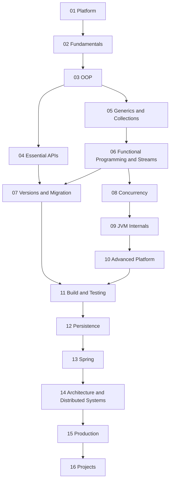

# Java 00 - Index

> Goal: master Java comprehensively, from basic syntax to the latest version, with Java 8, 11, 17, 21, and 25 treated as first-class versions (these are the versions found in real codebases).

Frontend counterpart: [[Angular 00 - Indice|Angular 00 - Index]].

## Purpose

- An ordered, comprehensive map of topics, with `- [ ]` checkboxes to track progress over months.
- This is a roadmap (what to learn, in what order, how to know you have mastered it), not a tutorial: one line per topic.
- The author's own notes are linked from each phase.
- Naming convention: `Java 08 - Concurrency` is phase 8 of the roadmap; `Java LTS 8` is the Java 8 release. Do not confuse them.
- The `(unverified)` marker: version-specific information not in the verified fact sheet; confirm at https://openjdk.org/jeps/ before citing it.

## Verified status as of 2026-11-11

| Item | Value | Source |
|---|---|---|
| Latest GA JDK | Java 27, GA 2026-09-15, not LTS, 9 JEPs | https://aliteq.com/jdk-27-whats-new-for-developers |
| Previous GA | Java 26, GA 2026-03-17, not LTS, 10 JEPs | https://www.infoq.com/news/2026/03/java26-released |
| Current LTS | Java 25 (GA 2025-09-16). Oracle Premier through Sep 2030, Extended through Sep 2033 | https://aliteq.com/jdk-27-whats-new-for-developers |
| Next LTS | Java 29, expected Sep 2027 (2-year LTS cadence: 17, 21, 25, 29) | https://aliteq.com/jdk-27-whats-new-for-developers |
| JDK in development | JDK 28: Rampdown One 2026-12-03, Rampdown Two 2027-01-14, RC 2027-02-04, expected GA 2027-03-09 (JEP list still subject to change) | https://www.happycoders.eu/java/java-28-features/ |
| Spring Boot | 4.1.2 stable; 4.2.0-RC2 (GA ~2026-11-30, unconfirmed) | https://repo1.maven.org/maven2/org/springframework/boot/spring-boot/maven-metadata.xml |
| Spring Framework | 7.0.10 stable; 7.1.0-RC2 | Maven Central `spring-core` |
| Hibernate ORM | 7.4.15.Final; 8.0.0.Beta4 (not GA) | https://in.relation.to/2026/05/26/orm-74/ |
| JUnit | 6.1.3 (6.0.0 GA 2025-09-30, Java 17 baseline) | https://docs.junit.org/6.1.0/release-notes/ |
| Maven | 3.9.16 stable; 4.0.0-rc-7 (not GA) | Maven Central `apache-maven` |
| Gradle | 9.9.1 | https://services.gradle.org/versions/current |
| Jakarta EE | 11 (June 2025, secondary source); Jakarta EE 12 NOT released (minimum JDK 21 expected) | https://jakartaee.github.io/platform/jakartaee12/JakartaEE12ReleasePlan |

Known contradictions: sources disagree on the practical end date of free Oracle JDK 21 updates (Oracle: Sep 2026; Azul: July 2026). Confirm at https://www.oracle.com/java/technologies/java-se-support-roadmap.html.

## Which version to study and why

| Version | Why | Note |
|---|---|---|
| 8 | Still common in legacy enterprise code; foundation for lambdas, streams, and `java.time` | [[Java LTS 8]] |
| 11 | Transitional LTS after 9 and 10: modules, `var`, HTTP Client, removal of Java EE/CORBA | [[Java LTS 11]] |
| 17 | Baseline for Spring Boot 3/4 and JUnit 6; records, sealed types, text blocks, strong encapsulation | [[Java LTS 17]] |
| 21 | Virtual threads, pattern matching for `switch`, Sequenced Collections | [[Java LTS 21]] |
| 25 | Current LTS: Scoped Values, Compact Source Files, Flexible Constructor Bodies, AOT | [[Java LTS 25]] |
| Latest (27) and future | Platform direction: Valhalla, Lazy Constants, G1 by default, Structured Concurrency | [[Java 26-27 y futuro|Java 26-27 and Future]] |

Timeline and migration hub: [[Java 07 - Versiones y migracion|Java 07 - Versions and Migration]].

## Dependencies between phases

## Phases

| No. | Expected outcome | Approx. time | Note |
|---|---|---|---|
| 01 | Install, switch between, and use JDKs and command-line tools | 1-2 weeks | [[Java 01 - Plataforma, JDK y herramientas|Java 01 - Platform, JDK and Tools]] |
| 02 | Write correct procedural programs in Java | 4-6 weeks | [[Java 02 - Fundamentos del lenguaje|Java 02 - Language Fundamentals]] |
| 03 | Model domains with modern OOP (records, sealed types, patterns) | 6-8 weeks | [[Java 03 - Programacion orientada a objetos|Java 03 - Object-Oriented Programming]] |
| 04 | Master everyday APIs (strings, time, I/O, exceptions) | 6-8 weeks | [[Java 04 - APIs esenciales|Java 04 - Essential APIs]] |
| 05 | Choose and reason about generics and collections | 4-6 weeks | [[Java 05 - Genericos y colecciones|Java 05 - Generics and Collections]] |
| 06 | Program in a functional style with Streams | 3-4 weeks | [[Java 06 - Programacion funcional y Streams|Java 06 - Functional Programming and Streams]] |
| 07 | Place each feature in its version and plan migrations | 2-3 weeks | [[Java 07 - Versiones y migracion|Java 07 - Versions and Migration]] |
| 08 | Write correct concurrent code, including virtual threads | 8-10 weeks | [[Java 08 - Concurrencia|Java 08 - Concurrency]] |
| 09 | Understand and diagnose the JVM (GC, JIT, memory) | 6-8 weeks | [[Java 09 - JVM por dentro|Java 09 - JVM Internals]] |
| 10 | Use modules, reflection, FFM, and bytecode manipulation | 6-8 weeks | [[Java 10 - Plataforma avanzada|Java 10 - Advanced Platform]] |
| 11 | Build, test, and maintain quality with Maven/Gradle | 4-6 weeks | [[Java 11 - Build, testing y calidad|Java 11 - Build, Testing and Quality]] |
| 12 | Persist data with SQL, JDBC, JPA, and migrations | 8-10 weeks | [[Java 12 - Persistencia y bases de datos|Java 12 - Persistence and Databases]] |
| 13 | Build backends with Spring Boot and Jakarta EE | 8-12 weeks | [[Java 13 - Spring y ecosistema backend|Java 13 - Spring and Backend Ecosystem]] |
| 14 | Design architectures and distributed systems | 8-12 weeks | [[Java 14 - Arquitectura, APIs y sistemas distribuidos|Java 14 - Architecture, APIs and Distributed Systems]] |
| 15 | Operate, secure, and observe Java in production | 6-8 weeks | [[Java 15 - Produccion|Java 15 - Production]] |
| 16 | Consolidate learning with projects, certification, and reading | ongoing | [[Java 16 - Proyectos y dominio|Java 16 - Projects and Mastery]] |

Estimated total: 12 to 18 months at a part-time pace. Phase 07 and the version-specific notes can be consulted in parallel starting in phase 02.

## How to use the roadmap

1. Follow phases 01 through 06 in order; then alternate according to actual work (8 through 10 are deeper study, 11 through 15 cover the ecosystem).
2. Check each `- [ ]` only after answering the mastery questions without notes and completing the phase's exercises.
3. Keep the practice JDK at 25 (LTS) and have JDKs 8 and 17 available with [[Jabba]] or [[Scoop]] to reproduce legacy code.
4. Each topic carries a version label (`Java 16+`) to show whether it exists in 8, 11, 17, 21, or 25.
5. Consult the corresponding `Java LTS N` note when working on a project using that version.

## Phase complete when

- [x] All topic checkboxes are checked.
- [x] The mastery questions can be answered without notes.
- [x] Each exercise has runnable code in a repository of your own.
- [x] You can explain a common mistake from the phase with your own example.

## Keep the roadmap up to date (every six months)

With each new JDK (March and September):

| File | What to update |
|---|---|
| This index | "Verified status" table (GA JDK, LTS, JDK in development, frameworks) and date |
| [[Java 26-27 y futuro|Java 26-27 and Future]] | New version, JEPs, status of OpenJDK projects |
| [[Java 07 - Versiones y migracion|Java 07 - Versions and Migration]] | Timeline and "feature to final release" matrix; support dates |
| Corresponding `Java LTS N` | Only if the release is LTS (next: Java 29, Sep 2027) |
| [[Java 09 - JVM por dentro|Java 09 - JVM Internals]] | GC changes, defaults, flags |
| [[Java 13 - Spring y ecosistema backend|Java 13 - Spring and Backend Ecosystem]] | Spring versions, Java baseline |
| [[Java 11 - Build, testing y calidad|Java 11 - Build, Testing and Quality]] | Maven, Gradle, JUnit |

Remove the `(unverified)` marker only after confirming at https://openjdk.org/projects/jdk/NN/.

## Author's own notes

[[Java 8 - Notas|Java 8]] · [[Java 25 - Notas|Java 25 - Notes]] · [[Java 8 vs Java 25]] · [[Resumen Bugs|Bug Summary]]

## Supporting guides

- Design (language-independent): [[POO|OOP]] · [[Guia SOLID - Principios con ejemplos Java y Spring|SOLID Guide - Principles with Java and Spring Examples]] · [[Guia GRASP - Principios de asignacion de responsabilidades|GRASP Guide - Responsibility Assignment Principles]] · [[Guia Arquitecturas de Software - Comparativa y Usos|Software Architecture Guide - Comparison and Uses]] · [[Guia Arquitectura de APIs - DTOs, capas y responsabilidades|API Architecture Guide - DTOs, Layers and Responsibilities]] · [[Guia CRUD - Conceptos, capas y buenas practicas|CRUD Guide - Concepts, Layers and Best Practices]]
- Java and Spring: [[Guia Spring Boot - Anotaciones y Ventajas|Spring Boot Guide - Annotations and Advantages]] · [[Guia Lombok - Anotaciones y Buenas Practicas|Lombok Guide - Annotations and Best Practices]]

---

# Java 01 - Platform, JDK and Tools

> Outcome: install several JDKs, switch between them, compile, run, package, and debug using JDK tools without relying on an IDE.

**Prerequisites:** none · **Next:** [[Java 02 - Fundamentos del lenguaje|Java 02 - Language Fundamentals]]

## Topics

### History and editions
- [x] History of Java (Sun, Oracle, OpenJDK) — milestones from JDK 1.0 to today; see [[Java 07 - Versiones y migracion|Java 07 - Versions and Migration]]
- [x] Editions: Java SE, Java EE renamed Jakarta EE, Java ME — what each covers
- [x] JDK vs JRE vs JVM — what each contains and why the JRE is no longer distributed separately
- [x] WORA (write once, run anywhere) — how bytecode and the JVM achieve it; their real limitations
- [ ] Compilation to bytecode and execution — source, `.class`, loading, interpretation, and JIT cycle
- [ ] Release cadence — one release every six months (March and September), JEP 322 (Java 10)
- [ ] LTS policy — LTS every two years: 8, 11, 17, 21, 25, next 29 (Sep 2027)
- [ ] JEP / JCP / OpenJDK process — who proposes, who approves, what a JSR is
- [ ] Preview and incubator — what they are, how to enable them (`--enable-preview --release N`, `jdk.incubator.*` modules)
- [ ] Feature lifecycle — incubator, preview 1..N, final, deprecation, removal

### Distributions and licenses
- [ ] Oracle JDK vs OpenJDK — licensing (NFTC) and support differences
- [ ] Eclipse Temurin — reference community distribution
- [ ] Amazon Corretto — free long-term support
- [ ] Azul Zulu — builds and commercial support
- [ ] BellSoft Liberica — includes variants with JavaFX
- [ ] Microsoft Build of OpenJDK
- [ ] GraalVM — Graal JIT and native image; the 25.x line tracks JDK 25
- [ ] Criteria for choosing a distribution — support, end-of-updates date, license, TCK certification
- [ ] End of free updates by version — free Oracle JDK 17 updates ended in Oct 2024; Temurin 17 supported at least through Oct 2027; Temurin 21 at least through Dec 2029

### Installation and version management
- [ ] Install a JDK manually — `JAVA_HOME` and `PATH`
- [ ] SDKMAN — install, list, and switch JDKs (Linux/macOS/WSL)
- [ ] [[Jabba]] — JDK manager on Windows
- [ ] [[Scoop]] — install JDKs on Windows using buckets
- [ ] Check active version — `java -version`, `javac -version`, `java --version`
- [ ] Keep JDKs 8, 11, 17, 21, and 25 side by side — to reproduce legacy code
- [ ] Version number format — `Runtime.version()`, `feature.interim.update.patch` scheme

### Command-line tools
- [ ] `javac` — options `-d`, `-cp`, `--release`, `-Xlint`, `-parameters`
- [ ] `java` — launch a class, JAR (`-jar`), module (`-m`)
- [ ] Single-file source-code launch — `java Hello.java` (Java 11+, JEP 330)
- [ ] Multiple source-file launch — Java 22+ (JEP 458)
- [ ] `jshell` — REPL (Java 9+, JEP 222)
- [ ] `jar` — create, list, and extract JARs; manifest
- [ ] `javadoc` — generate documentation, snippets (Java 18+, JEP 413), Markdown comments (Java 23+, JEP 467)
- [ ] `javap` — disassemble bytecode (`-c -v -p`)
- [ ] `jdeps` — analyze dependencies between modules and packages
- [ ] `jdeprscan` — detect use of deprecated APIs
- [ ] `jlink` — custom runtime (Java 9+, JEP 282)
- [ ] `jpackage` — native installers (incubator in 14, final in 16, JEP 392)
- [ ] `jcmd` — universal JVM diagnostic command
- [ ] `jps`, `jstack`, `jmap`, `jstat`, `jinfo` — basic diagnostics
- [ ] `jfr` and `jconsole`/`jvisualvm` (the latter is no longer included in the JDK)
- [ ] `jarsigner`, `keytool` — signing and key stores
- [ ] `jmod`, `jimage` — internal module formats
- [ ] `jwebserver` — Simple Web Server (Java 18+, JEP 408)
- [ ] `jhsdb` and `serialver` — specialized uses
- [ ] Removed tools — `javah` (removed in 10), `jjs`/Nashorn (removed in 15, JEP 372), Pack200 (removed in 14, JEP 367)

### Code, packages, and modules
- [ ] Classpath — resolution and ordering, wildcard `lib/*`
- [ ] Module path — difference from classpath; see [[Java 10 - Plataforma avanzada|Java 10 - Advanced Platform]]
- [ ] Packages and directory structure — reverse-domain convention
- [ ] JAR, manifest — `Main-Class`, `Class-Path`, `Multi-Release`
- [ ] Executable JAR and "fat JAR" — when to use them
- [ ] `-X`, `-XX` options and `@argfiles`; `JAVA_TOOL_OPTIONS` variable

### IDEs and debugging
- [ ] IntelliJ IDEA — projects, per-module SDK, inspections, shortcuts
- [ ] Eclipse — workspace, compiler profiles
- [ ] VS Code with Extension Pack for Java
- [ ] Debugger — conditional breakpoints, watch, evaluate, step into/over/out
- [ ] Remote debugging — `-agentlib:jdwp`
- [ ] Hot swap and limitations — what changes the JVM accepts without a restart
- [ ] Style conventions — Google Java Style, Oracle Code Conventions, naming

## Mastery questions
1. What is the difference between JDK, JRE, and JVM, and what is installed in production today?
2. When is the next LTS version due, and what is the cycle?
3. What does preview mean, and how do you compile and run code with a preview feature?
4. How do Oracle JDK, Temurin, and Corretto differ in licensing and support?
5. What does `--release 17` do that `-source 17 -target 17` does not?
6. How do you run a `.java` file without explicitly compiling it, and since which version?
7. What is the difference between classpath and module path?
8. What does an executable JAR contain, and how does it declare its main class?
9. What are `jlink` and `jpackage` for, and how do they differ?
10. How do you inspect a class's bytecode?
11. How do you switch JDKs in a session without changing system variables?
12. What is a JEP, and who approves it?

## Exercises
1. Install JDKs 8, 17, and 25 with [[Scoop]] or [[Jabba]] and switch between them.
2. Compile a "Hello world" with `javac`, package it with `jar`, and run it with `-jar`.
3. Run a single source file and a multi-file program on JDK 25.
4. Disassemble a `for` loop and a `switch` with `javap -c`.
5. Use `jshell` to try `List.of`, `var`, and text blocks.
6. Create a minimal runtime with `jlink` and measure its size.
7. Generate an installer with `jpackage`.
8. Debug a program with a conditional breakpoint in IntelliJ IDEA.

## Common mistakes
- Confusing the version of `java` with that of `javac` because of an incorrectly ordered `PATH`.
- Compiling with a newer JDK without `--release` and running on an older JRE (`UnsupportedClassVersionError`).
- Using a JRE/JDK without `JAVA_HOME` in build tools.
- Assuming `-source/-target` validates the available API (it does not; `--release` does).
- Enabling preview in production.
- Mixing classpath and module path without understanding automatic modules.
- Choosing a distribution without checking when free support ends.
- Ignoring `java -Xlog` and `jcmd` during diagnosis.

## Related notes
[[Jabba]] · [[Scoop]] · [[Java 8 - Notas|Java 8]] · [[Java 25 - Ejecutar Java25Showcase|Java 25 - Run Java25Showcase]]

## Sources
- https://openjdk.org/jeps/
- https://openjdk.org/projects/jdk/
- https://docs.oracle.com/en/java/javase/25/docs/specs/man/index.html
- https://www.oracle.com/java/technologies/java-se-support-roadmap.html
- https://sdkman.io/

---

# Java 02 - Language Fundamentals

> Outcome: write correct procedural programs in Java, reasoning about types, memory, control flow, and complexity.

**Prerequisites:** [[Java 01 - Plataforma, JDK y herramientas|Java 01 - Platform, JDK and Tools]] · **Next:** [[Java 03 - Programacion orientada a objetos|Java 03 - Object-Oriented Programming]]

## Topics

### Program structure
- [ ] Class, classic `main` method — `public static void main(String[] args)`
- [ ] Compact source files and instance main — Preview 21 (JEP 445), 22, 23, 24; final in Java 25 (JEP 512)
- [ ] Order of elements in a file — package, imports, type
- [ ] One public class per file — filename rule
- [ ] Exit code — `System.exit`, process return value

### Primitive types and conversions
- [ ] The eight primitives — `byte`, `short`, `int`, `long`, `float`, `double`, `char`, `boolean`
- [ ] Ranges and sizes — `MIN_VALUE`/`MAX_VALUE` constants
- [ ] Literals — decimal, hexadecimal, octal, binary (`0b`), underscores, `L`, `f`, `d` suffixes
- [ ] Explicit casting and numeric promotion — rules for `byte + byte` becoming `int`
- [ ] Lossy conversions — `long` to `int`, `double` to `int`
- [ ] Wrapper types — `Integer`, `Long`, `Double`, `Boolean`, `Character`
- [ ] Autoboxing and unboxing — `NullPointerException` when unboxing `null`
- [ ] Integer cache — `Integer.valueOf` caches -128 through 127; `==` vs `equals`
- [ ] Unsigned arithmetic — `Integer.toUnsignedString`, `divideUnsigned` (Java 8+)
- [ ] `char` and Unicode — code points, surrogate pairs

### Variables and scope
- [ ] Declaration, initialization, and default values of fields
- [ ] Scope — block, method, class
- [ ] `var` inference — local variables in Java 10+ (JEP 286); lambda parameters in Java 11+ (JEP 323)
- [ ] `var` restrictions — no initializer, `null`, fields, method parameters
- [ ] `final` — variables, parameters, constants
- [ ] `static final` constants and naming conventions

### Operators
- [ ] Arithmetic, relational, logical, bitwise, and shift operators (`>>`, `>>>`)
- [ ] Precedence and associativity
- [ ] Short-circuit `&&` / `||` vs `&` / `|`
- [ ] Ternary operator and compound assignment (implicit conversion)
- [ ] Increment and decrement — pre and post
- [ ] Integer overflow — `Math.addExact`, `multiplyExact`, `toIntExact`
- [ ] Floating-point pitfalls — `0.1 + 0.2`, `NaN`, `Infinity`, comparison with epsilon
- [ ] Strict floating-point semantics — always strict since Java 17 (JEP 306)
- [ ] Integer division and remainder with negative numbers — `%` vs `Math.floorMod`

### Strings (basics)
- [ ] `String` as an immutable object — literals vs `new String`
- [ ] Concatenation — `+`, `concat`, `StringBuilder`
- [ ] Comparison — `equals`, `equalsIgnoreCase`, `compareTo`
- [ ] Basic methods — `length`, `charAt`, `substring`, `indexOf`, `split`, `trim`
- [ ] Text blocks — final in Java 15 (JEP 378); see [[Java 04 - APIs esenciales|Java 04 - Essential APIs]]

### Control flow
- [ ] `if` / `else if` / `else`
- [ ] Classic `switch` statement — fall-through and `break`
- [ ] `switch` expression with `->` and `yield` — final in Java 14 (JEP 361)
- [ ] `switch` on `String` and `enum`; exhaustiveness in expressions
- [ ] `for`, enhanced `for`, `while`, `do-while`
- [ ] Labeled `break` and `continue`
- [ ] Infinite loops and exit conditions
- [ ] Pattern matching in `switch` — preview; see [[Java 03 - Programacion orientada a objetos|Java 03 - Object-Oriented Programming]]

### Arrays
- [ ] Declaration, creation, and initialization, `length`
- [ ] Multidimensional and jagged arrays
- [ ] Array covariance and `ArrayStoreException`
- [ ] `java.util.Arrays` — `sort`, `binarySearch`, `fill`, `copyOf`, `copyOfRange`, `equals`, `deepEquals`, `toString`, `deepToString`, `asList`, `stream`
- [ ] `Arrays.mismatch` and `Arrays.compare` — Java 9+
- [ ] `Arrays.parallelSort` and `parallelPrefix` — Java 8+
- [ ] Arrays and varargs

### Methods
- [ ] Declaration, parameters, return value, signature
- [ ] Overloading — compile-time resolution, ambiguities with boxing
- [ ] Varargs — rules and pitfalls with `null`
- [ ] Pass by value — references are copied; effect on mutable objects
- [ ] Recursion — base case, depth, `StackOverflowError`
- [ ] `static` methods — when to use them

### Memory (mental model)
- [ ] Stack vs heap — local variables, frames, objects
- [ ] References, `null`, and aliasing
- [ ] Garbage collection — general idea; details in [[Java 09 - JVM por dentro|Java 09 - JVM Internals]]
- [ ] Identity vs equality (`==` vs `equals`)

### Packages and imports
- [ ] `package`, `import`, static imports, name conflicts
- [ ] Module import declarations — final in Java 25 (JEP 511)
- [ ] Implicit `java.lang`

### Comments and documentation
- [ ] Line and block comments
- [ ] Javadoc — `@param`, `@return`, `@throws`, `{@code}`, `{@link}`
- [ ] Markdown documentation comments — final in Java 23 (JEP 467)
- [ ] Naming conventions — `CamelCase`, `camelCase`, `UPPER_SNAKE`, lowercase packages

### Console input and output
- [ ] `System.out`, `System.err`, `printf`, and `String.format`
- [ ] `Scanner` on `System.in`
- [ ] `System.console()` and console `IO` — `java.lang.IO` in Java 25 (JEP 512)
- [ ] Command-line arguments

### Algorithms and basic complexity
- [ ] Big-O notation — constant, logarithmic, linear, `n log n`, quadratic
- [ ] Linear and binary search
- [ ] Sorting — bubble, insertion, selection, merge, quick
- [ ] Recursion vs iteration
- [ ] String and array manipulation — palindromes, anagrams, two-pointers
- [ ] Numbers — primes, GCD, Fibonacci, factorial with overflow

## Mastery questions
1. Why is `Integer a = 127, b = 127; a == b` `true`, while with 128 it may be `false`?
2. What does `0.1 + 0.2 == 0.3` print, and why?
3. What is the difference between `a++` and `++a` inside an expression?
4. What happens with `byte b = 10; b += 5;`, and why does it compile?
5. Why is Java "pass by value" for objects too?
6. What is the difference between a `switch` statement and a `switch` expression?
7. What is `int` overflow, and how can you detect it?
8. Where do local variables, objects, and statics live in memory?
9. What restrictions does `var` have?
10. What does `>>>` do compared with `>>`?
11. What is the complexity of `Arrays.sort` for primitives and for objects?
12. When is a `main` without `public static void` valid?

## Exercises
1. Implement a console calculator with input validation.
2. Write FizzBuzz, factorial, and Fibonacci iteratively and recursively; measure overflow.
3. Implement binary search and three sorting algorithms of your own; compare them with `Arrays.sort`.
4. Trigger and explain `StackOverflowError`, `ArrayIndexOutOfBoundsException`, and `NumberFormatException`.
5. Reproduce the `Integer` cache and floating-point pitfalls in `jshell`.
6. Rewrite a classic `switch` as a `switch` expression.
7. Document a method with Javadoc and generate the HTML with `javadoc`.
8. Solve 20 basic algorithm exercises in a compact source file (JDK 25).

## Common mistakes
- Comparing `String` and wrappers with `==`.
- Forgetting `break` in a classic `switch` (fall-through).
- Using `float`/`double` for money.
- Ignoring silent integer overflow.
- Modifying an array while iterating with the wrong index.
- Confusing `=` with `==` in boolean conditions.
- Using `var` where the type is no longer obvious.
- Dividing integers while expecting a decimal result.
- Uninitialized variables in conditional branches.

## Related notes
[[Resumen Bugs|Bug Summary]] · [[Java 8 - Notas|Java 8]] · [[Java 25 - Ejecutar Java25Showcase|Java 25 - Run Java25Showcase]]

## Sources
- https://docs.oracle.com/javase/specs/jls/se25/html/index.html
- https://docs.oracle.com/javase/tutorial/java/
- https://openjdk.org/jeps/286
- https://openjdk.org/jeps/361
- https://openjdk.org/jeps/512

---

# Java 03 - Object-Oriented Programming

> Outcome: model domains with classes, interfaces, enums, records, and sealed types, applying design principles and patterns with modern Java idioms.

**Prerequisites:** [[Java 02 - Fundamentos del lenguaje|Java 02 - Language Fundamentals]] · **Next:** [[Java 04 - APIs esenciales|Java 04 - Essential APIs]]

## Topics

### Classes and objects
- [ ] Class, object, instance, state, and behavior
- [ ] Fields, methods, and `static` members
- [ ] Constructors — default, overloading, chaining with `this(...)`
- [ ] Flexible constructor bodies — statements before `super(...)`: P1 in 22 (JEP 447), P2 23, P3 24, final in Java 25 (JEP 513)
- [ ] Initialization order — static fields, static blocks, instance fields, instance blocks, constructor
- [ ] `this` and `super`
- [ ] Encapsulation and access modifiers — `private`, package-private, `protected`, `public`
- [ ] `static` — members, blocks, static nested classes
- [ ] Static factory methods and the builder pattern

### Inheritance and polymorphism
- [ ] Single inheritance of classes — `extends`
- [ ] Overriding rules (`@Override`) — visibility, covariant return type, exceptions
- [ ] Polymorphism and dynamic dispatch — runtime resolution
- [ ] Field and static method hiding
- [ ] Abstract classes — when to use them
- [ ] Interfaces — contract, multiple inheritance of type
- [ ] `default` and `static` methods in interfaces — Java 8
- [ ] `private` methods in interfaces — Java 9
- [ ] Diamond problem with `default` — `Interface.super.method()`
- [ ] Composition vs inheritance — prefer composition
- [ ] `final` on classes and methods
- [ ] Coupling and cohesion

### `Object` methods
- [ ] `equals` contract — reflexive, symmetric, transitive, consistent, `null`
- [ ] `hashCode` contract — consistent with `equals`
- [ ] Useful `toString`
- [ ] `clone` and why it is usually avoided — copy constructor, factory
- [ ] `finalize` — deprecated for removal in Java 18 (JEP 421); use `Cleaner` or try-with-resources
- [ ] `getClass`, `wait`, `notify` — see [[Java 08 - Concurrencia|Java 08 - Concurrency]]
- [ ] `compareTo` and consistency with `equals`

### Nested classes
- [ ] Inner class — implicit reference to the outer class, memory leaks
- [ ] Static nested class
- [ ] Local class
- [ ] Anonymous class — vs lambda
- [ ] Inner classes and interfaces — access control with "nest-based access" (Java 11, JEP 181)

### Enums
- [ ] Basic enum — constants, `values`, `valueOf`, `ordinal`, `name`
- [ ] Fields, constructors, and methods in enums
- [ ] Constant-specific bodies
- [ ] Enums that implement interfaces
- [ ] `EnumSet` and `EnumMap`
- [ ] `switch` on enums and exhaustiveness
- [ ] Enum as a singleton and state machine

### Records
- [ ] Record — Preview 14 (JEP 359), 15; final in Java 16 (JEP 395)
- [ ] Compact and canonical constructors
- [ ] Additional methods, static fields, interfaces
- [ ] Limitations — no inheritance, final fields
- [ ] Generic and nested records
- [ ] Records as DTOs and map keys
- [ ] Record serialization

### Sealed classes and interfaces
- [ ] `sealed`, `permits`, `non-sealed`, `final` — P1 in 15 (JEP 360), P2 16, final in Java 17 (JEP 409)
- [ ] Closed hierarchies and algebraic data types with records
- [ ] Exhaustiveness in `switch` over sealed hierarchies

### Pattern matching
- [ ] `instanceof` with pattern — P1 14 (JEP 305), P2 15; final in Java 16 (JEP 394)
- [ ] `switch` with patterns — P1 17 (JEP 406); final in Java 21 (JEP 441)
- [ ] `when` guards and pattern dominance
- [ ] Record patterns — final in Java 21 (JEP 440)
- [ ] Nested patterns and `null` in `switch`
- [ ] Unnamed variables and patterns (`_`) — Preview 21 (JEP 443); final in Java 22 (JEP 456)
- [ ] Primitive types in patterns — Preview 23 (JEP 455), P2 24, P3 25, P4 26, P5 27; according to a single source, withdrawn and to be removed in 28 (unverified). Not final in any version
- [ ] String Templates — Preview 21/22 and withdrawn before 23 (do not use)

### Immutability
- [ ] Immutable objects — `final` fields, no setters, defensive copies
- [ ] Records and shallow immutability
- [ ] Immutable collections — see [[Java 05 - Genericos y colecciones|Java 05 - Generics and Collections]]
- [ ] Value-based classes — warnings in Java 16 (JEP 390)
- [ ] Project Valhalla — JEP 401 Value Classes in Preview, targeting JDK 28 (in development); see [[Java 26-27 y futuro|Java 26-27 and Future]]

### Annotations (basics)
- [ ] Standard annotations — `@Override`, `@Deprecated`, `@SuppressWarnings`, `@FunctionalInterface`, `@SafeVarargs`
- [ ] Define custom annotations — retention and target
- [ ] Type-use and repeatable annotations — Java 8
- [ ] Processing details — see [[Java 10 - Plataforma avanzada|Java 10 - Advanced Platform]]

### Design principles
- [ ] SOLID — see [[Guia SOLID - Principios con ejemplos Java y Spring|SOLID Guide - Principles with Java and Spring Examples]]
- [ ] GRASP — see [[Guia GRASP - Principios de asignacion de responsabilidades|GRASP Guide - Responsibility Assignment Principles]]
- [ ] DRY, KISS, YAGNI, law of Demeter
- [ ] Program to interfaces, "tell, don't ask"
- [ ] More OOP concepts — [[POO|OOP]]

### GoF design patterns
Each pattern with its Java idiom.

| Category | Patterns and Java idiom |
|---|---|
| Creational | Singleton (enum), Factory Method (static method), Abstract Factory, Builder (nested class or record), Prototype (copy constructor) |
| Structural | Adapter (class or lambda), Bridge, Composite (sealed + record), Decorator (`InputStream` wrappers), Facade, Flyweight (`Integer.valueOf`), Proxy (`java.lang.reflect.Proxy`) |
| Behavioral | Chain of Responsibility, Command (`Runnable`), Interpreter, Iterator (`Iterable`), Mediator, Memento, Observer (`Flow`), State (enum), Strategy (lambda), Template Method, Visitor (pattern `switch` over sealed types) |

- [ ] Creational — implement all five
- [ ] Structural — implement all seven
- [ ] Behavioral — implement all eleven
- [ ] Replace Visitor with pattern `switch` over a sealed hierarchy — Java 21+
- [ ] Antipatterns — God object, Anemic domain model, mutable global Singleton

## Mastery questions
1. What is the exact initialization order when instantiating a subclass?
2. What contract must `equals` and `hashCode` satisfy?
3. When should you prefer an interface or an abstract class?
4. What is the difference between overloading and overriding?
5. What is a record and what is it NOT (what restrictions does it have)?
6. What is `sealed` for, and how does it enable exhaustive `switch`?
7. What is the difference between an inner, static nested, and anonymous class?
8. Why is `clone` problematic?
9. What does `non-sealed` do?
10. What is a value-based class, and what does it imply for `synchronized`?
11. When is composition better than inheritance?
12. How do you express an algebraic data type in Java 21?
13. What changes between classic `instanceof` and `instanceof` with a pattern?

## Exercises
1. Model a system of shapes with a sealed interface and records, and calculate areas with pattern `switch`.
2. Implement `equals`/`hashCode` by hand and verify the contract with tests.
3. Rewrite a deep inheritance hierarchy using composition.
4. Implement 6 different GoF patterns with lambdas where appropriate.
5. Create a state machine with an enum and constant-specific bodies.
6. Convert a mutable DTO with Lombok ([[Guia Lombok - Anotaciones y Buenas Practicas|Lombok Guide - Annotations and Best Practices]]) to a record.
7. Write an immutable class with defensive copies and test that it cannot be broken.
8. Apply SOLID to an existing design and document the violation you fixed.

## Common mistakes
- Overriding `equals` without `hashCode`.
- Using inheritance to reuse code instead of composition.
- Exposing internal mutable collections.
- Calling overridable methods from the constructor.
- Using `clone()` or `finalize()` in new code.
- Overusing getters/setters (anemic model).
- Singleton with mutable global state.
- Believing a record is deeply immutable.
- Using a chain of `instanceof` instead of polymorphism or pattern `switch`.

## Related notes
[[POO|OOP]] · [[Guia SOLID - Principios con ejemplos Java y Spring|SOLID Guide - Principles with Java and Spring Examples]] · [[Guia GRASP - Principios de asignacion de responsabilidades|GRASP Guide - Responsibility Assignment Principles]] · [[Guia Lombok - Anotaciones y Buenas Practicas|Lombok Guide - Annotations and Best Practices]] · [[Guia Arquitecturas de Software - Comparativa y Usos|Software Architecture Guide - Comparison and Uses]]

## Sources
- https://docs.oracle.com/javase/specs/jls/se25/html/index.html
- https://openjdk.org/jeps/395
- https://openjdk.org/jeps/409
- https://openjdk.org/jeps/441
- https://openjdk.org/jeps/440
- https://openjdk.org/jeps/456
- https://openjdk.org/jeps/513
- Effective Java, Joshua Bloch

---

# Java 04 - Essential APIs

> Outcome: use everyday standard APIs (strings, time, numbers, exceptions, I/O, networking, logging, cryptography) wisely and know their pitfalls.

**Prerequisites:** [[Java 03 - Programacion orientada a objetos|Java 03 - Object-Oriented Programming]] · **Next:** [[Java 05 - Genericos y colecciones|Java 05 - Generics and Collections]]

## Topics

### Strings in depth
- [ ] `String` internals — literal pool, immutability, `intern`
- [ ] Compact Strings — Java 9 (JEP 254): Latin-1 or UTF-16 representation
- [ ] `StringBuilder` vs `StringBuffer` — when to use each; initial capacity
- [ ] Concatenation with `invokedynamic` — Java 9+
- [ ] Text blocks — final in Java 15 (JEP 378): indentation, escapes, `\s`, `\<newline>`
- [ ] `String` methods added in 11 — `isBlank`, `lines`, `strip`, `stripLeading`, `stripTrailing`, `repeat`
- [ ] Methods added in 12 through 15 — `indent`, `transform`, `stripIndent`, `translateEscapes`, `formatted`
- [ ] Methods added in 21 — `indexOf` with a range, `splitWithDelimiters`, `StringBuilder.repeat`
- [ ] `String.format`, `printf`, `Formatter` — format specifiers and `Locale`
- [ ] Unicode, code points, and normalization — `Normalizer`
- [ ] UTF-8 by default — Java 18 (JEP 400): effect on `Charset.defaultCharset()`
- [ ] `HexFormat` — Java 17
- [ ] Base64 — `java.util.Base64`, URL and MIME variants (Java 8)

### Regular expressions
- [ ] `Pattern`, `Matcher`, `find`, `matches`, `group`, named groups
- [ ] Flags; greedy, lazy, and possessive quantifiers
- [ ] Lookahead and lookbehind
- [ ] Performance and ReDoS (catastrophic backtracking)
- [ ] `replaceAll` with lambdas — `Matcher.replaceAll(Function)` (Java 9)

### Numbers
- [ ] `Math`, `StrictMath`, exact functions (`addExact`, etc.)
- [ ] `BigInteger` — operations, primality, performance
- [ ] `BigDecimal` — scale, precision, `MathContext`, `RoundingMode`
- [ ] Handling money — `BigDecimal` with a fixed scale or minor units; not `double`
- [ ] `equals` vs `compareTo` in `BigDecimal`
- [ ] `Math.clamp` — Java 21

### Date and time
- [ ] `java.time` — Java 8 (JEP 150): `LocalDate`, `LocalTime`, `LocalDateTime`
- [ ] `Instant`, `ZonedDateTime`, `OffsetDateTime`, `ZoneId`, `ZoneOffset`
- [ ] `Duration` vs `Period`
- [ ] `DateTimeFormatter` and parsing (ISO-8601)
- [ ] `TemporalAdjusters`, `ChronoUnit`, `Clock` for tests
- [ ] Time zones and daylight saving time — pitfalls
- [ ] Legacy API — `Date`, `Calendar`, `SimpleDateFormat` (not thread-safe); conversion with `toInstant`
- [ ] `java.sql.Timestamp` and JDBC 4.2 mapping of `java.time`

### Optional
- [ ] `Optional` — Java 8: `map`, `flatMap`, `filter`, `orElse`, `orElseGet`, `orElseThrow`
- [ ] `ifPresentOrElse`, `or`, `stream` — Java 9
- [ ] `isEmpty` — Java 11
- [ ] `Optional` as a return type, not in fields or parameters
- [ ] `OptionalInt`, `OptionalLong`, `OptionalDouble`

### Exceptions
- [ ] Hierarchy — `Throwable`, `Error`, `Exception`, `RuntimeException`
- [ ] Checked vs unchecked — design criteria
- [ ] `try`/`catch`/`finally` — order, multi-catch, precise rethrow
- [ ] `try-with-resources` — `AutoCloseable`, closing order; effectively final resources (Java 9)
- [ ] Suppressed exceptions — `getSuppressed`, `addSuppressed`
- [ ] Custom exceptions — when to create them, chained causes
- [ ] Helpful `NullPointerException` messages — final in Java 14 (JEP 358)
- [ ] Best practices — do not swallow exceptions, do not use them for control flow, fail fast
- [ ] `StackOverflowError`, `OutOfMemoryError` — what can and cannot be recovered from
- [ ] `Objects.requireNonNull` and argument validation
- [ ] `assert` — enable with `-ea`
- [ ] `StackWalker` — Java 9

### Classic input/output
- [ ] Byte streams — `InputStream`, `OutputStream`, buffering
- [ ] Readers and Writers — encodings, `InputStreamReader`
- [ ] `File` (legacy), `RandomAccessFile`
- [ ] `PrintStream`, `Scanner`, `Console`
- [ ] `InputStream.transferTo` and `readAllBytes` — Java 9

### NIO and NIO.2
- [ ] `Path`, `Paths`, `Path.of` — Java 11 for `Path.of`
- [ ] `Files` — `readString`, `writeString` (Java 11), `lines`, `walk`, `list`, `copy`, `move`
- [ ] File attributes, symbolic links, permissions
- [ ] Channels and buffers — `ByteBuffer`, `FileChannel`, direct buffers
- [ ] `MappedByteBuffer` and non-volatile mapped buffers (Java 14, JEP 352)
- [ ] `WatchService`
- [ ] `AsynchronousFileChannel` and NIO selector (`Selector`, `SocketChannel`)
- [ ] Unix-domain socket channels — Java 16 (JEP 380)
- [ ] Reimplementation of the legacy socket API — Java 13 (JEP 353) and `DatagramSocket` in 15 (JEP 373)

### Serialization
- [ ] `Serializable`, `serialVersionUID`, `transient`
- [ ] Dangers of deserialization — gadget chains; do not deserialize untrusted data
- [ ] Deserialization filters — Java 9; context-specific filters in Java 17 (JEP 415)
- [ ] Alternatives — JSON (Jackson), Protobuf, Avro; see [[Java 14 - Arquitectura, APIs y sistemas distribuidos|Java 14 - Architecture, APIs and Distributed Systems]]

### Networking and HTTP
- [ ] `java.net` — `URI`, `URL`, `Socket`, `ServerSocket`, `InetAddress`
- [ ] Address resolution SPI — Java 18 (JEP 418)
- [ ] `HttpClient` — incubator in 9, standard in Java 11 (JEP 321): sync, async, HTTP/2, WebSocket
- [ ] HTTP/3 in `HttpClient` — final in Java 26 (JEP 517)
- [ ] Simple Web Server — Java 18 (JEP 408)
- [ ] TLS 1.3 — Java 11 (JEP 332)
- [ ] `HttpURLConnection` (legacy)

### Utilities
- [ ] `Objects` — `equals`, `hash`, `toString`, `requireNonNullElse`, `checkIndex`
- [ ] `Random`, `ThreadLocalRandom`, `SecureRandom`
- [ ] Random generator API — Java 17 (JEP 356): `RandomGenerator`, `RandomGeneratorFactory`
- [ ] `UUID` — versions, `randomUUID`
- [ ] `Locale`, i18n, `ResourceBundle`, `NumberFormat`, `MessageFormat`, `Collator`
- [ ] `Properties` and `java.util.prefs`
- [ ] `Runtime`, `System` — `getProperty`, `getenv`, `nanoTime`, `currentTimeMillis`, `gc`
- [ ] `ProcessBuilder` and `ProcessHandle` — Java 9 for `ProcessHandle`
- [ ] `Timer`/`TimerTask` and `ScheduledExecutorService` — see [[Java 08 - Concurrencia|Java 08 - Concurrency]]
- [ ] Stable Values / Lazy Constants — Preview 25 (JEP 502) renamed in 26; Preview 26 (JEP 526) and 27 (JEP 531)

### Logging
- [ ] `java.util.logging`
- [ ] `System.Logger` — Java 9
- [ ] SLF4J as a facade
- [ ] Logback and Log4j2 — configuration, appenders, levels
- [ ] Structured logging and MDC — see [[Java 15 - Produccion|Java 15 - Production]]
- [ ] Do not log sensitive data; cost of constructing messages

### Cryptography (overview)
- [ ] JCA/JCE — `MessageDigest`, `Cipher`, `Signature`, `KeyStore`, `SecureRandom`
- [ ] Curve25519/448 — Java 11 (JEP 324); ChaCha20-Poly1305 — Java 11 (JEP 329)
- [ ] EdDSA — Java 15 (JEP 339)
- [ ] Key Encapsulation Mechanism API — final in Java 21 (JEP 452)
- [ ] Key Derivation Function API — P1 in 24 (JEP 478), final in Java 25 (JEP 510)
- [ ] Post-quantum cryptography — ML-KEM and ML-DSA final in Java 24 (JEP 496, 497); hybrid key exchange in TLS 1.3 final in Java 27 (JEP 527)
- [ ] PEM encoding — P1 in 25 (JEP 470), P2 26 (JEP 524), P3 27 (JEP 538); targeted for finalization in JDK 28 (JEP 542, in development)
- [ ] Password hashing — bcrypt, Argon2 (not `MessageDigest` directly)

## Mastery questions
1. Why is `String` immutable, and what does `intern` imply?
2. When should you use `StringBuilder`, and when is `+` enough?
3. What is the difference between `LocalDateTime`, `ZonedDateTime`, and `Instant`?
4. Why should you not use `double` for money, and what should you use instead?
5. When should you use checked vs unchecked exceptions?
6. What happens if `close()` throws an exception inside try-with-resources?
7. Why is deserialization dangerous, and how can you mitigate it?
8. What is the difference between `Files.walk` and `Files.list`?
9. What advantages does `HttpClient` offer over `HttpURLConnection`?
10. When should you use `Optional`, and when should you not?
11. How can you avoid ReDoS in regex?
12. How do you get a cryptographically secure random number?
13. What changed with UTF-8 by default in Java 18?

## Exercises
1. Implement a text processor with regex (extract logs using named groups).
2. Calculate invoices with `BigDecimal` and rounding rules; test edge cases.
3. Write date utilities that handle daylight saving time changes; test them with a fixed `Clock`.
4. Copy a directory tree with NIO.2 and monitor it with `WatchService`.
5. Create a domain exception hierarchy with chained causes and tests.
6. Consume a REST API with `HttpClient` synchronously and asynchronously.
7. Configure SLF4J + Logback with MDC and JSON output.
8. Encrypt and decrypt with AES-GCM and sign with Ed25519.

## Common mistakes
- `new BigDecimal(0.1)` instead of `BigDecimal.valueOf` or the `String` constructor.
- Sharing `SimpleDateFormat` across threads.
- An empty `catch (Exception e) {}`.
- Concatenating `String` in loops.
- Using `Optional.get()` without checking.
- Relying on `Charset.defaultCharset()` in versions before 18.
- Deserializing untrusted data with `ObjectInputStream`.
- Using `LocalDateTime` for absolute instants.
- Logging passwords, tokens, or personal data.
- Using `Random` for security tokens.

## Related notes
[[Java 8 - Notas|Java 8]] · [[Resumen Bugs|Bug Summary]] · [[Guia Arquitectura de APIs - DTOs, capas y responsabilidades|API Architecture Guide - DTOs, Layers and Responsibilities]]

## Sources
- https://docs.oracle.com/en/java/javase/25/docs/api/index.html
- https://openjdk.org/jeps/321
- https://openjdk.org/jeps/517
- https://openjdk.org/jeps/415
- https://openjdk.org/jeps/510
- https://docs.oracle.com/javase/tutorial/datetime/

---

# Java 05 - Generics and Collections

> Outcome: design with generics, choose the right collection based on its internal structure and complexity, and implement classic data structures by hand.

**Prerequisites:** [[Java 03 - Programacion orientada a objetos|Java 03 - Object-Oriented Programming]] · **Next:** [[Java 06 - Programacion funcional y Streams|Java 06 - Functional Programming and Streams]]

## Topics

### Generics
- [ ] Generic classes, interfaces, and methods — type parameters
- [ ] Type inference and the diamond `<>` — diamond with anonymous classes in Java 9
- [ ] Bounded types — `<T extends Number & Comparable<T>>`
- [ ] Wildcards — `?`, `? extends`, `? super`
- [ ] PECS (Producer Extends, Consumer Super)
- [ ] Type erasure and its consequences — no `new T()`, no `instanceof List<String>`, ambiguous overloading
- [ ] Bridge methods
- [ ] Heap pollution — `@SafeVarargs`
- [ ] Reifiable types — what they are and why they matter for arrays
- [ ] Recursive bounds — `<T extends Comparable<T>>`, `Enum<E extends Enum<E>>`
- [ ] Generics and arrays — why generic arrays cannot be created
- [ ] Subtyping rules — `List<Object>` is not a supertype of `List<String>`
- [ ] Wildcard capture
- [ ] Future: specialized generics (Valhalla); not included in JDK 28 (see [[Java 26-27 y futuro|Java 26-27 and Future]])

### Framework hierarchy
- [ ] `Iterable` and `Collection`
- [ ] `List`, `Set`, `Queue`, `Deque`, `Map` — contracts
- [ ] `SortedSet`/`NavigableSet`, `SortedMap`/`NavigableMap`
- [ ] Sequenced Collections — `SequencedCollection`, `SequencedSet`, `SequencedMap`: final in Java 21 (JEP 431)
- [ ] `Collection.toArray`, `removeIf` (Java 8), `stream`

### Implementations and internals
| Implementation | Structure | Key operations |
|---|---|---|
| `ArrayList` | Resizable array | get O(1), add amortized O(1), insert/remove in the middle O(n) |
| `LinkedList` | Doubly linked list | access O(n), add/remove at the ends O(1) |
| `ArrayDeque` | Circular array | push/pop/offer/poll O(1) |
| `PriorityQueue` | Binary heap | offer/poll O(log n), peek O(1) |
| `HashMap` | Hash table + trees | get/put O(1) on average, O(log n) with treeification |
| `LinkedHashMap` | Hash table + linked list | insertion or access order (LRU) |
| `TreeMap` | Red-black tree | O(log n), natural order |
| `HashSet` / `TreeSet` | Backed by `HashMap`/`TreeMap` | same as their backing map |
| `EnumMap` | Array indexed by ordinal | O(1) |
| `IdentityHashMap` | Compares using `==` | O(1) |
| `WeakHashMap` | Weak keys | GC cleanup |

- [ ] `ArrayList` — capacity, growth, `ensureCapacity`, `trimToSize`
- [ ] `LinkedList` — when it is actually useful (almost never)
- [ ] `ArrayDeque` — preferred over `Stack` and `LinkedList` as a stack/queue
- [ ] `PriorityQueue` — ordering with `Comparator`; iteration is not sorted
- [ ] `HashMap` — hash function, collisions, load factor 0.75, resizing
- [ ] Treeification — a bucket changes from a list to a tree (threshold 8, minimum table size 64)
- [ ] `LinkedHashMap` — `accessOrder` and `removeEldestEntry` for an LRU cache
- [ ] `TreeMap` and `TreeSet` — `NavigableMap`: `floorKey`, `ceilingKey`, `subMap`
- [ ] `HashSet` and `LinkedHashSet`
- [ ] `EnumMap` and `EnumSet`
- [ ] `IdentityHashMap`, `WeakHashMap`
- [ ] Legacy collections — `Vector`, `Stack`, `Hashtable`, `Enumeration`: why to avoid them
- [ ] `BitSet`

### Sorting and comparison
- [ ] `Comparable` and `compareTo`
- [ ] `Comparator` — `comparing`, `thenComparing`, `reversed`, `nullsFirst`, `naturalOrder` (Java 8)
- [ ] Consistency between `compareTo` and `equals`
- [ ] Sort stability (TimSort for objects, dual-pivot quicksort for primitives)

### Iteration
- [ ] `Iterator` and `ListIterator`
- [ ] `Spliterator` — Java 8; basis for parallel streams
- [ ] Fail-fast vs fail-safe — `ConcurrentModificationException`, `modCount`
- [ ] Removing during iteration — `Iterator.remove`, `removeIf`
- [ ] `forEach`, `forEachRemaining`

### Immutable collections and utilities
- [ ] Unmodifiable views — `Collections.unmodifiableList`
- [ ] Immutable factories — `List.of`, `Set.of`, `Map.of`, `Map.entry`, `Map.ofEntries` (Java 9, JEP 269)
- [ ] `List.copyOf`, `Set.copyOf`, `Map.copyOf` — Java 10
- [ ] Difference between an unmodifiable view and an immutable collection
- [ ] Immutable factories reject `null`
- [ ] `Collections` — `sort`, `shuffle`, `reverse`, `binarySearch`, `frequency`, `nCopies`, `synchronizedList`, `emptyList`
- [ ] `Arrays.asList` — fixed-size view
- [ ] Java 8 `Map` methods — `getOrDefault`, `putIfAbsent`, `computeIfAbsent`, `compute`, `merge`, `replaceAll`
- [ ] `reversed()`, `getFirst`, `getLast`, `addFirst`, `removeLast` in `List` — Java 21 (JEP 431)

### Concurrent collections (pointer)
- [ ] `ConcurrentHashMap`, `CopyOnWriteArrayList`, `ConcurrentLinkedQueue`, `BlockingQueue` — details in [[Java 08 - Concurrencia|Java 08 - Concurrency]]

### Choosing and implementing data structures by hand
- [ ] Decision tree for choosing a collection — access, order, duplicates, concurrency
- [ ] Implement a linked list, stack, queue, and deque
- [ ] Implement a hash table with chaining
- [ ] Implement a binary heap and `PriorityQueue`
- [ ] Implement a binary search tree and traversals (preorder, inorder, postorder, level order)
- [ ] AVL or red-black tree (conceptual)
- [ ] Graph — adjacency list, BFS, DFS, Dijkstra
- [ ] Trie and union-find
- [ ] Algorithms: sorting, binary search, basic dynamic programming, backtracking
- [ ] LRU cache with `LinkedHashMap`

## Mastery questions
1. How does `HashMap.put` work, from hashing through treeification?
2. What happens during resizing, and what does it cost?
3. What is PECS, and when does it apply?
4. What are the consequences of type erasure?
5. Why can you not create `new List<String>[10]`?
6. When should you use `LinkedList` rather than `ArrayList`?
7. What is the difference between `unmodifiableList` and `List.of`?
8. What is fail-fast, and how can you avoid `ConcurrentModificationException`?
9. What contract does `TreeMap` require of its keys?
10. What do Sequenced Collections add, and since which version?
11. What is heap pollution?
12. How do you implement an LRU with `LinkedHashMap`?

## Exercises
1. Implement `MiArrayList<T>` and `MiHashMap<K,V>` with tests.
2. Write a generic `max` method with a recursive bound and another with wildcards (PECS).
3. Benchmark `ArrayList` vs `LinkedList` vs `ArrayDeque` with JMH (see [[Java 09 - JVM por dentro|Java 09 - JVM Internals]]).
4. Create a `HashMap` key with a bad `hashCode` and observe the effect on performance.
5. Implement an LRU cache with `LinkedHashMap`.
6. Solve 15 data structure problems, choosing and justifying the collection.
7. Reproduce `ConcurrentModificationException` and fix it in three ways.
8. Implement Dijkstra with `PriorityQueue`.

## Common mistakes
- Using raw types (`List` without a parameter).
- Mutating a `HashMap` key after insertion.
- A `hashCode` inconsistent with `equals`.
- Calling `add` on `Arrays.asList` (throws an exception).
- Removing elements inside an enhanced `for` loop.
- Assuming `HashMap` preserves order.
- Using `Stack`/`Vector`/`Hashtable` in new code.
- `List.of` with `null` elements.
- Using `LinkedList` for "fast insertions" without measuring.
- A comparator that subtracts integers (overflow).

## Related notes
[[Streams]] · [[Filter]] · [[Java 8 - Notas|Java 8]]

## Sources
- https://docs.oracle.com/en/java/javase/25/docs/api/java.base/java/util/package-summary.html
- https://docs.oracle.com/javase/tutorial/java/generics/
- https://openjdk.org/jeps/431
- https://openjdk.org/jeps/269
- Effective Java, Joshua Bloch

---

# Java 06 - Functional Programming and Streams

> Outcome: write declarative code with lambdas, functional interfaces, and the Streams API, and know when not to use them.

**Prerequisites:** [[Java 05 - Genericos y colecciones|Java 05 - Generics and Collections]] · **Next:** [[Java 07 - Versiones y migracion|Java 07 - Versions and Migration]]

## Topics

### Lambdas and functional interfaces
- [ ] Lambda syntax — Java 8 (JSR 335, JEP 126); see [[λ - Lambdas]]
- [ ] Functional interface and `@FunctionalInterface`
- [ ] Type inference in lambdas and `var` in parameters — Java 11 (JEP 323)
- [ ] Complete `java.util.function` package: `Function`, `BiFunction`, `UnaryOperator`, `BinaryOperator`, `Supplier`, `Consumer`, `BiConsumer`, `Predicate`, `BiPredicate`
- [ ] Primitive variants — `IntFunction`, `ToIntFunction`, `IntPredicate`, `IntUnaryOperator`, `IntSupplier`, `LongX`, `DoubleX`, `BooleanSupplier`, `ObjIntConsumer`
- [ ] Default methods — `andThen`, `compose`, `negate`, `and`, `or`, `Function.identity`
- [ ] `Predicate.not` — Java 11
- [ ] Lambdas vs anonymous classes — `this`, scope, bytecode with `invokedynamic`
- [ ] JDK functional interfaces outside `java.util.function` — `Runnable`, `Callable`, `Comparator`

### Method references
- [ ] Four kinds — static, bound instance, unbound instance, constructor (`Class::new`); see [[Method references]]
- [ ] Array constructor references (`int[]::new`)
- [ ] When to prefer a method reference over a lambda

### Closures and higher-order functions
- [ ] Captured variables — effectively final; see [[Closures]]
- [ ] Capturing `this` and memory leaks
- [ ] Higher-order functions — accepting and returning functions; see [[Callbacks - HOF]]
- [ ] Function composition and currying in Java
- [ ] Reusable lambdas — see [[Reusable Lambdas]]
- [ ] Functional signatures — see [[Firmas|Signatures]]
- [ ] Paradigm — see [[Functional Programming]]

### Optional (idioms)
- [ ] Chain with `map`/`flatMap`/`filter`; avoid `isPresent` + `get`
- [ ] No-argument `orElseThrow()` — Java 10
- [ ] Anti-patterns: `Optional` in fields, parameters, and collections

### Stream API
- [ ] Concept — pipeline: source, intermediate operations, terminal operation; see [[Streams]]
- [ ] Creation — `collection.stream()`, `Stream.of`, `Arrays.stream`, `Stream.generate`, `Stream.iterate`, `Stream.empty`, `Stream.concat`, `Stream.builder`, `Files.lines`, `String.chars`
- [ ] `Stream.iterate` with a predicate and `Stream.ofNullable` — Java 9
- [ ] Stateless intermediate operations — `filter` ([[Filter]]), `map`, `flatMap` ([[FlatMap, sum]]), `peek`, `mapToInt`, `mapToObj`, `boxed`
- [ ] Stateful intermediate operations — `distinct`, `sorted`, `limit`, `skip`
- [ ] `takeWhile` and `dropWhile` — Java 9
- [ ] `mapMulti` — Java 16
- [ ] Terminal operations — `forEach` ([[forEach()]]), `forEachOrdered`, `collect`, `reduce`, `count`, `min`, `max`, `toArray`
- [ ] Short-circuiting terminal operations — `findFirst`, `findAny`, `anyMatch`, `allMatch`, `noneMatch`
- [ ] `Stream.toList()` — Java 16; immutable list
- [ ] Laziness — nothing executes without a terminal operation
- [ ] Short-circuiting and element-by-element evaluation order
- [ ] Encounter order, `unordered`
- [ ] Reuse — a stream is consumed once
- [ ] `flatMapToInt`, `Stream.flatMap` with optionals
- [ ] Side effects and the requirements of non-interference, `stateless`, and `associativity`

### Collectors
- [ ] `toList`, `toSet`, `toCollection`, `joining`, `counting`, `summingX`, `averagingX`, `summarizingX`, `minBy`, `maxBy`
- [ ] `groupingBy` — classifier, downstream map, downstream collector
- [ ] `partitioningBy`
- [ ] `toMap` — duplicate keys throw an exception, merge function, map type
- [ ] `mapping`, `filtering`, `flatMapping` — Java 9 for `filtering`/`flatMapping`
- [ ] `reducing`, `collectingAndThen`
- [ ] `teeing` — Java 12
- [ ] `toUnmodifiableList/Set/Map` — Java 10
- [ ] Custom collectors — `Collector.of`, characteristics
- [ ] `Collectors.groupingByConcurrent`

### Primitive streams
- [ ] `IntStream`, `LongStream`, `DoubleStream` — `range`, `rangeClosed`, `sum`, `average`, `summaryStatistics`
- [ ] Conversions — `boxed`, `mapToObj`, `asLongStream`
- [ ] Avoid boxing in hot paths

### Parallel streams
- [ ] `parallel()`/`parallelStream()` and `ForkJoinPool.commonPool`
- [ ] When they help — large datasets, costly stateless operations, sources that split well
- [ ] Risks — blocking I/O, shared state, ordering, contention in the common pool
- [ ] Measure with JMH before parallelizing; see [[Java 09 - JVM por dentro|Java 09 - JVM Internals]]

### Stream Gatherers
- [ ] `Gatherer` — P1 in 22 (JEP 461), P2 23 (JEP 473), final in Java 24 (JEP 485)
- [ ] Built-in gatherers — `windowFixed`, `windowSliding`, `fold`, `scan`, `mapConcurrent`
- [ ] Write your own stateful gatherer

### Functional design in Java
- [ ] Pure functions and side effects
- [ ] Immutability and persistent data structures (concept)
- [ ] Records and sealed types as algebraic data types
- [ ] Error handling without exceptions — `Optional`, custom `Result` types
- [ ] Lazy evaluation with `Supplier`
- [ ] Libraries: Vavr (overview)

### When not to use streams
- [ ] Simple loops with indices or mutation — a `for` loop is more readable
- [ ] Checked exceptions inside lambdas
- [ ] Difficult debugging and opaque stack traces
- [ ] Complex nested streams and `peek` for logic
- [ ] Performance in small critical paths

### Availability by version
| Feature | Final in |
|---|---|
| Lambdas, streams, `Optional`, `java.time` | 8 |
| `takeWhile`/`dropWhile`, `Collectors.filtering/flatMapping` | 9 |
| `Collectors.toUnmodifiable*` | 10 |
| `var` in lambdas | 11 |
| `Predicate.not` | 11 |
| `Collectors.teeing` | 12 |
| `Stream.toList`, `mapMulti` | 16 |
| Gatherers | 24 |

## Mastery questions
1. What is the difference between an intermediate and a terminal operation, and why does laziness matter?
2. Why must captured variables be effectively final?
3. What four kinds of method references exist? Give an example of each.
4. What happens with `toMap` if there are duplicate keys?
5. When does a parallel stream worsen performance?
6. What is the difference between `map` and `flatMap`?
7. What does `reduce` do, and what conditions must the accumulator satisfy in parallel?
8. What problem do Gatherers solve that Collectors do not?
9. What is the difference between `Stream.toList()` and `collect(Collectors.toList())`?
10. What is currying, and how is it emulated in Java?
11. Why should `peek` not be used for logic?
12. When is a classic `for` loop better than a stream?

## Exercises
1. Rewrite 10 imperative loops as streams and compare readability.
2. Implement a custom collector (for example, for percentiles).
3. Group sales by month and product with nested `groupingBy` and `teeing`.
4. Write a sliding-window `Gatherer`.
5. Benchmark a `parallelStream` against a sequential stream with JMH.
6. Create a small library of composable functions (`Function`, `Predicate`).
7. Repeat the exercises in [[Java 8 - Notas|Java 8]] and rewrite them with later features (`toList`, `takeWhile`).
8. Handle checked exceptions in lambdas with your own wrapper.

## Common mistakes
- Reusing a consumed stream (`IllegalStateException`).
- Modifying the source during the pipeline.
- Using `forEach` with shared state in a parallel stream.
- `Collectors.toMap` without a merge function.
- Chaining `sorted` before `limit` unnecessarily.
- Excessive boxing instead of primitive streams.
- Using `parallelStream` with blocking I/O in the common pool.
- Overusing streams for logic with side effects.

## Related notes
[[Java 8 - Notas|Java 8]] · [[λ - Lambdas]] · [[Functional Programming]] · [[Firmas|Signatures]] · [[Closures]] · [[Callbacks - HOF]] · [[Method references]] · [[Reusable Lambdas]] · [[Streams]] · [[Filter]] · [[FlatMap, sum]] · [[forEach()]] · [[Java LTS 8]]

## Sources
- https://docs.oracle.com/en/java/javase/25/docs/api/java.base/java/util/stream/package-summary.html
- https://docs.oracle.com/en/java/javase/25/docs/api/java.base/java/util/function/package-summary.html
- https://openjdk.org/jeps/485
- https://openjdk.org/jeps/126

---

# Java 07 - Versions and Migration

> Outcome: place any feature in the release that finalized it, read the Java timeline, and plan an LTS-to-LTS migration using concrete tools.

**Prerequisites:** [[Java 06 - Programacion funcional y Streams|Java 06 - Functional Programming and Streams]] · **Next:** [[Java 08 - Concurrencia|Java 08 - Concurrency]]

Version-specific notes: [[Java LTS 8]] · [[Java LTS 11]] · [[Java LTS 17]] · [[Java LTS 21]] · [[Java LTS 25]] · [[Java 26-27 y futuro|Java 26-27 and Future]]

## Topics

### Release timeline
| Release | GA | LTS |
|---|---|---|
| JDK 1.0 | 1996 | no |
| 1.1, 1.2, 1.3, 1.4 | 1997 to 2002 | no |
| 5 | 2004 | no |
| 6 | 2006 | no |
| 7 | 2011 | no |
| 8 | 2014-03-18 | yes |
| 9 | 2017-09-21 | no |
| 10 | 2018-03-20 | no |
| 11 | 2018-09-25 | yes |
| 12 | 2019-03-19 | no |
| 13 | 2019-09-17 | no |
| 14 | 2020-03-17 | no |
| 15 | 2020-09-16 | no |
| 16 | 2021-03-16 | no |
| 17 | 2021-09-14 | yes |
| 18 | 2022-03-22 | no |
| 19 | 2022-09-20 | no |
| 20 | 2023-03-21 | no |
| 21 | 2023-09-19 | yes |
| 22 | 2024-03-19 | no |
| 23 | 2024-09-17 | no |
| 24 | 2025-03-18 | no |
| 25 | 2025-09-16 | yes |
| 26 | 2026-03-17 | no |
| 27 | 2026-09-15 | no (latest GA) |
| 28 | 2027-03-09 (expected) | no (in development) |
| 29 | Sep 2027 (expected) | yes (next LTS) |

- [ ] Memorize the cadence — six months between releases and two years between LTS releases since 17 (previously three years: 11 to 17)
- [ ] Understand the version numbering change — JEP 322 (Java 10)
- [ ] Know where to find each release in its `Java LTS N` note

### Milestones before Java 8
Checklist of releases 1.2 through 7 in [[Java LTS 8]] (section "Milestones before Java 8").

### Matrix: feature to final release
| Feature | Final in | JEP / note |
|---|---|---|
| Lambdas, default methods | 8 | JEP 126 |
| Streams, `Optional` | 8 | JEP 107 |
| `java.time` | 8 | JEP 150 |
| Type and repeatable annotations | 8 | JEP 104, JEP 120 |
| Metaspace (no PermGen) | 8 | JEP 122 |
| Modules (JPMS) | 9 | JSR 376 |
| Private methods in interfaces | 9 | JEP 213 |
| Collection factories | 9 | JEP 269 |
| `jshell` | 9 | JEP 222 |
| Local `var` | 10 | JEP 286 |
| `var` variables in lambda parameters | 11 | JEP 323 |
| Single-file source-code launch | 11 | JEP 330 |
| `HttpClient` | 11 | JEP 321 |
| `switch` expressions | 14 | JEP 361 |
| Helpful NPE | 14 | JEP 358 |
| Text blocks | 15 | JEP 378 |
| Pattern matching for `instanceof` | 16 | JEP 394 |
| Records | 16 | JEP 395 |
| Sealed classes | 17 | JEP 409 |
| Pattern matching for `switch` | 21 | JEP 441 |
| Record patterns | 21 | JEP 440 |
| Virtual threads | 21 | JEP 444 |
| Sequenced Collections | 21 | JEP 431 |
| Unnamed variables and patterns | 22 | JEP 456 |
| FFM API | 22 | JEP 454 |
| Multi-file source-code launch | 22 | JEP 458 |
| Markdown comments | 23 | JEP 467 |
| Class-File API | 24 | JEP 484 |
| Stream Gatherers | 24 | JEP 485 |
| Scoped Values | 25 | JEP 506 |
| Module imports | 25 | JEP 511 |
| Compact source files / instance main | 25 | JEP 512 |
| Flexible constructor bodies | 25 | JEP 513 |
| Structured Concurrency | not final (P7 in 27; final expected in 28, JEP 543, in development) | |
| Primitive types in patterns | not final (withdrawn according to one source, unverified) | JEP 455 and successors |
| String Templates | withdrawn | JEP 430, 459 |
| Value classes | Preview targeted for 28 | JEP 401 |

This matrix is only a lookup index; the details of each JEP and its checklist are in the version-specific notes (linked above).

- [ ] Reproduce this matrix from memory
- [ ] Explain the lifecycle of a preview feature

### Preview lifecycle
- [ ] Incubator → Preview → Final → deprecation → removal
- [ ] A preview can change between rounds or be withdrawn (String Templates)
- [ ] Preview requires `--enable-preview` and compilation with `--release` matching the runtime JDK
- [ ] Preview bytecode runs only on the same release

### Support and end of life (by vendor)
| Version | Oracle | Others |
|---|---|---|
| 17 | Premier through Sep 2026, Extended through Sep 2029; free Oracle JDK 17 updates ended in Oct 2024 | Temurin 17 at least through Oct 2027 |
| 21 | Free updates (NFTC) through Sep 2026, then OTN license; sources conflict on the practical date | Temurin 21 at least through Dec 2029 |
| 25 | Premier through Sep 2030, Extended through Sep 2033; free (NFTC) planned through Sep 2028 | |
| 27 | Premier through March 2027, no Extended | |
| 29 | Premier through Sep 2032, Extended through Sep 2035 (expected) | |
- [ ] Check dates at https://www.oracle.com/java/technologies/java-se-support-roadmap.html (third-party data in this table)
- [ ] Compare support from Temurin, Corretto, Zulu, and others

### 8-to-11 playbook
- [ ] Replace removed Java EE/CORBA modules (JEP 320) — add Jakarta/JAXB dependencies as libraries
- [ ] JavaFX no longer included
- [ ] Illegal reflective access to internals — warnings in 9 through 15
- [ ] `sun.misc.*`/`jdk.internal.*` and `--add-opens`
- [ ] Change in `java.version` version numbering
- [ ] Nashorn deprecated (JEP 335), Pack200 deprecated (JEP 336)
- [ ] Check `jdeps --jdk-internals` and `jdeprscan`
- [ ] Update build plugins and libraries that manipulate bytecode (ASM, ByteBuddy, Lombok, Mockito)
- [ ] G1 becomes the default GC (Java 9)
- [ ] Adapt startup scripts that used `-XX:+UseConcMarkSweepGC` and removed flags

### 11-to-17 playbook
- [ ] Removal of CMS (Java 14, JEP 363), Nashorn (15, JEP 372), Pack200 (14, JEP 367)
- [ ] Strong encapsulation: `--illegal-access=deny` in 16 (JEP 396), flag removed in 17 (JEP 403)
- [ ] Disabling biased locking (JEP 374)
- [ ] Removal of RMI Activation (JEP 407) and the experimental AOT/JIT compiler (JEP 410)
- [ ] Security Manager deprecated for removal (JEP 411)
- [ ] Strict floating-point semantics (JEP 306)
- [ ] Libraries relying on deep reflection (Hibernate, Spring, Jackson, Mockito) — compatible versions
- [ ] Take advantage of `--release 17`, records, sealed types, text blocks

### 17-to-21 playbook
- [ ] UTF-8 by default (JEP 400) — review file reading/writing
- [ ] Finalization deprecated for removal (JEP 421)
- [ ] Warning on dynamic agent loading (JEP 451)
- [ ] Deprecation of the 32-bit Windows x86 port (JEP 449)
- [ ] Adopt virtual threads with care around pinning; Sequenced Collections
- [ ] Check frameworks (Spring Boot 3.2+ for virtual threads)

### 21-to-25 playbook
- [ ] Security Manager permanently disabled (JEP 486)
- [ ] Removal of the 32-bit x86 port (JEP 479 Windows, JEP 503 Linux)
- [ ] `sun.misc.Unsafe` — warnings (JEP 471, JEP 498)
- [ ] JNI: warnings for unrestricted native access (JEP 472)
- [ ] Removal of non-generational ZGC (JEP 490); Generational ZGC by default (JEP 474)
- [ ] Improvement: virtual threads without pinning in `synchronized` (JEP 491)
- [ ] Improvement: Scoped Values, Class-File API, Gatherers finalized
- [ ] Optional: AOT cache (JEP 483, 514, 515), Compact Object Headers (JEP 519)
- [ ] Looking ahead: "final means final" (JEP 500, Java 26), Applet API removed (JEP 504, Java 26), `Thread.stop()` removed (26), G1 by default in every environment (JEP 523, 27)

### Migration tools
- [ ] `jdeps` — dependencies and use of internal APIs
- [ ] `jdeprscan` — deprecated APIs
- [ ] OpenRewrite — automated recipes (`UpgradeToJava17`, `UpgradeSpringBoot_3_x`)
- [ ] `--release N` vs `-source/-target`
- [ ] Multi-release JARs — `Multi-Release: true`, `META-INF/versions/N`
- [ ] Toolchains in Maven/Gradle to compile with different JDKs
- [ ] Migrate `javax.*` to `jakarta.*` — see [[Java 13 - Spring y ecosistema backend|Java 13 - Spring and Backend Ecosystem]]
- [ ] Strategy: compile with the new JDK and an older `--release`, upgrade gradually, run regression tests and compare performance

## Mastery questions
1. In which release did each of these become final: records, sealed types, pattern matching for `switch`, virtual threads, Scoped Values?
2. What disappeared from the JDK between 8 and 11?
3. How did encapsulation of internals change between 9, 16, and 17?
4. What is the difference between `--release` and `-source/-target`?
5. What is a multi-release JAR?
6. What are the current and next LTS releases, and when?
7. Which features that existed as previews were withdrawn?
8. What automated checks are performed before migrating?
9. Why can UTF-8 by default break an application?
10. Which GC is the default in 8, 9+, and 27?
11. Which libraries commonly block a migration, and why?
12. What is the "final status" of a preview feature?

## Exercises
1. Take a Java 8 project and run `jdeps --jdk-internals` and `jdeprscan`.
2. Migrate from 8 to 11 and document every failure.
3. Migrate from 11 to 17 and enable records, text blocks, and pattern matching for `instanceof`.
4. Migrate from 17 to 21 and test virtual threads in a blocking endpoint.
5. Migrate from 21 to 25 and measure startup with the AOT cache.
6. Build a multi-release JAR with an alternative class for 17.
7. Apply OpenRewrite to a sample project.
8. Maintain your own table of "blocking dependencies" and their fixed versions.

## Common mistakes
- Skipping LTS versions without testing.
- Trusting successful compilation as proof of compatibility (the failure occurs at runtime).
- Ignoring reflective-access warnings until they break in 17.
- Leaving `--add-opens` in place permanently instead of updating the library.
- Migrating the JDK and framework (Spring Boot, `javax` to `jakarta`) in a single step.
- Not reviewing obsolete JVM flags in deployment scripts.
- Forgetting the container base image when upgrading the JDK.

## Related notes
[[Java 8 vs Java 25]] · [[Java 25 - Notas|Java 25 - Notes]] · [[Java 25 - Ventajas principales|Java 25 - Main Advantages]] · [[Java 8 - Notas|Java 8]]

## Sources
- https://openjdk.org/projects/jdk/
- https://en.wikipedia.org/wiki/Java_version_history
- https://www.oracle.com/java/technologies/java-se-support-roadmap.html
- https://docs.openrewrite.org/
- https://docs.oracle.com/en/java/javase/25/migrate/

---

# Java 08 - Concurrency

> Outcome: write correct and efficient concurrent code, choose between platform threads, virtual threads, and `java.util.concurrent` structures, and diagnose concurrency problems.

**Prerequisites:** [[Java 06 - Programacion funcional y Streams|Java 06 - Functional Programming and Streams]] · **Next:** [[Java 09 - JVM por dentro|Java 09 - JVM Internals]]

## Topics

### Thread fundamentals
- [ ] Process vs thread; concurrency vs parallelism
- [ ] `Thread`, `Runnable`, `Callable`
- [ ] Lifecycle — NEW, RUNNABLE, BLOCKED, WAITING, TIMED_WAITING, TERMINATED
- [ ] `start` vs `run`, `join`, `sleep`, `yield`, daemon threads
- [ ] Interruption — `interrupt`, `isInterrupted`, `InterruptedException`
- [ ] `Thread.stop()` — removed in Java 26 (JDK-8368226)
- [ ] `UncaughtExceptionHandler`
- [ ] `Thread.onSpinWait` — Java 9

### Basic synchronization
- [ ] `synchronized` — method, block, monitor, reentrancy
- [ ] `wait`, `notify`, `notifyAll` — condition in a loop
- [ ] `volatile` — visibility, not atomicity
- [ ] Biased locking disabled and deprecated — Java 15 (JEP 374)

### Java Memory Model
- [ ] Java Memory Model — happens-before
- [ ] Reordering, visibility, and atomicity
- [ ] Safe publication — `final`, `volatile`, static initialization, holder idiom
- [ ] Correct double-checked locking
- [ ] Immutability as a thread-safety strategy
- [ ] Strategies: thread confinement, immutability, synchronization, concurrent structures

### Liveness problems
- [ ] Race conditions and data races
- [ ] Deadlock — conditions, lock acquisition order
- [ ] Livelock and starvation
- [ ] Priority inversion

### `java.util.concurrent`
- [ ] `Executor`, `ExecutorService`, `Executors` — factories
- [ ] `ThreadPoolExecutor` — core/max sizes, queue, rejection policy
- [ ] Pool sizing — CPU-bound vs I/O-bound, Little's law
- [ ] `ScheduledExecutorService`
- [ ] `Future`, cancellation, `invokeAll`, `invokeAny`
- [ ] `CompletableFuture` — Java 8: `supplyAsync`, `thenApply`, `thenCompose`, `thenCombine`, `allOf`, `anyOf`, `exceptionally`, `handle`
- [ ] Later `CompletableFuture` additions — `orTimeout`, `completeOnTimeout`, `delayedExecutor` (Java 9)
- [ ] Dedicated executors for `CompletableFuture`; avoid the common pool for I/O
- [ ] Locks — `Lock`, `ReentrantLock`, `tryLock`, `lockInterruptibly`
- [ ] `ReadWriteLock` and `ReentrantReadWriteLock`
- [ ] `StampedLock` — Java 8: optimistic reads
- [ ] `Condition`
- [ ] Atomics — `AtomicInteger`, `AtomicReference`, `AtomicLongArray`, CAS
- [ ] `LongAdder`, `LongAccumulator` — Java 8; high contention
- [ ] `VarHandle` — Java 9 (JEP 193)
- [ ] Synchronizers — `CountDownLatch`, `CyclicBarrier`, `Semaphore`, `Phaser`, `Exchanger`
- [ ] Concurrent collections — `ConcurrentHashMap` (atomic operations, `compute`), `CopyOnWriteArrayList`, `ConcurrentSkipListMap`, `ConcurrentLinkedQueue`
- [ ] Blocking queues — `ArrayBlockingQueue`, `LinkedBlockingQueue`, `SynchronousQueue`, `PriorityBlockingQueue`, `DelayQueue`, `LinkedTransferQueue`
- [ ] Fork/Join — `ForkJoinPool`, `RecursiveTask`, work stealing, common pool
- [ ] `ThreadLocal` and `InheritableThreadLocal` — leaks in pools

### Virtual threads
- [ ] Concept — Preview 19 (JEP 425), P2 20 (JEP 436), final in Java 21 (JEP 444)
- [ ] Creation — `Thread.ofVirtual()`, `Executors.newVirtualThreadPerTaskExecutor()`
- [ ] Carrier threads and scheduler (`ForkJoinPool`)
- [ ] Pinning with `synchronized` — fixed in Java 24 (JEP 491)
- [ ] Residual pinning after Java 24 (JEP 491) — native/FFM calls and class initializers
- [ ] When they help — massive blocking I/O; when they do not — CPU-bound work
- [ ] Do not pool virtual threads; limit concurrency with `Semaphore`
- [ ] Diagnostics — `jcmd Thread.dump_to_file`, JFR pinning events
- [ ] Virtual threads and `ThreadLocal`

### Structured concurrency and scoped values
- [ ] Structured Concurrency — I1 19, I2 20, P1 21 (JEP 453), P2..P6 through 26, P7 in 27 (JEP 533); final expected in 28 (JEP 543, in development). Not final yet
- [ ] `StructuredTaskScope` and shutdown policies
- [ ] Scoped Values — I1 20, P1 21, P2 22, P3 23, P4 24, final in Java 25 (JEP 506)
- [ ] Scoped Values vs `ThreadLocal`

### Reactive streams
- [ ] Reactive Streams and `java.util.concurrent.Flow` — Java 9 (JEP 266)
- [ ] Backpressure
- [ ] Project Reactor and RxJava (overview); see [[Java 13 - Spring y ecosistema backend|Java 13 - Spring and Backend Ecosystem]]
- [ ] Reactive programming vs virtual threads — when to choose each model

### Testing and debugging
- [ ] Thread dumps — `jstack`, `jcmd Thread.print`
- [ ] Deadlock detection
- [ ] jcstress — memory model testing
- [ ] Stress tests and `CountDownLatch` for coordination
- [ ] JFR for lock contention; see [[Java 09 - JVM por dentro|Java 09 - JVM Internals]]
- [ ] Awaitility for asynchronous testing

### Performance
- [ ] False sharing and `@Contended`
- [ ] Lock contention and critical-section size
- [ ] Amdahl's law
- [ ] Context-switch cost

## Mastery questions
1. What does `volatile` guarantee, and what does it not guarantee?
2. What is happens-before? Give three rules.
3. Why is `wait` called in a loop?
4. What is the difference between `synchronized` and `ReentrantLock`?
5. How do you size a pool for I/O tasks?
6. What is virtual-thread pinning, and how was it resolved?
7. When is a virtual thread not a good choice?
8. What is the difference between `LongAdder` and `AtomicLong`?
9. What does `ConcurrentHashMap.compute` do that `get`+`put` does not?
10. How do you diagnose a deadlock in production?
11. What is the difference between Scoped Values and `ThreadLocal`?
12. What is the status of Structured Concurrency?
13. What problems does `parallelStream` have with the common pool?

## Exercises
1. Implement producer-consumer with `wait/notify` and with `BlockingQueue`.
2. Trigger and resolve a deadlock; capture the thread dump.
3. Build a rate limiter with `Semaphore`.
4. Chain asynchronous calls with `CompletableFuture`, handling errors and timeouts.
5. Compare a server using a thread pool with one using virtual threads under load.
6. Write a jcstress test for unsafe publication.
7. Implement a concurrent cache with `ConcurrentHashMap.computeIfAbsent`.
8. Use `StructuredTaskScope` with `--enable-preview` for parallel calls.

## Common mistakes
- Thinking `volatile` makes `i++` atomic.
- Synchronizing on mutable objects or a `String` literal.
- Failing to shut down (`shutdown`) `Executors.newFixedThreadPool`.
- Swallowing `InterruptedException`.
- Using `ThreadLocal` without `remove()` in pools.
- Blocking inside a `CompletableFuture` on the common pool.
- Pooling virtual threads or using heavyweight `ThreadLocal` values with them.
- Inconsistent lock ordering.
- Using `Collections.synchronizedMap` and then iterating without an external lock.

## Related notes
[[Java 8 - Notas|Java 8]] · [[Streams]] · [[Java LTS 21]]

## Sources
- https://docs.oracle.com/en/java/javase/25/docs/api/java.base/java/util/concurrent/package-summary.html
- https://openjdk.org/jeps/444
- https://openjdk.org/jeps/491
- https://openjdk.org/jeps/506
- https://openjdk.org/jeps/533
- Java Concurrency in Practice, Brian Goetz et al.

---

# Java 09 - JVM Internals

> Outcome: explain how the JVM loads and executes code and manages memory, choose and tune the garbage collector, and diagnose performance and memory problems with real tools.

**Prerequisites:** [[Java 08 - Concurrencia|Java 08 - Concurrency]] · **Next:** [[Java 10 - Plataforma avanzada|Java 10 - Advanced Platform]]

## Topics

### Architecture and bytecode
- [ ] JVM architecture — class loader, data areas, execution engine
- [ ] `.class` file format — constant pool, fields, methods, attributes, major version
- [ ] Bytecode — operand stack, instructions, `javap -c -v`
- [ ] `invokedynamic`, `invokevirtual`, `invokeinterface`, `invokespecial`, `invokestatic`
- [ ] Bytecode verification
- [ ] Dynamic class-file constants — Java 11 (JEP 309)
- [ ] JVM Constants API — Java 12 (JEP 334)
- [ ] Hidden classes — Java 15 (JEP 371)
- [ ] Nest-based access control (nestmates) — Java 11 (JEP 181)
- [ ] JVMS specification — read chapters 2, 4, and 5

### Class loading
- [ ] Class loader hierarchy — bootstrap, platform, application
- [ ] Parent delegation and departures from the model (servlet containers, OSGi)
- [ ] Custom class loaders
- [ ] Phases — loading, linking (verification, preparation, resolution), initialization
- [ ] `<clinit>` and class initialization; initialization deadlocks
- [ ] `ClassNotFoundException` vs `NoClassDefFoundError`
- [ ] Class-loader leaks

### Memory areas
- [ ] Heap — generations, regions
- [ ] Thread stacks and frames
- [ ] Metaspace — replaces PermGen in Java 8 (JEP 122); Elastic Metaspace in Java 16 (JEP 387)
- [ ] Code cache
- [ ] Direct and off-heap memory; `-XX:MaxDirectMemorySize`
- [ ] Native Memory Tracking (`-XX:NativeMemoryTracking`)

### Object layout
- [ ] Object header — mark word and klass pointer
- [ ] Compact Object Headers — experimental in 24 (JEP 450); product feature in 25 (JEP 519, opt-in); default in Java 27 (JEP 534)
- [ ] Compressed oops and compressed class pointers; uncompressed class pointers removed in 27
- [ ] Alignment and padding, JOL (Java Object Layout) tool
- [ ] Escape analysis and stack allocation (scalar replacement)

### References
- [ ] Strong, soft (`SoftReference`), weak (`WeakReference`), phantom (`PhantomReference`)
- [ ] `ReferenceQueue`
- [ ] `Cleaner` — alternative to `finalize`; finalization deprecated for removal (JEP 421)
- [ ] `WeakHashMap` and reference-based caches

### Garbage collection
- [ ] Theory — reachability, marking, sweeping, compaction, generations, write barriers, stop-the-world
- [ ] Serial GC
- [ ] Parallel GC (throughput)
- [ ] CMS — history; removed in Java 14 (JEP 363)
- [ ] G1 — regions, mixed collections, target pauses; default since Java 9 and in all environments since 27 (JEP 523)
- [ ] G1 improvements — parallel full GC (10, JEP 307), abortable mixed collections (12, JEP 344), memory return (12, JEP 346), NUMA (14, JEP 345), region pinning (22, JEP 423), late barrier expansion (24, JEP 475), less synchronization (26, JEP 522)
- [ ] ZGC — experimental in 11 (JEP 333), production in 15 (JEP 377), generational final in 21 (JEP 439), generational by default in 23 (JEP 474), non-generational removed in 24 (JEP 490)
- [ ] Planned ZGC improvements — faster startup and adaptive heap (JEP 545, 546, targeted for 28, in development)
- [ ] Shenandoah — experimental in 12 (JEP 189), production in 15 (JEP 379), generational final in 25 (JEP 521), generational mode planned as default in 28 (JEP 535, in development)
- [ ] Epsilon — experimental in 11 (JEP 318), for testing
- [ ] Default GC by version — 8: Parallel; 9 to 26: G1 subject to machine-size rules; 27: always G1
- [ ] GC interface — Java 10 (JEP 304)
- [ ] Unified GC logging — `-Xlog:gc*`; analysis with GCViewer or GCeasy
- [ ] Tuning — `-Xms`, `-Xmx`, `-XX:MaxGCPauseMillis`, `-XX:MaxRAMPercentage`
- [ ] `InitialRAMPercentage` without a default value in 26; `-XX:G1IHOP` in 27

### JIT compilation
- [ ] Interpreter, C1, and C2; tiered compilation
- [ ] Inlining, escape analysis, dead-code elimination, loop unrolling
- [ ] Deoptimization and "uncommon traps"
- [ ] OSR (on-stack replacement)
- [ ] Graal as a JIT — JEP 317 experimental in 10; experimental AOT/JIT compiler removed from the JDK in 17 (JEP 410); GraalVM remains separate
- [ ] Diagnostic flags — `-XX:+PrintCompilation`, `-XX:+UnlockDiagnosticVMOptions`
- [ ] Warm-up and its impact on benchmarks

### Startup and footprint
- [ ] CDS — Default CDS archives (12, JEP 341), Dynamic CDS (13, JEP 350), AppCDS (10, JEP 310)
- [ ] Project Leyden — AOT class loading & linking final in 24 (JEP 483); command-line ergonomics final in 25 (JEP 514); AOT method profiling final in 25 (JEP 515); object cache with any GC final in 26 (JEP 516); AOT code compilation targeted for 28 (JEP 544, in development)
- [ ] CRaC — checkpoint/restore (overview)
- [ ] GraalVM native image — AOT compilation, limitations (reflection, resources); see [[Java 13 - Spring y ecosistema backend|Java 13 - Spring and Backend Ecosystem]]
- [ ] `jlink` to reduce size

### Diagnostics and profiling
- [ ] JFR — open-sourced in 11 (JEP 328); streaming in 14 (JEP 349); cooperative sampling in 25 (JEP 518); CPU-time profiling experimental in 25 (JEP 509); method timing & tracing in 25 (JEP 520); in-process redaction in 27 (JEP 536)
- [ ] JMC (Mission Control)
- [ ] `jcmd` — `GC.heap_dump`, `Thread.print`, `VM.flags`, `JFR.start`
- [ ] `jstack`, `jmap`, `jstat`, `jinfo`
- [ ] Heap dumps and analysis with Eclipse MAT
- [ ] async-profiler and flame graphs
- [ ] Low-overhead heap profiling — Java 11 (JEP 331)
- [ ] JMH — correct benchmarking (JEP 230, Java 12 microbenchmark suite in the JDK)
- [ ] Memory leaks — common patterns (listeners, ThreadLocal, unbounded caches, class loaders)
- [ ] `OutOfMemoryError` — types (heap, metaspace, direct, "unable to create native thread") and analysis
- [ ] Container behavior — cgroups support, `MaxRAMPercentage`, limited CPU

### Essential flags
- [ ] `-Xms`, `-Xmx`, `-Xss`, `-XX:+UseG1GC`, `-XX:+UseZGC`, `-XX:+UseSerialGC`
- [ ] `-XX:+HeapDumpOnOutOfMemoryError`, `-XX:HeapDumpPath`
- [ ] `-XX:+UseStringDeduplication`, `-XX:+AlwaysPreTouch`
- [ ] `-XX:+PrintFlagsFinal`, `-XX:+UseCompactObjectHeaders` (opt-in in 25)
- [ ] `-Xlog` — selecting tags and destinations

## Mastery questions
1. What steps occur between `java Main` and the execution of `main`?
2. What is the difference between `ClassNotFoundException` and `NoClassDefFoundError`?
3. What does an object contain in memory, and how much space does a `new Object()` take?
4. When should you choose G1, ZGC, Shenandoah, or Parallel?
5. What is a write barrier, and why does it matter?
6. What does the tiered JIT do, and what is deoptimization?
7. What is escape analysis, and what are its consequences?
8. How do you analyze a heap dump to find a leak?
9. What is the difference between soft and weak references?
10. How does Leyden improve startup?
11. How do you configure the heap in a container?
12. What changed with Compact Object Headers, and when did they become the default?
13. Why is a naive microbenchmark misleading?

## Exercises
1. Disassemble a lambda and a string concatenation with `javap`; identify `invokedynamic`.
2. Write your own class loader that loads classes from a directory.
3. Trigger an `OutOfMemoryError` and analyze the heap dump with MAT.
4. Compare G1, ZGC, and Parallel with the same workload and `-Xlog:gc*` logs.
5. Record an application with JFR and locate the hot method.
6. Generate a flame graph with async-profiler.
7. Write a correct JMH benchmark of two implementations.
8. Create an AOT cache and measure the startup improvement in JDK 25.

## Common mistakes
- Tuning GC without measuring (copying flags from the internet).
- Setting `-Xmx` equal to the container limit without leaving room for non-heap memory.
- Running microbenchmarks without warm-up or JMH.
- Confusing heap usage with the process's resident memory.
- Calling `System.gc()` in production.
- Leaks from `ThreadLocal`, listeners, or unbounded caches.
- Thinking more heap is always better (pauses, footprint).
- Keeping obsolete flags across versions.

## Related notes
[[Java 8 - Notas|Java 8]] · [[Java 25 - Ventajas principales|Java 25 - Main Advantages]]

## Sources
- https://docs.oracle.com/javase/specs/jvms/se25/html/index.html
- https://docs.oracle.com/en/java/javase/25/gctuning/
- https://openjdk.org/jeps/439
- https://openjdk.org/jeps/519
- https://openjdk.org/jeps/483
- https://github.com/openjdk/jmh

---

# Java 10 - Advanced Platform

> Outcome: use modules, reflection, method handles, FFM, bytecode, and agents with an understanding of the modern platform's integrity restrictions.

**Prerequisites:** [[Java 09 - JVM por dentro|Java 09 - JVM Internals]] · **Next:** [[Java 11 - Build, testing y calidad|Java 11 - Build, Testing and Quality]]

## Topics

### Modules (JPMS)
- [ ] Module system — Java 9 (JSR 376, Project Jigsaw)
- [ ] `module-info.java` — `requires`, `requires transitive`, `requires static`
- [ ] `exports`, `exports ... to`, `opens`, `opens ... to`
- [ ] Services — `uses`, `provides ... with`
- [ ] Automatic and unnamed modules
- [ ] Migrating from the classpath to modules — work from the bottom up
- [ ] `jdeps --generate-module-info`
- [ ] Module layers and graphs; `ModuleLayer`
- [ ] Modules and frameworks — reflection with `opens`

### Reflection
- [ ] `Class`, `Method`, `Field`, `Constructor`, `Modifier`
- [ ] `setAccessible` and its module-related restrictions
- [ ] Reflection on records and sealed types (`getRecordComponents`, `getPermittedSubclasses`)
- [ ] Reflection reimplemented with method handles — Java 18 (JEP 416)
- [ ] Performance costs and alternatives

### Proxies, method handles, and invokedynamic
- [ ] Dynamic proxies — `java.lang.reflect.Proxy`, `InvocationHandler`
- [ ] `MethodHandle`, `MethodHandles.Lookup`, `MethodType`
- [ ] `VarHandle` — Java 9 (JEP 193)
- [ ] `invokedynamic` and bootstrap methods — lambdas and string concatenation
- [ ] `LambdaMetafactory`

### Annotations
- [ ] Retention (`SOURCE`, `CLASS`, `RUNTIME`), `@Target`, `@Inherited`, `@Repeatable`
- [ ] Reading annotations through reflection
- [ ] Annotation processing — `javax.annotation.processing`, `AbstractProcessor`
- [ ] Compile-time code generation (Lombok, MapStruct, Dagger)
- [ ] `@Retention` and type-annotation compatibility (Java 8)

### Bytecode manipulation
- [ ] ASM
- [ ] ByteBuddy
- [ ] Javassist and CGLIB (historical)
- [ ] Class-File API — P1 22 (JEP 457), P2 23 (JEP 466), final in Java 24 (JEP 484)
- [ ] When to generate bytecode and when to avoid it

### Instrumentation and agents
- [ ] `java.lang.instrument`, `-javaagent`, `Premain-Class`, `Agent-Class`
- [ ] Dynamic agent loading — warnings in Java 21 (JEP 451); future paths toward restriction
- [ ] Uses: APM, profilers, coverage (JaCoCo), mocks

### Native interoperability
- [ ] `ServiceLoader` — classic SPI and modular SPI
- [ ] JNI — write a native function, `javac -h` (replaces `javah`, removed in 10)
- [ ] JNI restrictions — preparation in Java 24 (JEP 472), `--enable-native-access`
- [ ] FFM API (Foreign Function & Memory) — I 17/18 (JEP 412, 419), P 19/20/21 (JEP 424, 434, 442), final in Java 22 (JEP 454)
- [ ] `Arena`, `MemorySegment`, `Linker`, `jextract` (tool)
- [ ] Predecessors: Foreign-Memory Access API (I 14, 15, 16) and Foreign Linker API (I 16)
- [ ] Vector API — incubating since 16 (JEP 338) through I12 in 27 (JEP 537); awaiting Valhalla
- [ ] `sun.misc.Unsafe` — memory methods deprecated for removal in 23 (JEP 471); warnings in 24 (JEP 498)
- [ ] Alternatives to `Unsafe` — `VarHandle`, FFM

### Platform integrity and security
- [ ] Strong encapsulation of internals — Java 16 (JEP 396), `--illegal-access` removed in 17 (JEP 403)
- [ ] "Final means final" — warnings for reflective mutation of final fields in Java 26 (JEP 500)
- [ ] Integrity by default — direction of the platform
- [ ] Security Manager — deprecated in 17 (JEP 411); permanently disabled in 24 (JEP 486)
- [ ] Serialization filters — Java 17 (JEP 415)
- [ ] Secure Coding Guidelines for Java SE
- [ ] JAR signatures and `jarsigner`
- [ ] Cryptography — see [[Java 04 - APIs esenciales|Java 04 - Essential APIs]]

### Packaging and runtime
- [ ] `jlink` — custom runtimes; linking without JMODs in Java 24 (JEP 493)
- [ ] `jpackage` — final in Java 16 (JEP 392)
- [ ] Multi-release JARs
- [ ] Minimal container images with `jlink`; see [[Java 15 - Produccion|Java 15 - Production]]

### Other topics
- [ ] Scripting API (`javax.script`) — Nashorn removed in 15 (JEP 372); alternatives (GraalJS)
- [ ] Advanced internationalization — modular `ResourceBundle`, CLDR
- [ ] Interoperability with Kotlin, Scala, and Groovy — one line per language: Kotlin (nullability and data classes), Scala (its own collections), Groovy (dynamic); see [[Java 13 - Spring y ecosistema backend|Java 13 - Spring and Backend Ecosystem]]
- [ ] Project Babylon (code reflection, HAT) — no release; draft JEP (8361105)
- [ ] Hidden classes (JEP 371) and their use by lambdas

## Mastery questions
1. What is the difference between `exports` and `opens`?
2. What is an automatic module, and when is it used?
3. Why does `setAccessible(true)` fail on JDK modules since 17?
4. What is the difference between JDK `Proxy` and CGLIB/ByteBuddy?
5. How does `invokedynamic` work in a lambda?
6. What does FFM replace, and when did it become final?
7. Why is `Unsafe` being deprecated?
8. What does "final means final" mean?
9. What is an agent, and why is dynamic loading being restricted?
10. What is a multi-release JAR?
11. How is a service registered and discovered with `ServiceLoader`?
12. What happened to the Security Manager?

## Exercises
1. Modularize a small application with `module-info` and services.
2. Write a minimal dependency injector with reflection and annotations.
3. Implement a dynamic proxy for logging.
4. Write an annotation processor that generates a builder.
5. Call a C function (`strlen`) with FFM.
6. Generate a class with the Class-File API.
7. Create an agent that measures method execution time.
8. Build a runtime with `jlink` and an installer with `jpackage`.

## Common mistakes
- Overusing `--add-opens` as a permanent solution.
- Using reflection in hot paths without caching `Method`.
- Loading agents dynamically in production without assessing the implications.
- Mixing modules and the classpath without understanding the unnamed module.
- Using `Unsafe` in new code.
- Assuming reflection on `final` fields will work in future versions.
- Annotation processors with nondeterministic side effects.

## Related notes
[[Guia Lombok - Anotaciones y Buenas Practicas|Lombok Guide - Annotations and Best Practices]] · [[Java 8 - Notas|Java 8]]

## Sources
- https://openjdk.org/projects/jigsaw/
- https://openjdk.org/jeps/454
- https://openjdk.org/jeps/484
- https://openjdk.org/jeps/403
- https://openjdk.org/jeps/500
- https://openjdk.org/jeps/471

---

# Java 11 - Build, Testing and Quality

> Outcome: build reproducible projects with Maven and Gradle, manage dependencies, and sustain quality with tests, static analysis, and CI.

**Prerequisites:** [[Java 10 - Plataforma avanzada|Java 10 - Advanced Platform]] · **Next:** [[Java 12 - Persistencia y bases de datos|Java 12 - Persistence and Databases]]

Verified status as of 2026-11-11: Maven 3.9.16 (Maven 4.0.0-rc-7, not GA), Gradle 9.9.1, JUnit 6.1.3, Mockito 5.24.0, AssertJ 3.27.7 (4.0.0-M1), Testcontainers 2.0.5.

## Topics

### Maven
- [ ] Lifecycle — `validate`, `compile`, `test`, `package`, `verify`, `install`, `deploy`; `clean` and `site`
- [ ] POM — coordinates, inheritance, `dependencyManagement`, properties
- [ ] Dependency scopes — `compile`, `provided`, `runtime`, `test`, `import`
- [ ] Dependency mediation — "nearest wins", exclusions, `dependency:tree`
- [ ] BOMs — `import` scope, Spring Boot BOM
- [ ] Essential plugins — compiler, surefire, failsafe, jar, shade, enforcer, versions, release, dependency
- [ ] Profiles
- [ ] Multi-module projects and reactor
- [ ] Maven Wrapper (`mvnw`)
- [ ] Toolchains
- [ ] Maven 4 — 4.0.0-rc-7, not GA as of this date
- [ ] Repositories — Central, local, Nexus/Artifactory

### Gradle
- [ ] Kotlin DSL (`build.gradle.kts`) vs Groovy
- [ ] Tasks — graph, `dependsOn`, custom tasks, `@Input`/`@Output`
- [ ] Configurations — `implementation`, `api`, `compileOnly`, `runtimeOnly`, `testImplementation`
- [ ] `java-library` and `application` plugins
- [ ] Version catalogs (`libs.versions.toml`)
- [ ] Build cache and daemon, on-demand configuration, configuration cache
- [ ] Java toolchains
- [ ] Multi-project builds and convention plugins
- [ ] Gradle Wrapper
- [ ] Gradle vs Maven — selection criteria

### Dependencies and supply chain
- [ ] Semantic versioning and version ranges
- [ ] Transitive dependencies and conflicts
- [ ] SBOM — CycloneDX or SPDX
- [ ] Vulnerability scanning — OWASP Dependency-Check, Dependabot, Renovate, Snyk
- [ ] Signature and checksum verification
- [ ] Private repositories and proxies

### Testing with JUnit
- [ ] JUnit 5 — Jupiter, Platform, Vintage
- [ ] JUnit 6 — 6.0.0 GA 2025-09-30, Java 17 baseline; 6.1 with `org.junit.start` for compact files and a new parallel executor; JUnit 4 support removed in Spring Boot 4
- [ ] Lifecycle — `@BeforeEach`, `@AfterEach`, `@BeforeAll`, `@AfterAll`
- [ ] Parameterized tests — `@ParameterizedTest`, `@ValueSource`, `@MethodSource`, `@CsvSource`
- [ ] `@Nested`, `@DisplayName`, `@Tag`, `@Disabled`, `@Timeout`
- [ ] Extensions — `@ExtendWith`, `ParameterResolver`
- [ ] Parallel execution
- [ ] Assertions: `assertThrows`, `assertAll`, `assertTimeout`
- [ ] AssertJ — fluent assertions, `assertThat`, extractors
- [ ] Hamcrest (overview)

### Test doubles and integration testing
- [ ] Dummy, stub, fake, mock, spy
- [ ] Mockito — `@Mock`, `@InjectMocks`, `when/thenReturn`, `verify`, `ArgumentCaptor`, static mocks
- [ ] Design for testability — dependency injection, injected `Clock`
- [ ] Testcontainers — database containers, Kafka; Testcontainers 2.x
- [ ] Integration vs unit vs E2E tests
- [ ] Contract tests — Pact, Spring Cloud Contract
- [ ] WireMock and MockWebServer
- [ ] API tests — REST Assured
- [ ] UI tests — Selenium/Playwright (overview)

### Methodologies and techniques
- [ ] TDD — red, green, refactor
- [ ] BDD — Cucumber, Given/When/Then
- [ ] Property-based tests — jqwik
- [ ] Mutation tests — PIT
- [ ] Architecture tests — ArchUnit
- [ ] Testing pyramid and trophy
- [ ] Coverage — JaCoCo; line vs branch coverage; limitations of the metric

### Static analysis and formatting
- [ ] Checkstyle, PMD, SpotBugs
- [ ] Error Prone
- [ ] SonarQube / SonarCloud
- [ ] Nullability — NullAway and JSpecify (`@NullMarked`; Spring Framework 7 adopts it)
- [ ] Formatting — Spotless, google-java-format
- [ ] EditorConfig

### Quality and collaboration
- [ ] Clean code — names, small functions, useful comments
- [ ] Refactoring catalog — extract method, introduce parameter object, replace conditional with polymorphism
- [ ] Code smells — long method, feature envy, shotgun surgery
- [ ] Code review — what to look for
- [ ] Git workflow — branches, rebase vs merge, conventional commits, trunk-based
- [ ] Basic CI — GitHub Actions: build, test, cache, JDK matrix
- [ ] Reproducibility — reproducible builds and pinned versions

## Mastery questions
1. What phases does the Maven lifecycle have, and which plugin runs each one?
2. How does Maven resolve transitive version conflicts?
3. What is the difference between `api` and `implementation` in Gradle?
4. What is a BOM, and how is it imported?
5. What is the difference between a mock and a stub?
6. When is an integration test with Testcontainers better than a mock?
7. What does coverage measure, and what does it not measure?
8. What is a mutation test?
9. What changed between JUnit 5 and JUnit 6?
10. How do you test time-dependent functions?
11. What is an SBOM?
12. How do you avoid brittle or flaky tests?

## Exercises
1. Create a multi-module Maven project with its own BOM.
2. Migrate the same project to Gradle with Kotlin DSL and a version catalog.
3. Apply TDD to a kata (Bowling, extended FizzBuzz).
4. Write parameterized tests and a custom JUnit extension.
5. Test a JPA repository with Testcontainers and PostgreSQL.
6. Configure Spotless, Checkstyle, and SpotBugs in the build.
7. Add JaCoCo and PIT and analyze surviving mutants.
8. Create a CI pipeline with a JDK 17, 21, and 25 matrix.

## Common mistakes
- Unpinned dependency versions or open ranges.
- Unused or conflicting dependencies from not checking `dependency:tree`.
- Mocking everything, even simple types of your own.
- Tests that depend on order, time, or the network.
- Chasing 100% coverage without meaningful assertions.
- Slow integration tests run on every cycle.
- Ignoring static analysis warnings.
- Building in CI with a different JDK from production.

## Related notes
[[Guia Spring Boot - Anotaciones y Ventajas|Spring Boot Guide - Annotations and Advantages]] · [[Guia Lombok - Anotaciones y Buenas Practicas|Lombok Guide - Annotations and Best Practices]]

## Sources
- https://maven.apache.org/guides/
- https://docs.gradle.org/current/userguide/userguide.html
- https://docs.junit.org/
- https://assertj.github.io/doc/
- https://site.mockito.org/
- https://java.testcontainers.org/
- https://docs.jacoco.org/

---

# Java 12 - Persistence and Databases

> Outcome: design relational schemas, write advanced SQL, reason about transactions, and use JDBC, JPA/Hibernate, and Spring Data without falling into N+1 or transactional errors.

**Prerequisites:** [[Java 11 - Build, testing y calidad|Java 11 - Build, Testing and Quality]] · **Next:** [[Java 13 - Spring y ecosistema backend|Java 13 - Spring and Backend Ecosystem]]

Verified status as of 2026-11-11: Hibernate ORM 7.4.15.Final (8.0.0.Beta4 is a pre-release), jOOQ 3.21.9, Flyway 13.12.1 (Boot 4.1 manages 12.4), Liquibase 5.0.4.

## Topics

### Relational theory and SQL
- [ ] Relational model — tables, primary and foreign keys, constraints
- [ ] Normalization — 1NF, 2NF, 3NF, BCNF; when to denormalize
- [ ] DDL — `CREATE`, `ALTER`, `DROP`, data types, `CHECK` and `UNIQUE` constraints
- [ ] DML — `INSERT`, `UPDATE`, `DELETE`, `MERGE`/upsert
- [ ] Queries — `SELECT`, `WHERE`, `GROUP BY`, `HAVING`, `ORDER BY`, pagination
- [ ] Joins — inner, left, right, full, cross, self
- [ ] Subqueries, correlated subqueries, and `EXISTS`
- [ ] CTEs and recursive CTEs
- [ ] Window functions — `ROW_NUMBER`, `RANK`, `LAG`, `LEAD`, `SUM() OVER`
- [ ] Set operations — `UNION`, `INTERSECT`, `EXCEPT`
- [ ] Indexes — B-tree, hash, composite, covering, partial, selectivity
- [ ] Execution plans — `EXPLAIN ANALYZE`, sequential vs index scans
- [ ] Views and materialized views
- [ ] Stored procedures and triggers (when to avoid them)

### Transactions
- [ ] ACID
- [ ] Isolation levels — READ COMMITTED, REPEATABLE READ, SERIALIZABLE
- [ ] Anomalies — dirty read, non-repeatable read, phantom read, write skew, lost update
- [ ] MVCC
- [ ] Optimistic (version) and pessimistic (`SELECT ... FOR UPDATE`) locking
- [ ] Database deadlocks
- [ ] Distributed transactions — see [[Java 14 - Arquitectura, APIs y sistemas distribuidos|Java 14 - Architecture, APIs and Distributed Systems]]

### PostgreSQL
- [ ] Specific types — `jsonb`, arrays, `uuid`, ranges, enums
- [ ] Full-text search and extensions (pg_trgm, PostGIS)
- [ ] `VACUUM`, autovacuum, and bloat
- [ ] Partitioning, replication, and read replicas
- [ ] `pg_stat_statements` and slow-query diagnosis

### JDBC
- [ ] `Connection`, `Statement`, `PreparedStatement`, `CallableStatement`, `ResultSet`
- [ ] SQL injection prevention — bound parameters
- [ ] Manual transactions — `setAutoCommit`, `commit`, `rollback`, savepoints
- [ ] Batching and generated keys
- [ ] Pools — HikariCP: sizing, timeouts, connection leaks
- [ ] `DataSource` and drivers
- [ ] JDBC 4.2 and `java.time` mapping
- [ ] Result streaming and `fetchSize`

### JPA/Hibernate
- [ ] Jakarta Persistence — entities, `@Entity`, `@Id`, generation strategies
- [ ] Lifecycle — transient, managed, detached, removed
- [ ] Persistence context, `EntityManager`
- [ ] Mappings — `@Column`, `@Embeddable`, `@Enumerated`, converters
- [ ] Associations — `@OneToMany`, `@ManyToOne`, `@ManyToMany`, `@OneToOne`, owning side
- [ ] Fetch strategies — `LAZY` vs `EAGER`, proxies
- [ ] N+1 problem and solutions — `JOIN FETCH`, entity graphs, `@BatchSize`
- [ ] `LazyInitializationException`
- [ ] JPQL, native queries, and Criteria API
- [ ] Inheritance mapping — `SINGLE_TABLE`, `JOINED`, `TABLE_PER_CLASS`, `@MappedSuperclass`
- [ ] Dirty checking and `flush` — `FlushModeType`
- [ ] Projections and DTOs — interfaces, records, `SELECT new`
- [ ] Caches — first-level, second-level, query cache
- [ ] Concurrency — `@Version`, `LockModeType`
- [ ] `equals`/`hashCode` in entities
- [ ] Hibernate 7 and Hibernate 8 (Beta, targeting Jakarta Persistence 4.0)
- [ ] Records and entities — mapping limitations

### Spring Data
- [ ] Spring Data JPA — repositories, derived queries, `@Query`
- [ ] Pagination and sorting — `Pageable`, `Slice`
- [ ] Specifications and Query by Example
- [ ] Auditing — `@CreatedDate`, `@LastModifiedBy`
- [ ] Spring Data JDBC — aggregates
- [ ] Spring Data projections
- [ ] Spring Data for NoSQL — overview

### `@Transactional`
- [ ] Propagation — `REQUIRED`, `REQUIRES_NEW`, `NESTED`, `SUPPORTS`, `MANDATORY`, `NEVER`
- [ ] Rollback rules — unchecked exceptions by default
- [ ] Proxies and self-invocation — `@Transactional` ignored on internal calls
- [ ] Transaction scope and open sessions in view
- [ ] Read-only and isolation
- [ ] Transactions and events (`@TransactionalEventListener`)

### Migrations
- [ ] Flyway — versioned, repeatable, baseline
- [ ] Liquibase — changelogs
- [ ] Expand/contract strategy for changes without downtime
- [ ] Never use `ddl-auto=update` in production

### Data access alternatives
- [ ] jOOQ — type-safe SQL
- [ ] MyBatis
- [ ] JdbcTemplate / `JdbcClient`

### NoSQL
- [ ] MongoDB — documents, indexes, aggregations
- [ ] Redis — structures, TTL, use as cache and locks
- [ ] Elasticsearch — inverted indexes, mappings
- [ ] Cassandra — query-driven modeling, tunable consistency
- [ ] CAP theorem applied to database choice

### Caching, multi-tenancy, and testing
- [ ] Caching strategies — cache-aside, write-through, write-behind; invalidation
- [ ] Spring Cache (`@Cacheable`) and Caffeine
- [ ] Multi-tenancy — schema per tenant, database per tenant, discriminator
- [ ] Database tests — Testcontainers, `@DataJpaTest`, test data and cleanup

## Mastery questions
1. What is the N+1 problem, and how do you detect and fix it?
2. Which anomalies does each isolation level prevent?
3. When should you use optimistic or pessimistic locking?
4. What is the persistence context, and what happens on `flush`?
5. Why does `@Transactional` not work on an internal call?
6. What is the difference between `LAZY` and `EAGER`, and which is better by default?
7. How do you read an execution plan?
8. When is an index not used?
9. How do you size a HikariCP pool?
10. What is `LazyInitializationException`?
11. How do you perform a migration without downtime?
12. What is the difference between `@MappedSuperclass` and entity inheritance?
13. When should you prefer jOOQ or JDBC over JPA?

## Exercises
1. Design and normalize an e-commerce schema; write 20 queries with joins, CTEs, and windows.
2. Reproduce isolation anomalies in PostgreSQL with two sessions.
3. Implement a DAO with plain JDBC and batching.
4. Trigger N+1 in JPA, measure the queries, and fix it with an entity graph.
5. Write a repository with Specifications and pagination.
6. Configure Flyway with an expand/contract migration.
7. Add optimistic locking with `@Version` and test the conflict.
8. Compare JPA, `JdbcClient`, and jOOQ for the same query.

## Common mistakes
- `EAGER` by default on to-many associations.
- Exposing JPA entities directly in the API.
- `@Transactional` in the wrong layers or on private methods.
- Not limiting results (missing pagination).
- Concatenating SQL with user input.
- Oversized pools.
- `equals`/`hashCode` based on the generated ID.
- Relying on `ddl-auto` instead of migrations.
- Long transactions that include HTTP calls.

## Related notes
[[Guia CRUD - Conceptos, capas y buenas practicas|CRUD Guide - Concepts, Layers and Best Practices]] · [[Guia Spring Boot - Anotaciones y Ventajas|Spring Boot Guide - Annotations and Advantages]] · [[Guia Lombok - Anotaciones y Buenas Practicas|Lombok Guide - Annotations and Best Practices]]

## Sources
- https://jakarta.ee/specifications/persistence/
- https://hibernate.org/orm/documentation/
- https://in.relation.to/2026/05/26/orm-74/
- https://www.postgresql.org/docs/current/
- https://docs.spring.io/spring-data/jpa/reference/
- https://documentation.red-gate.com/flyway

---

# Java 13 - Spring and Backend Ecosystem

> Outcome: build and maintain backends with Spring Boot (and learn about Jakarta EE and alternatives), understanding the container's internals, security, and migration between versions.

**Prerequisites:** [[Java 12 - Persistencia y bases de datos|Java 12 - Persistence and Databases]] · **Next:** [[Java 14 - Arquitectura, APIs y sistemas distribuidos|Java 14 - Architecture, APIs and Distributed Systems]]

## Verified status as of 2026-11-11

| Project | Stable version | Pre-release | Note |
|---|---|---|---|
| Spring Boot | 4.1.2 | 4.2.0-RC2 (GA ~2026-11-30, unconfirmed) | Java 17+ baseline, Java 25 supported, Jakarta EE 11, Servlet 6.1 |
| Spring Boot 4.0 | GA 2025-11-20 (4.0.9); OSS support ends Dec 2026 | | |
| Spring Boot 3.5 | 3.5.16; OSS support ended Jun 2026 | | |
| Spring Framework | 7.0.10 | 7.1.0-RC2 (GA expected Nov 2026) | RestTemplate deprecated, removal planned in Framework 8 |
| Spring Security | 7.1.2 | 7.2.0-RC1 | |
| Spring Data | 2026.0.2 release train | 2026.1.0-RC1 | |
| Spring Cloud | 2025.1.4 "Oakwood" | 2026.0.0-RC2 | |
| Spring AI | 2.0.x line | 2.1.0-RC2 | Java 17 minimum (21+ recommended), Jackson 3 |
| Spring Modulith | 2.1.x | 2.2.0-RC1 | |
| Spring Batch | 6.0.6 | 6.1.0-RC1 | |

Java/Spring pairings: Spring Boot 2.x runs on Java 8 and 11; Boot 3.x requires Java 17+ and `jakarta.*`; Boot 4.x retains Java 17+ as its baseline.

## Topics

### Spring Core
- [ ] IoC container — `ApplicationContext`, `BeanFactory`
- [ ] Injection — constructor (preferred), setter, field
- [ ] Bean lifecycle — `@PostConstruct`, `@PreDestroy`, `InitializingBean`
- [ ] Scopes — singleton, prototype, request, session
- [ ] Configuration styles — `@Configuration` + `@Bean`, stereotypes (`@Component`, `@Service`, `@Repository`), `@ComponentScan`
- [ ] Profiles and properties — `@Profile`, `@Value`, `@ConfigurationProperties`
- [ ] AOP and proxies — dynamic JDK vs CGLIB, aspects, `@Aspect`, self-invocation
- [ ] Events — `ApplicationEvent`, `@EventListener`
- [ ] SpEL
- [ ] Null validation with JSpecify — `@NullMarked` (Framework 7)

### Spring Boot
- [ ] Auto-configuration — `@EnableAutoConfiguration`, conditions, `AutoConfiguration.imports`
- [ ] Starters
- [ ] Actuator — endpoints, health, metrics
- [ ] Typed `@ConfigurationProperties` and validation
- [ ] DevTools
- [ ] Test slices — `@WebMvcTest`, `@DataJpaTest`, `@SpringBootTest`
- [ ] Versions and baselines — Boot 3.x (Java 17+), Boot 4.0/4.1 (Jakarta EE 11, Java 17+)
- [ ] Boot 2 to 3 migration — `javax.*` to `jakarta.*`, Java 17, Hibernate 6
- [ ] Boot 3 to 4 migration — Jackson 3 (`tools.jackson`), JUnit 4 removed, Undertow removed, modularized jars
- [ ] What's new in Boot 4.1 — gRPC support, SSRF filter, context propagation in `@Async`
- [ ] Container and native images — see below

### Spring MVC
- [ ] Controllers — `@RestController`, `@RequestMapping`, `@PathVariable`, `@RequestParam`, `@RequestBody`
- [ ] Validation — Jakarta Bean Validation, `@Valid`, groups
- [ ] Exception handling — `@ControllerAdvice`, `ProblemDetail` (RFC 9457)
- [ ] Content negotiation
- [ ] API versioning — native in Framework 7
- [ ] HTTP clients — `RestClient`, HTTP interfaces (`@HttpExchange`), Framework 7 HTTP service clients; `RestTemplate` deprecated
- [ ] `WebClient`
- [ ] Interceptors and filters

### WebFlux and Reactor
- [ ] Reactive model — `Mono`, `Flux`, operators, backpressure
- [ ] Reactive and functional controllers
- [ ] When to choose WebFlux or MVC with virtual threads
- [ ] Tests with `StepVerifier`

### Spring Security
- [ ] Filter chain (`SecurityFilterChain`)
- [ ] Authentication — `AuthenticationManager`, `UserDetailsService`, `PasswordEncoder`
- [ ] Authorization — roles, authorities, expressions
- [ ] OAuth 2.0 / OIDC — resource server, client, authorization server
- [ ] JWT — validation, claims, expiration
- [ ] Method-level security — `@PreAuthorize`
- [ ] CSRF and CORS
- [ ] Sessions vs stateless tokens
- [ ] Security tests

### Data and messaging
- [ ] Spring Data — see [[Java 12 - Persistencia y bases de datos|Java 12 - Persistence and Databases]]
- [ ] Spring Kafka and Spring AMQP — see [[Java 14 - Arquitectura, APIs y sistemas distribuidos|Java 14 - Architecture, APIs and Distributed Systems]]
- [ ] Spring Batch — jobs, steps, chunks, restart
- [ ] Spring Integration — EIP patterns
- [ ] Spring Modulith — modules, events, boundary verification
- [ ] Spring AI — model clients, tools, RAG, MCP (overview)

### Spring Cloud
- [ ] API Gateway
- [ ] Centralized configuration
- [ ] Service discovery
- [ ] Circuit breakers — Resilience4j (2.4.0)
- [ ] Client-side load balancing
- [ ] Distributed tracing

### Observability, virtual threads, and native
- [ ] Micrometer (1.17.2) — metrics and traces
- [ ] OpenTelemetry starter
- [ ] Virtual threads in Spring — `spring.threads.virtual.enabled`
- [ ] GraalVM native image with Spring — AOT processing, reflection hints
- [ ] Containers — buildpacks, layered images; see [[Java 15 - Produccion|Java 15 - Production]]

### Jakarta EE
- [ ] Key specifications — Servlet, CDI, JPA (Persistence), JAX-RS (REST), Bean Validation, JSON-B/JSON-P, WebSocket
- [ ] Profiles — Core, Web, Platform
- [ ] Jakarta EE 11 (June 2025, secondary source); Jakarta EE 12 not released as of this date (minimum JDK 21 expected; conflicting schedules across sources)
- [ ] From the `javax` package to `jakarta` — Jakarta EE 9 as the dividing line
- [ ] Servers — WildFly, Payara, Open Liberty, Tomcat/Jetty as servlet containers

### Alternatives
- [ ] Quarkus — 3.40.1 stable, 4.0.0.CR1; fast startup, native-first
- [ ] Micronaut — 5.2.x; compile-time DI
- [ ] Helidon — 27.0.1 (version aligned with JDK)
- [ ] Criteria — team, ecosystem, startup, native, experience

### Common libraries
- [ ] Lombok (1.18.48) — see [[Guia Lombok - Anotaciones y Buenas Practicas|Lombok Guide - Annotations and Best Practices]]; risks of hiding code
- [ ] MapStruct (1.6.3) — compile-time mapping
- [ ] Jackson 2 (2.23.0) vs Jackson 3 (3.3.0, `tools.jackson` packages; annotations remain in `com.fasterxml.jackson`)
- [ ] Resilience4j
- [ ] Validation, OpenAPI (springdoc), Apache Commons, Guava

## Mastery questions
1. How does Spring Boot auto-configuration work internally?
2. What is the difference between JDK and CGLIB proxies, and what does it mean for `@Transactional`?
3. What happens when a `@SpringBootApplication` starts?
4. What changed between Boot 2, 3, and 4 in Java and packages?
5. What is `SecurityFilterChain`, and in what order do the filters run?
6. When should you prefer WebFlux over MVC with virtual threads?
7. How is a JWT validated in a resource server?
8. What is the difference between CSRF and CORS?
9. What is `ProblemDetail`, and why is it used?
10. What limits GraalVM native with Spring?
11. When should you choose Quarkus or Micronaut?
12. What changes with Jackson 3?
13. Why use constructor injection?

## Exercises
1. Build a REST API with Boot, validation, `ProblemDetail`, and slice tests.
2. Write your own auto-configuration and starter.
3. Secure the API with an OAuth2 resource server and JWT (Keycloak).
4. Migrate a Boot 2.7 project to 3.x, changing `javax` to `jakarta` with OpenRewrite.
5. Enable virtual threads and compare throughput with a traditional pool.
6. Expose metrics and traces with Actuator, Micrometer, and OpenTelemetry.
7. Generate a native image and compare startup and memory.
8. Reimplement an endpoint in Quarkus and compare.

## Common mistakes
- Field injection and beans with circular dependencies.
- `@Transactional` on private or self-invoked methods.
- Exposing entities in controllers.
- Disabling CSRF/CORS without understanding the risk.
- Mixing Spring versions without using the BOM.
- Overusing Lombok in JPA entities.
- Putting business logic in controllers.
- Leaving Actuator endpoints exposed without protection.
- Staying on Boot 3.5 after its OSS support ends.

## Related notes
[[Guia Spring Boot - Anotaciones y Ventajas|Spring Boot Guide - Annotations and Advantages]] · [[Guia Lombok - Anotaciones y Buenas Practicas|Lombok Guide - Annotations and Best Practices]] · [[Guia Arquitectura de APIs - DTOs, capas y responsabilidades|API Architecture Guide - DTOs, Layers and Responsibilities]] · [[Guia CRUD - Conceptos, capas y buenas practicas|CRUD Guide - Concepts, Layers and Best Practices]]

## Sources
- https://docs.spring.io/spring-framework/reference/
- https://docs.spring.io/spring-boot/
- https://github.com/spring-projects/spring-boot/wiki/Spring-Boot-4.0-Release-Notes
- https://github.com/spring-projects/spring-boot/wiki/Spring-Boot-4.1-Release-Notes
- https://github.com/spring-projects/spring-framework/wiki/Spring-Framework-7.1-Release-Notes
- https://jakarta.ee/
- https://quarkus.io/ · https://micronaut.io/ · https://helidon.io/

---

# Java 14 - Architecture, APIs and Distributed Systems

> Outcome: design systems with explicit architecture, well-defined APIs, and resilient distributed communication, justifying every trade-off.

**Prerequisites:** [[Java 13 - Spring y ecosistema backend|Java 13 - Spring and Backend Ecosystem]] · **Next:** [[Java 15 - Produccion|Java 15 - Production]]

## Topics

### Architectural principles and styles
- [ ] SOLID in practice — [[Guia SOLID - Principios con ejemplos Java y Spring|SOLID Guide - Principles with Java and Spring Examples]]
- [ ] GRASP — [[Guia GRASP - Principios de asignacion de responsabilidades|GRASP Guide - Responsibility Assignment Principles]]
- [ ] Layered architecture — boundaries and leaks
- [ ] Hexagonal architecture (ports and adapters)
- [ ] Clean Architecture — dependency rule
- [ ] Screaming Architecture — structure that communicates the domain
- [ ] Comparison of styles — [[Guia Arquitecturas de Software - Comparativa y Usos|Software Architecture Guide - Comparison and Uses]]
- [ ] Modular monolith — Spring Modulith, verifiable boundaries
- [ ] Monolith vs microservices — decision criteria
- [ ] ADRs (Architecture Decision Records)
- [ ] Quality attributes and trade-offs (availability, latency, consistency, maintainability)

### Domain-Driven Design
- [ ] Strategic — domain, subdomains, bounded contexts, ubiquitous language, context maps
- [ ] Tactical — entities, value objects (records), aggregates, repositories, domain services, domain events
- [ ] Invariants and transaction boundaries per aggregate
- [ ] Anti-corruption layer
- [ ] Event Storming

### CQRS and Event Sourcing
- [ ] CQRS — separation of read and write models
- [ ] Event Sourcing — events as the source of truth, snapshots, projections
- [ ] Eventual consistency in reads
- [ ] When not to use them

### REST API design
- [ ] Resources and URIs
- [ ] Verbs and semantics — safety and idempotency
- [ ] Correct status codes
- [ ] Pagination — offset vs cursor
- [ ] Filtering, sorting, and searching
- [ ] Versioning — URI, header, native support in Spring Framework 7
- [ ] HATEOAS
- [ ] Idempotency with idempotency keys
- [ ] Errors — RFC 9457 Problem Details
- [ ] OpenAPI — contract-first vs code-first
- [ ] Layers, DTOs, and mapping — [[Guia Arquitectura de APIs - DTOs, capas y responsabilidades|API Architecture Guide - DTOs, Layers and Responsibilities]]
- [ ] CRUD done well — [[Guia CRUD - Conceptos, capas y buenas practicas|CRUD Guide - Concepts, Layers and Best Practices]]
- [ ] Rate limiting, ETag, HTTP caching

### Other API styles
- [ ] GraphQL — schema, resolvers, N+1 with DataLoader
- [ ] gRPC — Protobuf, streaming; support in Spring Boot 4.1
- [ ] WebSocket and SSE
- [ ] Webhooks
- [ ] Contract evolution and backward compatibility

### Messaging
- [ ] Kafka in depth — topics, partitions, offsets, consumer groups, rebalancing, retention, compaction, KRaft (4.4.0 clients; 4.x is KRaft-only)
- [ ] Producers — `acks`, idempotency, transactions, batching
- [ ] Consumers — commits, retries, dead letter topics
- [ ] RabbitMQ — exchanges, queues, ack, DLQ
- [ ] Delivery semantics — at-most-once, at-least-once, exactly-once (limitations)
- [ ] Consumer idempotency
- [ ] Outbox pattern
- [ ] Sagas — choreography vs orchestration
- [ ] Schema evolution — Avro/Protobuf, Schema Registry
- [ ] Ordering and partitioning by key

### Microservices
- [ ] Patterns — API gateway, BFF, strangler fig, sidecar
- [ ] Data per service and its costs
- [ ] Synchronous vs asynchronous communication
- [ ] Service discovery and configuration
- [ ] Operational costs — observability, deployment, testing
- [ ] Anti-patterns — distributed monolith, coupling through a shared database

### Distributed systems fundamentals
- [ ] Fallacies of distributed computing
- [ ] CAP theorem and PACELC
- [ ] Consistency models — linearizable, sequential, causal, eventual
- [ ] Consensus (Raft, Paxos) — overview
- [ ] Clocks — logical, vector, physical clock skew
- [ ] Replication and partitioning (sharding)
- [ ] Distributed transactions — 2PC and alternatives (sagas)
- [ ] Idempotency and deduplication
- [ ] Consistent hashing

### Resilience
- [ ] Timeouts on every remote call
- [ ] Retries with exponential backoff and jitter
- [ ] Circuit breaker
- [ ] Bulkhead
- [ ] Backpressure
- [ ] Rate limiting and load shedding
- [ ] Graceful degradation and fallbacks
- [ ] Resilience4j and Spring Framework 7 native resilience

### Caches, gateways, and discovery
- [ ] Local and distributed caching (Redis, Caffeine); invalidation
- [ ] CDN and HTTP caching
- [ ] API gateways — Spring Cloud Gateway, Kong, Envoy
- [ ] Service mesh (overview)
- [ ] Service discovery — DNS, Consul, Kubernetes

### System design practice
- [ ] Capacity estimation (QPS, storage, bandwidth)
- [ ] Classic designs — URL shortener, feed, chat, rate limiter, job queue
- [ ] Document with C4 diagrams
- [ ] Review your own designs against quality-attribute checklists

## Mastery questions
1. What is the difference between hexagonal and layered architecture?
2. When is a modular monolith better than microservices?
3. What is an aggregate and which invariants does it protect?
4. What does "exactly-once" in Kafka guarantee, and what does it not guarantee?
5. How does the Outbox pattern prevent message loss?
6. What is the difference between a choreographed and an orchestrated saga?
7. What does CAP say, and how does it apply to a real decision?
8. Which HTTP verbs are idempotent, and why does it matter?
9. When should you use GraphQL or gRPC instead of REST?
10. How do you configure timeouts, retries, and circuit breakers without causing retry storms?
11. What is eventual consistency, and how do you explain it to users?
12. How do you evolve an API contract without breaking clients?

## Exercises
1. Restructure a layered app into a hexagonal one and compare the cost of change.
2. Model a domain with tactical DDD using records and aggregates.
3. Design and document an API with contract-first OpenAPI.
4. Implement Outbox with Kafka and an idempotent consumer.
5. Implement an orchestrated saga for an order with compensations.
6. Add a circuit breaker and bulkhead with Resilience4j and simulate failures.
7. Design a feed system on paper with a capacity estimate.
8. Write three ADRs for real decisions in a project of your own.

## Common mistakes
- Premature microservices.
- A database shared between services.
- Retries without backoff or idempotency.
- Remote calls without timeouts.
- Events tightly coupled to the internal schema.
- Assuming end-to-end exactly-once delivery.
- APIs that expose the persistence model.
- Unnecessary overengineering with CQRS/Event Sourcing.
- Ignoring message order within a partition.

## Related notes
[[Guia SOLID - Principios con ejemplos Java y Spring|SOLID Guide - Principles with Java and Spring Examples]] · [[Guia GRASP - Principios de asignacion de responsabilidades|GRASP Guide - Responsibility Assignment Principles]] · [[Guia Arquitecturas de Software - Comparativa y Usos|Software Architecture Guide - Comparison and Uses]] · [[Guia Arquitectura de APIs - DTOs, capas y responsabilidades|API Architecture Guide - DTOs, Layers and Responsibilities]] · [[Guia CRUD - Conceptos, capas y buenas practicas|CRUD Guide - Concepts, Layers and Best Practices]]

## Sources
- https://kafka.apache.org/documentation/
- https://www.rfc-editor.org/rfc/rfc9457
- https://spec.openapis.org/oas/latest.html
- https://martinfowler.com/
- https://microservices.io/patterns/
- Designing Data-Intensive Applications, Martin Kleppmann

---

# Java 15 - Production

> Outcome: deploy, secure, observe, and operate Java applications in production, and upgrade the JDK and frameworks without disruption.

**Prerequisites:** [[Java 14 - Arquitectura, APIs y sistemas distribuidos|Java 14 - Architecture, APIs and Distributed Systems]] · **Next:** [[Java 16 - Proyectos y dominio|Java 16 - Projects and Domain]]

## Topics

### Application security
- [ ] OWASP Top 10 applied to Java — injection, broken access control, SSRF, vulnerable components
- [ ] OWASP ASVS as a checklist
- [ ] Secret management — Vault, Kubernetes Secrets, AWS Secrets Manager; never in the repository
- [ ] Dependency scanning and SBOM — see [[Java 11 - Build, testing y calidad|Java 11 - Build, Testing and Quality]]
- [ ] Security headers — CSP, HSTS, X-Content-Type-Options
- [ ] Input validation and output encoding
- [ ] Authentication and authorization hardening — MFA, token rotation, least privilege
- [ ] Safe deserialization — filters (JEP 415)
- [ ] TLS — TLS 1.3 and certificate configuration; post-quantum hybrid key exchange in TLS 1.3 (JEP 527, Java 27)
- [ ] SSRF protection in Spring Boot 4.1 (`InetAddressFilter`)
- [ ] JDK security updates — apply quarterly CPUs

### Observability
- [ ] Structured logging (JSON), levels, and MDC correlation
- [ ] Metrics — Micrometer: counters, timers, histograms; RED and USE metrics
- [ ] Distributed tracing — context propagation
- [ ] OpenTelemetry — SDK, auto-instrumentation, agent
- [ ] Dashboards — Grafana; Prometheus
- [ ] Alerts and SLOs — SLI, SLO, error budget
- [ ] Health checks and probes
- [ ] Production profiling — continuous JFR; see [[Java 09 - JVM por dentro|Java 09 - JVM Internals]]

### Performance
- [ ] Load testing — Gatling, k6, JMeter
- [ ] Production profiling — JFR, async-profiler
- [ ] Capacity planning
- [ ] Tail latencies (p95, p99) and coordinated omission
- [ ] Pool tuning (HTTP, database, threads)
- [ ] GC and startup costs in autoscaling environments

### Containers
- [ ] Dockerfile for Java — multi-stage, minimal base image, non-root user
- [ ] Layered JARs — `layertools` removed in Boot 4.1; use alternative layered packaging approaches
- [ ] Buildpacks (Paketo) and Jib
- [ ] JVM container ergonomics — `MaxRAMPercentage`, visible CPUs
- [ ] Images with `jlink` and GraalVM native
- [ ] Fast startup — AOT cache (Leyden), CRaC; see [[Java 09 - JVM por dentro|Java 09 - JVM Internals]]
- [ ] Image scanning

### Kubernetes (fundamentals)
- [ ] Pods, Deployments, Services, Ingress
- [ ] Probes — liveness, readiness, startup
- [ ] Resources — requests and limits; effect on GC and heap
- [ ] ConfigMaps and Secrets
- [ ] Autoscaling — HPA
- [ ] Graceful shutdown
- [ ] Helm and Kustomize (overview)

### CI/CD and deployment
- [ ] Pipelines — build, test, analysis, image, deployment
- [ ] Strategies — rolling, blue/green, canary
- [ ] Feature flags
- [ ] Database migrations during deployment — expand/contract
- [ ] Rollbacks and reversible deployments
- [ ] GitOps (overview)

### Cloud and infrastructure as code
- [ ] Common AWS services for a Java backend — EC2, ECS/EKS, RDS/Aurora, S3, SQS/SNS, ElastiCache, CloudWatch, IAM, Secrets Manager, Lambda
- [ ] Java on Lambda — cold starts, SnapStart, native
- [ ] Infrastructure as code — Terraform, CloudFormation, CDK (overview)
- [ ] Costs and sizing

### Operations
- [ ] Incident response — detection, mitigation, communication
- [ ] Blameless postmortems
- [ ] Runbooks and on-call rotations
- [ ] Diagnosing common incidents — OOM, high CPU, GC pauses, exhausted connection pool, thread leaks
- [ ] Managing technical debt and upgrades

### Upgrading the JDK and frameworks in production
- [ ] Schedule — track the current LTS (25) and plan for the next (29, Sep 2027)
- [ ] Test environments with the new JDK before production
- [ ] Compare performance and GC before and after
- [ ] Update the base image and distribution
- [ ] Rollback plan; see [[Java 07 - Versiones y migracion|Java 07 - Versions and Migration]]

## Mastery questions
1. How do you detect and respond to a vulnerability in a transitive dependency?
2. Which three signals define observability, and how are they correlated?
3. What is an SLO, and how does it relate to the error budget?
4. How do you configure JVM memory inside a container?
5. What is the difference between liveness and readiness?
6. How do you do a canary deployment of a schema migration?
7. What steps do you take after an `OutOfMemoryError` in production?
8. What is coordinated omission?
9. Why should you not store secrets in variables in the image?
10. How do you gracefully shut down a Spring Boot service?
11. When should you adopt a new JDK in production?
12. How do you write a useful postmortem?

## Exercises
1. Containerize a Spring Boot application with a multi-stage Dockerfile and with buildpacks; compare sizes.
2. Deploy to a local cluster (kind or minikube) with probes and resource limits.
3. Instrument with OpenTelemetry and view traces and metrics in Grafana.
4. Run a load test with k6 and locate a bottleneck with JFR.
5. Set up a CI/CD pipeline with a canary deployment.
6. Simulate an incident (exhausted pool) and write the postmortem.
7. Audit dependencies with an SBOM and fix a vulnerability.
8. Upgrade an application from JDK 21 to 25 in a test environment and measure the results.

## Common mistakes
- Container memory limits smaller than the heap plus non-heap memory.
- Misconfigured probes that cause cascading restarts.
- Logs without correlation or structure.
- Alerting on causes instead of symptoms.
- Secrets in the repository or image.
- Measuring only averages rather than percentiles.
- Incompatible schema changes in the same deployment.
- Running as root in the container.
- Indefinitely postponing JDK upgrades.

## Related notes
[[Java 8 - Notas|Java 8]] · [[Java 25 - Ejecutar Java25Showcase|Java 25 - Run Java25Showcase]]

## Sources
- https://owasp.org/www-project-top-ten/
- https://owasp.org/www-project-application-security-verification-standard/
- https://opentelemetry.io/docs/languages/java/
- https://kubernetes.io/docs/home/
- https://docs.spring.io/spring-boot/reference/packaging/container-images/index.html
- https://sre.google/sre-book/table-of-contents/

---

# Java 16 - Projects and Domain

> Outcome: consolidate your knowledge through a progression of projects, verify your mastery with challenging questions, and keep learning continuously.

**Prerequisites:** [[Java 15 - Produccion|Java 15 - Production]] · **Next:** [[Java 00 - Indice|Java 00 - Index]] (repeat the cycle with the next version)

## Topics

### Project progression
| Stage | Project | Phases practiced | Acceptance criteria |
|---|---|---|---|
| 1 | Task management CLI (compact source file → Maven project) | 01, 02, 03 | Persists to a file, has unit tests, README, `jar` packaging |
| 2 | Your own data structures library | 05, 06 | List, hash map, heap, and tree with tests and a JMH benchmark |
| 3 | Log processor with streams and regex | 04, 06 | Processes 1 GB as a stream, bounded memory, grouped report with `Collectors` |
| 4 | Concurrent chat/download server | 08 | Handles 10 000 connections with virtual threads; no data races (jcstress/tests) |
| 5 | Library REST API with Spring Boot and PostgreSQL | 11, 12, 13 | CRUD + pagination + validation + `ProblemDetail`; Testcontainers; Flyway |
| 6 | Secure API with OAuth2/JWT and roles | 13, 15 | Resource server, security tests, no secrets in the repository |
| 7 | Order system with Kafka, Outbox, and saga | 14 | Idempotency, retries, DLQ, demonstrated eventual consistency |
| 8 | Modular monolith with DDD (Spring Modulith) | 14 | Boundaries verified by tests; aggregates and invariants |
| 9 | Observable, deployed platform | 15 | Docker, local Kubernetes, OpenTelemetry, dashboards, SLOs, CI/CD pipeline |
| 10 | Legacy Java 8 project migrated 8 → 11 → 17 → 21 → 25 | 07 and all | See below |
| 11 | Full-stack capstone project | all | See below |

- [ ] Stage 1 completed
- [ ] Stage 2 completed
- [ ] Stage 3 completed
- [ ] Stage 4 completed
- [ ] Stage 5 completed
- [ ] Stage 6 completed
- [ ] Stage 7 completed
- [ ] Stage 8 completed
- [ ] Stage 9 completed
- [ ] Stage 10 completed
- [ ] Stage 11 completed

### Legacy project: Java 8 migrated step by step
- [ ] Deliberately write an application in Java 8 (Spring Boot 2.x, `javax`, `Date`, loops, anonymous classes)
- [ ] Cover it with characterization tests before migrating
- [ ] Migrate 8 to 11 — [[Java LTS 8]] → [[Java LTS 11]]; fix removed modules
- [ ] Migrate 11 to 17 — [[Java LTS 17]]; adopt records, text blocks, `switch` expressions; Spring Boot 3 and `jakarta`
- [ ] Migrate 17 to 21 — [[Java LTS 21]]; patterns, Sequenced Collections, virtual threads
- [ ] Migrate 21 to 25 — [[Java LTS 25]]; Scoped Values, AOT cache, compact source files
- [ ] Record for each step: changes, breakages, time, performance before and after
- [ ] Publish a guide with lessons learned

### Full-stack capstone project
- [ ] Java backend (Spring Boot 4.x) with hexagonal architecture, PostgreSQL, Kafka, and OAuth2
- [ ] Angular frontend consuming the API — see [[Angular 00 - Indice|Angular 00 - Index]]
- [ ] Shared OpenAPI contract and generated client
- [ ] Observability, CI/CD, and container deployment
- [ ] Documentation: README, C4 diagrams, and ADRs
- [ ] Present the project with real metrics

### Mastery self-assessment (challenging questions by area)
- [ ] Language — What does a snippet with `Integer` caching, a ternary expression with boxing, and `+=` on a `byte` print? Explain each result
- [ ] OOP — How can the `equals` contract be broken in a hierarchy with `instanceof`, and how does using records and sealed types resolve it?
- [ ] Collections — Explain `HashMap.resize` and treeification and construct a collision case
- [ ] Generics — Why does `List<? extends Number>` not allow `add`? Give a PECS example
- [ ] Streams — What happens with `sorted().limit()` on an infinite parallel stream?
- [ ] Concurrency — Demonstrate an unsafe-publication failure with the JMM; explain pinning
- [ ] JVM — Explain what the JIT does with a hot method and when it deoptimizes
- [ ] GC — Choose a collector for three workload profiles and justify your choices
- [ ] Platform — What restrictions does strong encapsulation impose on DI frameworks?
- [ ] Build — Resolve a transitive dependency conflict
- [ ] Persistence — Diagnose an N+1 and an isolation anomaly
- [ ] Spring — Explain why `@Transactional` fails on self-invocation
- [ ] Architecture — Justify a modular monolith over microservices for a specific case
- [ ] Distributed systems — Design a saga with compensations and explain "exactly-once"
- [ ] Production — Reconstruct a container OOM incident from logs and JFR
- [ ] Versions — Given a snippet, identify the minimum Java version that compiles it

### Certification
- [ ] Oracle Certified Professional: Java SE 21 Developer, exam 1Z0-830
- [ ] Oracle Certified Professional: Java SE 25 Developer, exam 1Z0-831 — 50 questions, 120 min, 68% to pass, approximate cost USD 245 (unverified: third-party site data; confirm on Oracle's certification page)
- [ ] Prepare with practice exams and review the updated official syllabus (unverified)
- [ ] Cloud and Kubernetes certifications as a supplement (optional)

### Reading
- [ ] The Java Language Specification (JLS) — https://docs.oracle.com/javase/specs/
- [ ] The Java Virtual Machine Specification (JVMS)
- [ ] Effective Java — Joshua Bloch
- [ ] Java Concurrency in Practice — Brian Goetz et al.
- [ ] Modern Java in Action — Raoul-Gabriel Urma et al.
- [ ] Java Performance — Scott Oaks
- [ ] Optimizing Cloud Native Java — Ben Evans
- [ ] Clean Code — Robert C. Martin
- [ ] Refactoring — Martin Fowler
- [ ] Domain-Driven Design — Eric Evans
- [ ] Designing Data-Intensive Applications — Martin Kleppmann
- [ ] Head First Design Patterns / Design Patterns (GoF)
- [ ] Java Generics and Collections — Naftalin and Wadler
- [ ] Spring in Action — Craig Walls

### Staying current
- [ ] Follow the JEP index — https://openjdk.org/jeps/
- [ ] Pages for each release — https://openjdk.org/projects/jdk/NN/
- [ ] https://inside.java/ and JDK release notes
- [ ] OpenJDK mailing lists (amber-dev, loom-dev, valhalla-dev, etc.)
- [ ] Conferences — JavaOne, Devoxx, JavaZone, QCon, Spring I/O
- [ ] Newsletters — JVM Weekly, Foojay
- [ ] Update this roadmap every six months — see [[Java 00 - Indice|Java 00 - Index]]

## Mastery questions
1. What did each step of the legacy project's 8 → 25 migration teach you?
2. Which architectural decision in the capstone would you change today, and why?
3. How would you demonstrate with data whether virtual threads improve a service?
4. Which part of the roadmap do you still find difficult, and how will you tackle it?
5. What is the minimum Java version required by each key feature you use?
6. How would you explain the memory model to a junior colleague?
7. What do you do when a new JDK is released?
8. What trade-offs did you accept in the final project, and why?

## Exercises
1. Complete at least 6 stages of the project progression with a repository, tests, and README.
2. Carry out and document the complete legacy project migration.
3. Deliver the capstone project with Angular.
4. Take a full practice exam for 1Z0-831 and analyze mistakes.
5. Give a short talk on a topic from phases 08 to 10.
6. Review the code of an open-source Java project and propose an improvement.
7. Write a technical article about a pitfall you learned about.
8. Update the roadmap with the next released JDK.

## Common mistakes
- Tutorial projects without tests or deployment.
- Skipping the legacy project and missing out on migration practice.
- Studying for the exam without practicing real code.
- Accumulating reading without applying it.
- Using preview versions in portfolio projects without disclosing it.
- Leaving projects without a README, diagrams, or recorded decisions.

## Related notes
[[Java LTS 8]] · [[Java LTS 11]] · [[Java LTS 17]] · [[Java LTS 21]] · [[Java LTS 25]] · [[Angular 00 - Indice|Angular 00 - Index]] · [[Java 8 vs Java 25]]

## Sources
- https://docs.oracle.com/javase/specs/jls/se25/html/index.html
- https://docs.oracle.com/javase/specs/jvms/se25/html/index.html
- https://education.oracle.com/
- https://inside.java/
- https://openjdk.org/jeps/

---

