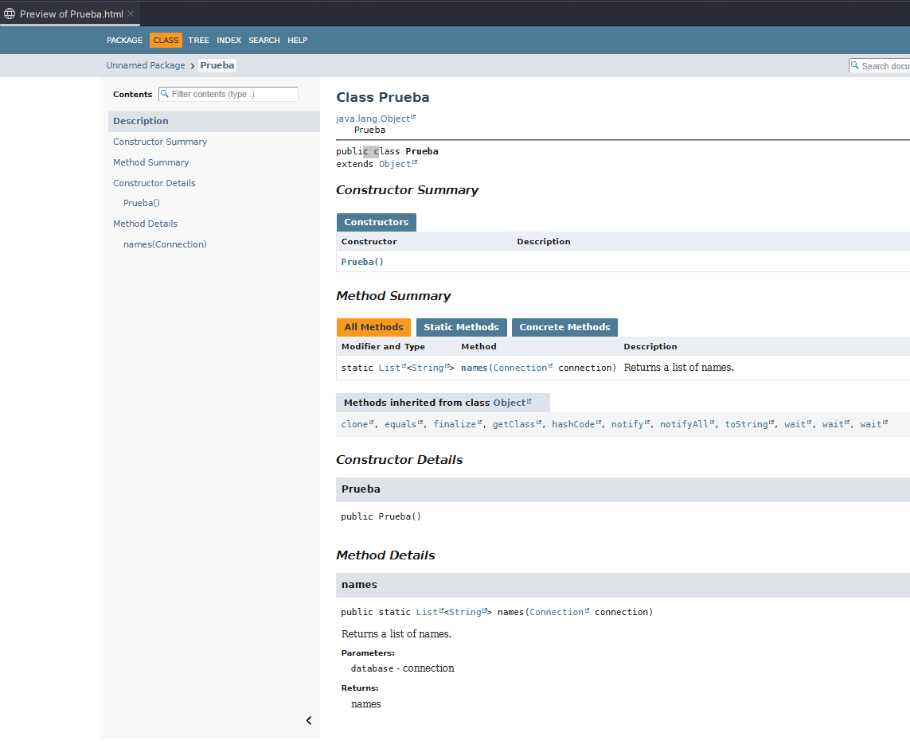

# javadoc, javap, jdeps

# javadoc — generate documentation, snippets (Java 18+, JEP 413), Markdown comments (Java 23+, JEP 467)

Generates HyperText Markup Language (HTML) pages from documentation comments. Create `Test.java` with this content; `@param` describes the parameter and `@return` the returned value:

```java
import java.sql.Connection;
import java.util.List;

public class Test {
    /**
     * Returns a list of names.
     * @param connection a database connection
     * @return the names
     */
    public static List<String> names(Connection connection) {
        return List.of();
    }
}
```

| Option | Use |
|---|---|
| `-d docs` | Writes pages to `docs\` (open `docs\index.html`). |
| `--snippet-path path` | Finds external files to insert fragments with `{@snippet file="..."}`; unnecessary for the inline snippet below. |

```bash
javadoc -d docs Test.java
```
*The docs directory contains extensive information; you can view the class page at **"~\Java_English\01 - Platform, JDK and Tools\01_4 Command-Line Tools\Examples_017\docs\Test.html"***

***It looks something like this:***



- **Snippets** (Java 18+, [JDK Enhancement Proposal (JEP) 413](https://openjdk.org/jeps/413)): a JEP is a numbered OpenJDK improvement proposal. `{@snippet : ... }` inserts structured code in a documentation comment. For example, this comment can replace the one on the method in `Test.java`:

  ```java
  /**
   * Example: {@snippet :
   *     List<String> names = List.of("Ada");
   * }
   */
  ```

- **Markdown comments** (Java 23+, [JEP 467](https://openjdk.org/jeps/467)): `///` lines support Markdown formatting, such as `**bold**`. Alternatively, replace the method comment with:

  ```java
  /// Returns **names**.
  /// @param connection a database connection
  /// @return the names
  ```

## javap — disassemble bytecode (-c -v -p)

Reads a `.class` to show its signatures and bytecode instructions (intermediate code executed by the Java Virtual Machine). First compile `Test.java`:

```bash
javac -d out Test.java
```

| Option | What it shows |
|---|---|
| `-c` | Disassembled instructions of methods with code. |
| `-v` | Additional details such as the constant pool and attributes. |
| `-p` | Private members too (if any). |
| `-classpath out` | Finds `Test` in `out\Test.class`. |

```bash
javap -classpath out -c -v -p Test  # inspects bytecode, does not recover the original source.
```
 
> Practical use cases
> 1. [Diagnose UnsupportedClassVersionError with major version](Practical%20Cases_017/Case_1.md)
> 2. [Diagnose NoSuchMethodError and NoSuchFieldError](Practical%20Cases_017/Case_2.md)
> 3. [Understand compiler output (autoboxing, concatenation, lambdas, switch, record, enum)](Practical%20Cases_017/Case_3.md)
> 4. [Inspect a JAR's public API without source code](Practical%20Cases_017/Case_4.md)
> 5. [Verify that the compiler honored --release](Practical%20Cases_017/Case_5.md)


## jdeps — analyze dependencies between modules and packages

Examines references in compiled classes: `Test` uses `java.sql.Connection` and `java.util.List`. Package analysis shows specific relationships; the module list summarizes which JDK modules are needed.

This tool is particularly useful for migration to modules (JPMS) and finding internal JDK APIs (such as sun.misc or jdk.internal) that may cause compatibility errors in future versions.

| Option | Result |
|---|---|
| `-verbose:package` | Package dependencies (for example, on `java.sql` and `java.util`); omits same-package dependencies by default. |
| `--list-deps` | Required modules (`java.base` and `java.sql` for this class). |

```bash
jdeps -verbose:package out
jdeps --list-deps out

jar --create --file myapp.jar -C out .
jdeps myapp.jar
jdeps --jdk-internals myapp.jar
jdeps --dot-output ./diagrams myapp.jar
```

The last three analyses show, respectively, dependencies such as `java.base` and `java.sql`, no internal APIs for `Test`, and the dependency graph in `diagrams\*.dot`.

# Linux/macOS Commands

Paths use `/` instead of `\`; separate multiple classpath entries with `:` instead of `;`. The `javadoc`, `javac`, `javap` and `jdeps` commands above are identical on Linux/macOS since their paths contain no separators.
